# CỔNG TÀI LIỆU KỸ THUẬT & THIẾT KẾ TOÀN TẬP (MASTER DOCUMENTATION PORTAL)
## Dự án: **SKYBREAK: Fragments of the Core** (`v12 PremiumUI • Macro-World 27× / 9× Edition`)

- **Phiên bản chuẩn hóa**: `v12 PremiumUI • WorldArtVersion = 8 (Macro-Scale 27× / 9×)`
- **Ngày ban hành**: `30/10/2026`
- **Tổng quy mô bộ tài liệu bàn giao**: **11 văn bản chuẩn hóa** (`4,800+` dòng • `~780 KB` tài liệu kỹ thuật & thiết kế chuyên sâu, `500+` liên kết mã nguồn `file:///` đã kiểm toán `100% PASS`)
- **File Roblox Place chính thức**: [SKYBREAK_Playable_v12_PremiumUI.rbxlx](file:///C:/Users/khang/Documents/Codex/2026-10-22/new-chat/outputs/SKYBREAK_Antigravity_Handoff/04_Roblox/SKYBREAK_Playable_v12_PremiumUI.rbxlx) (`306,809,536` bytes • SHA-256 `f8a6182e07aaf790...`)
- **Nguồn mã nguồn Luau chuẩn (`123` files)**: [04_Roblox/src](file:///C:/Users/khang/Documents/Codex/2026-10-22/new-chat/outputs/SKYBREAK_Antigravity_Handoff/04_Roblox/src) (`74,760` dòng code • `3,610,087` bytes)
- **Bộ công cụ Build, Chẩn đoán Máy trạm & QA tự hành**: [05_Pipeline_Tools_27x_9x](file:///C:/Users/khang/Documents/Codex/2026-10-22/new-chat/outputs/SKYBREAK_Antigravity_Handoff/05_Pipeline_Tools_27x_9x)

---

## 1. Bản Đồ Bộ Tài Liệu Đầy Đủ (Complete Studio-to-Studio Documentation Suite)

Bộ tài liệu dự án bao gồm **Hồ Sơ Bàn Giao Tổng Thể**, **Quy Tắc AI Workspace (`AGENTS.md` + 3 Skills nội bộ)** và **8 Tập Tài Liệu Chuyên Sâu (`00` → `07`)** trong `00_Documents/`:

```mermaid
flowchart TD
    ROOT["SKYBREAK_MASTER_PROJECT_HANDOVER.md\n(Hồ Sơ Bàn Giao Điều Hành Studio-to-Studio • 55.6 KB)"] --> IDX["Tập 00: 00_DOCUMENTATION_INDEX.md\n(Cổng Điều Hướng Tài Liệu & Lộ Trình Đọc Theo Vai Trò)"]
    IDX --> V1["Tập 01: 01_SYSTEM_ARCHITECTURE_AND_NETWORK_PROTOCOL.md\n(Vòng Đời Runtime, DataModel, 15 RemoteEvents & 66 Trường DataStore • 106.9 KB)"]
    IDX --> V2["Tập 02: 02_COMPLETE_LUAU_API_REFERENCE_123_MODULES.md\n(Từ Điển API Toàn Bộ 123/123 File Luau & Cặp File Mirror • 115.6 KB)"]
    IDX --> V3["Tập 03: 03_GAME_DESIGN_AND_COMBAT_BALANCE_BIBLE.md\n(Toán Học Lv.1-2550, 3 Class, 12 Trái Ác Quỷ 60 Chiêu V1/V2, Võ Thuật, Tộc V4, 22+ Boss • 144.0 KB)"]
    IDX --> V4["Tập 04: 04_WORLD_ATLAS_27X_9X_AND_3D_ASSET_PIPELINE.md\n(Atlas 20 Thế Giới 27x/9x, 94+21 Model 3D, Rig Shared19 & Pipeline < 2,048 Studs • 135.2 KB)"]
    IDX --> V5["Tập 05: 05_UI_UX_11_SCREENS_I18N_AND_AUDIO_GUIDE.md\n(UI 5 Tầng Z-Layer, 11 Màn Hình, 13 Components, VI/EN, Bay 6-DOF & 30 Tệp WAV • 131.7 KB)"]
    IDX --> V6["Tập 06: 06_DEVOPS_BUILD_QA_AND_CLOUD_PUBLISHING_RUNBOOK.md\n(CLI Build Runbook, SmokeTest 199 Phép Kiểm, DevSandbox & Publish Open Cloud • 67.8 KB)"]
    IDX --> V7["Tập 07: 07_SOFTWARE_ENVIRONMENT_MCP_AND_AGENT_SKILLS_SETUP.md\n(Phần Mềm Cần Cài, Blender Python Zstd, MCP Servers & 38+ AI Agent Skills • 22.0 KB)"]
```

| Mã tập | Tên tài liệu | Quy mô | Phạm vi chuyên môn chính | Đối tượng bắt buộc đọc |
| :---: | :--- | :---: | :--- | :--- |
| **Master** | [SKYBREAK_MASTER_PROJECT_HANDOVER.md](file:///C:/Users/khang/Documents/Codex/2026-10-22/new-chat/outputs/SKYBREAK_Antigravity_Handoff/SKYBREAK_MASTER_PROJECT_HANDOVER.md) | `372` dòng (`55.6 KB`) | Hồ sơ bàn giao tổng thể cho đối tác tiếp nhận: chỉ số kiểm định, kiến trúc vĩ mô, 6 ràng buộc sống còn, nghiệm thu Day-1 & lộ trình 4 Phase. | CTO, Producer, Tech Lead, Art Lead, QA Lead |
| **Tập 00** | [00_DOCUMENTATION_INDEX.md](file:///C:/Users/khang/Documents/Codex/2026-10-22/new-chat/outputs/SKYBREAK_Antigravity_Handoff/00_Documents/00_DOCUMENTATION_INDEX.md) | `80` dòng (`13.1 KB`) | Cổng chỉ mục trung tâm, phân luồng đọc theo vai trò nhân sự, quy ước nguồn chân lý và hướng dẫn khởi chạy nhanh. | Toàn bộ thành viên dự án |
| **Tập 01** | [01_SYSTEM_ARCHITECTURE_AND_NETWORK_PROTOCOL.md](file:///C:/Users/khang/Documents/Codex/2026-10-22/new-chat/outputs/SKYBREAK_Antigravity_Handoff/00_Documents/01_SYSTEM_ARCHITECTURE_AND_NETWORK_PROTOCOL.md) | `837` dòng (`106.9 KB`) | Trình tự khởi động Server/Client + 3 tầng Decorator, cây `Workspace` & hợp đồng `Attributes`, đặc tả payload **15 `RemoteEvents`** (`45 tokens/sec` Token Bucket), schema **66 trường `PlayerDataService`** & `SessionLock`. | Lead Architect, Server Engineers, Network/Security Engineers |
| **Tập 02** | [02_COMPLETE_LUAU_API_REFERENCE_123_MODULES.md](file:///C:/Users/khang/Documents/Codex/2026-10-22/new-chat/outputs/SKYBREAK_Antigravity_Handoff/00_Documents/02_COMPLETE_LUAU_API_REFERENCE_123_MODULES.md) | `476` dòng (`115.6 KB`) | Từ điển tra cứu không rút gọn **123/123 file `.lua`** (`44` `ReplicatedStorage`, `25` `ServerScriptService`, `1` `ServerStorage`, `53` `StarterPlayerScripts`), chữ ký hàm API của 26+ module nền tảng, `%` trần `199,000 B` & các cặp file mirror. | Toàn bộ lập trình viên Luau (Server, Client, UI, VFX) |
| **Tập 03** | [03_GAME_DESIGN_AND_COMBAT_BALANCE_BIBLE.md](file:///C:/Users/khang/Documents/Codex/2026-10-22/new-chat/outputs/SKYBREAK_Antigravity_Handoff/00_Documents/03_GAME_DESIGN_AND_COMBAT_BALANCE_BIBLE.md) | `850` dòng (`144.0 KB`) | Toán học `Lv.1–2550`, 3 Class, 3 Đồng hành AI, Võ thuật, **12 Trái Ác Quỷ 3D (`60` chiêu V1 + `60` chiêu V2 + Hóa Rồng/Phật Tổ)**, Vũ khí/Súng/Rèn `+15`/Thăng Sao `★5`/Phù phép, 6 Tộc V4, 3 Haki, 56 Danh hiệu, Bestiary 22+ Boss 3 pha, Quest `Q01..Q14`, Tàu chiến, Danger Sea Lv 1–6, Giao dịch & Giftcodes. | Game Designers, Combat Designers, Economy/Live-Ops Planners |
| **Tập 04** | [04_WORLD_ATLAS_27X_9X_AND_3D_ASSET_PIPELINE.md](file:///C:/Users/khang/Documents/Codex/2026-10-22/new-chat/outputs/SKYBREAK_Antigravity_Handoff/00_Documents/04_WORLD_ATLAS_27X_9X_AND_3D_ASSET_PIPELINE.md) | `809` dòng (`135.2 KB`) | Atlas địa lý 8 Realms & 20 Thế giới `27× / 9×` (`40` điểm FastTravel, `25` cổng `WorldPortals`), kiểm toán đủ **`94/94` gói `DelegatedV5Sources` + `21/21` `VirtualSplitSpecs`**, rig `Shared19` / `10-Bone World Rig`, vertex shader 3D FBM và thuật toán KD-tree `<= 1,748` studs + Collider OBB `<= 1,680` studs. | 3D Environment Artists, Character Riggers, Technical Artists, Engine Programmers |
| **Tập 05** | [05_UI_UX_11_SCREENS_I18N_AND_AUDIO_GUIDE.md](file:///C:/Users/khang/Documents/Codex/2026-10-22/new-chat/outputs/SKYBREAK_Antigravity_Handoff/00_Documents/05_UI_UX_11_SCREENS_I18N_AND_AUDIO_GUIDE.md) | `618` dòng (`131.7 KB`) | Kiến trúc UI phản ứng 5 tầng Z-Layer (`Store`/`ScreenRouter`), sơ đồ phím PC/Gamepad/Mobile Touch Arc, đặc tả **11/11 màn hình** & **13/13 Components** (`CelestialMinimap`, `ViewportOrbit`), song ngữ `VI / EN` (`I18n.lua`), bay 6-DOF 12 mô hình & `SkybreakAudioEngine` (`30/30` tệp `.wav`). | UI/UX Engineers, Localization Team, Camera/Feel Programmers, Sound Designers |
| **Tập 06** | [06_DEVOPS_BUILD_QA_AND_CLOUD_PUBLISHING_RUNBOOK.md](file:///C:/Users/khang/Documents/Codex/2026-10-22/new-chat/outputs/SKYBREAK_Antigravity_Handoff/00_Documents/06_DEVOPS_BUILD_QA_AND_CLOUD_PUBLISHING_RUNBOOK.md) | `477` dòng (`67.8 KB`) | Sổ tay CLI cho toàn bộ 8 công cụ trong `05_Pipeline_Tools_27x_9x/`, kiểm thử In-Studio **`SkybreakSmokeTest` (`199` assertions)**, bảng lệnh `DevSandbox (F9)`, xử lý sự cố kỹ thuật & quy trình di trú 94 gói V5 lên Roblox Open Cloud `rbxassetid://`. | DevOps / Build Engineers, QA Engineers, Release Managers |
| **Tập 07** | [07_SOFTWARE_ENVIRONMENT_MCP_AND_AGENT_SKILLS_SETUP.md](file:///C:/Users/khang/Documents/Codex/2026-10-22/new-chat/outputs/SKYBREAK_Antigravity_Handoff/00_Documents/07_SOFTWARE_ENVIRONMENT_MCP_AND_AGENT_SKILLS_SETUP.md) | `214` dòng (`22.0 KB`) | Toàn bộ phần mềm cần cài (Roblox Studio Beta Features, Blender 5.2.2 LTS + Embedded Python `zstandard`, Python 3.12+, Git LFS, Node.js), kết nối `Roblox_Studio` / `Photoshop` MCP Servers, **3 Project Skills** trong `.agents/skills/` + **35 Global 3D/Workflow Skills** & script [check_workstation_setup.py](file:///C:/Users/khang/Documents/Codex/2026-10-22/new-chat/outputs/SKYBREAK_Antigravity_Handoff/05_Pipeline_Tools_27x_9x/check_workstation_setup.py). | IT Onboarding, Toàn bộ Kỹ sư, 3D Artists & AI Engineers |
| **Root** | [README.md](file:///C:/Users/khang/Documents/Codex/2026-10-22/new-chat/outputs/SKYBREAK_Antigravity_Handoff/README.md) & [AGENTS.md](file:///C:/Users/khang/Documents/Codex/2026-10-22/new-chat/outputs/SKYBREAK_Antigravity_Handoff/AGENTS.md) | `85` dòng (`7.5 KB`) | Hướng dẫn mở nhanh ở thư mục gốc và tệp quy tắc bảo vệ bất biến tự động nạp cho AI Coding Agents kèm 3 Skills trong `.agents/skills/`. | Toàn bộ nhân sự & AI Agents |

> [!NOTE]
> Trong thư mục `00_Documents/` vẫn bảo lưu 2 tài liệu lịch sử từ giai đoạn tiền sản xuất ([SKYBREAK_ARGON_3D_HANDOFF.md](file:///C:/Users/khang/Documents/Codex/2026-10-22/new-chat/outputs/SKYBREAK_Antigravity_Handoff/00_Documents/SKYBREAK_ARGON_3D_HANDOFF.md) — ánh xạ 17 tranh Concept Art gốc và [SKYBREAK_TECH_AND_GAME_INTRO_DOCS.md](file:///C:/Users/khang/Documents/Codex/2026-10-22/new-chat/outputs/SKYBREAK_Antigravity_Handoff/00_Documents/SKYBREAK_TECH_AND_GAME_INTRO_DOCS.md) — bản nháp giai đoạn `1×` cũ) để đối chiếu lịch sử mỹ thuật. Đối với mọi thông số kỹ thuật, tọa độ `27× / 9×` và danh sách `123` module hiện hành, **luôn lấy bộ Tập `00` → `07` và `SKYBREAK_MASTER_PROJECT_HANDOVER.md` làm chuẩn duy nhất**.

---

## 2. Lộ Trình Đọc Nhanh Theo Vai Trò Nhân Sự (Role-Based Onboarding Paths)

- **IT / DevOps Thiết lập Máy trạm Ngày Đầu Tiên**:
  1. Đọc **Tập 07** → cài đặt Roblox Studio (bật `EditableMesh & EditableImage`), Blender `5.2.2 LTS` (`pip install zstandard` vào Python nhúng), Python `3.12+`, Git LFS, Node.js, MCP và Skills.
  2. Chạy `python 05_Pipeline_Tools_27x_9x/check_workstation_setup.py` để xác nhận `[PASS]`.
- **Giám đốc Kỹ thuật / Tech Lead**:
  1. Đọc [SKYBREAK_MASTER_PROJECT_HANDOVER.md](file:///C:/Users/khang/Documents/Codex/2026-10-22/new-chat/outputs/SKYBREAK_Antigravity_Handoff/SKYBREAK_MASTER_PROJECT_HANDOVER.md).
  2. Đọc **Tập 01** (Kiến trúc & Giao thức mạng 15 RemoteEvents) và **Tập 06** (Trần `199,000 B` mỗi script và lộ trình bake `MeshPart` lên Roblox Open Cloud).
- **Lập trình viên Gameplay Server (Luau)**:
  1. Đọc **Tập 01** (Hợp đồng RemoteEvents, Attributes & 66 trường `PlayerDataService`).
  2. Tra cứu **Tập 02** (`ServerScriptService` & `ReplicatedStorage/Shared`) và **Tập 03** (Công thức sát thương, Boss AI 3 pha, Trái Ác Quỷ V1/V2, Sự kiện Biển).
- **Lập trình viên Client, VFX & UI/UX**:
  1. Đọc **Tập 05** (Kiến trúc UI 5 tầng Z-Layer, 11 màn hình, 13 Components, `I18n.lua`, bay tự do 6-DOF & 30 tệp Audio).
  2. Tra cứu **Tập 02** (`StarterPlayerScripts` — `ClientBootstrap`, `DelegatedV5.client`, `SkybreakClientVFX`, `UniversalVFXOverhaul`, `DragonSovereignVFX`).
- **Technical Artist & 3D Environment / Character Artist (Blender)**:
  1. Đọc **Tập 04** (Hệ trục `Roblox(X,Y,Z) = Blender(x,z,-y)`, cấu trúc rig `Shared19` / `10-Bone World Rig`, thuật toán chia lưới KD-tree `<= 1,748` studs và sinh Collider OBB `<= 1,680` studs).
  2. Đọc **Tập 06** (Cách chạy `run_blender_safe.py`, `export_all_13_worlds_27x_9x_v8.py` và `build_13_worlds_27x_9x_colliders.py`).
- **Game Designer & QA Tester**:
  1. Đọc **Tập 03** (Toàn bộ bảng thông số cân bằng `Lv.1–2550`, chiêu thức, tỷ lệ rơi đồ, nhiệm vụ & Giftcodes).
  2. Đọc **Tập 06** (Chạy `SkybreakSmokeTest` và bảng lệnh `DevSandbox (F9)`).

---

## 3. Ba Nguyên Tắc Bất Di Bất Dịch Khi Làm Việc Trên Kho Mã Nguồn

> [!CAUTION]
> 1. **Nguồn chân lý duy nhất cho mã Luau**: Luôn chỉnh sửa code tại [04_Roblox/src](file:///C:/Users/khang/Documents/Codex/2026-10-22/new-chat/outputs/SKYBREAK_Antigravity_Handoff/04_Roblox/src), sau đó chạy [sync_solid3d_and_scripts_to_rbxlx.py](file:///C:/Users/khang/Documents/Codex/2026-10-22/new-chat/outputs/SKYBREAK_Antigravity_Handoff/05_Pipeline_Tools_27x_9x/sync_solid3d_and_scripts_to_rbxlx.py) để đồng bộ tự động vào `.rbxlx`, `SKYBREAK_Visual_v2/src` và các cặp file mirror.
> 2. **Giới hạn cứng `< 199,000` bytes / file `.lua` và `< 2,048` studs / `MeshPart` hoặc `Part`**: Luôn chạy [verify_27x_9x_game_sync.py](file:///C:/Users/khang/Documents/Codex/2026-10-22/new-chat/outputs/SKYBREAK_Antigravity_Handoff/05_Pipeline_Tools_27x_9x/verify_27x_9x_game_sync.py) sau mỗi bản build để đảm bảo `100%` script và mesh tuân thủ giới hạn vật lý của Roblox Studio.
> 3. **Không chạy các script đóng gói thế hệ cũ**: Không sử dụng các script lịch sử trong `06_Antigravity_Work/` như `rework_skybreak_from_scratch.py`; chỉ sử dụng bộ công cụ chuẩn hóa trong [05_Pipeline_Tools_27x_9x](file:///C:/Users/khang/Documents/Codex/2026-10-22/new-chat/outputs/SKYBREAK_Antigravity_Handoff/05_Pipeline_Tools_27x_9x).
