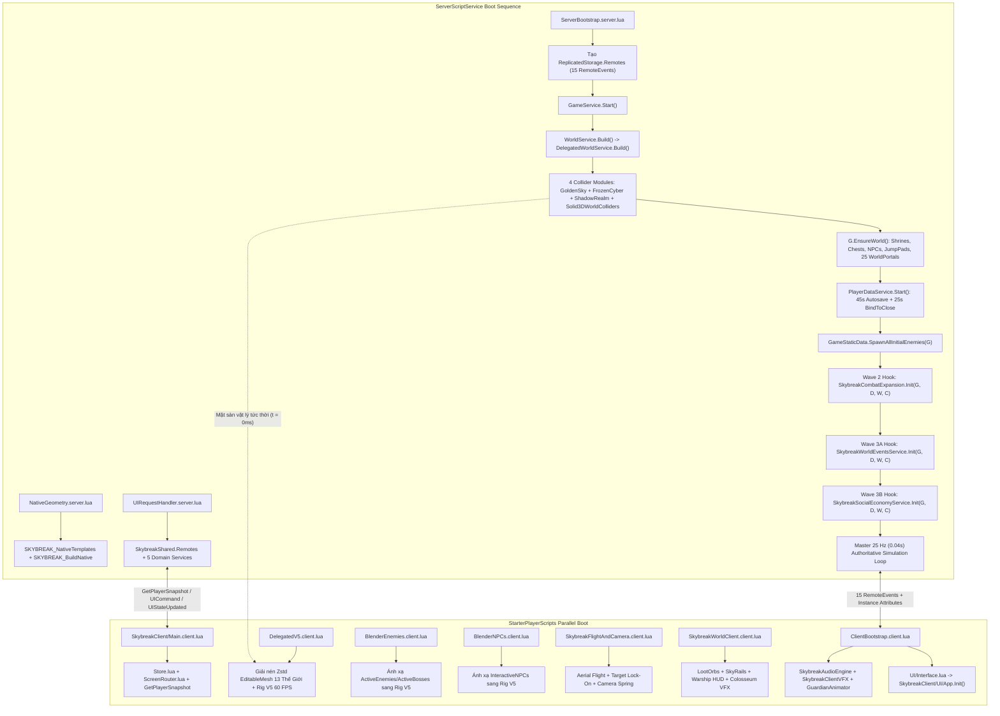
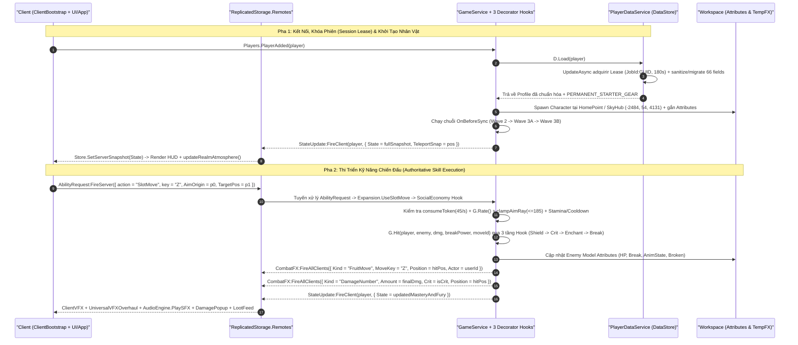

# TẬP 01: KIẾN TRÚC HỆ THỐNG RUNTIME, HỢP ĐỒNG DATAMODEL & GIAO THỨC MẠNG (SYSTEM ARCHITECTURE & NETWORK PROTOCOL)

**Dự án:** `SKYBREAK: Fragments of the Core` (`v12 PremiumUI • Macro-World 27x / 9x Edition`)  
**Phiên bản kiến trúc:** `WorldArtVersion = 8` • `123 Luau Modules` (`74,760` dòng • `3,610,087` bytes)  
**Đối tượng sử dụng:** Lead Systems Engineers, Gameplay Programmers, Network/Security Engineers & Technical Architects của Studio tiếp nhận.

---

## Tổng Quan Triết Lý Kiến Trúc (Architectural Philosophy)

**SKYBREAK: Fragments of the Core** được thiết kế theo mô hình **Server-Authoritative Action RPG** hiệu năng cao trên Roblox Engine, vận hành một thế giới mở quy mô đại địa hình (**Macro-World `27x` cho 3 đại lục chính `Sea 1..3` và `9x` cho 10 đảo mở rộng + 5 thiên giới `Realms 4..8`**) với các trụ cột kỹ thuật cốt lõi sau:

1. **Server-Authoritative Combat & Zero-Humanoid Enemy Simulation (`25 Hz`)**: Toàn bộ quái vật (`ActiveEnemies`) và trùm (`ActiveBosses`) trên Server **không sử dụng `Humanoid` của Roblox** nhằm triệt tiêu hoàn toàn chi phí vật lý `Humanoid` state machine ở quy mô hàng trăm thực thể. Server chỉ quản lý một `Anchored Part` (`Body`) đại diện cho tọa độ/AABB và cập nhật AI, raycast mặt đất, đánh dấu `Attributes` (`HP`, `MaxHP`, `Break`, `Phase`, `AnimState`, `AnimAttackSeq`) trong vòng lặp chính `0.04s` (`25 Hz`). Client đọc các `Attributes` này và nội suy khung xương `Bone` 3D mượt ở `60+ FPS` thông qua [DelegatedV5Renderer.lua](file:///C:/Users/khang/Documents/Codex/2026-10-22/new-chat/outputs/SKYBREAK_Antigravity_Handoff/04_Roblox/src/ReplicatedStorage/DelegatedV5Renderer.lua) và [BlenderEnemies.client.lua](file:///C:/Users/khang/Documents/Codex/2026-10-22/new-chat/outputs/SKYBREAK_Antigravity_Handoff/04_Roblox/src/StarterPlayer/StarterPlayerScripts/BlenderEnemies.client.lua).
2. **Decorator Hook-Chain Service Composition (Kiến trúc Chuỗi Mở Rộng Đa Tầng)**: Để tuân thủ nghiêm ngặt giới hạn `199,000 bytes` cho mỗi nút `<ProtectedString name="Source">` trong định dạng XML `.rbxlx` của Roblox Studio mà vẫn giữ được tính nguyên tử của trạng thái chiến đấu (`G.Runtime`, `G.Enemies`, `G.Boss`), lõi [GameService.lua](file:///C:/Users/khang/Documents/Codex/2026-10-22/new-chat/outputs/SKYBREAK_Antigravity_Handoff/04_Roblox/src/ServerScriptService/Services/GameService.lua) (`186,503 B`) đóng vai trò Kernel và lần lượt nạp 3 tầng dịch vụ mở rộng theo mô hình **Function Wrapping / Hook Chain**:
   - **Wave 1 Kernel:** [GameService.lua](file:///C:/Users/khang/Documents/Codex/2026-10-22/new-chat/outputs/SKYBREAK_Antigravity_Handoff/04_Roblox/src/ServerScriptService/Services/GameService.lua) + [GameStaticData.lua](file:///C:/Users/khang/Documents/Codex/2026-10-22/new-chat/outputs/SKYBREAK_Antigravity_Handoff/04_Roblox/src/ServerScriptService/Services/GameStaticData.lua)
   - **Wave 2 Combat & Fruit Layer:** [SkybreakCombatExpansion.lua](file:///C:/Users/khang/Documents/Codex/2026-10-22/new-chat/outputs/SKYBREAK_Antigravity_Handoff/04_Roblox/src/ServerScriptService/Services/SkybreakCombatExpansion.lua) (`161,685 B`)
   - **Wave 3 World Events, Raid, Spire & Warships Layer:** [SkybreakWorldEventsService.lua](file:///C:/Users/khang/Documents/Codex/2026-10-22/new-chat/outputs/SKYBREAK_Antigravity_Handoff/04_Roblox/src/ServerScriptService/Services/SkybreakWorldEventsService.lua) (`160,350 B`)
   - **Wave 3 Social, Economy, Colosseum & DevSandbox Layer:** [SkybreakSocialEconomyService.lua](file:///C:/Users/khang/Documents/Codex/2026-10-22/new-chat/outputs/SKYBREAK_Antigravity_Handoff/04_Roblox/src/ServerScriptService/Services/SkybreakSocialEconomyService.lua) (`131,899 B`)
3. **Dual-Layer Physics & Streaming V8 EditableMesh Architecture**: Hình học hiển thị 3D (`EditableMesh` nén `Zstd + Base64` trong `ReplicatedStorage.DelegatedV5Sources`) được tách rời hoàn toàn khỏi hình học va chạm vật lý (`BasePart` OBB/Box Colliders sinh tự động từ Blender trong `ServerScriptService/Services/*Collision.lua` và [Solid3DWorldColliders.lua](file:///C:/Users/khang/Documents/Codex/2026-10-22/new-chat/outputs/SKYBREAK_Antigravity_Handoff/04_Roblox/src/ServerScriptService/Services/Solid3DWorldColliders.lua)). Nhờ đó, Server có mặt sàn vật lý tức thời ở `t = 0ms` trước khi bất kỳ Client nào kịp giải nén mesh 3D.
4. **Unidirectional Reactive UI Store (`v12 PremiumUI`)**: Client tách biệt tuyệt đối trạng thái đồng bộ từ Server (`Store.Snapshot`, chuẩn hóa qua [UIState.lua](file:///C:/Users/khang/Documents/Codex/2026-10-22/new-chat/outputs/SKYBREAK_Antigravity_Handoff/04_Roblox/src/ReplicatedStorage/SkybreakShared/Types/UIState.lua)) và trạng thái điều hướng cục bộ (`Store.View` quản lý bởi [ScreenRouter.lua](file:///C:/Users/khang/Documents/Codex/2026-10-22/new-chat/outputs/SKYBREAK_Antigravity_Handoff/04_Roblox/src/StarterPlayer/StarterPlayerScripts/SkybreakClient/UI/ScreenRouter.lua) và [App.lua](file:///C:/Users/khang/Documents/Codex/2026-10-22/new-chat/outputs/SKYBREAK_Antigravity_Handoff/04_Roblox/src/StarterPlayer/StarterPlayerScripts/SkybreakClient/UI/App.lua)).

> [!IMPORTANT]
> Mọi giao tiếp từ Client lên Server đều bị xem là **không đáng tin cậy (untrusted input)**. Server áp dụng đồng thời bộ lọc tốc độ hai tầng (`G.Rate(p, channel, interval)` theo từng kênh hành động và thùng thông báo `consumeToken(p, cost)` `45 tokens/giây` trong [SkybreakCombatExpansion.lua](file:///C:/Users/khang/Documents/Codex/2026-10-22/new-chat/outputs/SKYBREAK_Antigravity_Handoff/04_Roblox/src/ServerScriptService/Services/SkybreakCombatExpansion.lua)), kiểm tra số thực hữu hạn (`finiteNumber`), làm sạch vector (`sanitizeVec3`), kẹp tia ngắm súng (`clampAimRay <= 185 studs`) và xác thực quyền sở hữu vật phẩm trong `PlayerDataService` trước khi thay đổi bất kỳ chỉ số nào.

---

## Phần 1: Vòng Đời Khởi Động & Thực Thi Runtime (Full Runtime Boot & Execution Lifecycle)

### 1.1 Trình Tự Khởi Động Phía Server (Server Startup Order)

Khi Roblox Server khởi tạo instance của place `SKYBREAK_Playable_v12_PremiumUI.rbxlx`, Engine kích hoạt song song **3 `Script` cấp cao nhất** trong `ServerScriptService`:

#### A. Nhánh 1 — Luồng Khởi Tạo Chính: [ServerBootstrap.server.lua](file:///C:/Users/khang/Documents/Codex/2026-10-22/new-chat/outputs/SKYBREAK_Antigravity_Handoff/04_Roblox/src/ServerScriptService/ServerBootstrap.server.lua)
1. **Khởi tạo Bus Mạng Chính (`ReplicatedStorage.Remotes`)**: Tạo thư mục `Remotes` trực tiếp dưới `ReplicatedStorage` và cấp phát đủ **15 `RemoteEvent` chuẩn** trước khi nạp bất kỳ dịch vụ gameplay nào:
   `CombatRequest`, `AbilityRequest`, `InteractRequest`, `StateUpdate`, `EquipmentRequest`, `CombatFX`, `CombatEvent`, `AppearanceRequest`, `UIRequest`, `UICommand`, `FruitAction`, `TradeAction`, `StatAllocate`, `TeleportIsland`, `ForgeRequest`.
2. **Kích hoạt Kernel `GameService.Start()`**: Nạp [GameService.lua](file:///C:/Users/khang/Documents/Codex/2026-10-22/new-chat/outputs/SKYBREAK_Antigravity_Handoff/04_Roblox/src/ServerScriptService/Services/GameService.lua) bên trong `xpcall(GameService.Start, debug.traceback)` để bắt trọn vẹn stack trace nếu có lỗi khởi tạo.

Bên trong `GameService.Start()`, trình tự thực thi diễn ra tuần tự và tất định qua **7 pha**:

- **Pha S1 — Kiến Tạo Địa Hình Vật Lý (`WorldService.Build()` -> `DelegatedWorldService.Build(W)`)**:
  - [WorldService.lua](file:///C:/Users/khang/Documents/Codex/2026-10-22/new-chat/outputs/SKYBREAK_Antigravity_Handoff/04_Roblox/src/ServerScriptService/Services/WorldService.lua) kiểm tra sự tồn tại của `ReplicatedStorage.DelegatedV5Sources`. Khi phát hiện gói tài nguyên V5/V8, nó ủy quyền toàn bộ việc dựng thế giới cho [DelegatedWorldService.lua](file:///C:/Users/khang/Documents/Codex/2026-10-22/new-chat/outputs/SKYBREAK_Antigravity_Handoff/04_Roblox/src/ServerScriptService/Services/DelegatedWorldService.lua).
  - `DelegatedWorldService.Build(W)` dọn sạch các thư mục thế giới cũ, thiết lập `Workspace.FallenPartsDestroyHeight = -4500`, dựng `Workspace.SkyHub` với `SkybornSpawn` tại `(-2484, 51.5, 4131)` và lần lượt khởi tạo:
    1. `Workspace.GoldenSky` (`WorldVersion = 5`, tâm `(0, 46, 0)`) cùng lưới va chạm [GoldenSkyCollision.lua](file:///C:/Users/khang/Documents/Codex/2026-10-22/new-chat/outputs/SKYBREAK_Antigravity_Handoff/04_Roblox/src/ServerScriptService/Services/GoldenSkyCollision.lua) (`405` OBB/Box parts).
    2. `Workspace.FrozenCyber` (tâm `(48000, 46, 0)`) cùng lưới va chạm [FrozenCyberCollision.lua](file:///C:/Users/khang/Documents/Codex/2026-10-22/new-chat/outputs/SKYBREAK_Antigravity_Handoff/04_Roblox/src/ServerScriptService/Services/FrozenCyberCollision.lua) (`641` parts).
    3. `Workspace.ShadowRealm` (tâm `(-48000, 46, 0)`) cùng lưới va chạm [ShadowRealmCollision.lua](file:///C:/Users/khang/Documents/Codex/2026-10-22/new-chat/outputs/SKYBREAK_Antigravity_Handoff/04_Roblox/src/ServerScriptService/Services/ShadowRealmCollision.lua) (`414` parts).
    4. Năm thiên giới cấp cao (`VerdantCrown`, `EmberforgeWastes`, `AbyssalTides`, `ChronosBastion`, `VeilsEnd`) trải dài từ `Z = -33,870` đến `Z = -60,380` ở cao độ `Y = 166..306`.
    5. `Solid3DWorldColliders.Build()` trong [Solid3DWorldColliders.lua](file:///C:/Users/khang/Documents/Codex/2026-10-22/new-chat/outputs/SKYBREAK_Antigravity_Handoff/04_Roblox/src/ServerScriptService/Services/Solid3DWorldColliders.lua) tạo thư mục `Workspace.GrandSkyIslands` (chứa 12 neo streaming `V5Asset` cho 10 đảo mở rộng `9x` và 2 đền thờ độc lập), `GrandSkyIslands_Collision` và `Workspace.Solid3DObstacles` (lõi tường/tháp chặn ngang AI và đạn đạo).
    6. Tắt `CanQuery = false` trên toàn bộ part có tên chứa `Guardrail` hoặc `_Rail` để tia raycast mặt đất không bao giờ cắm nhầm lên đỉnh lan can cầu; gắn các hàm truy vấn địa hình `W.RaycastGround`, `W.GroundY`, `W.IsBlockedByObstacle`, `W.SnapToOpenGround`; áp dụng bầu trời mặc định `RealmEnvironment.Apply("GoldenSky")` và đóng dấu `workspace:SetAttribute("WorldArtVersion", 8)`.

- **Pha S2 — Khởi Tạo Thực Thể Tương Tác Thế Giới (`G.EnsureWorld()`)**:
  - Khởi tạo các thư mục động trên `Workspace`: `ActiveCompanions`, `TempFX`, `SkybreakWorldObjects`, `JumpPads`, `WorldPortals`.
  - Sinh **12 rương khu vực** (`Chest_01`..`Chest_12`), **19 bàn thờ / bảng điều khiển** (`Shrine_GoldenSky`, `Shrine_FrozenCyber`, `Shrine_ShadowRealm`, `MicrochipRaidLab_Console` và các `Shrine_*` đảo phụ), **3 bến tàu chính** (`Dock_SkyHub`, `Dock_FrozenCyber`, `Dock_ShadowRealm`) kèm mô hình chiến hạm trưng bày, chỉ huy `Lyra_SkyHubCommander`, `2` điểm Gacha `Zioles`, `3` đại sư `AncientMonk`, **18 NPC nhiệm vụ/rèn/thương nhân**, **6 bệ phóng `JumpPad`** và **25 cổng dịch chuyển không gian `WorldPortals`** (`WorldGate_01..20` + 5 cổng liên thông Hub/Sea).

- **Pha S3 — Khởi Động Tầng Lưu Trữ Dữ Liệu (`PlayerDataService.Start()`)**:
  - [PlayerDataService.lua](file:///C:/Users/khang/Documents/Codex/2026-10-22/new-chat/outputs/SKYBREAK_Antigravity_Handoff/04_Roblox/src/ServerScriptService/Services/PlayerDataService.lua) khởi chạy vòng lặp `Autosave` chu kỳ `45 giây` (`C.AutosaveSeconds`) và đăng ký hook `game:BindToClose` với hạn mức khóa thoát an toàn `25 giây` để xả toàn bộ hồ sơ người chơi và giải phóng `Session Lock` khi Server tắt.

- **Pha S4 — Kết Nối Tương Tác Vật Lý & 5 Remote Cốt Lõi**:
  - Quét toàn bộ `ProximityPrompt` hiện hữu (và lắng nghe `workspace.DescendantAdded`) để tự động nối mọi `BasePart` mang `Attribute` `InteractableId` vào `G.Interact(player, interactableId)`.
  - Kết nối 5 `RemoteEvent` nền tảng: `CombatRequest`, `AbilityRequest`, `InteractRequest`, `EquipmentRequest`, `AppearanceRequest`.

- **Pha S5 — Triệu Hồi Quần Thể Quái Vật Khởi Thủy (`GameStaticData.SpawnAllInitialEnemies(G)`)**:
  - [GameStaticData.lua](file:///C:/Users/khang/Documents/Codex/2026-10-22/new-chat/outputs/SKYBREAK_Antigravity_Handoff/04_Roblox/src/ServerScriptService/Services/GameStaticData.lua) đọc bảng phân bố quái của toàn bộ `Sea 1`, `Sea 2`, `Sea 3` và `Realms 4..8`, gọi `W.SnapToOpenGround` để thả từng bãi quái và Boss canh cổng xuống đúng cao độ mặt sàn `27x / 9x` mà không kẹt trong lõi tháp.

- **Pha S6 — Lắp Ghép Chuỗi Hook Mở Rộng 3 Tầng (Decorator Hook Chain)**:
  1. `SkybreakCombatExpansion.Init(G, D, W, C)` ([SkybreakCombatExpansion.lua](file:///C:/Users/khang/Documents/Codex/2026-10-22/new-chat/outputs/SKYBREAK_Antigravity_Handoff/04_Roblox/src/ServerScriptService/Services/SkybreakCombatExpansion.lua)):
     - Bọc (`wrap`) `G.Rate` bằng thuật toán Token Bucket (`45 tokens/s`), mở rộng `G.Stats`, `G.Hit`, `G.Kill`, `G.PlayerDamage`, `G.TickEnemy`, `G.Action`, `G.UseSlotMove`, `G.Equipment`, `G.Interact`.
     - Đăng ký `G.OnBeforeSync`, `G.HandleUIRequest`, `G.HandleAbilityExtra`.
     - Dựng thư mục `Workspace.SkybreakExpansionWorld` (`InteractiveNPCs`, `CyberportCafeTradingHub` gồm 2 bàn giao dịch 4 ghế, `SeaWaterZones`, `ElementalWaterPads`, `AlliedSeaBeasts`).
     - Kết nối 6 `RemoteEvent` mở rộng: `UIRequest`, `FruitAction`, `TradeAction`, `StatAllocate`, `TeleportIsland`, `ForgeRequest`.
     - Khởi chạy bộ đếm nền `0.20s` xử lý nước biển/đệm băng-dung nham, thanh Nộ Khí Hóa Rồng (`FuryMeter`), thanh Thức Tỉnh Tộc V4 (`AwakeningMeter`) và pháo thủy quái đồng minh `SkySeaBeast`.
  2. `SkybreakWorldEventsService.Init(G, D, W, C)` ([SkybreakWorldEventsService.lua](file:///C:/Users/khang/Documents/Codex/2026-10-22/new-chat/outputs/SKYBREAK_Antigravity_Handoff/04_Roblox/src/ServerScriptService/Services/SkybreakWorldEventsService.lua)):
     - Nối chuỗi (`chain`) lên các hàm đã bọc của Wave 2: `G.Hit` (cơ chế khiên chắn chính diện của `ShieldVanguard` & Boss Multi-Phase), `G.PlayerDamage`, `G.Kill` (rơi `LootOrb`, MVP Boss Summary, đồng hồ hồi sinh Boss Hologram 3D), `G.TickEnemy` (AI xạ thủ bắn tỉa `RangedSniper` & cơ chế Boss nhiều giai đoạn), thay thế `G.TickCompanions` bằng AI đồng đội nâng cao, nối chuỗi `G.Equipment`, `G.OnBeforeSync`, `G.HandleUIRequest` và gán `G.OnVoidRescue` (mạch nước mây `CloudGeyserRescue` cứu người chơi rơi khỏi đảo mà không chết).
     - Dựng bàn thờ nghi thức `SoulReaperRift` (3 đuốc cổ ngữ), tù và `PirateRaid`, đấu trường `MicrochipRaidLab` 5 đảo bay, cổng leo tháp vô tận `SkySpire` (Tầng 1..100+), bù nhìn đo sát thương `DPSDummy` tại `SkyHub`, và 4 xưởng đóng tàu `HarborShipwright`.
     - Kết nối `RunService.Heartbeat` cho vật lý lái chiến hạm (`ActiveShips`) + kéo tim thủy quái `LeviathanHeart`, cùng vòng lặp sự kiện thế giới `1.0s` (`MirageIsland`, `PirateRaid`, `RaidTimer`, `SpireTimer`).
  3. `SkybreakSocialEconomyService.Init(G, D, W, C)` ([SkybreakSocialEconomyService.lua](file:///C:/Users/khang/Documents/Codex/2026-10-22/new-chat/outputs/SKYBREAK_Antigravity_Handoff/04_Roblox/src/ServerScriptService/Services/SkybreakSocialEconomyService.lua)):
     - Dựng 20 tinh thể lưu điểm hồi sinh `HomePointCrystals`, 30 bia cổ ngữ `Workspace.SkybreakLoreTablets`, vật thể phá hủy `DestructibleProps`, đường ray lướt không trung `AetherSkyRails`, lò phù phép vũ khí `ArcaneEnchanter`, quần thể rương 4 phẩm cấp `Workspace.SkybreakChests`, bảng nhiệm vụ nhanh `QuickQuestBoards`, đấu trường PvP `SkyColosseum`, đài tưởng niệm bảng xếp hạng hologram trực tiếp `SkyHubLeaderboardMonument` và thương nhân hư không `VoidMerchant`.
     - Nối chuỗi tầng cuối cùng vào `G.Stats` (cộng chỉ số Phù Phép & Danh Hiệu), `G.Hit` (hiệu ứng `Vampiric`, `ChainVolt`, `SolarCrit`, `ArmorBreaker`), `G.Kill`, `G.Reward` (chia sẻ EXP/Gold tổ đội Co-op Party), `G.Action`, `G.UseSlotMove`, `G.Equipment`, `G.Interact`, `G.Character`, `G.OnBeforeSync`, `G.HandleUIRequest`.
     - Khởi chạy vòng lặp xã hội `1.0s` kiểm soát vùng an toàn `SafeZone`, cờ chiến đấu `PvP`, đồng bộ Top 5 `Level / Bounty / BossDPS` và lịch xuất hiện của `VoidMerchant`.

- **Pha S7 — Hydrate Người Chơi & Khởi Chạy Vòng Lặp Mô Phỏng Chính `25 Hz` (`0.04s`)**:
  - Kết nối `Players.PlayerAdded` -> `G.Join(p)` và `Players.PlayerRemoving` -> `G.Leave(p)`, đồng thời gọi `task.spawn(G.Join, p)` cho mọi người chơi đã vào phòng trước khi Server hoàn tất Pha S6.
  - Khởi chạy coroutine vô tận `while true do local dt = task.wait(0.04) ... end` điều phối: AI quái vật (`G.TickEnemy`), AI đồng đội (`G.TickCompanions`), hồi phục `Stamina`/`Energy`/`InstinctDodges`, đồng bộ `G.Sync(p)` tiết lưu mỗi `0.30s`, kích hoạt bệ phóng `JumpPads`, cổng `WorldPortals`, cứu hộ rơi vực `VoidRescue` (`Y < -28` hoặc thấp hơn mặt sàn tham chiếu `68 studs`) và kiểm tra chống hack tốc độ bay/chạy (`Anti-Speedhack Rubberband`).

#### B. Nhánh 2 — Dịch Vụ Dựng Mẫu Hình Học Server: [NativeGeometry.server.lua](file:///C:/Users/khang/Documents/Codex/2026-10-22/new-chat/outputs/SKYBREAK_Antigravity_Handoff/04_Roblox/src/ServerScriptService/NativeGeometry.server.lua)
- Tạo thư mục `ReplicatedStorage.SKYBREAK_NativeTemplates` và hàm từ xa `ReplicatedStorage.SKYBREAK_BuildNative` (`RemoteFunction`).
- Cho phép dựng và lưu đệm (`cache`) mô hình V5 phía Server bằng `DelegatedV5Renderer.Build(name)`, giới hạn tối đa `2` yêu cầu đồng thời trên mỗi `Player` và chiều dài tên `<= 64` ký tự để chống tấn công làm nghẽn bộ nhớ Server.

#### C. Nhánh 3 — Bộ Điều Phối Giao Thức UI Mô-đun: [UIRequestHandler.server.lua](file:///C:/Users/khang/Documents/Codex/2026-10-22/new-chat/outputs/SKYBREAK_Antigravity_Handoff/04_Roblox/src/ServerScriptService/SkybreakServer/UIRequestHandler.server.lua)
- Đảm bảo thư mục `ReplicatedStorage.SkybreakShared.Remotes` tồn tại với `GetPlayerSnapshot` (`RemoteFunction`), `UICommand` (`RemoteEvent`), `UIRequest` (`RemoteEvent`), `UIStateUpdated` (`RemoteEvent`) và đồng bộ `UICommand` sang `ReplicatedStorage.Remotes.UICommand`.
- Khi Client gửi lệnh qua `UICommand` hoặc `SkybreakShared.Remotes.UIRequest`, bộ xử lý kiểm tra rate-limit `0.06s`, ủy quyền ưu tiên cho `GameService.HandleUIRequest(player, payload)` (đã nối chuỗi toàn bộ Wave 3 -> Wave 2), hoặc định tuyến sang 5 dịch vụ miền chuyên biệt trong `ServerScriptService/SkybreakServer/`: [InventoryService.lua](file:///C:/Users/khang/Documents/Codex/2026-10-22/new-chat/outputs/SKYBREAK_Antigravity_Handoff/04_Roblox/src/ServerScriptService/SkybreakServer/InventoryService.lua), [SkillService.lua](file:///C:/Users/khang/Documents/Codex/2026-10-22/new-chat/outputs/SKYBREAK_Antigravity_Handoff/04_Roblox/src/ServerScriptService/SkybreakServer/SkillService.lua), [QuestService.lua](file:///C:/Users/khang/Documents/Codex/2026-10-22/new-chat/outputs/SKYBREAK_Antigravity_Handoff/04_Roblox/src/ServerScriptService/SkybreakServer/QuestService.lua), [TravelService.lua](file:///C:/Users/khang/Documents/Codex/2026-10-22/new-chat/outputs/SKYBREAK_Antigravity_Handoff/04_Roblox/src/ServerScriptService/SkybreakServer/TravelService.lua), [CraftingService.lua](file:///C:/Users/khang/Documents/Codex/2026-10-22/new-chat/outputs/SKYBREAK_Antigravity_Handoff/04_Roblox/src/ServerScriptService/SkybreakServer/CraftingService.lua).

---

### 1.2 Trình Tự Khởi Động Phía Client (Client Startup Order)

Khi người chơi kết nối vào Server, Roblox sao chép `StarterPlayer/StarterPlayerScripts` vào `PlayerScripts` và khởi chạy **10 `LocalScript`** theo kiến trúc bất đồng bộ không khóa lẫn nhau (`WaitForChild` có timeout và `Idempotent Init`):

1. **[ClientBootstrap.client.lua](file:///C:/Users/khang/Documents/Codex/2026-10-22/new-chat/outputs/SKYBREAK_Antigravity_Handoff/04_Roblox/src/StarterPlayer/StarterPlayerScripts/ClientBootstrap.client.lua)** (`LocalScript` điều phối trung tâm):
   - Chờ `ReplicatedStorage.Shared.Config` và 6 `RemoteEvent` thiết yếu (`CombatRequest`, `AbilityRequest`, `InteractRequest`, `StateUpdate`, `EquipmentRequest`, `CombatFX`).
   - Nạp shim [Interface.lua](file:///C:/Users/khang/Documents/Codex/2026-10-22/new-chat/outputs/SKYBREAK_Antigravity_Handoff/04_Roblox/src/StarterPlayer/StarterPlayerScripts/UI/Interface.lua) (tự động ánh xạ sang hệ thống UI `v12` [App.lua](file:///C:/Users/khang/Documents/Codex/2026-10-22/new-chat/outputs/SKYBREAK_Antigravity_Handoff/04_Roblox/src/StarterPlayer/StarterPlayerScripts/SkybreakClient/UI/App.lua)).
   - Gọi `GuardianAnimator.Init()` ([GuardianAnimator.lua](file:///C:/Users/khang/Documents/Codex/2026-10-22/new-chat/outputs/SKYBREAK_Antigravity_Handoff/04_Roblox/src/StarterPlayer/StarterPlayerScripts/GuardianAnimator.lua)), gắn bộ tổng hợp âm thanh DSP [SkybreakAudioEngine.lua](file:///C:/Users/khang/Documents/Codex/2026-10-22/new-chat/outputs/SKYBREAK_Antigravity_Handoff/04_Roblox/src/StarterPlayer/StarterPlayerScripts/SkybreakAudioEngine.lua) (`AudioEngine.Bind(UI, TempFX)`), khởi tạo thư viện hiệu ứng [SkybreakClientVFX.lua](file:///C:/Users/khang/Documents/Codex/2026-10-22/new-chat/outputs/SKYBREAK_Antigravity_Handoff/04_Roblox/src/StarterPlayer/StarterPlayerScripts/SkybreakClientVFX.lua).
   - Tự động gắn SFX `ui_hover` / `ui_click` cho toàn bộ `GuiButton` trong `PlayerGui` và âm cảnh báo `boss_telegraph` khi `Workspace.TempFX` xuất hiện `TelegraphZone`.
   - Gọi `UI.Init(send, beginAttack)`, đăng ký bảng phím tắt `ContextActionService` ưu tiên cao (`1..3`, `R`, `E`, `Q`, `LeftShift`, `V`, `Tab`, `I`, `K`, `M`, `J`, `F`, `O`) và `UserInputService` (`MouseButton1` nhấn/giữ `0.4s` cho `Heavy`, `4`, `Z`, `X`, `C`, `T`->`V`, `U`, `H`, `Y`).
   - Kết nối `StateUpdate.OnClientEvent`, `CombatFX.OnClientEvent`, `CombatEvent.OnClientEvent` và đồng bộ ánh sáng vùng qua `updateRealmAtmosphere()`.
2. **[Main.client.lua](file:///C:/Users/khang/Documents/Codex/2026-10-22/new-chat/outputs/SKYBREAK_Antigravity_Handoff/04_Roblox/src/StarterPlayer/StarterPlayerScripts/SkybreakClient/Main.client.lua)** (`SkybreakClient/Main.client.lua`):
   - Gọi `App.Init()` (hàm idempotent — chỉ khởi tạo cây `ScreenGui` `SkybreakUI` 5 lớp đúng một lần).
   - Gọi `SkybreakShared.Remotes.GetPlayerSnapshot:InvokeServer()` để nạp snapshot đầu tiên ngay khi vào game, lắng nghe `UIStateUpdated` và tín hiệu đổi `CurrentRealm`.
3. **[SkybreakUIController.client.lua](file:///C:/Users/khang/Documents/Codex/2026-10-22/new-chat/outputs/SKYBREAK_Antigravity_Handoff/04_Roblox/src/StarterPlayer/StarterPlayerScripts/SkybreakUIController.client.lua)**:
   - Kết nối hoạt ảnh `UIAnimator`, `PanelMotion` và `SpritePlayer` (atlas `4x4` `256x256`) nếu `PlayerGui` có sẵn cây giao diện tĩnh `SkybreakGui`.
4. **[DelegatedV5.client.lua](file:///C:/Users/khang/Documents/Codex/2026-10-22/new-chat/outputs/SKYBREAK_Antigravity_Handoff/04_Roblox/src/StarterPlayer/StarterPlayerScripts/DelegatedV5.client.lua)**:
   - Trình kết xuất thế giới 3D V8 và nhân vật V5: giải nén theo mức ưu tiên khoảng cách đến camera (`Renderer.BuildPriority`) toàn bộ 13 thế giới đại địa hình (`GoldenSky`, `FrozenCyber`, `ShadowRealm`, 10 đảo mở rộng trong `Workspace.GrandSkyIslands`, 2 đền thờ độc lập và 5 thiên giới `Realms 4..8`).
   - Thay thế hình học nhân vật người chơi bằng rig Blender V5 có xương `Bone`, gắn vũ khí 3D + cánh Tộc V4 + trái ác quỷ cầm trên tay qua [Skybreak3DEquipment.lua](file:///C:/Users/khang/Documents/Codex/2026-10-22/new-chat/outputs/SKYBREAK_Antigravity_Handoff/04_Roblox/src/ReplicatedStorage/Shared/Skybreak3DEquipment.lua), xử lý biến hình Rồng (`AbyssalSovereignDragon` / `AbyssalDragonHybrid`), và chạy vòng lặp `RunService.RenderStepped` cập nhật hoạt ảnh xương `Renderer.Pose`.
5. **[BlenderEnemies.client.lua](file:///C:/Users/khang/Documents/Codex/2026-10-22/new-chat/outputs/SKYBREAK_Antigravity_Handoff/04_Roblox/src/StarterPlayer/StarterPlayerScripts/BlenderEnemies.client.lua)**:
   - Theo dõi `Workspace.ActiveEnemies` và `Workspace.ActiveBosses`, tự động gắn mô hình 3D V5 theo cự ly hiển thị (`Streaming Cull / LOD`), ẩn khối hộp `Body` gốc của Server và diễn hoạt đòn đánh/bị thương/ngã quỳ (`BreakKneeling`) theo `Attribute` từ Server.
6. **[BlenderNPCs.client.lua](file:///C:/Users/khang/Documents/Codex/2026-10-22/new-chat/outputs/SKYBREAK_Antigravity_Handoff/04_Roblox/src/StarterPlayer/StarterPlayerScripts/BlenderNPCs.client.lua)**:
   - Theo dõi `Workspace.SkybreakWorldObjects` và `Workspace.SkybreakExpansionWorld.InteractiveNPCs`, gắn mô hình 3D V5 cho `Lyra`, `Zioles`, `AncientMonk`, bậc thầy võ thuật, thợ rèn và NPC nhiệm vụ kèm chuyển động thở và xoay đầu nhìn người chơi gần nhất.
7. **[SkybreakFlightAndCamera.client.lua](file:///C:/Users/khang/Documents/Codex/2026-10-22/new-chat/outputs/SKYBREAK_Antigravity_Handoff/04_Roblox/src/StarterPlayer/StarterPlayerScripts/SkybreakFlightAndCamera.client.lua)**:
   - Điều khiển bay lượn Aether (`SkybreakFlightActive`), nhảy kép trên không, lướt gió, hệ thống camera đàn hồi theo trạng thái biến hình (`SolarTitan` lùi `+14 studs`, `AbyssalSovereign` lùi `+8 studs`), khóa mục tiêu `Tab` (`SkybreakFlightCamCommand`) và xung chấn rung camera (`SkybreakCameraImpulse`).
8. **[SkybreakWorldClient.client.lua](file:///C:/Users/khang/Documents/Codex/2026-10-22/new-chat/outputs/SKYBREAK_Antigravity_Handoff/04_Roblox/src/StarterPlayer/StarterPlayerScripts/SkybreakWorldClient.client.lua)**:
   - Diễn hoạt hiệu ứng môi trường phía Client: lực hút nam châm cho `LootOrbs`, hướng dẫn lái chiến hạm khi ngồi ghế `DriverSeat`, vệt sáng đường trượt `AetherSkyRails`, vòm năng lượng `SkyColosseum`, hào quang rương báu 4 bậc và đồng hồ đếm ngược Boss Hologram.
9. **[RealmEnvironment.client.lua](file:///C:/Users/khang/Documents/Codex/2026-10-22/new-chat/outputs/SKYBREAK_Antigravity_Handoff/04_Roblox/src/StarterPlayer/StarterPlayerScripts/RealmEnvironment.client.lua)**:
   - Lắng nghe thay đổi `CurrentRealm` trên `LocalPlayer` để kích hoạt `RealmEnvironment.Apply(realm)` tức thời khi bước qua cổng `WorldPortals`.
10. **[SkybornSurfaces.client.lua](file:///C:/Users/khang/Documents/Codex/2026-10-22/new-chat/outputs/SKYBREAK_Antigravity_Handoff/04_Roblox/src/StarterPlayer/StarterPlayerScripts/SkybornSurfaces.client.lua)**:
    - Tinh chỉnh chất liệu bề mặt, độ phản xạ kim loại/đá cẩm thạch trên `SkyHub` và các công trình kiến trúc thủ tục.

---

### 1.3 Sơ Đồ Kiến Trúc Khởi Động & Luồng Dữ Liệu Runtime (Mermaid Diagrams)

#### Sơ Đồ 1: Lưu Đồ Khởi Động Server/Client & Chuỗi Bọc Decorator (`flowchart TD`)



#### Sơ Đồ 2: Tuần Tự Vào Phòng, Chiếm Quyền DataStore Lease & Thi Triển Kỹ Năng (`sequenceDiagram`)



---

## Phần 2: Cây DataModel Runtime & Hợp Đồng Thuộc Tính Thực Thể (`Workspace` & `ReplicatedStorage` Contract)

### 2.1 Cây Phân Cấp `Workspace` & `ReplicatedStorage` Tại Thời Điểm Runtime

Dưới đây là cấu trúc chính xác của `DataModel` sau khi cả Server (Pha S1..S7) và Client hoàn tất khởi tạo:

```text
game (DataModel)
├── Workspace [FallenPartsDestroyHeight = -4500, Attributes: WorldArtVersion = 8, EnableDevSandbox = bool?]
│   ├── Terrain
│   ├── Camera [FieldOfView = 70, điều khiển bởi SkybreakFlightAndCamera & ClientBootstrap]
│   ├── SkyHub (Folder)                              -- Khu vực khởi đầu Sea 1
│   │   └── SkybornSpawn (SpawnLocation)             -- CFrame = (-2484.0, 51.5, 4131.0)
│   ├── GoldenSky (Folder) [WorldVersion = 5]        -- Đại lục Sea 1 (27x, Origin = 0, 46, 0)
│   │   ├── GoldenSky_Collision (Folder)             -- 405 OBB/Box BaseParts (Anchored, Transparency = 1)
│   │   └── V5Visuals_Client (Model/Folder)          -- EditableMesh chunks do DelegatedV5.client dựng cục bộ
│   ├── FrozenCyber (Folder)                         -- Đại lục Sea 2 (27x, Origin = 48000, 46, 0)
│   │   └── FrozenCyber_Collision (Folder)           -- 641 OBB/Box BaseParts
│   ├── ShadowRealm (Folder)                         -- Đại lục Sea 3 (27x, Origin = -48000, 46, 0)
│   │   └── ShadowRealm_Collision (Folder)           -- 414 OBB/Box BaseParts
│   ├── GrandSkyIslands (Folder)                     -- 10 Đảo Mở Rộng (9x) + 2 Đền Thờ Độc Lập
│   │   ├── SunshardSkySanctuary [V5Asset="SunshardSkySanctuary", V5Scale=1]
│   │   ├── WestGardenPirateBastion [V5Asset="WestGardenPirateBastion", V5Scale=1]
│   │   ├── CyberportCafeTradingHub [V5Asset="CyberportCafeTradingHub", V5Scale=1]
│   │   ├── PermafrostGarrisonFortress [V5Asset="PermafrostGarrisonFortress", V5Scale=1]
│   │   ├── MicrochipAwakeningRaidLab [V5Asset="MicrochipAwakeningRaidLab", V5Scale=1]
│   │   ├── GlacialWreckageDangerSea [V5Asset="GlacialWreckageDangerSea", V5Scale=1]
│   │   ├── CastleOnTheVoidMansion [V5Asset="CastleOnTheVoidMansion", V5Scale=1]
│   │   ├── UmbralCrystalForest [V5Asset="UmbralCrystalSanctumForest", V5Scale=1]
│   │   ├── TempleOfTheCoreRaceV4 [V5Asset="TempleOfTheCoreRaceV4", V5Scale=1]
│   │   ├── MirageSkyIslandLeviathanAbyss [V5Asset="MirageSkyIslandLeviathanAbyss", V5Scale=1]
│   │   ├── ZiolesGachaShrine [V5Asset="ZiolesGachaShrine", V5Scale=1]
│   │   ├── AetherShrines [V5Asset="AetherShrinesAndRaidConsole", V5Scale=1]
│   │   └── GrandSkyIslands_Collision (Folder)       -- OBB/Box Colliders cho toàn bộ 10 đảo mở rộng + 5 thiên giới
│   ├── VerdantCrown (Folder)                        -- Realm 4 (9x, Origin = 0, 166, -33940)
│   ├── EmberforgeWastes (Folder)                    -- Realm 5 (9x, Origin = 48000, 166, -34850)
│   ├── AbyssalTides (Folder)                        -- Realm 6 (9x, Origin = -48000, 166, -33870)
│   ├── ChronosBastion (Folder)                      -- Realm 7 (9x, Origin = 0, 226, -47935)
│   ├── VeilsEnd (Folder)                            -- Realm 8 (9x, Origin = 0, 306, -60380)
│   ├── Solid3DObstacles (Folder)                    -- Lõi tháp/tường đứng chặn AI & raycast tầm nhìn
│   ├── ActiveEnemies (Folder)                       -- Quái thường (Zero-Humanoid Server Body + Attributes)
│   ├── ActiveBosses (Folder)                        -- Trùm khu vực & Raid Bosses (Multi-Phase + Break Gauge)
│   ├── ActiveCompanions (Folder)                    -- Đồng đội AI sát cánh theo PartySize (1..3)
│   ├── ActiveShips (Folder)                         -- Chiến hạm người chơi triệu hồi (VehicleSeat/DriverSeat + Cannons)
│   ├── DroppedDevilFruits (Folder)                  -- Trái Ác Quỷ 3D người chơi thả ra thế giới (nhặt lại trong 25 studs)
│   ├── SkybreakWorldObjects (Folder)                -- Lyra, Zioles, AncientMonk, 18 NPCs, Shrines, Chest_01..12,
│   │   │                                               SkyHubLeaderboardMonument, SoulReaper Torches, Raid/Spire Portals,
│   │   │                                               HomePointCrystals, ArcaneEnchanter, QuickQuestBoards, SkyColosseum
│   │   └── NaturalFruits (Folder)                   -- Điểm mọc Trái Ác Quỷ tự nhiên trên bản đồ
│   ├── SkybreakChests (Folder)                      -- Hệ thống rương 4 bậc (Wooden, Silver, Golden, Mythic Aether)
│   ├── SkybreakLoreTablets (Folder)                 -- 30 Bia Cổ Ngữ mảnh vỡ Lõi Aether rải khắp 8 Realms
│   ├── SkybreakExpansionWorld (Folder)              -- Thực thể chuyên biệt của Wave 2 CombatExpansion
│   │   ├── InteractiveNPCs (Folder)                 -- 5 Võ Sư, 2 Mirage Fruit Dealers, 2 Dr. Vega, AncientGearTrialLever
│   │   ├── CyberportCafeTradingHub (Folder)         -- FruitTradingTable_1 & FruitTradingTable_2 (4 ghế Seat/bàn)
│   │   ├── SeaWaterZones (Folder)                   -- Vùng nước biển [IsSeaWaterZone = true]
│   │   ├── ElementalWaterPads (Folder)              -- Đệm băng/đá bazan tự sinh dưới chân người ăn trái Ice/Magma
│   │   └── AlliedSeaBeasts (Folder)                 -- Thủy quái hộ vệ triệu hồi khi Bounty >= 10,000,000
│   ├── JumpPads (Folder)                            -- 6 Bệ phóng đường parabol liên vùng
│   ├── WorldPortals (Folder)                        -- 25 Cổng không gian (WorldGate_01..20 + 5 cổng chính)
│   └── TempFX (Folder)                              -- TelegraphZone, LootOrbs, DamagePopups, BindableEvents Camera/Lock
│
└── ReplicatedStorage
    ├── Remotes (Folder)                             -- 15 Canonical RemoteEvents (xem Phần 3)
    ├── SKYBREAK_NativeTemplates (Folder)            -- Bộ đệm mô hình 3D V5 dựng sẵn phía Server
    ├── SKYBREAK_BuildNative (RemoteFunction)        -- RPC yêu cầu dựng mô hình vào SKYBREAK_NativeTemplates
    ├── DelegatedV5Renderer (ModuleScript)           -- Engine giải nén Zstd EditableMesh, PBR procedural & 60 FPS Bone Pose
    ├── DelegatedV5Sources (Folder)                  -- 94 thư mục tài nguyên 3D (Header + Mesh001..MeshNNN + StringValues Data001..)
    ├── GuardianMotion (Folder)                      -- GuardianMotionController + 22 clip chuyển động khung xương
    ├── Shared (Folder)                              -- Config, DelegatedV5Renderer (mirror), RealmConfig, RealmEnvironment,
    │                                                   Skybreak3DEquipment, SkybreakCombatData, SkybreakSmokeTest
    └── SkybreakShared (Folder)                      -- AssetManifest, MotionTokens, PanelMotion, SpritePlayer, ThemeTokens,
        ├── Config (Folder)                          -- RarityConfig, Theme, UIAssets, WorldConfig
        ├── Types (Folder)                           -- UIState
        ├── WorldConfig (ModuleScript)               -- Bản sao đối xứng (mirror) của Config/WorldConfig
        ├── UIState (ModuleScript)                   -- Bản sao đối xứng (mirror) của Types/UIState
        └── Remotes (Folder)                         -- GetPlayerSnapshot (RemoteFunction), UICommand, UIRequest, UIStateUpdated
```

---

### 2.2 Hợp Đồng Thuộc Tính Thực Thể (Instance Attribute Contract)

Hệ thống Client-Server của SKYBREAK tận dụng cơ chế đồng bộ nhị phân độ trễ thấp của Roblox `Instance:SetAttribute()` cho các trạng thái tần suất cao (hoạt ảnh, biến hình, hào quang Haki/V4, máu quái vật) thay vì gửi bảng JSON lớn qua `RemoteEvent` ở mỗi khung hình.

#### A. Hợp Đồng Thuộc Tính Trên `Player` & `Player.Character`

| Tên Attribute | Gắn Trên | Kiểu Dữ Liệu | Nguồn Ghi (Authority) | Ý Nghĩa & Module Tiêu Thụ Phía Client |
| :--- | :--- | :--- | :--- | :--- |
| `ClassId` | `Player`, `Character` | `string` | `GameService` | Hệ phái hiện tại (`"SkyGuardian"`, `"ThunderStriker"`, `"ArcaneMage"`). Quyết định bộ kỹ năng phím `1..3, R` và rig nhân vật V5 trong [DelegatedV5.client.lua](file:///C:/Users/khang/Documents/Codex/2026-10-22/new-chat/outputs/SKYBREAK_Antigravity_Handoff/04_Roblox/src/StarterPlayer/StarterPlayerScripts/DelegatedV5.client.lua). |
| `CurrentRealm` | `Player` | `string` | `GameService`, `Expansion` | Tên vùng khí quyển hiện tại (`"GoldenSky"`, `"FrozenCyber"`, `"ShadowRealm"`, `"VerdantCrown"`, `"EmberforgeWastes"`, `"AbyssalTides"`, `"ChronosBastion"`, `"VeilsEnd"`). Kích hoạt bầu trời/DOF trong [ClientBootstrap.client.lua](file:///C:/Users/khang/Documents/Codex/2026-10-22/new-chat/outputs/SKYBREAK_Antigravity_Handoff/04_Roblox/src/StarterPlayer/StarterPlayerScripts/ClientBootstrap.client.lua), BGM và minimap UI. |
| `ActiveSlot` | `Player`, `Character` | `number` | `GameService`, `Expansion` | Ô vũ khí đang cầm trên thanh nóng (`1` = Võ Thuật, `2` = Trái Ác Quỷ, `3` = Kiếm, `4` = Súng). Điều khiển hiển thị mô hình vũ khí trên tay phải/lưng trong [DelegatedV5.client.lua](file:///C:/Users/khang/Documents/Codex/2026-10-22/new-chat/outputs/SKYBREAK_Antigravity_Handoff/04_Roblox/src/StarterPlayer/StarterPlayerScripts/DelegatedV5.client.lua). |
| `Weapon` | `Player`, `Character` | `string` | `GameService` | Mã vũ khí cận chiến đang trang bị (ví dụ `"starter_sword"`, `"cursed_dual_skyblades"`, `"noxar_abyssal_greatsword"`). |
| `WeaponEnhance` | `Player`, `Character` | `number` | `GameService` | Cấp cường hóa vũ khí (`0..15`). Kích hoạt hào quang thần khí ở mốc `+5`, `+10`, `+15` trong `DelegatedV5.client.lua`. |
| `WeaponEnchant` | `Player`, `Character` | `string` | `SocialEconomy` | Phù phép cổ ngữ trên vũ khí (`""`, `"Vampiric"`, `"ChronoHaste"`, `"ChainVolt"`, `"SolarCrit"`, `"ArmorBreaker"`). |
| `EquippedGun` | `Player`, `Character` | `string` | `GameService`, `Expansion` | Mã súng tầm xa ở Slot 4 (`"aether_flintlock"`, `"soul_guitar_void"`, `"bizarre_rifle_cyber"`, v.v.). |
| `FightingStyle` | `Player`, `Character` | `string` | `Expansion` | Mã môn phái võ thuật ở Slot 1 (`"skyborn_combat"`, `"jade_dragon"`, `"thunder_talon"`, `"solar_ashura"`, `"celestial_godhuman"`). |
| `EquippedFruit` | `Player`, `Character` | `string` | `GameService`, `Expansion` | Mã chuẩn của 1 trong 12 Trái Ác Quỷ Aether đã ăn (ví dụ `"GaleCore"`, `"AbyssalSovereignCore"`). |
| `HeldFruit` | `Player`, `Character` | `string` | `Expansion`, `ClientBootstrap` | Mã Trái Ác Quỷ 3D đang cầm trên lòng bàn tay phải (hoặc đang xem thử 8 giây tại kệ trưng bày). `DelegatedV5.client.lua` dựng mô hình 3D của trái đó gắn trực tiếp vào xương bàn tay. |
| `FruitTransform` | `Player`, `Character` | `string` | `GameService`, `Expansion` | Trạng thái hóa thú thần thoại (`""`, `"SolarTitan"`, `"AbyssalSovereign"`). Điều chỉnh khoảng lùi camera và hoán đổi rig nhân vật sang mô hình Rồng/Titan khổng lồ. |
| `DragonFormTier` | `Player`, `Character` | `number` | `Expansion` | Cấp độ Hóa Rồng của `AbyssalSovereignCore` (`0` = Thường, `1` = Hybrid Dragon ở `>= 50%` Fury, `2` = Full Sovereign Dragon ở `100%` Fury). |
| `FuryMeter` | `Player`, `Character` | `number` | `Expansion` | Thanh Nộ Khí hiện tại (`0..100`), tiêu hao `2.0/s` (Tier 1) hoặc `3.0/s` (Tier 2) khi biến hình. |
| `Race` | `Player`, `Character` | `string` | `Expansion` | Tộc hệ nhân vật (`"Skyborn"`, `"Leviathan"`, `"Cyborg"`, `"Mink"`, `"Ghoul"`, `"Draco"`). |
| `RaceV4Unlocked` | `Player` | `boolean` | `Expansion` | Đã vượt qua Thử Thách 60s tại `TempleOfTheCore` để mở khóa Thức Tỉnh Tộc V4 hay chưa. |
| `RaceV4Active` / `RaceV4` | `Player`, `Character` | `boolean` / `string` | `Expansion` | Cờ bật trạng thái V4 và tên tộc đang bung cánh 3D V4 (`Skybreak3DEquipment.AttachRaceWings`). |
| `AwakeningMeter` | `Player` | `number` | `Expansion` | Thanh năng lượng Thức Tỉnh V4 (`0..100`), rút `2.2/s` khi bật `RaceV4Active`. |
| `LeviathanShieldHP` | `Player`, `Character` | `number` | `Expansion` | Lượng khiên nước hấp thụ sát thương thực tế của nội tại Tộc `Leviathan` V4. |
| `HakiActive` / `HakiStage` | `Player`, `Character` | `boolean` / `number` | `Expansion` | Trạng thái bật Busoshoku Haki và tầng tiến hóa (`0..5`), quyết định số bộ phận cơ thể phủ giáp đen/hào quang. |
| `HakiColorId` / `HakiColorRGB` | `Player`, `Character` | `string` / `Color3` | `Expansion` | Mã màu và giá trị màu hào quang Haki (8 màu từ `crimson_conqueror` đến `rainbow_saviour`). |
| `InstinctActive` | `Player`, `Character` | `boolean` | `GameService`, `Expansion` | Cờ bật Kenbunshoku Haki (Né đòn tự động + hiệu ứng thị giác `InstinctVision` + soi chỉ số Ken V2). |
| `Title` | `Player` | `string` | `Expansion` | Tên hiển thị của Danh Hiệu Phát Sáng (1 trong 34 danh hiệu) trên `BillboardGui` đỉnh đầu. |
| `InSafeZone` / `PvPEnabled` | `Player` | `boolean` | `SocialEconomy` | Trạng thái đứng trong khu bảo hộ hòa bình và trạng thái bật cờ giao đấu PvP ngoài vùng an toàn. |
| `InTrade` / `InRaceTrial` | `Player` | `boolean` | `Expansion` | Cờ khóa dịch chuyển/nhặt trái khi đang ngồi bàn giao dịch Cafe hoặc đang làm Thử Thách V4. |
| `RaidActive` / `InSpire` | `Player` | `boolean` | `WorldEvents` | Cờ đánh dấu người chơi đang trong phiên Đột Kích `MicrochipRaidLab` hoặc đang leo `SkySpire`. |
| `ColosseumActive` / `InColosseumDuel` | `Player` | `boolean` | `SocialEconomy` | Cờ khóa dịch chuyển khi đang thi đấu sinh tử trong lồng `SkyColosseum`. |
| `PilotingShip` | `Player` | `string` | `WorldEvents` | Mã chiến hạm đang cầm lái (`""` nếu đi bộ), dùng để bật giao diện tâm ngắm đại bác chiến hạm. |
| `SkybreakFlightActive` | `Player` | `boolean` | `SkybreakFlightAndCamera` | Cờ trạng thái đang bay lượn trên không để phân nhánh phím `F` giữa kỹ năng SlotMove `F` và mở lò rèn `Forge`. |
| `ZeroCooldowns` | `Player` | `boolean` | `SocialEconomy` | Cờ chế độ kiểm thử `DevSandbox` bỏ qua toàn bộ thời gian hồi chiêu kỹ năng. |

#### B. Hợp Đồng Thuộc Tính Trên Quái Vật, Trùm & Thực Thể Thế Giới

| Nhóm Thực Thể (`Workspace`) | Các Attribute Bắt Buộc | Mô Tả Kỹ Thuật & Cơ Chế Đồng Bộ |
| :--- | :--- | :--- |
| `ActiveEnemies/*` & `ActiveBosses/*` (`Model`) | `EnemyId` (`string`), `VisualAsset` (`string`), `Level` (`number`), `IsBoss` (`boolean`), `HP` (`number`), `MaxHP` (`number`), `Break` (`number`), `MaxBreak` (`number`), `Broken` (`boolean`), `BreakKneeling` (`boolean`), `Phase` (`number`), `Element` (`string`), `AnimState` (`string`), `AnimAttackSeq` (`number`), `EnemyDead` (`boolean`), `ShieldVanguard` (`boolean`), `EliteModifier` (`string`) | `Body` là `PrimaryPart` neo cứng (`Anchored = true`) trên Server. Mỗi khi quái di chuyển, ra đòn hoặc trúng đòn, Server cập nhật `Body.CFrame` và các `Attribute` trên. `BlenderEnemies.client.lua` lắng nghe `AnimState` (`"Idle"`, `"Walk"`, `"Attack"`, `"Stagger"`, `"Kneel"`, `"Dead"`) và xung tăng `AnimAttackSeq` để kích hoạt clip chém/bắn tương ứng mà không cần tải `Animator` trên Server. Khi `Break` đạt `100%` (`MaxBreak`), Boss chuyển `BreakKneeling = true` trong `4.5s` và nhận `1.5x` sát thương. |
| `GrandSkyIslands/*` (`Model` / `Folder`) | `V5Asset` (`string`), `V5Scale` (`number`), `IslandId` (`string`) | Đánh dấu tâm tọa độ thế giới (`Origin`) cho 10 đảo mở rộng `9x` và 2 đền thờ độc lập. `DelegatedV5.client.lua` đọc `V5Asset` để tải đúng gói mesh từ `ReplicatedStorage.DelegatedV5Sources[V5Asset]`. |
| `WorldPortals/WorldGate_*` (`BasePart` / `Model`) | `InteractableId` (`string`), `TargetOrder` (`number`), `TargetPos` (`Vector3`), `TargetRealm` (`string`), `MinLevel` (`number`), `GateLabel` (`string`) | Khi người chơi chạm vào bán kính cổng hoặc bấm `E`, `GameService.EnterWorldPortal(p, gate)` kiểm tra `profile.Level >= MinLevel` (hoặc cờ `EnableDevSandbox`), cập nhật `CurrentRealm` và dịch chuyển an toàn sang `TargetPos`. |
| `SkybreakWorldObjects/*` (`BasePart` / `Model`) | `InteractableId` (`string`), `ShowcaseFruitId` (`string?`), `ShowcaseFruitName` (`string?`) | Mọi trạm tương tác (`Lyra`, `Zioles`, `AncientMonk`, `Chest_01..12`, `Shrine_*`, `Dock_*`, `NPC_*`) đều gắn `InteractableId` trên part chứa `ProximityPrompt`. Client tự động hiện nhãn nhắc phím `[E]` khi khoảng cách `< 12 studs`. |
| `SkybreakChests/*` (`Model`) | `ChestId` (`string`), `ChestTier` (`number`: `1..4`), `OpenedUntil` (`number`) | 4 bậc rương thế giới (`1` = Gỗ, `2` = Bạc, `3` = Hoàng Kim, `4` = Thần Thoại Aether) với chu kỳ tự tái tạo và hiệu ứng nắp rương mở + pháo sáng vật phẩm. |
| `SkybreakLoreTablets/*` (`Model`) | `LoreId` (`string`), `LoreIndex` (`number`: `1..30`), `Realm` (`string`) | 30 bia cổ ngữ cốt truyện; thu thập mở khóa `profile.CollectedLore[LoreId] = true`, thưởng `CoreShards` và tiến độ Thành Tựu. |
| `ActiveShips/*` (`Model`) | `ShipId` (`string`), `OwnerUserId` (`number`), `HP` (`number`), `MaxHP` (`number`) | Chiến hạm bay/biển (`CelestialAetherGalleon`, `CyberEnforcerShip`, `LeviathanHunterShip`) vận hành bởi `RunService.Heartbeat` trong `SkybreakWorldEventsService.lua`. |
| `DroppedDevilFruits/*` (`Model`) | `FruitId` (`string`), `DroppedBy` (`number`), `SpawnedAt` (`number`) | Mô hình Trái Ác Quỷ 3D có thể nhặt qua `FruitAction` (`"ClaimWildFruit"`) khi người chơi đứng trong bán kính `<= 25 studs` và không ở trạng thái `InTrade`. |
| `SkybreakExpansionWorld/SeaWaterZones/*` (`Part`) | `IsSeaWaterZone` (`boolean` = `true`) | Mặt biển năng lượng dày đặc: rút máu nhẹ người ăn Trái Ác Quỷ thông thường, tăng `+35%` tốc bơi cho Tộc `Leviathan`, hoặc tự động kết tinh thảm băng/đá bazan dưới chân người sở hữu `GlacierIceCore` / `StarforgedMagmaCore`. |

---

## Phần 3: Đặc Tả Giao Thức Mạng 15-RemoteEvent Toàn Diện (Exhaustive Network Protocol Specification)

### 3.1 Tổng Quan Bus Mạng & Cơ Chế Chống Gian Lận (Anti-Cheat & Rate Limiting)

Toàn bộ giao thông mạng của **SKYBREAK** đi qua **15 `RemoteEvent` chuẩn** trong `ReplicatedStorage.Remotes` (được cấp phát bởi [ServerBootstrap.server.lua](file:///C:/Users/khang/Documents/Codex/2026-10-22/new-chat/outputs/SKYBREAK_Antigravity_Handoff/04_Roblox/src/ServerScriptService/ServerBootstrap.server.lua)) cùng **4 kênh phụ trợ** trong `ReplicatedStorage.SkybreakShared.Remotes` và `ReplicatedStorage.SKYBREAK_BuildNative`.

#### Ba Lớp Bảo Vệ Chống Khai Thác (Server Anti-Exploit Guards)
1. **Token Bucket Toàn Cục (`consumeToken(p, cost)` — [SkybreakCombatExpansion.lua](file:///C:/Users/khang/Documents/Codex/2026-10-22/new-chat/outputs/SKYBREAK_Antigravity_Handoff/04_Roblox/src/ServerScriptService/Services/SkybreakCombatExpansion.lua))**:
   - Mỗi người chơi có một xô `45 tokens`, tự động nạp đầy ở tốc độ `45 tokens/giây`. Mọi gói tin gửi lên `G.Rate`, `HandleUIRequest`, `HandleFruitAction`, `HandleTradeAction` tiêu tốn `1 token`. Nếu Client dùng script spam `> 45 gói/giây`, gói tin bị hủy ngay tại cửa ngõ với chi phí CPU `O(1)`.
2. **Per-Channel Interval Throttle (`G.Rate(p, channel, interval)` — [GameService.lua](file:///C:/Users/khang/Documents/Codex/2026-10-22/new-chat/outputs/SKYBREAK_Antigravity_Handoff/04_Roblox/src/ServerScriptService/Services/GameService.lua))**:
   - Khóa khoảng cách thời gian tối thiểu theo từng kênh độc lập: `"Combat"` (`0.08s`), `"Ability"` (`0.08s`), `"Interact"` (`0.25s`), `"Equip"` (`0.08s`), `"Appearance"` (`0.20s`), `"UICommand"` (`0.06s`), đi kèm bộ khử trùng lặp kép (`RecentCodeDedup = 0.75s`, `RecentStarDedup = 0.45s`, `PresetAppliedAt = 0.25s`).
3. **Kiểm Tra Hình Học, Số Thực & Ngữ Cảnh Khóa (`Sanity & Encounter Locks`)**:
   - `finiteNumber(n)`: Loại bỏ `NaN`, `+Inf`, `-Inf` và giá trị ngoài `(-1e9, 1e9)`.
   - `sanitizeVec3(v)` & `clampAimRay(hrp, payload, maxRange)`: Gốc tia ngắm (`AimOrigin`) bắt buộc nằm trong bán kính `<= 18 studs` quanh `HumanoidRootPart.Position` của người bắn; cự ly đạn đạo bị kẹp cứng trong `[8, 185] studs`.
   - **Khóa Ngữ Cảnh (`Encounter / Trade / Raid / Colosseum Locks`)**: Cấm hoàn toàn việc dịch chuyển đảo (`TeleportToIsland`), nhặt trái tự nhiên (`ClaimWildFruit`) hoặc đổi phe khi đang trong `G.Boss.Party`, `InTrade`, `InRaceTrial`, `RaidActive`, `ColosseumActive` hoặc `InColosseumDuel`.

#### Bảng Tổng Hợp 15 Canonical `RemoteEvent` (`ReplicatedStorage.Remotes`)

| STT | Tên `RemoteEvent` | Chiều Truyền | Module Lắng Nghe / Phát Chính | Nhiệm Vụ Cốt Lõi |
| :---: | :--- | :---: | :--- | :--- |
| 1 | `CombatRequest` | `C -> S` | `GameService` -> `Expansion` -> `SocialEconomy` | Đòn đánh thường (`Attack`), trọng kích (`Heavy`), chém tụ lực (`ChargedSlash`), né (`Dodge`) và lướt (`Dash`). |
| 2 | `AbilityRequest` | `C -> S` | `GameService` -> `Expansion` -> `SocialEconomy` | 12 kỹ năng Hệ Phái (`1, 2, 3, R`), chiêu thức vũ khí/trái/võ/súng (`SlotMove` `Z, X, C, V, F`), cổng dịch chuyển `[C]` và triệu hồi `SkySeaBeast`. |
| 3 | `InteractRequest` | `C -> S` | `GameService` -> `Expansion` -> `SocialEconomy` | Mọi tương tác phím `[E]` / `ProximityPrompt`: NPC, Rương, Đền Thờ, Cổng Thế Giới, Bệ Trái Ác Quỷ, Bia Cổ Ngữ, Lò Phù Phép. |
| 4 | `StateUpdate` | `S -> C` | `GameService.Sync` (+ 3 `OnBeforeSync`) -> `ClientBootstrap`, `UI/App` | Đồng bộ trạng thái hồ sơ toàn phần (`State`), thông báo (`Message`), hội thoại (`Dialogue`), dịch chuyển tức thời (`TeleportSnap`), `WorldBanner`, `InspectCard`, `MVPSummary`. |
| 5 | `EquipmentRequest` | `C -> S` | `GameService` -> `Expansion` -> `WorldEvents` -> `SocialEconomy` | Đổi ô nóng `1..4`, trang bị/chế tạo/cường hóa, đổi Hệ Phái, Bình Máu, Gacha/Ăn/Cầm/Thả/Thức Tỉnh Trái, bật Haki/Ken/Conqueror/Race V4. |
| 6 | `CombatFX` | `S -> C` | `GameService`, `Expansion`, `WorldEvents`, `SocialEconomy` -> `ClientBootstrap` | Phát quảng bá (`FireAllClients`) hiệu ứng kỹ năng 3D, tia súng, số sát thương, né Logia, phá giáp Boss (`BossBreak`), Hóa Rồng, Pháo Chiến Hạm. |
| 7 | `CombatEvent` | `S -> C` | `GameService.FireCombatEvent` -> `ClientBootstrap` | Kênh sự kiện chiến đấu bổ trợ cho popup sát thương nổi, thông báo phá giáp, mở rương và né nguyên tố. |
| 8 | `AppearanceRequest` | `C -> S` | `GameService` / `CosmeticService` | Đổi giới tính hiển thị (`Male`/`Female`), giai đoạn trang phục (`Novice`/`Adventurer`/`SkyGuardian`) và tùy biến ngoại hình. |
| 9 | `UIRequest` | `C -> S` | `Expansion` -> `WorldEvents` -> `SocialEconomy` | Kênh lệnh tổng hợp của giao diện `v12 PremiumUI`: Giftcode, Thăng Sao, Preset Chỉ Số, Raid, Sky Spire, Chiến Hạm, Tổ Đội, Hải Đoàn, Phù Phép, `DevSandbox`. |
| 10 | `UICommand` | `C -> S` | `UIRequestHandler.server.lua` -> `GameService.HandleUIRequest` | Cầu nối chuẩn hóa giữa `SkybreakClient/UI` và 5 dịch vụ miền trong `SkybreakServer/*` + chuỗi `HandleUIRequest`. |
| 11 | `FruitAction` | `C <-> S` | `Expansion.HandleFruitAction` <-> `UI/Screens/Fruits` | Xem/mua kho trái xoay vòng mỗi giờ `MirageStock`, thả trái đang cầm ra thế giới 3D và nhặt trái tự nhiên (`ClaimWildFruit`). |
| 12 | `TradeAction` | `C <-> S` | `Expansion.HandleTradeAction` <-> `UI/Screens/Fruits` | Giao dịch Trái Ác Quỷ tại bàn 4 ghế `CyberportCafe`: thêm/gỡ tối đa 4 trái, khóa chênh lệch `<= 40%` giá trị, đếm ngược nguyên tử `5s`. |
| 13 | `StatAllocate` | `C -> S` | `Expansion` (`Init` listener) | Cộng điểm chỉ số (`Melee`, `Defense`, `Sword`, `Gun`, `Fruit`), tẩy điểm (`RefundStats`) và lưu/áp dụng `StatPresets` `1..3`. |
| 14 | `TeleportIsland` | `C -> S` | `Expansion.TeleportToIsland` | Dịch chuyển nhanh qua Bản Đồ Thế Giới `[M]` tới 23+ đảo/thiên giới đã mở khóa. |
| 15 | `ForgeRequest` | `C -> S` | `Expansion` -> `GameService` -> `SocialEconomy` | Yêu cầu Lò Rèn: Chế tác thần khí (`Craft`), Cường hóa `+1..+15` (`Enhance`), Thăng Hoa `1..5 Sao` (`AscendStar`) và Phù Phép Cổ Ngữ (`EnchantWeapon`). |

#### Các Kênh Phụ Trợ Ngoài `ReplicatedStorage.Remotes`

| Đường Dẫn Instance | Lớp Roblox | Chiều | Đặc Tả Kỹ Thuật |
| :--- | :---: | :---: | :--- |
| `ReplicatedStorage.SKYBREAK_BuildNative` | `RemoteFunction` | `C -> S -> C` | Nhận `(assetName: string)` (`#assetName <= 64`, tối đa `2` tiến trình đồng thời/người chơi). Server dựng mô hình qua `DelegatedV5Renderer.Build`, lưu vào `ReplicatedStorage.SKYBREAK_NativeTemplates[assetName]` và trả về `Instance` mẫu. |
| `ReplicatedStorage.SkybreakShared.Remotes.GetPlayerSnapshot` | `RemoteFunction` | `C -> S -> C` | Được `SkybreakClient/Main.client.lua` gọi một lần khi khởi động để nhận bảng trạng thái chuẩn hóa `UIState.NormalizeServerState` ngay lập tức trước chu kỳ `0.30s` kế tiếp. |
| `ReplicatedStorage.SkybreakShared.Remotes.UIStateUpdated` | `RemoteEvent` | `S -> C` | Đẩy gói `{ State = normalizedSnapshot?, Toast = { message: string, kind: string }? }` từ `UIRequestHandler.server.lua` về `Main.client.lua`. |
| `ReplicatedStorage.SkybreakShared.Remotes.UICommand` / `UIRequest` | `RemoteEvent` | `C -> S` | Gương đồng bộ với `Remotes.UICommand` & `Remotes.UIRequest`, đảm bảo mọi màn hình UI gọi theo đường dẫn mới hay cũ đều đi vào cùng một bộ định tuyến Server. |

---

### 3.2 Đặc Tả Chi Tiết Từng RemoteEvent, Payload & Sub-Commands

#### 1. `CombatRequest` (`Client -> Server`)
- **Kênh Rate-Limit:** `G.Rate(p, "Combat", 0.08)` + hồi chiêu riêng của từng hành động trong `C.Actions` (hoặc `0s` khi bật `ZeroCooldowns`).
- **Schema Payload (`table`):**
  ```lua
  {
      action = "Attack" | "Light" | "M1" | "Heavy" | "ChargeHeavy" | "ChargedSlash" | "Shoot" | "Dodge" | "Dash",
      direction = Vector3?,      -- Vector hướng lướt cho Dodge / Dash (được chuẩn hóa phẳng XZ trên Server)
      ChargeRatio = number?,     -- [0.0 .. 1.0] cho đòn đại kiếm tụ lực Crescent Slash (noxar_abyssal_greatsword, v.v.)
      AimOrigin = Vector3?,      -- Gốc tia ngắm khi đang cầm Súng ở ActiveSlot == 4
      AimDir = Vector3?,         -- Hướng tia ngắm chuẩn hóa khi bắn Súng
      TargetPos = Vector3?,      -- Tọa độ điểm va chạm mục tiêu dưới tâm ngắm
  }
  ```
- **Quy Tắc Xử Lý & Phân Nhánh Theo `ActiveSlot`:**
  - `ActiveSlot == 1` (`FightingStyle`) + `Attack`: Thi triển chuỗi quyền cước 4 nhịp (`executeMartialStyleKata`) của môn phái đang dùng, tăng điểm thông thạo `MasteryXP` và hồi `Energy`.
  - `ActiveSlot == 3` (`Sword`) + `Heavy`/`ChargedSlash` trên vũ khí đại kiếm: Phóng luồng kiếm khí bán nguyệt tầm xa (`executeChargedCrescentSlash`) tỷ lệ thuận với `ChargeRatio`.
  - `ActiveSlot == 4` (`Gun`) + `Attack`/`Heavy`/`Shoot`: Thực thi raycast đạn đạo tức thời (`executeAimedGunShot`, kẹp `<= 185 studs`), áp hiệu ứng đặc trưng (ví dụ `Cryo` đóng băng mục tiêu, `SoulGuitar` hút sinh lực/sóng âm).
  - `Dodge` / `Dash`: Tiêu hao `25 Stamina` (hồi chiêu `1.2s`), cấp cửa sổ bất tử ngắn (`InvincibleUntil`) và phát `CombatFX` (`Kind = "Dodge"`).

#### 2. `AbilityRequest` (`Client -> Server`)
- **Kênh Rate-Limit:** `G.Rate(p, "Ability", 0.08)` + kiểm tra `Energy`/`Stamina`, `Cooldowns[skillKey]` và ngưỡng `Mastery` mở khóa chiêu.
- **Các Nhóm Sub-Command Hợp Lệ:**
  1. **Kỹ Năng Hệ Phái (`{ skillId = string }`):**
     - `SkyGuardian`: `"SkySlash"` (`CD 6s, Cost 10, 220% ATK`), `"GuardianShield"` (`CD 14s, Cost 15, giảm 65% DMG 5s`), `"JudgmentStrike"` (`CD 10s, Cost 18, 310% ATK, 35 Break`), `"CelestialAegis"` (`CD 20s, Cost 25, 450% ATK + Khiên bất tử 6s`).
     - `ThunderStriker`: `"ArcCut"`, `"FlashStep"`, `"StormBlitz"`, `"ThunderJudgement"`.
     - `ArcaneMage`: `"FrostBolt"`, `"ManaBarrier"`, `"ArcaneComet"`, `"AstralCataclysm"`.
  2. **Tuyệt Kỹ Theo Ô Vũ Khí (`{ action = "SlotMove", key = "Z" | "X" | "C" | "V" | "F", AimOrigin = Vector3?, TargetPos = Vector3?, DestinationId = string?, ChargeRatio = number? }`):**
     - `Slot 1 (Martial Arts)`: Chiêu `[Z]`, `[X]`, `[C]` cho 5 bộ võ (`skyborn_combat`, `jade_dragon`, `thunder_talon`, `solar_ashura`, `celestial_godhuman`).
     - `Slot 2 (Aether Fruit)`: Toàn bộ bộ chiêu `[Z][X][C][V][F]` (cả dạng Thường V1 và Thức Tỉnh V2 khi `profile.AwakenedFruits[fid] == true`) của **12 Trái Ác Quỷ**: `GaleCore`, `SandstoneCore`, `SolarFlameCore`, `GlacierIceCore`, `CelestialLightCore`, `StarforgedMagmaCore`, `ThunderRumbleCore`, `AstralGravityCore`, `DimensionalPortalCore`, `SolarTitanCore`, `AetherflowCore`, `AbyssalSovereignCore`.
       - Đặc biệt: `DimensionalPortalCore` + phím `[C]` kích hoạt **Cổng Không Gian Liên Đảo (`executePortalMoveC`)** dịch chuyển cả tổ đội tới `DestinationId`; `AbyssalSovereignCore` + phím `[V]` kích hoạt **Hóa Rồng 2 Tầng (`executeDragonFuryMoveV`)**: `>= 50% Fury` lên `Tier 1 (Hybrid Dragon)`, `100% Fury` lên `Tier 2 (Full Sovereign Dragon)`.
     - `Slot 3 (Sword)`: Kiếm kỹ `[Z]`, `[X]` (kèm tụ lực `ChargeRatio` nếu có).
     - `Slot 4 (Gun)`: Kỹ năng xạ kích `[Z]`, `[X]`, `[C]`, `[V]` sử dụng `clampAimRay`.
  3. **Hành Động Mở Rộng (`G.HandleAbilityExtra`):**
     - `{ action = "PortalWarp", islandId = string }`: Mở cổng dịch chuyển không gian khi đang trang bị `DimensionalPortalCore`.
     - `{ action = "SummonSeaBeast" }`: Triệu hồi/thu hồi hộ vệ `SkySeaBeast` trong `35s` (yêu cầu `Bounty >= 10,000,000`, bắn tia `Hydro-Aether Beam` `380% ATK` mỗi `3.5s`, hồi chiêu `45s`).

#### 3. `InteractRequest` (`Client -> Server`)
- **Kênh Rate-Limit:** `G.Rate(p, "Interact", 0.25)`, kiểm tra `#interactableId <= 40` và khoảng cách Euclid `<= 16..22 studs` tới vật thể thật trên `Workspace`.
- **Schema Payload:** `{ interactableId = string }` (hoặc `{ action = "FastTravel", islandId = string }`).
- **Danh Mục `interactableId` Được Xử Lý:**
  - `WorldGate_01`..`WorldGate_20` & cổng liên vùng: Gọi `G.EnterWorldPortal` (kiểm tra `MinLevel`).
  - `Chest_01`..`Chest_12` hoặc `"Chest"`: Mở rương khu vực (`CD 60s`, `+400 Gold`, `+100 CoreShards`, `+2 SunshardCore`, `+3 SkyIron`).
  - `WorldChest_*` (`SkybreakChests` bậc `1..4`): Mở rương khám phá thế giới, phát `CombatFX` (`Kind = "ChestOpened"`) và rơi `LootOrbs`.
  - `Shrine_*` hoặc `"AetherShrine"`: Hồi đầy `100% HP/Energy/Stamina`, lưu điểm hồi sinh và ban chúc phúc đền thờ.
  - `MicrochipRaidLab_Console`: Mở giao diện hoặc khởi động phiên Đột Kích Thức Tỉnh (`Normal` / `Hardcore` / `Mythic`).
  - `Lyra`: Nhận/trả chuỗi nhiệm vụ cốt truyện chính `Q01..Q23+` và mở hội thoại hướng dẫn.
  - `Zioles` / `ZiolesGachaNPC`: Quay Gacha Trái Ác Quỷ Thượng Cổ (tiêu `FreeFruitVouchers` hoặc Gold/Shards).
  - `AncientMonk` / `AncientMonkNPC`: Luân chuyển và lĩnh ngộ Võ Thuật Thần Quyền.
  - `FruitPedestal_<FruitId>`: Thu thập và cầm thử Trái Ác Quỷ 3D (`CD 22s`, kiểm tra đứng gần cây đại thụ/bệ đá `<= 45 studs`).
  - `LoreTablet_01`..`LoreTablet_30`: Khắc ghi mảnh vỡ lịch sử vào `CollectedLore`, thưởng `CoreShards`.
  - `HomePoint_<IslandId>`: Kết tinh điểm hồi sinh `profile.HomeIsland`.
  - `ArcaneEnchanter`: Mở giao diện hoặc xoay bùa Phù Phép Cổ Ngữ cho vũ khí đang cầm.
  - `SkyColosseum_Console`: Ghi danh vào đấu trường PvP / Co-op Gladiator.
  - `VoidMerchant`: Giao dịch vật phẩm hiếm bằng `CoreShards` / `LeviathanHearts`.

#### 4. `EquipmentRequest` (`Client -> Server`)
- **Kênh Rate-Limit:** `G.Rate(p, "Equip", 0.08)` + bộ chặn xung đột `0.25s` sau `ApplyStatPreset`.
- **Bảng Tất Cả `payload.action` Trên `EquipmentRequest`:**

| `payload.action` | Tham Số Đi Kèm | Hành Vi Xử Lý Trên Server |
| :--- | :--- | :--- |
| `"SelectSlot"` | `slot: number (1..4)` | Chuyển ô nóng đang cầm (`1`=Võ, `2`=Trái, `3`=Kiếm, `4`=Súng), cập nhật `ActiveSlot` Attribute. |
| `"Equip"` | `itemId: string` | Trang bị vũ khí, súng hoặc phụ kiện giáp (`Helmet`, `Chest`, `Gloves`, `Boots`, `Ring`, `Necklace`, `Artifact`) nếu có trong `Inventory`. |
| `"SelectClass"` | `classId: string` | Đổi Hệ Phái (`"SkyGuardian"`, `"ThunderStriker"`, `"ArcaneMage"`), nạp lại `Loadouts[classId]` và tính lại `G.Stats(p)`. |
| `"PartySize"` | `size: "Solo"\|"Duo"\|"Trio"\|"Squad"` | Điều chỉnh số lượng đồng đội AI (`Kairo` mở ở `Lv.15`, `Lumen` mở ở `Lv.30`, `Nyx` mở ở `Lv.50`) qua `G.SyncCompanions(p)`. |
| `"UsePotion"` | *(không)* | Uống bình sinh lực Aether (`Potions > 0`), hồi ngay `% MaxHP` và phát VFX hồi máu. |
| `"Craft"` / `"Enhance"` | `recipeId` / `itemId` | Chế tác trang bị từ nguyên liệu hoặc cường hóa vũ khí `+1..+15` (tích lũy bảo hiểm `EnhancePity`). |
| `"RollFruit"` | `useShards: boolean?` | Quay Gacha 1 trong 12 Trái Ác Quỷ, ưu tiên trừ `FreeFruitVouchers`, tự động lưu kho `StoredFruits` và cầm trên tay. |
| `"EatFruit"` / `"EquipStoredFruit"` | `fruitId: string` | Ăn trái từ kho `StoredFruits` hoặc từ tay (`HeldFruit`), gán `EquippedFruit`, chuyển `ActiveSlot = 2`. |
| `"HoldFruit"` | `fruitId: string, showcasePreview: bool?` | Đưa mô hình 3D của Trái Ác Quỷ trong kho ra lòng bàn tay phải (`HeldFruit` Attribute). |
| `"StoreHeldFruit"` / `"DropHeldFruit"` | `fruitId: string?` | Cất trái đang cầm vào `StoredFruits` hoặc thả thành thực thể 3D vật lý trong `Workspace.DroppedDevilFruits`. |
| `"AwakenFruit"` | `fruitId: string` | Thức tỉnh Trái Ác Quỷ lên **V2 Awakened** (tiêu `CoreShards` hoặc hoàn thành `Mythic Raid` với Microchip), mở bộ kỹ năng V2 cực đại. |
| `"ToggleAura"` | *(không)* | Bật/tắt Busoshoku Haki (`Haki.Aura`), cộng `% ATK/DEF`, cho phép đánh xuyên phản xạ Logia và hiện giáp Haki theo `HakiStage (0..5)`. |
| `"ToggleInstinct"` | *(không)* | Bật/tắt Kenbunshoku Haki (`Haki.Instinct`), kích hoạt `8` lượt né đòn tự động và chế độ thấu thị `KenV2`. |
| `"ConquerorBurst"` | *(không)* | Phóng thích Bá Vương Khí (Haoshoku Haki) làm choáng quái thường xung quanh và gây sát thương tinh thần diện rộng. |
| `"ActivateRaceV4"` | *(không)* | Kích hoạt huyết mạch **Race V4** khi `RaceV4Unlocked == true` (hoặc `Lv >= 1500`) và `AwakeningMeter >= 25%`; bung cánh V4 3D và bật nội tại tộc. |
| *Các lệnh cầu nối UI* | `RedeemCode`, `AscendStar`, `ApplyStatPreset`, `SaveStatPreset`, `SelectFightingStyle`, `EquipTitle`, `EquipHakiColor`, `RerollRace`, `FastTravel`, `SummonSeaBeast` | Tự động chuyển tiếp sang `Expansion.HandleUIRequest` / `TeleportToIsland` để đảm bảo tính tương thích kép 100%. |

#### 5. `AppearanceRequest` (`Client -> Server`)
- **Kênh Rate-Limit:** `G.Rate(p, "Appearance", 0.20)`.
- **Schema Payload:** `{ gender = "Male" | "Female"?, outfitStage = "Novice" | "Adventurer" | "SkyGuardian"?, hairColor = string?, auraStyle = string? }`.
- **Hành Vi:** Cập nhật `profile.Gender` và các `Attribute` ngoại hình trên `Player` / `Character` để `DelegatedV5.client.lua` và `CosmeticService.lua` dựng lại bộ giáp tương ứng.

#### 6. `UIRequest` & `UICommand` (`Client -> Server` — Bộ Định Tuyến Hợp Nhất 3 Tầng)
Mọi gói tin gửi tới `Remotes.UIRequest`, `Remotes.UICommand` hoặc `SkybreakShared.Remotes.UICommand` đều chấp nhận định dạng linh hoạt `(action: string, data: table?)` hoặc `({ action = string, cmd = string, ... })` và đi qua chuỗi xử lý ưu tiên **Wave 3B (`SocialEconomy`) -> Wave 3A (`WorldEvents`) -> Wave 2 (`CombatExpansion`) -> `SkybreakServer/*` Services**:

| Tầng Dịch Vụ | Danh Sách Lệnh (`action` / `cmd`) | Tham Số Chính & Tác Động |
| :--- | :--- | :--- |
| **Wave 2 (`CombatExpansion`)** | `RedeemCode` | `{ code: string }` — Đổi Giftcode (chống đúp `0.75s`), cộng Gold, Shards, `2x EXP`, trái lưu kho, vé Gacha hoặc hoàn điểm. |
| | `AscendStar` / `UpgradeWeaponStar` | `{ itemId: string }` — Thăng hoa vũ khí từ `1 -> 5 Sao` (hệ thống bảo hiểm `StarPity` lên `100%` chắc chắn thành công, tăng `% CritRate` & `% SkillDMG`). |
| | `ApplyStatPreset` / `SaveStatPreset` | `{ slot: 1..3, stats: table? }` — Lưu hoặc nạp tức thời 3 cấu hình phân bổ chỉ số (Melee / Defense / Sword / Gun / Fruit). |
| | `RefundStats` / `AllocateStat` | `{ stat: string, amount: number }` — Tẩy toàn bộ điểm chỉ số hoặc cộng `1 / 10 / 100 / Max` điểm. |
| | `SelectFightingStyle` / `LearnFightingStyle` | `{ styleId: string }` — Mua/trang bị 1 trong 5 môn võ thuật vào Slot 1. |
| | `EquipTitle` / `EquipHakiColor` / `RerollRace` | `{ titleId }` / `{ colorId }` / `{}` — Đổi danh hiệu phát sáng (`34` danh hiệu), mở khóa/đổi màu Haki (`8` màu), hoặc đổi Tộc Hệ ngẫu nhiên (`50 Shards`). |
| **Wave 3A (`WorldEvents`)** | `StartRaid` / `LeaveRaid` | `{ difficulty: "Normal"\|"Hardcore"\|"Mythic" }` — Mở chiến dịch Đột Kích 5 Đảo (`MicrochipRaidLab`); vượt `Mythic` thức tỉnh thẳng Trái Ác Quỷ V2. |
| | `StartSpire` / `LeaveSpire` | `{ startFloor: number? }` — Vào tháp leo tầng vô tận `SkySpire`, lưu kỷ lục `HighestSpireFloor`. |
| | `SpawnShip` / `DespawnShip` / `FireShipCannon` | `{ shipId: string, portId: string?, aimPos: Vector3? }` — Triệu hồi chiến hạm tại cảng gần nhất, thu hồi tàu hoặc khai hỏa đại bác Aether (`3,200..6,500 DMG`). |
| | `FireHarpoon` | `{ targetPos: Vector3? }` — Bắn lao móc săn tim thủy quái `LeviathanHeart` từ đuôi tàu `LeviathanHunterShip` kéo về cảng đổi thưởng thần thoại. |
| | `SetCompanionMode` / `TriggerPirateRaid` | `{ mode: "Aggressive"\|"Guard"\|"Passive" }` — Điều chỉnh chiến thuật AI đồng đội hoặc kích hoạt sự kiện Hải Tặc Công Thành. |
| **Wave 3B (`SocialEconomy`)** | `EnchantWeapon` | `{ itemId: string? }` — Phù phép vũ khí bằng `EnchantScroll` / `CoreShards` nhận 1 trong 5 dòng (`Vampiric`, `ChronoHaste`, `ChainVolt`, `SolarCrit`, `ArmorBreaker`). |
| | `TogglePvP` / `JoinColosseum` / `LeaveColosseum` | `{}` — Bật/tắt cờ giao chiến PvP (có thời gian chờ chống trốn giao tranh) hoặc bước vào lồng đấu `SkyColosseum`. |
| | `CreateParty` / `InviteParty` / `JoinParty` / `LeaveParty` / `KickParty` | `{ targetUserId: number? }` — Quản lý Tổ Đội Co-op người chơi thật (chia sẻ tiến độ nhiệm vụ, EXP/Gold cộng thêm và hiển thị thanh máu đồng đội). |
| | `CreateCrew` / `JoinCrew` / `LeaveCrew` | `{ crewName: string, crewTag: string, crewColor: string }` — Thành lập Hải Đoàn / Phi Đội với huy hiệu `[TAG]` và tổng Bounty cộng dồn. |
| | `InspectPlayer` | `{ targetUserId: number }` — Truy vấn thẻ hồ sơ chi tiết của người chơi bất kỳ; Server trả về `{ InspectCard = card }` qua `StateUpdate`. |
| | `BindHomePoint` / `RecallHome` | `{ islandId: string? }` — Lưu điểm hồi sinh hoặc dịch chuyển tức thời về `HomeIsland`. |
| | `ClaimDailyLogin` / `ClaimDailyTask` / `ClaimAchievement` | `{ id: string? }` — Nhận thưởng chuỗi đăng nhập 7 ngày (`LoginStreak`), nhiệm vụ ngày (`DailyTasks`) và cột mốc thành tựu (`Achievements`). |
| | `BuyVoidMerchant` | `{ offerId: string }` — Mua vật phẩm giới hạn của Thương Nhân Hư Không. |
| | `DevSandbox` | `{ subAction: string, ... }` — **Chỉ hoạt động trong Roblox Studio hoặc khi `workspace:GetAttribute("EnableDevSandbox") == true`** (`FullFury`, `ZeroCooldowns`, `SpawnBoss`, `TeleportIsland`, `GrantAllGear`, `MaxLevel2550`, `CycleRaceV4`, `SpawnMirage`, `SpawnLeviathan`). |

#### 7. `FruitAction` (`Client <-> Server`)
- **Chiều `Client -> Server`:**
  - `{ action = "GetMirageStock" }`: Yêu cầu danh sách Trái Ác Quỷ đang mở bán trong giờ hiện tại (`os.time() // 3600`).
  - `{ action = "BuyMirageFruit", fruitId = string, equipNow = boolean? }`: Mua trực tiếp Trái Ác Quỷ bằng `Gold` từ Mirage Dealer mà không cần quay Gacha ngẫu nhiên.
  - `{ action = "DropHeldFruit" | "DropFruit", fruitId = string? }`: Thả trái đang cầm trên tay ra `Workspace.DroppedDevilFruits` ngay trước mặt nhân vật.
  - `{ action = "ClaimWildFruit", fruitId = string }`: Nhặt Trái Ác Quỷ 3D dưới đất (kiểm tra cự ly `<= 25 studs`, `CD 22s`, không trong `InTrade`).
- **Chiều `Server -> Client`:** `FruitAction:FireClient(p, "MirageStock", { SeedHour = number, ExpiresIn = number, Items = { { Id, Name, Rarity, PriceGold, InStock } } })`.

#### 8. `TradeAction` (`Client <-> Server` — Giao Dịch Nguyên Tử Khóa `<= 40%` Giá Trị)
- **Điều kiện tiên quyết:** Hai người chơi ngồi đối diện nhau trên 1 cặp ghế `Seat` của `FruitTradingTable_1` hoặc `FruitTradingTable_2` tại `CyberportCafe` (`35000, 53, 8560`). Nếu chỉ có 1 người chơi ngồi sau `1.0s`, Server tự động sinh đối tác AI **`NPC_FruitCollector` ("Nhà Sưu Tầm Ảo Ảnh")** ngồi ghế đối diện và tự cân bằng gói trái có chênh lệch `<= 40%` để người chơi đơn vẫn trải nghiệm/kiểm thử trọn vẹn tính năng giao dịch.
- **Chiều `Client -> Server`:**
  - `{ action = "AddFruit", fruitId = string }`: Đặt thêm 1 trái từ `StoredFruits` lên bàn (tối đa `4` trái/bên). Mọi thay đổi lập tức hủy cờ `AcceptedA`/`AcceptedB` và hủy đếm ngược (`CountdownToken += 1`) để chống lừa đảo tráo đồ phút chót.
  - `{ action = "RemoveFruit", fruitId = string }`: Gỡ trái khỏi bàn giao dịch, đặt lại trạng thái xác nhận của cả hai bên.
  - `{ action = "AcceptTrade" }`: Kiểm tra công thức khóa chênh lệch giá trị:
    $$\text{DiffRatio} = \frac{|V_A - V_B|}{\max(V_A, V_B)} \le 0.40$$
    Nếu `DiffRatio > 0.40`, Server từ chối khóa và phát sự kiện `"TradeLocked"`. Khi cả `AcceptedA` và `AcceptedB` đều `true` và `DiffRatio <= 0.40`, Server khởi chạy luồng đếm ngược `5 giây` (`TradeCountdownSeconds = 5`).
  - `{ action = "CancelTrade" }`: Hủy phiên giao dịch ngay lập tức.
- **Chiều `Server -> Client`:** `TradeAction:FireClient(p, eventKind, snapshot)` với `eventKind` thuộc `"TradeStarted"`, `"TradeState"`, `"TradeLocked"`, `"TradeCountdown"`, `"TradeCompleted"`, `"TradeCancelled"`, `"TradeError"`. Tại giây `0`, `executeAtomicTradeSwap` kiểm tra lại tồn kho thực tế của cả hai bên trước khi trừ/cộng nguyên tử và gọi `D.Save` tức thời.

#### 9. `StatAllocate`, `TeleportIsland` & `ForgeRequest` (`Client -> Server`)
- **`StatAllocate`**: Nhận `(statName, amount)` hoặc `({ action = "Allocate" | "RefundStats" | "ApplyStatPreset" | "SaveStatPreset", stat = "Melee"|"Defense"|"Sword"|"Gun"|"Fruit", amount = number, slot = 1..3 })`. Kẹp chỉ số tối đa mỗi nhánh ở `C.MaxStat = 2550`.
- **`TeleportIsland`**: Nhận `(islandId: string)` hoặc `({ islandId = string })`. Hỗ trợ toàn bộ **37 điểm truyền tống** trong `C.FastTravel` (8 vùng `Sea 1`, 6 vùng `Sea 2` yêu cầu `Lv >= 700`, 6 vùng `Sea 3` yêu cầu `Lv >= 1500`, và 20 đảo thuộc `Realms 4..8` yêu cầu `Lv >= 2200..2480`), từ chối khi đang vướng khóa giao tranh/giao dịch.
- **`ForgeRequest`**: Nhận `({ action = "Craft" | "Enhance" | "AscendStar" | "EnchantWeapon", itemId = string, recipeId = string? })`, điều phối thống nhất tới lò rèn cổ ngữ, cường hóa `+15`, thăng hoa `5 Sao` và phù phép vũ khí.

#### 10. `CombatFX` & `CombatEvent` (`Server -> Client`)
Được phát qua `FireAllClients` để mọi người chơi trong tầm nhìn thấy hiệu ứng chiến đấu đồng bộ:
```lua
-- Schema chuẩn của gói CombatFX / CombatEvent
{
    Kind = "Swing" | "Hit" | "DamageNumber" | "LogiaDodge" | "ElementalReflex"
         | "Dodge" | "Shield" | "Skill" | "SlotMove" | "FruitMove" | "StyleMove"
         | "ChargedSlash" | "GunShot" | "DragonTransform" | "PortalWarp"
         | "SeaBeastBeam" | "BossBreak" | "HakiStageUp" | "RaceV4Unlock"
         | "ChestOpened" | "LootOrbPickup" | "ShipCannonBlast" | "CloudGeyserRescue",
    Action = string?,          -- Mã chiêu thức / kỹ năng (ví dụ "SkySlash", "AstralCataclysm")
    MoveKey = string?,         -- "Z" | "X" | "C" | "V" | "F"
    Element = string?,         -- "Sky" | "Lightning" | "Frost" | "Void" | "Flame" | "Magma" | "Light" | "Gravity" | "Portal" | "Solar"
    Actor = number?,           -- Player.UserId của người thi triển
    Position = Vector3,        -- Tâm phát hiệu ứng / popup sát thương
    Origin = Vector3?,         -- Điểm đầu tia đạn / tia laser SeaBeast / điểm xuất phát lướt
    EndPos = Vector3?,         -- Điểm cuối tia đạn / điểm đáp kỹ năng lướt [F]
    Direction = Vector3?,      -- Vector hướng lướt hoặc hướng chém bán nguyệt
    Radius = number?,          -- Bán kính nổ AoE
    Amount = number?,          -- Giá trị sát thương hiển thị (0 nếu miễn nhiễm Logia)
    Crit = boolean?,           -- Đòn chí mạng (in phông vàng phóng đại + rung nhẹ)
    IsBreak = boolean?,        -- Đòn phá vỡ thanh Break 100% của Boss
    Text = string?,            -- Chuỗi ghi đè ("LOGIA!", "ELEMENTAL REFLEX", "BREAK!", "+400 GOLD")
    Combo = number?,           -- Nhịp đòn đánh thường (1..4)
    DragonFormTier = number?,  -- 0 (thoát hóa rồng), 1 (Hybrid), 2 (Full Sovereign Dragon)
    AwakenedV2 = boolean?,     -- Kích hoạt biến thể đồ họa Thức Tỉnh V2 trong UniversalVFXOverhaul
}
```

---

### 3.3 Schema Toàn Phần Của Gói Đồng Bộ `StateUpdate` (`Server -> Client`)

`Remotes.StateUpdate` là kênh đồng bộ trạng thái quyền uy duy nhất từ Server xuống từng Client (`FireClient(player, envelope)` hoặc `FireAllClients` cho thông báo toàn máy chủ). Một gói `envelope` có thể mang một hoặc nhiều khóa cấp cao nhất sau:

```lua
type StateUpdateEnvelope = {
    -- 1. Lệnh nắn tọa độ nhân vật tức thời phía Client (khi qua WorldPortal, RecallHome, VoidRescue)
    TeleportSnap: Vector3?,

    -- 2. Chuỗi thông báo Toast nhanh trên góc màn hình (kèm tự động kích hoạt SFX tương ứng)
    Message: string?,

    -- 3. Hộp thoại NPC ngữ cảnh (Lyra, Zioles, AncientMonk, Bệ Đá Trái Ác Quỷ)
    Dialogue: {
        Speaker: string,           -- Tên NPC hiển thị
        Role: string,              -- Chức danh (ví dụ "CHỈ HUY TỐI CAO", "THƯƠNG NHÂN TRÁI ÁC QUỶ")
        Text: string,              -- Nội dung thoại tiếng Việt
        ActionLabel: string?,      -- Nhãn nút hành động nhanh (ví dụ "Mở Bảng Trái Ác Quỷ [G]")
        ActionCommand: string?,    -- Lệnh điều hướng (ví dụ "OpenScreen:Fruits", "OpenScreen:Map")
    }?,

    -- 4. Băng rôn sự kiện toàn máy chủ (Mirage Island xuất hiện, Hạ gục Raid Boss, Thức tỉnh Thần Khí)
    WorldBanner: {
        Title: string,
        Subtitle: string,
        Category: "Mythic" | "Event" | "Boss" | "PvP",
        Timestamp: number,
    }?,

    -- 5. Thẻ thông tin soi hồ sơ người chơi khác (phản hồi lệnh InspectPlayer)
    InspectCard: {
        UserId: number, Name: string, DisplayName: string, Level: number, ClassId: string,
        Race: string, RaceTier: number, RaceV4Unlocked: boolean, Faction: string, Title: string,
        Bounty: number, Honor: number, CrewName: string, CrewTag: string, CrewColor: string,
        FightingStyle: string, EquippedFruit: string, FruitMastery: number, FruitAwakened: boolean,
        Weapon: string, WeaponStars: number, WeaponEnhance: number, WeaponEnchant: string,
        EquippedGun: string, HakiStage: number, HakiColorId: string, KenV2Unlocked: boolean,
        HighestSpireFloor: number, LeviathanHearts: number, LoreCollected: number,
        AchievementsUnlocked: number, StatAlloc: { [string]: number },
        CombatStats: { HP: number, ATK: number, DEF: number, CritRate: number, CritDmg: number },
    }?,

    -- 6. Bảng tổng kết đóng góp sát thương MVP sau khi tiêu diệt Boss lớn
    MVPSummary: {
        BossName: string,
        MVPName: string,
        Rankings: { { Name: string, Damage: number, SharePct: number } },
    }?,

    -- 7. Snapshot Hồ Sơ & Trạng Thái Chiến Đấu Toàn Phần (tổng hợp bởi G.Sync + 3 tầng OnBeforeSync)
    State: {
        -- [A. Định danh, Cấp độ & Tiền tệ - GameService.Sync]
        Level: number,                     -- 1 .. 2550
        XP: number,                        -- Kinh nghiệm hiện tại
        RequiredXP: number,                -- 65 + 14 * (Level - 1)
        ClassId: "SkyGuardian" | "ThunderStriker" | "ArcaneMage",
        Gender: "Male" | "Female",
        OutfitStage: "Novice" | "Adventurer" | "SkyGuardian",
        Gold: number,
        CoreShards: number,
        SkillPoints: number,
        SkillLevels: { [string]: number },
        StatPoints: number,
        StatAlloc: { Melee: number, Defense: number, Sword: number, Gun: number, Fruit: number },
        SaveStatus: "Live" | "Studio" | "ReadOnlyFallback",

        -- [B. Chỉ số chiến đấu thực tế, Tài nguyên & Hồi chiêu - GameService.Sync]
        HP: number, MaxHP: number,
        ATK: number, DEF: number,
        CritRate: number, CritDmg: number, Break: number,
        Stamina: number,                   -- 0 .. 100
        Energy: number,                    -- 0 .. 100
        Shield: number,                    -- Thời gian khiên giảm sát thương còn lại (giây)
        Potions: number,
        Cooldowns: { [string]: number },   -- Thời gian hồi chiêu còn lại (giây) của từng kỹ năng

        -- [C. Vũ khí, Kho đồ, Trái Ác Quỷ & Võ Thuật - GameService + Wave 2 OnBeforeSync]
        ActiveSlot: number,                -- 1=FightingStyle, 2=AetherFruit, 3=Sword, 4=Gun
        Weapon: string,
        WeaponEnhance: number,             -- 0 .. 15
        EnhancePity: number,               -- 0 .. 100
        WeaponStars: { [string]: number }, -- 1 .. 5 sao cho từng mã vũ khí
        StarPity: { [string]: number },    -- 0 .. 100% chúc phúc thăng sao
        WeaponEnchants: { [string]: string },
        EquippedGun: string,
        Equipped: { Weapon: string?, Helmet: string?, Chest: string?, Gloves: string?, Boots: string?, Ring: string?, Necklace: string?, Artifact: string? },
        Inventory: { [string]: number },
        FightingStyle: string,
        UnlockedStyles: { [string]: boolean },
        EquippedFruit: string,
        HeldFruit: string,
        StoredFruits: { [string]: number },
        AwakenedFruits: { [string]: boolean },
        Mastery: { [string]: number },     -- Cấp thông thạo 1 .. 600 cho từng võ/trái/kiếm/súng
        MasteryXP: { [string]: number },
        FuryMeter: number,                 -- 0 .. 100 (Nộ khí Hóa Rồng)
        DragonFormTier: number,            -- 0, 1, 2
        StatPresets: { [string]: { Melee: number, Defense: number, Sword: number, Gun: number, Fruit: number } },

        -- [D. Haki, Tộc Hệ V4, Danh Hiệu & Giftcode - Wave 2 OnBeforeSync]
        Haki: { Aura: boolean, AuraStage: number, Instinct: boolean, InstinctDodges: number, MaxDodges: number, ConquerorUnlocked: boolean },
        HakiStage: number,                 -- 0 .. 5
        HakiEXP: number,
        HakiColorId: string,
        UnlockedHakiColors: { [string]: boolean },
        KenEXP: number,
        KenV2Unlocked: boolean,
        Race: "Skyborn" | "Leviathan" | "Cyborg" | "Mink" | "Ghoul" | "Draco",
        RaceTier: number,                  -- 1 .. 4
        RaceV4Unlocked: boolean,
        RaceV4Active: boolean,
        CoreGears: number,
        AwakeningMeter: number,            -- 0 .. 100
        LeviathanShieldHP: number,
        Faction: "Pirate" | "Marine",
        Bounty: number,                    -- 0 .. 30,000,000
        Honor: number,                     -- 0 .. 30,000,000
        Title: string,
        UnlockedTitles: { [string]: boolean },
        DoubleExpSeconds: number,          -- Số giây nhân đôi EXP còn lại
        FreeFruitVouchers: number,
        StatRefundTokens: number,
        RedeemedCodes: { [string]: boolean },
        MirageStock: table?,

        -- [E. Thế giới, Nhiệm vụ, Trùm, Raid, Spire & Chiến Hạm - GameService + Wave 3A OnBeforeSync]
        CurrentRealm: string,
        HomeIsland: string,
        UnlockedWorlds: { [string]: boolean },
        Quest: { Id: string, Name: string, Text: string, Realm: string, Level: number, XP: number, Gold: number, CoreShards: number, Accepted: boolean, Objectives: { table } }?,
        CompletedQuests: { [string]: boolean },
        LastCompletedQuest: string?,
        Complete: boolean,
        PartySize: "Solo" | "Duo" | "Trio" | "Squad",
        Companions: { { Id: string, Name: string, Role: string, HP: number, MaxHP: number, Mode: string } },
        Boss: { Id: string, Name: string, HP: number, MaxHP: number, Break: number, MaxBreak: number, Broken: boolean, Phase: number }?,
        Raid: { Active: boolean, Difficulty: string?, Island: number?, TimeLeft: number?, EnemiesRemaining: number? }?,
        Spire: { Active: boolean, Floor: number?, HighestFloor: number, TimeLeft: number? }?,
        ActiveShip: string,
        UnlockedShips: { [string]: boolean },
        LeviathanHearts: number,
        WorldEvents: { MirageActive: boolean, PirateRaidActive: boolean, SoulRitualTorches: number }?,

        -- [F. Xã Hội, PvP, Hải Đoàn, Cổ Ngữ & Thành Tựu - Wave 3B OnBeforeSync]
        InSafeZone: boolean,
        PvPEnabled: boolean,
        ColosseumActive: boolean,
        Party: { LeaderId: number, Members: { { UserId: number, Name: string, Level: number, HP: number, MaxHP: number } } }?,
        CrewName: string,
        CrewTag: string,
        CrewColor: string,
        CollectedLore: { [string]: boolean },
        LoginStreak: number,
        DailyClaimed: number,
        DailyTasks: { [string]: table },
        Achievements: { [string]: boolean },
    }?,
}
```

---

## Phần 4: Kiến Trúc Hồ Sơ Người Chơi & Schema DataStore Toàn Phần (`PlayerDataService.lua`)

### 4.1 Kiến Trúc Lưu Trữ, Khóa Phiên Phân Tán (Session Locking) & Chống Ghi Đè

[PlayerDataService.lua](file:///C:/Users/khang/Documents/Codex/2026-10-22/new-chat/outputs/SKYBREAK_Antigravity_Handoff/04_Roblox/src/ServerScriptService/Services/PlayerDataService.lua) (`811` dòng, được re-export cho hệ thống UI qua proxy [SkybreakServer/PlayerDataService.lua](file:///C:/Users/khang/Documents/Codex/2026-10-22/new-chat/outputs/SKYBREAK_Antigravity_Handoff/04_Roblox/src/ServerScriptService/SkybreakServer/PlayerDataService.lua)) là tầng bền vững dữ liệu duy nhất của Server, vận hành với các tham số cấu hình từ [Config.lua](file:///C:/Users/khang/Documents/Codex/2026-10-22/new-chat/outputs/SKYBREAK_Antigravity_Handoff/04_Roblox/src/ReplicatedStorage/Shared/Config.lua):

- **`C.StoreName = "SKYBREAK_P0_TEST_v1"`** (khóa hồ sơ theo định dạng `"Player_" .. tostring(player.UserId)`).
- **`C.StudioPersistence = false` (`StudioSessionCache` vs Live `DataStoreService`)**:
  - Khi chạy trong **Roblox Studio** với `C.StudioPersistence == false` (hoặc place chưa bật API Services), `PlayerDataService` tự động chuyển sang bộ nhớ đệm phiên `StudioSessionCache[userId]` trong RAM (`SaveStatus = "Studio"`). Nhờ đó kỹ sư có thể Play/Stop kiểm thử liên tục mà không bị chặn bởi hạn ngạch DataStore hoặc làm bẩn dữ liệu Cloud.
  - Khi chạy trên **Production Roblox Server** (`not RunService:IsStudio()`), hệ thống bắt buộc sử dụng `DataStoreService:GetDataStore(C.StoreName)` (`SaveStatus = "Live"`).
- **Distributed Session Lease (`C.LeaseSeconds = 180`)**:
  - Mỗi tiến trình Server sinh một định danh duy nhất `ServerOwnerId = (game.JobId ~= "" and game.JobId or "Studio") .. ":" .. HttpService:GenerateGUID(false)`.
  - Khi `D.Load(player)` chạy, nó gọi `store:UpdateAsync(key, ...)` để kiểm tra trường `raw.Lock = { Owner = string, Expires = number }`.
  - Nếu hồ sơ đang bị một Server khác giữ khóa (`raw.Lock.Owner ~= ServerOwnerId`) và chưa hết hạn (`raw.Lock.Expires > os.time()`), Server chờ và thử lại; nếu sau các đợt thử lại mà khóa vẫn chưa giải phóng (ví dụ người chơi nhảy phòng quá nhanh khi phòng cũ đang xả `BindToClose`), hồ sơ được nạp ở chế độ bảo vệ **`ReadOnlyFallback = true`** (`SaveStatus = "ReadOnlyFallback"`).
- **Cơ Chế Chống Ghi Đè Mất Cấp (`Anti-Clobber Protection`)**:
  - Trong `D.Save(player, releaseLock)`, nếu phiên đang ở trạng thái `ReadOnlyFallback`, `UpdateAsync` sẽ so sánh dữ liệu đang nằm trên Cloud (`cloudLv`, `cloudGold`) với dữ liệu cục bộ (`localLv`, `localGold`). Nếu `cloudLv > localLv` hoặc `cloudGold > localGold` (nghĩa là phòng cũ vừa lưu tiến độ cao hơn thành công), Server **từ chối ghi đè** để bảo toàn 100% tài sản của người chơi.
- **Retry Exponential Backoff, Autosave (`45s`) & `game:BindToClose` (`25s`)**:
  - Mọi lệnh `UpdateAsync` đều bọc trong `retry(label, fn)` với tối đa `3` lần thử, thời gian nghỉ tăng dần `0.8s -> 1.6s -> 2.4s`.
  - Vòng lặp `Autosave` chạy mỗi `C.AutosaveSeconds = 45` giây để làm mới hạn thuê khóa (`Expires = os.time() + 180`) và lưu định kỳ.
  - Khi Server đóng (`game:BindToClose`), toàn bộ người chơi đang trực tuyến được lưu song song (`task.spawn` -> `D.Save(p, true)`) với `releaseLock = true` (xóa `Lock = nil`) và chặn tối đa `25 giây` cho tới khi bộ đếm tiến trình đang lưu về `0`.

---

### 4.2 Quy Trình Làm Sạch `sanitizeForDataStore` & Di Trú Schema (`Schema Migration`)

Roblox `DataStoreService` sẽ ném ngoại lệ nghiêm trọng nếu bảng Luau chứa `NaN`, `Infinity`, `Instance`, `Vector3`, `Color3`, hoặc **bảng lai vừa có khóa số nguyên vừa có khóa chuỗi / mảng thưa (sparse integer keys)**. Hàm `sanitizeForDataStore(val, depth)` trong [PlayerDataService.lua](file:///C:/Users/khang/Documents/Codex/2026-10-22/new-chat/outputs/SKYBREAK_Antigravity_Handoff/04_Roblox/src/ServerScriptService/Services/PlayerDataService.lua) triệt tiêu hoàn toàn rủi ro này trước mọi lệnh ghi:

1. **Giới hạn độ sâu đệ quy (`depth <= 14`)**: Ngăn chặn vòng lặp tham chiếu bảng vô tận (`cyclic table reference`).
2. **Làm sạch số thực (`number`)**: Nếu `val ~= val` (`NaN`) hoặc `val == math.huge` hoặc `val == -math.huge`, tự động ép về `0`.
3. **Phân loại Mảng Đặc (`Dense 1..N Array`) vs Từ Điển (`Dictionary`)**:
   - Quét toàn bộ khóa của `table`: bảng chỉ được giữ nguyên khóa số nguyên nếu **100% khóa là số nguyên dương liên tục từ `1` đến `count`** (`maxIdx == count`).
   - Trong mọi trường hợp còn lại (ví dụ `StatPresets` chỉ có slot `1` và `3`, hoặc `UnlockedWorlds` có lẫn khóa số cũ và khóa chuỗi), toàn bộ khóa được ép sang chuỗi `tostring(k)` để JSON serializer của DataStore luôn mã hóa thành JSON Object hợp lệ.
4. **Loại bỏ kiểu không tuần tự hóa được**: Bỏ qua hoàn toàn `function`, `thread`, `userdata`, `Instance`; chỉ giữ lại `boolean`, `number` hữu hạn, `string` và `table` sạch.
5. **Di Trú Schema & Bảo Toàn Vũ Khí Khởi Đầu (`PERMANENT_STARTER_GEAR`)**:
   - Tự động bơm và khóa tối thiểu số lượng `>= 1` cho 4 trang bị nền tảng trong `Inventory`: `starter_sword = 1`, `starter_daggers = 1`, `starter_staff = 1`, `aether_flintlock = 1`.
   - Tự động di trú `UnlockedWorlds` từ định dạng khóa chỉ mục số của các bản thử nghiệm cũ (`[1] = true`) sang khóa chuỗi định danh chuẩn (`SkyHub = true`, `GoldenSky = true`, `FrozenCyber = ...`).
   - Chuẩn hóa mã `FightingStyle` và `EquippedFruit` qua `CombatData.ResolveStyleId` / `CombatData.ResolveFruitId`, đồng thời kẹp mọi trường số qua `cleanNum(val, min, max, fallback)`.

---

### 4.3 Bảng Đặc Tả Toàn Bộ 66 Trường Dữ Liệu Mặc Định (`defaults()` Schema Reference)

Bảng dưới đây liệt kê đầy đủ **66/66 trường cấp cao nhất** trong hồ sơ `PlayerDataService.Default()` theo đúng thứ tự khai báo trong mã nguồn:

| # | Tên Trường (`Field`) | Kiểu Luau | Giá Trị Mặc Định (`Default`) | Ràng Buộc / Kẹp Giá Trị & Vai Trò Nghiệp Vụ |
| :-: | :--- | :---: | :--- | :--- |
| 1 | `SchemaVersion` | `number` | `1` | Phiên bản cấu trúc hồ sơ phục vụ di trú dữ liệu tự động. |
| 2 | `StarterGrantDone` | `boolean` | `true` | Cờ xác nhận đã cấp gói vật phẩm tân thủ ban đầu. |
| 3 | `Level` | `number` | `1` | Cấp độ nhân vật, kẹp trong `[1, 2550]` (`C.MaxLevel`). |
| 4 | `XP` | `number` | `0` | Điểm kinh nghiệm cấp hiện tại (`>= 0`, về `0` khi đạt `Lv.2550`). |
| 5 | `Gold` | `number` | `300` | Tiền vàng giao dịch chính (`>= 0`, dùng cho Gacha, Mirage, Rèn, Võ thuật). |
| 6 | `CoreShards` | `number` | `50` | Tinh thể Lõi Aether cao cấp (`>= 0`, dùng cho Thức tỉnh V2, Đổi Tộc, Màu Haki, Thăng Sao). |
| 7 | `SkillPoints` | `number` | `1` | Điểm nâng cấp kỹ năng Hệ Phái (`+1` mỗi cấp độ). |
| 8 | `StatPoints` | `number` | `0` | Điểm phân bổ chỉ số tự do (`+3` mỗi cấp độ theo `C.StatPointsPerLevel`). |
| 9 | `StatAlloc` | `table` | `{ Melee=1, Defense=1, Sword=1, Gun=1, Fruit=1 }` | Điểm chỉ số đã cộng cho 5 nhánh, mỗi nhánh kẹp trong `[1, 2550]`. |
| 10 | `Potions` | `number` | `4` | Số bình thuốc hồi máu mang theo (tự nạp lại tối thiểu `4` khi lên cấp). |
| 11 | `DailyClaimed` | `number` | `0` | Mốc ngày nhận thưởng hàng ngày gần nhất (tương thích ngược Wave 1). |
| 12 | `PartySize` | `string` | `"Solo"` | Quy mô đội hình đồng hành AI (`"Solo"`, `"Duo"`, `"Trio"`, `"Squad"`). |
| 13 | `WeaponEnhance` | `number` | `0` | Cấp cường hóa vũ khí chung `[0 .. 15]`. |
| 14 | `EnhancePity` | `number` | `0` | Điểm bảo hiểm cường hóa `[0 .. 100]`. |
| 15 | `WeaponStars` | `table` | `{}` | Ánh xạ `[itemId: string] = starLevel (1..5)`. |
| 16 | `StarPity` | `table` | `{}` | Ánh xạ `[itemId: string] = pityPct (0..100)` cho Thăng Hoa Sao. |
| 17 | `WeaponEnchants` | `table` | `{}` | Ánh xạ `[itemId: string] = enchantId` (`Vampiric`, `ChronoHaste`, `ChainVolt`, `SolarCrit`, `ArmorBreaker`). |
| 18 | `StatPresets` | `table` | `{}` | Lưu tối đa 3 cấu hình chỉ số `["1"]`, `["2"]`, `["3"]`. |
| 19 | `ClassId` | `string` | `"SkyGuardian"` | Hệ phái hiện tại (`"SkyGuardian"`, `"ThunderStriker"`, `"ArcaneMage"`). |
| 20 | `Gender` | `string` | `"Male"` | Giới tính mô hình nhân vật V5 (`"Male"` hoặc `"Female"`). |
| 21 | `ActiveSlot` | `number` | `3` | Ô thanh nóng đang chọn (`1`=FightingStyle, `2`=AetherFruit, `3`=Sword, `4`=Gun). |
| 22 | `FightingStyle` | `string` | `"SkybornCombat"` | Môn võ đang trang bị ở Slot 1 (tự động đồng bộ alias `"skyborn_combat"`). |
| 23 | `UnlockedStyles` | `table` | `{ SkybornCombat=true, SkyStep=true }` | Tập hợp các môn võ thuật đã mở khóa vĩnh viễn. |
| 24 | `EquippedFruit` | `string` | `"GaleCore"` | Trái Ác Quỷ Aether đang mang năng lực trong cơ thể (Slot 2). |
| 25 | `HeldFruit` | `string` | `""` | Mã Trái Ác Quỷ 3D đang cầm trên tay (rỗng nếu không cầm). |
| 26 | `StoredFruits` | `table` | `{ GaleCore=1, SolarFlameCore=1 }` | Kho lưu trữ Trái Ác Quỷ (`[fruitId] = count`), dùng để ăn hoặc giao dịch tại Cafe. |
| 27 | `AwakenedFruits` | `table` | `{}` | Tập hợp Trái Ác Quỷ đã mở khóa kỹ năng Thức Tỉnh V2 (`[fruitId] = true`). |
| 28 | `EquippedGun` | `string` | `"aether_flintlock"` | Vũ khí tầm xa trang bị ở Slot 4. |
| 29 | `Mastery` | `table` | `{ SkybornCombat=1, GaleCore=1, starter_sword=1, starter_daggers=1, starter_staff=1, aether_flintlock=1 }` | Cấp thông thạo `[1 .. 600]` của từng môn võ, trái ác quỷ, kiếm và súng. |
| 30 | `MasteryXP` | `table` | `{}` | Kinh nghiệm thông thạo tích lũy hiện tại của từng trang bị/trái (`[id] = xp`). |
| 31 | `MasteryMilestones` | `table` | `{}` | Đánh dấu các mốc thưởng thông thạo đã nhận (`100`, `300`, `600`). |
| 32 | `Haki` | `table` | `{ Aura=false, AuraStage=1, Instinct=false, InstinctDodges=8, MaxDodges=8, ConquerorUnlocked=false }` | Trạng thái bật/tắt và số lượt né của Busoshoku, Kenbunshoku & Haoshoku Haki. |
| 33 | `HakiStage` | `number` | `0` | Tầng tiến hóa Busoshoku Haki `[0 .. 5]` tính theo `HakiEXP`. |
| 34 | `HakiEXP` | `number` | `0` | Điểm thông thạo Busoshoku Haki tích lũy khi đánh trúng quái lúc bật Aura. |
| 35 | `HakiColorId` | `string` | `"crimson_conqueror"` | Mã màu hào quang Haki đang kích hoạt. |
| 36 | `UnlockedHakiColors` | `table` | `{ crimson_conqueror=true }` | Danh sách các màu hào quang Haki đã mở khóa. |
| 37 | `KenEXP` | `number` | `0` | Điểm thông thạo Kenbunshoku tích lũy mỗi lần né đòn thành công (`+10/dodge`). |
| 38 | `KenV2Unlocked` | `boolean` | `false` | Cờ mở khóa Thiên Nhãn Kenbunshoku V2 (tự mở khi đủ `KenEXP` hoặc đạt `Lv.700`). |
| 39 | `Race` | `string` | `"Skyborn"` | Tộc hệ hiện tại (`Skyborn`, `Leviathan`, `Cyborg`, `Mink`, `Ghoul`, `Draco`). |
| 40 | `RaceTier` | `number` | `1` | Bậc tiến hóa Tộc Hệ `[1 .. 4]`. |
| 41 | `RaceV4Active` | `boolean` | `false` | Trạng thái đang biến hình bung cánh Tộc V4 trong phiên. |
| 42 | `RaceV4Unlocked` | `boolean` | `false` | Cờ mở khóa vĩnh viễn Tộc V4 sau khi hoàn tất Thử Thách Đền Thờ Lõi. |
| 43 | `CoreGears` | `number` | `0` | Số bánh răng cổ đại `Core Gear` thu được từ `TempleOfTheCore`. |
| 44 | `AwakeningMeter` | `number` | `0` | Năng lượng tích lũy của thanh Thức Tỉnh V4 `[0 .. 100]`. |
| 45 | `DoubleExpUntil` | `number` | `0` | Mốc Unix timestamp (`os.time()`) hết hạn hiệu ứng `2x EXP`. |
| 46 | `RedeemedCodes` | `table` | `{}` | Tập hợp các mã Giftcode đã nhập (`[UPPERCASE_CODE] = true`) chống nhập lại. |
| 47 | `FreeFruitVouchers` | `number` | `0` | Số vé quay Gacha Trái Ác Quỷ miễn phí tại `Zioles`. |
| 48 | `StatRefundTokens` | `number` | `0` | Số thẻ tẩy điểm chỉ số miễn phí không tốn `CoreShards`. |
| 49 | `Faction` | `string` | `"Pirate"` | Phe phái người chơi chọn (`"Pirate"` tính `Bounty`, `"Marine"` tính `Honor`). |
| 50 | `Bounty` | `number` | `0` | Tiền truy nã Hải Tặc `[0 .. 30,000,000]` (`>= 10M` mở khóa triệu hồi `SkySeaBeast`). |
| 51 | `Honor` | `number` | `0` | Điểm danh dự Hải Quân `[0 .. 30,000,000]`. |
| 52 | `Title` | `string` | `"Skyborn Novice"` | Mã danh hiệu đang đeo (được chuẩn hóa sang `"sky_rookie"` và 34 danh hiệu CombatData). |
| 53 | `UnlockedTitles` | `table` | `{ ["Skyborn Novice"]=true, sky_rookie=true }` | Tập hợp các danh hiệu phát sáng đã mở khóa. |
| 54 | `ActiveShip` | `string` | `"CelestialAetherGalleon"` | Mẫu chiến hạm mặc định được chọn khi gọi tàu tại bến cảng. |
| 55 | `UnlockedShips` | `table` | `{ SkySloop=true, CelestialBrigantine=true, CelestialAetherGalleon=true }` | Danh sách chiến hạm đã sở hữu trong xưởng đóng tàu. |
| 56 | `Transformed` | `boolean` | `false` | Cờ trạng thái hóa hình đặc biệt (dự phòng đồng bộ qua phiên). |
| 57 | `TransformId` | `string?` | `nil` | Định danh dạng hóa hình đang kích hoạt (nếu có). |
| 58 | `HomeIsland` | `string` | `"SkyHub"` | Mã đảo lưu điểm hồi sinh khi chết hoặc dùng lệnh `RecallHome`. |
| 59 | `Loadouts` | `table` | `{ SkyGuardian="starter_sword", ThunderStriker="starter_daggers", ArcaneMage="starter_staff" }` | Vũ khí gắn riêng cho từng Hệ Phái khi người chơi chuyển đổi Class. |
| 60 | `SkillLevels` | `table` | `defaultSkillLevels()` | Cấp độ nâng cấp của toàn bộ 12 kỹ năng Hệ Phái (khởi điểm cấp `1`). |
| 61 | `Equipped` | `table` | `{ Weapon="starter_sword" }` | Các ô trang bị đang mặc (`Weapon`, `Helmet`, `Chest`, `Gloves`, `Boots`, `Ring`, `Necklace`, `Artifact`). |
| 62 | `QuestIndex` | `number` | `1` | Chỉ mục nhiệm vụ chính tuyến hiện tại trong mảng `C.Quests`. |
| 63 | `Accepted` | `boolean` | `true` | Cờ đang nhận thực hiện nhiệm vụ ở `QuestIndex`. |
| 64 | `Progress` | `table` | `{}` | Tiến độ đếm mục tiêu nhiệm vụ hiện tại (`["1"] = count, ["2"] = count`). |
| 65 | `CompletedQuests` | `table` | `{}` | Lịch sử các mã nhiệm vụ đã hoàn tất (`["Q01"] = true, ...`). |
| 66 | `Inventory` / *Nhóm Khám Phá & Xã Hội* | `table` / *đa kiểu* | Xem chi tiết ngay bên dưới | Bao gồm kho vật phẩm và các trường mở rộng Wave 1..3 ở cuối bảng `defaults()`. |

> [!NOTE]
> Cụ thể, phần đuôi của bảng `defaults()` (dòng `229..265` của [PlayerDataService.lua](file:///C:/Users/khang/Documents/Codex/2026-10-22/new-chat/outputs/SKYBREAK_Antigravity_Handoff/04_Roblox/src/ServerScriptService/Services/PlayerDataService.lua#L229-L265)) định nghĩa tiếp các khóa khám phá & xã hội gắn liền với `Inventory`:
> - `Inventory` (`table`): `{ starter_sword=1, starter_daggers=1, starter_staff=1, aether_flintlock=1, SkyIron=3, SunshardCore=1, upgrade_material=2, EnchantScroll=1 }`
> - `Weapon` (`string`): `"starter_sword"` — Vũ khí cận chiến chính hiện tại.
> - `FirstClearBosses` (`table`): `{}` — Đánh dấu hạ gục lần đầu `AureonSentinel`, `CryonPrime`, `Noxar`, v.v.
> - `UnlockedWorlds` (`table`): `{ SkyHub=true, GoldenSky=true, FrozenCyber=false, ShadowRealm=false, VerdantCrown=false, EmberforgeWastes=false, AbyssalTides=false, ChronosBastion=false, VeilsEnd=false }`.
> - `DiscoveredPortals` (`table`): `{}` — Các cổng `WorldGate_01..20` người chơi đã kích hoạt.
> - `CurrentWorldOrder` (`number`): `1` — Thứ tự vùng tiến trình cốt truyện (`1..23`) phục vụ la bàn dẫn đường `PortalCompass`.
> - `CollectedLore` (`table`): `{}` — Tập hợp 30 bia cổ ngữ đã giải mã.
> - `LoginStreak` (`number`): `1`, `LastLoginDay` (`number`): `0`, `DailyClaimedDay` (`number`): `0`, `DailyTasks` (`table`): `{}` — Hệ thống điểm danh và nhiệm vụ hàng ngày theo `os.time() // 86400`.
> - `Achievements` (`table`): `{}` — Các mốc thành tựu trọn đời đã hoàn thành.
> - `HighestSpireFloor` (`number`): `0` — Tầng cao nhất từng chinh phục tại `SkySpire`.
> - `LeviathanHearts` (`number`): `0` — Số Tim Thủy Quái săn được từ vùng biển sâu `LeviathanAbyss`.
> - `CrewName` (`string`): `""`, `CrewTag` (`string`): `""`, `CrewColor` (`string`): `"255,210,80"` — Định danh Hải Đoàn / Phi Đội của người chơi.
