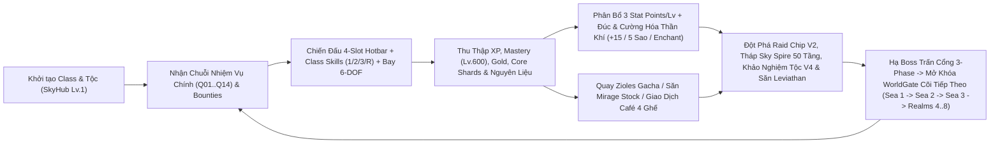
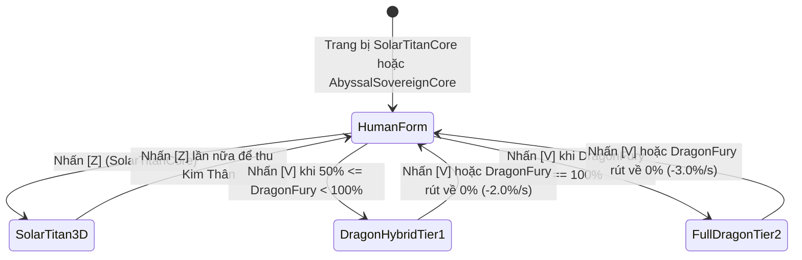

# SKYBREAK: Fragments of the Core — Kinh Thánh Thiết Kế Gameplay & Cân Bằng Chiến Đấu (v12 PremiumUI • Macro-World 27x / 9x)

**Phiên bản tài liệu:** `v12.0-Handoff` • **Đối tượng sử dụng:** Game Designers, Combat & Balance Designers, Systems Engineers, QA Balancing Team  
**Nguồn sự thật (Authoritative Codebase):**
- [Config.lua](file:///C:/Users/khang/Documents/Codex/2026-10-22/new-chat/outputs/SKYBREAK_Antigravity_Handoff/04_Roblox/src/ReplicatedStorage/Shared/Config.lua) — Cấu hình cấp độ `Lv. 1–2550`, 40 điểm FastTravel, 3 Class, 12 `AetherFruits`, Võ thuật, Trang bị, Boss/Mob và Chuỗi nhiệm vụ `Q01..Q14`.
- [SkybreakCombatData.lua](file:///C:/Users/khang/Documents/Codex/2026-10-22/new-chat/outputs/SKYBREAK_Antigravity_Handoff/04_Roblox/src/ReplicatedStorage/Shared/SkybreakCombatData.lua) — Dữ liệu chuẩn Wave 2: 5 hệ Võ thuật chuẩn (`Kata` 4 bước + `Z/X/C`), Mastery `Lv. 1–600`, 60 chiêu thức Thức tỉnh V2 (`AwakenedFruitMoves`), Mirage Stock theo giờ, 6 Tộc V4 (`RaceV4Passives`), 6 bậc Busoshoku Haki (`0..5`) + 8 màu Haki, Bounty `0..30,000,000`, 56 Danh hiệu phát sáng (`Titles`), `StarAscension` `1★..5★` và `Giftcodes`.
- [GameService.lua](file:///C:/Users/khang/Documents/Codex/2026-10-22/new-chat/outputs/SKYBREAK_Antigravity_Handoff/04_Roblox/src/ServerScriptService/Services/GameService.lua) — Pipeline tính chỉ số `G.Stats`, sát thương `G.Hit` / `G.PlayerDamage`, kết liễu `G.Kill`, Gacha Zioles, Kael Forge và trang bị.
- [SkybreakCombatExpansion.lua](file:///C:/Users/khang/Documents/Codex/2026-10-22/new-chat/outputs/SKYBREAK_Antigravity_Handoff/04_Roblox/src/ServerScriptService/Services/SkybreakCombatExpansion.lua) — Hook chiến đấu Wave 2, Logia Elemental Reflex, Nộ khí Hắc Long 2 tầng, V2 Moves, Safe Trading 4 ghế, Khảo nghiệm Tộc V4 và Triệu hồi Hải Vương.
- [SkybreakWorldEventsService.lua](file:///C:/Users/khang/Documents/Codex/2026-10-22/new-chat/outputs/SKYBREAK_Antigravity_Handoff/04_Roblox/src/ServerScriptService/Services/SkybreakWorldEventsService.lua) — AI 3 vai trò cho quái thường, AI Boss 3 giai đoạn (`3-Phase Boss System`), 3 AI Companions, 3 Chiến hạm 3D, Danger Sea Lv 1–6, Leviathan Heart Tow, Mirage Island, Pirate Raid, Microchip Awakening Raid 5 đợt và Tháp vô tận 50 tầng `Sky Spire`.
- [SkybreakSocialEconomyService.lua](file:///C:/Users/khang/Documents/Codex/2026-10-22/new-chat/outputs/SKYBREAK_Antigravity_Handoff/04_Roblox/src/ServerScriptService/Services/SkybreakSocialEconomyService.lua) — Đường cong kinh nghiệm mượt (`Smooth Progression Curve`), 5 Phù phép Cổ ngữ (`Arcane Enchantments`), Rương Aether 4 bậc, Sky-Rails, Đấu trường `Sky Colosseum`, Thành tựu & Chuỗi đăng nhập 7 ngày.
- [Skybreak3DEquipment.lua](file:///C:/Users/khang/Documents/Codex/2026-10-22/new-chat/outputs/SKYBREAK_Antigravity_Handoff/04_Roblox/src/ReplicatedStorage/Shared/Skybreak3DEquipment.lua) & [RarityConfig.lua](file:///C:/Users/khang/Documents/Codex/2026-10-22/new-chat/outputs/SKYBREAK_Antigravity_Handoff/04_Roblox/src/ReplicatedStorage/SkybreakShared/Config/RarityConfig.lua) — Gắn kết vũ khí 3D lên xương `Shared19`, vệt chém nguyên tố, cánh Tộc V4 có xương và 6 phụ kiện 3D thủ tục.

---

## Mục 1: Bối Cảnh Thế Giới (Lore), Vòng Lặp Gameplay Cốt Lõi & Toán Học Tăng Trưởng

### 1.1. Bối Cảnh Thế Giới (World Lore — *Fragments of the Core*)
Trước kỷ nguyên Đại Phân Tách, vạn vật được neo giữ bởi **Lõi Sáng Thế (`The Primeval Core of Light`)** — nguồn mạch năng lượng Aether duy trì sự cân bằng trọng trường cho cả thiên giới. Khi Đấng Kiến Tạo Đầu Tiên **Veyr (`Veyr • The First Architect`)** phong ấn kỳ điểm tại biên giới thực tại, Lõi Sáng Thế vỡ vụn thành hàng vạn mảnh tinh thể (`Core Shards`) và kết tinh thành 12 **Trái Ác Quỷ Aether (`Aether Core Fruits`)**. Lục địa cổ đại bị xé toạc, trôi dạt lên tầng bình lưu và phân hóa thành **8 Cõi Giới (`8 Realms`)** trải dài trên quy mô đại thế giới `27x / 9x`:

1. **Sea 1 — `GoldenSky` (`Lv. 1–700`)**: Quần Đảo Hoàng Kim rực ánh bình minh, nơi các chiến binh **Skyborn** thức tỉnh tại `SkyHub`, rèn luyện ở `LumenPlaza`, `WestGarden`, `SunshardSanctuary` và đối mặt hộ pháp **Aureon Sentinel** tại Đấu trường Tháp Ánh Sáng (`BossForecourt`).
2. **Sea 2 — `FrozenCyber` (`Lv. 700–1500`)**: Đại Hải Trình Băng Giá Cơ Giới — sự giao thoa giữa kỷ băng hà vĩnh cửu và nền văn minh lượng tử cổ đại. Tâm điểm là cảng giao thương `CyberportCafe`, pháo đài `PermafrostGarrison`, phòng thí nghiệm `MicrochipRaidLab`, vùng biển tử thần `GlacialWreckage` và ngai vàng của Băng Đế **Cryon Prime**.
3. **Sea 3 — `ShadowRealm` (`Lv. 1500–2200`)**: Vực Thẳm Hắc Tinh chìm trong sương mù hư không, bao gồm dinh thự `CastleOnTheVoid`, rừng pha lê đen `UmbralSanctum`, thánh điện khảo nghiệm huyết mạch `TempleOfTheCore`, vực biển sâu `LeviathanAbyss` và ngai vàng của Chúa Tể Hư Không **Noxar • Void Sovereign**.
4. **Realms 4–8 — Ngũ Giới Thượng Cổ & Chung Cuộc (`Lv. 2200–2550 MAX`)**:
   - **Realm 4 `VerdantCrown` (`Lv. 2200–2270`)**: Vương Miện Đại Cổ Thụ của **Sylvaris**.
   - **Realm 5 `EmberforgeWastes` (`Lv. 2270–2340`)**: Hoang Mạc Lò Rèn Sao Nung của Titan Lửa **Ignivar**.
   - **Realm 6 `AbyssalTides` (`Lv. 2340–2410`)**: Thủy Triều Vực Sâu phát quang của Thủy Hoàng **Nerith**.
   - **Realm 7 `ChronosBastion` (`Lv. 2410–2480`)**: Pháo Đài Thời Gian bị ngưng đọng bởi Pháp Vương **Aion**.
   - **Realm 8 `VeilsEnd` (`Lv. 2480–2550 MAX`)**: Tận Cùng Bức Màn — chân trời sự kiện nơi **Veyr • Đấng Kiến Tạo Đầu Tiên** ngự trị ở đỉnh cấp độ `Lv. 2550`.

### 1.2. Vòng Lặp Gameplay Cốt Lõi (Core Gameplay Loop)

> [!IMPORTANT]
> Toàn bộ 4 ô vũ trang trên thanh Hotbar (`Slot 1: FightingStyle`, `Slot 2: AetherFruit`, `Slot 3: Sword`, `Slot 4: Gun`) tồn tại song song với bộ 4 kỹ năng Class gốc (`[1]`, `[2]`, `[3]`, `[R]`). Thiết kế lai ghép (**Class + Blox-Style 4-Slot Loadout**) này cho phép người chơi kết hợp vai trò tổ đội (`Tank / Assassin / Spellcaster`) với chuỗi combo hoán đổi vũ khí tức thời (`Z / X / C / V / F`).

### 1.3. Toán Học Cấp Độ, Kinh Nghiệm & Đường Cong Tăng Trưởng Mượt (`Lv. 1 – 2550`)

Trong [Config.lua](file:///C:/Users/khang/Documents/Codex/2026-10-22/new-chat/outputs/SKYBREAK_Antigravity_Handoff/04_Roblox/src/ReplicatedStorage/Shared/Config.lua#L2-L30), giới hạn cấp độ nhân vật và chỉ số được ấn định ở mức:
- `C.MaxLevel = 2550`
- `C.MaxStat = 2550`
- `C.StatPointsPerLevel = 3` (tổng điểm chỉ số cộng thêm ở cấp tối đa `Lv. 2550` là `(2550 - 1) * 3 = 7,647` điểm, phân bổ tự do vào 5 nhánh `Melee`, `Defense`, `Sword`, `Gun`, `Fruit` [`Core`], mỗi nhánh khởi đầu ở mức `1` và tối đa `2,550`).

Lượng kinh nghiệm yêu cầu để lên cấp tiếp theo từ cấp `L` (`1 <= L <= 2550`) tuân theo hàm tuyến tính chuẩn hóa trong `C.RequiredXP(level)`:

$$\text{RequiredXP}(L) = \lfloor 65 + 14 \times (L - 1) \rfloor$$

Để triệt tiêu hoàn toàn hiện tượng "nghẽn cấp" (leveling wall) giữa các đại hải trình, [SkybreakSocialEconomyService.lua](file:///C:/Users/khang/Documents/Codex/2026-10-22/new-chat/outputs/SKYBREAK_Antigravity_Handoff/04_Roblox/src/ServerScriptService/Services/SkybreakSocialEconomyService.lua#L431-L455) áp dụng hàm điều phối `GetSmoothProgressionMultiplier(level, partyCount)` nhân trực tiếp vào phần thưởng hạ quái/Boss trong `G.Kill`:

| Khung Cấp Độ Nhân Vật | Hệ Số Nhân XP (`xpMult`) | Hệ Số Nhân Gold (`goldMult`) | Thưởng Tổ Đội Co-op (`partyCount > 1`) | Chia Sẻ Đồng Đội Xung Quanh |
| :--- | :---: | :---: | :---: | :--- |
| `Lv. 1 – 149` (Tân thủ Sea 1) | `1.30x` | `1.25x` | `x1.15` XP & `x1.15` Gold | `+25%` XP & `+25%` Gold trong bán kính `160` studs |
| `Lv. 150 – 699` (Trung/Cuối Sea 1) | `1.22x` | `1.18x` | `x1.15` XP & `x1.15` Gold | `+25%` XP & `+25%` Gold trong bán kính `160` studs |
| `Lv. 700 – 1499` (Sea 2 `FrozenCyber`) | `1.28x` | `1.22x` | `x1.15` XP & `x1.15` Gold | `+25%` XP & `+25%` Gold trong bán kính `160` studs |
| `Lv. 1500 – 2199` (Sea 3 `ShadowRealm`) | `1.34x` | `1.28x` | `x1.15` XP & `x1.15` Gold | `+25%` XP & `+25%` Gold trong bán kính `160` studs |
| `Lv. 2200 – 2550` (Realms 4–8) | `1.40x` | `1.32x` | `x1.15` XP & `x1.15` Gold | `+25%` XP & `+25%` Gold trong bán kính `160` studs |

Ngoài ra, khi hiệu ứng `DoubleExpSeconds` đang kích hoạt (ví dụ từ Giftcode `SKYBREAK2026`), toàn bộ lượng XP nhận được từ hạ quái/Boss được nhân thêm `2.0x`.

### 1.4. Hệ Thống Mastery (`Lv. 1 – 600`) Cho Vũ Khí, Võ Thuật, Súng & Trái Aether
Theo [SkybreakCombatData.lua](file:///C:/Users/khang/Documents/Codex/2026-10-22/new-chat/outputs/SKYBREAK_Antigravity_Handoff/04_Roblox/src/ReplicatedStorage/Shared/SkybreakCombatData.lua#L517-L541), mỗi Võ thuật, Trái Aether, Kiếm và Súng lưu trữ cấp độ thông thạo riêng biệt từ `Lv. 1` đến `MaxLevel = 600`:

$$\text{RequiredMasteryXP}(M) = \left\lfloor 45 + 16M + 2.2 \times M^{1.32} \right\rfloor$$

- **Hệ số tăng sát thương kỹ năng theo Mastery:** `+0.05%` mỗi cấp Mastery (`SkillDamagePerLevel = 0.0005`), đạt tối đa **`+30%` Skill DMG** ở `Mastery Lv. 600`.
- **Ngưỡng mở khóa chiêu chuẩn Wave 2 (`MoveUnlockThresholds`):** `[Z] = Lv. 1`, `[F] = Lv. 1` (đột phá `Flight Overdrive` ở `Lv. 75`), `[X] = Lv. 50`, `[C] = Lv. 100`, `[V] = Lv. 200` (riêng Trái bậc `Mythic` yêu cầu `MythicalVThreshold = Lv. 250`, và `AbyssalSovereignCore` yêu cầu `Lv. 300` trong `Config.lua`).
- **5 Mốc Thưởng Thành Tựu Mastery (`MasteryConfig.Milestones`):**
  - `Lv. 50`: `+2,500` Gold, `+25` Core Shards (*Mở khóa chiêu `[X]`*).
  - `Lv. 100`: `+6,000` Gold, `+60` Core Shards (*Mở khóa chiêu `[C]` & Cường hóa `[F]`*).
  - `Lv. 200`: `+15,000` Gold, `+150` Core Shards (*Mở khóa Tuyệt Kỹ `[V]`*).
  - `Lv. 300`: `+30,000` Gold, `+300` Core Shards (*Đột phá Tinh Thông Cao Cấp*).
  - `Lv. 600`: `+100,000` Gold, `+1,000` Core Shards + Danh hiệu `grand_master_600` (*Đại Tông Sư Thông Thạo*).

### 1.5. Công Thức Chỉ Số Nhân Vật, Tỉ Lệ Scale 5 Nhánh Stat & Hồi Chiêu Stamina
Hàm `C.Stats(level, classId, statAlloc)` trong [Config.lua](file:///C:/Users/khang/Documents/Codex/2026-10-22/new-chat/outputs/SKYBREAK_Antigravity_Handoff/04_Roblox/src/ReplicatedStorage/Shared/Config.lua#L154-L176) kết hợp cùng `G.Stats(p)` trong [GameService.lua](file:///C:/Users/khang/Documents/Codex/2026-10-22/new-chat/outputs/SKYBREAK_Antigravity_Handoff/04_Roblox/src/ServerScriptService/Services/GameService.lua#L1414-L1480) và bộ hook Wave 2 trong [SkybreakCombatExpansion.lua](file:///C:/Users/khang/Documents/Codex/2026-10-22/new-chat/outputs/SKYBREAK_Antigravity_Handoff/04_Roblox/src/ServerScriptService/Services/SkybreakCombatExpansion.lua#L1682-L1785) tính toán chỉ số theo hai tầng rõ rệt:

#### Tầng 1: Chỉ số nền theo Cấp độ, Class và Điểm Stat (`C.Stats`)
Gọi $d = \text{clamp}(\text{Defense} - 1,\ 0,\ 2549)$ và $o = \text{clamp}(\max(0,\ \text{Melee}-1,\ \text{Sword}-1,\ \text{Gun}-1,\ \text{Fruit}-1),\ 0,\ 2549)$:

$$\text{BaseHP} = \left\lfloor \big(120 + 2.2(L - 1) + 4.8d\big) \times \text{Class}_{\text{HP}} \right\rfloor$$

$$\text{BaseATK} = \left\lfloor \big(14 + 0.18(L - 1) + 0.42o\big) \times \text{Class}_{\text{ATK}} \right\rfloor$$

$$\text{BaseDEF} = \left\lfloor \big(6 + 0.08(L - 1) + 0.18d\big) \times \text{Class}_{\text{DEF}} \right\rfloor$$

#### Tầng 2: Cộng gộp Trang bị, Cường hóa, Haki, Tộc V4, Biến hình & Bounty (`G.Stats` + Wave 2)
1. **Trang bị & Cường hóa Kael Forge (`+1..+15`):**
   - Mỗi cấp cường hóa `EnhanceLevel` tăng `+6%` chỉ số `ATK` của vũ khí đang cầm (`WeaponATK * (1 + 0.06 * EnhanceLevel)`, tối đa `+90%` ở `+15`).
   - Toàn bộ trang bị trên các ô `EquipSlots` cộng trực tiếp `HP`, `ATK`, `DEF`, `CritRate`, `CritDmg`.
   - Năng lượng tối đa (`MaxStamina` / `Energy`): `MaxStamina = 100 + clamp(Melee - 1, 0, 2549) * 2` (tối đa `5,198` Energy ở `2,550 Melee`).
2. **Hệ số chuyên biệt theo Vũ khí đang kích hoạt (`SlotSpecificMult` trong `G.UseSlotMove`):**
   - Với `Slot 1 (Melee)`, `Slot 2 (Fruit)`, `Slot 3 (Sword)`, `Slot 4 (Gun)`, điểm Stat tương ứng $S_{\text{slot}} \in [1, 2550]$ nhân thêm hệ số sát thương kỹ năng:

$$\text{SlotStatMult}(S_{\text{slot}}) = 1 + \frac{\text{clamp}(S_{\text{slot}} - 1,\ 0,\ 2549)}{900}$$

   *(Đạt tới `3.832x` sát thương kỹ năng ở mốc `2,550` điểm chuyên môn).*
3. **Thăng Hoa Sao (`StarAscension` `1★..5★`) & Phù Phép (`SolarCrit`):**
   - Cộng thêm `AtkPct` (`+6%..+48%`), `CritRateBonus` (`+3%..+22%`), `SkillDmgPct` (`+6%..+45%`). Phù phép `SolarCrit` cộng thêm `+12%` `CritRate` và `+30%` `CritDmg` (`CritRate` được kẹp trần ở `95%`).
4. **Huyết mạch Tộc (`Race` & `RaceV4Active`):**
   - Trạng thái thường: nhân `+35%` phần bonus vượt `1.0` của tộc (`1 + (RaceMult - 1) * 0.35`).
   - Trạng thái **Thức tỉnh Tộc V4 (`RaceV4Active = true`)**: áp dụng toàn bộ `AtkMult` (`1.18x..1.30x`), `DefMult` (`1.14x..1.32x`) từ `CombatData.RaceV4Passives` và tốc độ chạy `SpeedMult` (`1.05x..1.35x`).
5. **Busoshoku Haki (`Stages 0..5`):**
   - Khi bật Haki Vũ Trang (`Haki.Aura = true`), nhân thêm `1 + AtkBonus` (`+8%` ở Stage 0 đến **`+22%` ATK** ở Stage 5) và `1 + DefBonus` (`+5%` ở Stage 0 đến **`+18%` DEF** ở Stage 5), đồng thời cộng thẳng `+3..+16` `Break`.
6. **Biến Hình 3D (`FruitTransform`) & Danh Vọng (`Bounty / Honor`):**
   - `AbyssalDragonHybrid` (50%–99% Fury): `+18%` ATK, `+25%` DEF, `+22%` Speed.
   - `AbyssalSovereign` (100% Fury): `+32%` ATK, `+40%` DEF, `+32%` Speed.
   - Buff `Bounty / Honor`: mỗi mốc `1,500,000` điểm tăng `+1%` ATK & `+1%` DEF, tối đa **`+20%` ATK & `+20%` DEF** ở `30,000,000`.

### 1.6. Công Thức Chí Mạng (Critical Hit), Giảm Trừ Phòng Ngự (DEF Mitigation) & Thanh Phá Giáp (`Break Gauge`)

Khi người chơi gây sát thương lên mục tiêu có phòng ngự $\text{DEF}_{\text{target}}$ trong `G.Hit` ([GameService.lua](file:///C:/Users/khang/Documents/Codex/2026-10-22/new-chat/outputs/SKYBREAK_Antigravity_Handoff/04_Roblox/src/ServerScriptService/Services/GameService.lua#L1515-L1578)):

$$\text{RawDmg} = \text{ATK} \times M_{\text{skill}} \times M_{\text{slot}} \times M_{\text{mastery}} \times M_{\text{V2}} \times \text{CritMult}$$

Trong đó $\text{CritMult} = 1 + \frac{\text{CritDmg}}{100}$ nếu quay trúng xác suất $\frac{\text{CritRate}}{100}$ (ngược lại $\text{CritMult} = 1.0$). Sát thương thực tế sau giảm trừ giáp và trạng thái của mục tiêu là:

$$\text{FinalDmg}_{\text{PvE}} = \max\left(1,\ \left\lfloor \text{RawDmg} \times \frac{100}{100 + \text{DEF}_{\text{enemy}}} \times M_{\text{break}} \times M_{\text{shred}} \times M_{\text{shield}} \right\rfloor\right)$$

- **Trạng thái Boss Phá Giáp (`Boss Break Kneel`):** Mỗi đòn đánh cộng điểm `Break` vào thanh `BreakGauge` (`0..100`). Khi chạm `100`, Boss quỳ gối choáng trong **`4.5` giây** (riêng `CryonPrime` khi vỡ 3 trụ băng là `4.8` giây) và chịu hệ số khuếch đại sát thương **`M_break = 1.50x`**.
- **Hiệu ứng Phá Giáp (`Armor Shred`):** Kỹ năng `FrostBolt`, Kata của `jade_dragon` (`6%`) hoặc debuff `WeakenedUntil` tăng thêm `M_shred = 1.08x`.
- **Công thức Sát thương PvP Đấu trường & Thế giới mở ([SkybreakSocialEconomyService.lua](file:///C:/Users/khang/Documents/Codex/2026-10-22/new-chat/outputs/SKYBREAK_Antigravity_Handoff/04_Roblox/src/ServerScriptService/Services/SkybreakSocialEconomyService.lua#L2985-L3015)):**

$$\text{FinalDmg}_{\text{PvP}} = \max\left(12,\ \left\lfloor \text{ATK}_{\text{attacker}} \times M_{\text{move}} \times 0.42 \times \frac{100}{100 + \text{DEF}_{\text{defender}}} \right\rfloor\right)$$

### 1.7. Cơ Chế Miễn Nhiễm Nguyên Tố Logia (`Logia Elemental Reflex`)
Hệ thống miễn nhiễm cơ thể nguyên tố được kiểm tra hai lớp trong `G.PlayerDamage` và hook Wave 2 ([SkybreakCombatExpansion.lua](file:///C:/Users/khang/Documents/Codex/2026-10-22/new-chat/outputs/SKYBREAK_Antigravity_Handoff/04_Roblox/src/ServerScriptService/Services/SkybreakCombatExpansion.lua#L4310-L4336)):

1. **Quy tắc chuẩn Wave 2 (`100%` Miễn nhiễm tuyệt đối):**
   - Điều kiện kích hoạt: Trái Aether đang trang bị có cờ `Logia == true`, kẻ địch tấn công **không phải Boss** (`not enemy.Boss`), **không sở hữu Haki Vũ Trang** (`not enemy.HasBusoHaki`), và cấp độ người chơi cao hơn kẻ địch tối thiểu **`15` cấp** (`player.Level >= enemy.Level + 15`).
   - Kết quả: Sát thương nhận vào bằng **`0`**, nhân vật phát hiệu ứng hạt nguyên tố xuyên thấu và hiển thị chữ nổi `"LOGIA!"` màu lam ngọc (`#64DCFF`).
2. **Quy tắc bảo hộ tầm gần (`GameService.lua` L1611 Fallback):**
   - Nếu chênh lệch cấp nằm trong khoảng `+5 <= (player.Level - enemy.Level) < +15` trước quái thường không phải Elite/Boss, người chơi vẫn có **`65%` xác suất** hóa giải đòn đánh nhờ phản xạ nguyên tố sơ cấp (`"LOGIA IMMUNE"`).

> [!NOTE]
> Trong codebase tồn tại một chi tiết phân loại kép cần lưu ý khi thiết kế UI/Tooltip: `7` trái hệ `Elemental` (`GaleCore`, `SandstoneCore`, `SolarFlameCore`, `GlacierIceCore`, `CelestialLightCore`, `StarforgedMagmaCore`, `ThunderRumbleCore`) có `Logia = true` đồng nhất trên mọi bảng dữ liệu. Riêng trái thần thoại thứ 11 **`AetherflowCore` (*Dough*)** được định nghĩa là **Special Logia** (`Type = "Elemental", Logia = true`) trong `Config.AetherFruits`, nhưng trong `CombatData.FruitCatalog` (dùng để kiểm tra hook Wave 2) lại mang `Type = "Natural", Logia = false`. Do đó ở runtime: `AetherflowCore` kích hoạt miễn nhiễm `65%` ở lớp `Config.AetherFruits` (`+5` Lv), trong khi 7 trái Logia thuần kích hoạt miễn nhiễm tuyệt đối `100%` ở lớp Wave 2 (`+15` Lv).

### 1.8. Hệ Thống Danh Vọng Chiến Hải (`Bounty` / `Honor` `0 .. 30,000,000`)
- **Giới hạn & Phân nhánh Phe phái:** `0` đến `30,000,000` (`CombatData.MaxBounty`). Người chơi chọn phe `Pirate` tích lũy **Bounty**, chọn phe `Marine` / `Guardian` tích lũy **Honor** (cùng dùng công thức buff chiến đấu `GetBountyBuffPct`).
- **Nguồn tích lũy & Khấu trừ:**
  - **Hạ Boss PvE:** `clamp(180,000 + EnemyLevel * 320, 200,000, 950,000)` trong Wave 2 (+`15,000` nền trong `G.Kill`).
  - **Hạ Quái thường PvE:** `clamp(3,500 + EnemyLevel * 18, 3,500, 48,000)`.
  - **Chiến thắng PvP Thế giới mở:** Người thắng nhận **`+12,500` Bounty/Honor**, người thua bị trừ `-6,000` (có khóa chống cày thuê `300s` trên mỗi cặp đấu và khiên bảo hộ PvP `15` phút cho người vừa bị hạ). Đấu trường `1v1 Sky Colosseum` là chế độ danh dự **`0` mất Bounty**.
- **Đặc quyền Bá Vương `10,000,000` Bounty (`SummonAlliedSeaBeast`):**
  - Ngay khi cán mốc `10,000,000` Bounty/Honor, mở khóa lệnh triệu hồi **Thủy Quái Đồng Minh 3D (`SkySeaBeast`)** tồn tại trong **`35` giây** (hồi chiêu `45` giây). Mỗi **`3.5` giây**, Hải Vương phóng đại pháo **Hydro-Aether Beam** gây **`3.80x` Player ATK** trong bán kính `20` studs lên mọi kẻ địch xung quanh.

---

## Mục 2: Ba Hệ Phái Khởi Đầu (`3 Starter Classes`) & Đồng Đội AI (`AI Companions`)

### 2.1. Bảng So Sánh Thông Số Cốt Lõi & Tiến Hóa Ngoại Hình 3 Bậc

Cả 3 hệ phái khởi đầu sử dụng chung bộ xương nhân vật chuẩn `Shared19` nhưng sở hữu hệ số nhân chỉ số riêng, đòn đánh thường `M1` riêng, nội tại riêng và lộ trình tiến hóa mô hình 3D theo cấp độ (`getVisualModelForPlayer` trong [DelegatedV5.client.lua](file:///C:/Users/khang/Documents/Codex/2026-10-22/new-chat/outputs/SKYBREAK_Antigravity_Handoff/04_Roblox/src/StarterPlayer/StarterPlayerScripts/DelegatedV5.client.lua)):

| `ClassId` | Tên Hiển Thị & Vai Trò | Vũ Khí Khởi Đầu | Hệ Số `HP` | Hệ Số `ATK` | Hệ Số `DEF` | `WalkSpeed` | `CritRate` / `CritDmg` Gốc | Nội Tại Độc Quyền & Hành Vi Đánh Thường (`M1`) | Lộ Trình Tiến Hóa Mô Hình 3D (`DelegatedV5Sources`) |
| :--- | :--- | :--- | :---: | :---: | :---: | :---: | :---: | :--- | :--- |
| `SkyGuardian` | **Sky Guardian** (`Tank / Vanguard`) | `starter_sword` | `1.25x` | `0.95x` | `1.20x` | `18` | `5%` / `50%` | **Vanguard Aura (`Lv. 10+`)**: Giảm thêm `-10%` sát thương nhận vào khi đứng gần đồng đội/Companion. Cận chiến tầm `10m`, hồi `0.42s`, `1.0x` ATK, `8` Break. | `Lv. 1–3`: `Male_Novice` / `Female_Novice` `Lv. 4–7`: `Male_Adventurer` / `Female_Adventurer` `Lv. 8+`: `Male_SkyGuardian` / `Female_SkyGuardian` |
| `ThunderStriker` | **Thunder Striker** (`Melee Assassin / Burst`) | `starter_daggers` | `0.90x` | `1.10x` | `0.90x` | `22` | `12%` / `60%` | **Striker Stacks**: Mỗi đòn trúng tích `1` tầng (tối đa `5` tầng), mỗi tầng giảm thời gian hồi đánh thường `+4%` tốc đánh (`+20%` ở 5 tầng). Cận chiến siêu tốc. | `Mọi cấp`: `ThunderStriker` (Nam) / `ThunderStrikerFemale` (Nữ) |
| `ArcaneMage` | **Arcane Mage** (`Ranged Spellcaster / AoE`) | `starter_staff` | `0.85x` | `1.15x` | `0.80x` | `18` | `8%` / `50%` | **Arcane Bolt M1**: Đòn đánh thường chuyển thành đạn phép tầm xa **`34` studs** (hồi `0.70s`), giữ khoảng cách an toàn ngoài vòng vây Boss. | `Mọi cấp`: `ArcaneMage` / `ArcaneMageFemale` |

- **Hành động cơ bản dùng chung (`C.Actions`):**
  - `Attack` (Chuột trái `M1`): Hồi chiêu `0.42s` (`0.70s` với `ArcaneMage`), tầm `10` studs (`34` studs với `ArcaneMage`), sát thương `1.0x` ATK, `8` Break.
  - `Heavy` (Đòn trọng kích): Hồi chiêu `1.8s`, tiêu hao `20` Energy, tầm `11` studs, sát thương `2.4x` ATK, `28` Break (phá vỡ khiên chắn trực diện của quái `Shield Vanguard`).
  - `Dodge` / `Dash` (`Q` hoặc `LeftShift` nhấp nhanh): Hồi chiêu `1.2s`, tiêu hao `25` Energy, ban khung hình bất tử ngắn (`i-frames`).

### 2.2. Bảng Chi Tiết 12 Kỹ Năng Hệ Phái (`Keys 1 / 2 / 3 / R`)

Mỗi kỹ năng hệ phái có thể nâng cấp từ `Skill Level 1` lên `Skill Level 5` thông qua giao diện `Skills`, khuếch đại hệ số sát thương theo công thức `EffectiveMult = BaseMult * (1 + 0.12 * (SkillLv - 1))` (tăng tới **`+48%` sát thương** ở cấp 5):

| Hệ Phái | Phím | `SkillId` & Tên Kỹ Năng | Phân Loại | Nguyên Tố | Hồi Chiêu | Energy | Tầm (`Range`) | Hệ Số (`Lv.1` -> `Lv.5`) | `Break` | Cơ Chế Chiến Đấu Đặc Biệt Trong `GameService.lua` |
| :--- | :---: | :--- | :--- | :---: | :---: | :---: | :---: | :---: | :---: | :--- |
| `SkyGuardian` | `1` | `SkySlash` (*Sky Slash*) | Active | `Sky` | `6.0s` | `10` | `18m` | `2.20x` -> `3.26x` | `22` | Chém vòng cung ánh sáng tầm trung phía trước, tích nộ ổn định và dọn quái nhóm. |
| `SkyGuardian` | `2` | `GuardianShield` (*Guardian Shield*) | Defense | `Sky` | `14.0s` | `15` | `20m` | `0.00x` | `0` | Ban khiên thánh quang cho bản thân và toàn bộ đồng đội trong bán kính `20m` suốt **`5.0` giây**, giảm **`65%` sát thương** nhận vào. |
| `SkyGuardian` | `3` | `JudgmentStrike` (*Judgment Strike*) | Heavy Skill | `Sky` | `10.0s` | `18` | `20m` | `3.10x` -> `4.59x` | `35` | Giáng kiếm phán xét từ trên cao xuống mục tiêu, gây lượng `Break` lớn để ép Boss quỳ gối. |
| `SkyGuardian` | `R` | `CelestialAegis` (*Celestial Aegis*) | Ultimate | `Sky` | `20.0s` | `25` | `24m` | `4.50x` -> `6.66x` | `50` | Bùng nổ thánh quang diện rộng `24m` gây `450%` ATK và kích hoạt khiên bảo hộ toàn đội suốt **`6.0` giây**. |
| `ThunderStriker` | `1` | `ArcCut` (*Arc Cut*) | Combo Skill | `Lightning` | `5.0s` | `10` | `12m` | `3 x 0.95x` (`2.85x` -> `4.22x`) | `10`/nhát (`30`) | Tung **3 nhát chém lôi điện** liên hoàn cực nhanh, lập tức cộng `3` tầng `Striker Stacks`. |
| `ThunderStriker` | `2` | `FlashStep` (*Flash Step*) | Mobility | `Lightning` | `8.0s` | `15` | `20m` (`58m` lướt) | `1.40x` -> `2.07x` | `12` | Lướt chớp nhoáng xuyên không ở trạng thái **vô địch ngắn (`i-frame`)**, chém điện dọc đường lướt. |
| `ThunderStriker` | `3` | `StormBlitz` (*Storm Blitz*) | Burst Skill | `Lightning` | `11.0s` | `18` | `16m` | `3.30x` -> `4.88x` | `30` | Bão kiếm sấm sét quét quanh bản thân, lập tức kích hoạt tối đa **`5` tầng `Striker Stacks`** trong `6.0` giây. |
| `ThunderStriker` | `R` | `ThunderJudgement` (*Thunder Judgement*) | Ultimate | `Lightning` | `20.0s` | `25` | `24m` | `4.80x` -> `7.10x` | `45` | Triệu hồi thiên lôi giáng xuống mọi kẻ địch trong bán kính `24m`, gây sát thương dồn cực đại. |
| `ArcaneMage` | `1` | `FrostBolt` (*Frost Bolt*) | Ranged Spell | `Frost` | `5.5s` | `12` | `42m` | `2.30x` -> `3.40x` | `22` | Bắn mũi tên băng tinh xa `42m`, gắn debuff **Phá giáp (`Armor Shred +8%` sát thương nhận vào)** lên mục tiêu. |
| `ArcaneMage` | `2` | `ManaBarrier` (*Mana Barrier*) | Arcane Ward | `Frost` | `14.0s` | `15` | `18m` | `0.00x` | `0` | Tạo kết giới ma lực trong **`5.0` giây** giảm **`65%` sát thương** nhận vào và hồi ngay **`+25` Stamina**. |
| `ArcaneMage` | `3` | `ArcaneComet` (*Arcane Comet*) | AoE Spell | `Void` | `11.0s` | `20` | `36m` | `3.40x` -> `5.03x` | `32` | Triệu hồi sao chổi cổ ngữ dội xuống vị trí chỉ định ở tầm `36m`, gây nổ ma lực diện rộng. |
| `ArcaneMage` | `R` | `AstralCataclysm` (*Astral Cataclysm*) | Ultimate | `Void` | `20.0s` | `25` | `38m` | `5.00x` -> `7.40x` | `50` | Tuyệt kỹ sát thương gốc cao nhất trong 3 Class (`500%` ATK), kích nổ trường trọng lực hư không tầm xa `38m`. |

### 2.3. Hệ Thống Đồng Đội AI Tổ Đội (`AI Companions`: `Kairo`, `Lumen`, `Nyx`)
Khi người chơi mở chế độ tổ đội (`PartySize`: `Solo` -> `Duo` ở `Lv. 15` -> `Trio` / `Raid 4` ở `Lv. 30` -> `Squad` ở `Lv. 50`), máy chủ tự động triệu hồi các Đồng đội AI sử dụng mô hình 3D V5 đầy đủ hoạt ảnh từ [GameService.lua](file:///C:/Users/khang/Documents/Codex/2026-10-22/new-chat/outputs/SKYBREAK_Antigravity_Handoff/04_Roblox/src/ServerScriptService/Services/GameService.lua#L140-L171) và vận hành trí tuệ nhân tạo chuyên biệt trong [SkybreakWorldEventsService.lua](file:///C:/Users/khang/Documents/Codex/2026-10-22/new-chat/outputs/SKYBREAK_Antigravity_Handoff/04_Roblox/src/ServerScriptService/Services/SkybreakWorldEventsService.lua#L1140-L1285):

| `CompanionId` | Danh Xưng & Hệ Phái | Mô Hình 3D (`VisualAsset`) | Vai Trò AI | Cấp Mở Khóa & Chế Độ Đội | `Base HP` | `Base ATK` | Vị Trí Đội Hình (`Offset`) | Kỹ Năng AI Tự Động & Cơ Chế Cứu Trợ Trong Chiến Đấu |
| :--- | :--- | :--- | :---: | :---: | :---: | :---: | :---: | :--- |
| `Kairo` | **Kairo • Vanguard** (`SkyGuardian`) | `Male_SkyGuardian` | `TANK` | `Lv. 15` (`Duo`, `Trio`, `Raid 4`, `Squad`) | `1,800` | `42` | `(-10, 0, -5)` | Mỗi **`14` giây** dựng **Golden Barrier** trị giá **`15%` MaxHP** cho người chơi và phát **Khiêu Khích (`Taunt`)** trong **`6` giây**, làm giảm `-20%` sát thương đòn đánh của kẻ địch bị khiêu khích. |
| `Lumen` | **Lumen • Starweaver** (`ArcaneMage`) | `ArcaneMage` | `HEALER` | `Lv. 30` (`Trio`, `Raid 4`, `Squad`) | `1,350` | `48` | `(10, 0, -5)` | Mỗi **`10` giây** tỏa sóng **Emerald Healing Pulse** hồi **`+12%` MaxHP** và **`+18` Stamina** cho chủ nhân. Đặc biệt: khi người chơi gục ngã trong Raid, Lumen tự động lao tới **cứu sống sau `4.0` giây** với **`45%` HP**. |
| `Nyx` | **Nyx • Shadowblitz** (`ThunderStriker`) | `ThunderStrikerFemale` | `ASSASSIN` | `Lv. 50` (`Squad`) | `1,450` | `55` | `(0, 0, -9)` | Mỗi **`7` giây** thi triển **Shadow-Step Backstab** dịch chuyển ra sau lưng mục tiêu ưu tiên (hoặc trụ cơ chế Boss) tung đòn kết liễu gây **`1.45x` ATK** kèm hiệu ứng sét tím. |

---

## Mục 3: Toàn Bộ Danh Mục Võ Thuật Cận Chiến (`Martial Arts / Fighting Styles Catalog` — Slot 1)

### 3.1. Năm Trường Phái Võ Thuật Chính Thức Chuẩn Wave 2 (`CombatData.MartialStyles`)
Trong [SkybreakCombatData.lua](file:///C:/Users/khang/Documents/Codex/2026-10-22/new-chat/outputs/SKYBREAK_Antigravity_Handoff/04_Roblox/src/ReplicatedStorage/Shared/SkybreakCombatData.lua#L12-L414), ô `Slot 1 (FightingStyle)` được chuẩn hóa thành **5 tuyệt học võ đạo** có võ sư truyền dạy trực tiếp trên bản đồ, sở hữu chuỗi **4 bước quyền cước `M1 Kata`** độc lập và 3 kỹ năng chủ động `[Z]`, `[X]`, `[C]`:

| `StyleId` | Tên Trường Phái | Võ Sư Truyền Thụ (`MasterNPC`) | Đảo Tọa Độ (`IslandId` & `Offset`) | Giá Mở Khóa (`Gold` / `Core Shards`) | Nguyên Tố | Màu Hào Quang (`RGB`) | Định Hướng Chiến Thuật |
| :--- | :--- | :--- | :--- | :--- | :---: | :---: | :--- |
| `skyborn_combat` | **Võ Thuật Skyborn** (*Skyborn Combat*) | `MasterZephyr` (*Võ Sư Zephyr - Skyborn Dojo*) | `SkyHub` `(-36, 0, -28)` | **Miễn phí** (`0` Gold / `0` Shards) | `Sky` | `(120, 220, 255)` | Quyền pháp khởi đầu cân bằng, lướt ngắn linh hoạt và đánh văng cuối chuỗi Kata. |
| `jade_dragon` | **Long Quyền Ngọc Bích** (*Jade Dragon Kung Fu*) | `MasterShen` (*Tông Sư Shen - Jade Dragon*) | `SkyHub` `(-46, 0, -24)` & `SunshardIsle` | `450,000` Gold + `350` Shards | `Jade` | `(64, 242, 168)` | Chuyên **Phá giáp (`6% ArmorShred`)**, gom quái vào tâm (`Pull`) và bắn long xung xuyên thấu. |
| `thunder_talon` | **Lôi Trảo Cước** (*Thunder Talon*) | `MasterRaiden` (*Lôi Sư Raiden - Thunder Talon*) | `CyberportCafe` `(-28, 0, 22)` | `1,250,000` Gold + `1,200` Shards | `Lightning` | `(95, 195, 255)` | Tốc độ ra đòn M1 nhanh nhất trò chơi (`0.19s`/nhịp) kèm chuỗi **Làm choáng (`Stun 0.35s..1.20s`)** liên hoàn. |
| `solar_ashura` | **Thái Dương Tu La Quyền** (*Solar Ashura Fist*) | `MasterIgnis` (*Tu La Võ Đế Ignis - Solar Ashura*) | `CyberportCafe` `(28, 0, 22)` | `2,200,000` Gold + `2,200` Shards | `Flame` | `(255, 128, 42)` | Trọng quyền phá thanh `Break Gauge` cực đại và gây **Thiêu đốt (`Burn 14%..26%`)** trên từng cú đấm. |
| `celestial_godhuman` | **Thiên Thần Tuyệt Kỹ** (*Celestial Godhuman*) | `GrandmasterAurelius` (*Thần Võ Aurelius*) | `TempleOfTheCore` `(22, 0, -18)` | `3,500,000` Gold + `3,500` Shards | `Celestial` | `(255, 224, 125)` | Đỉnh cao võ học cuối game: tầm đánh `21m`, hệ số Kata bước 4 lên tới `2.18x` và chiêu `[C]` `5.45x` ATK. |

### 3.2. Bảng Phân Tích Chuỗi 4 Đòn Đánh Thường `M1 Kata` Của 5 Võ Thuật

| `StyleId` | Bước 1 (`Step 1`) | Bước 2 (`Step 2`) | Bước 3 (`Step 3`) | Bước 4 — Đòn Kết (`Step 4 Finisher`) | Hiệu Ứng Đặc Biệt Trên Chuỗi Kata |
| :--- | :--- | :--- | :--- | :--- | :--- |
| `skyborn_combat` | *Wind Palm Jab* `1.00x` • `14.0m` • `0.24s` • `5` Brk | *Aero Cross Strike* `1.08x` • `14.5m` • `0.24s` • `6` Brk | *Cyclone Backhand* `1.18x` • `15.2m` • `0.26s` • `7` Brk | *Skyborn Tempest Finisher* **`1.50x`** • `17.0m` • `0.36s` • `14` Brk (`AoE`) | Lướt tiến `3.5m -> 4.5m`; đòn 4 hất văng `Knockback = 24`. |
| `jade_dragon` | *Emerald Fang Strike* `1.08x` • `14.8m` • `0.23s` • `6` Brk | *Coiling Scale Claw* `1.16x` • `15.2m` • `0.23s` • `7` Brk | *Spiral Jade Whip* `1.28x` • `16.0m` • `0.25s` • `9` Brk | *Imperial Dragon Snap* **`1.65x`** • `18.0m` • `0.35s` • `17` Brk (`AoE`) | Đòn 1 & 2 xuyên `6%` giáp (`ArmorShred`); đòn 3 kéo địch (`Pull`); đòn 4 `Knockback = 26`. |
| `thunder_talon` | *Flash Low Kick* `1.10x` • `15.0m` • **`0.19s`** • `6` Brk | *Arcing Roundhouse* `1.20x` • `15.6m` • **`0.19s`** • `7` Brk | *Twin Volt Talon* `1.32x` • `16.4m` • `0.21s` • `9` Brk | *Thunderclap Heel Drop* **`1.75x`** • `18.5m` • `0.31s` • `19` Brk (`AoE`) | Lướt `5.5m`/đòn; đòn 3 choáng `0.35s`, đòn 4 choáng diện rộng `0.75s`. |
| `solar_ashura` | *Cinder Straight* `1.18x` • `15.0m` • `0.25s` • `8` Brk | *Molten Hook* `1.30x` • `15.5m` • `0.25s` • `10` Brk | *Ashura Gut Crusher* `1.44x` • `16.2m` • `0.27s` • `13` Brk | *Solar Supernova Slam* **`1.92x`** • `19.2m` • `0.37s` • **`25` Brk** (`AoE`) | Mọi đòn đều gây bỏng `BurnPct` (`14% -> 16% -> 18% -> 26%`); đòn 4 `Knockback = 30`. |
| `celestial_godhuman` | *Astral Palm Flash* `1.25x` • `16.5m` • `0.20s` • `9` Brk | *Divine Gale Kick* `1.38x` • `17.2m` • `0.20s` • `11` Brk | *Sovereign Void Elbow* `1.52x` • `18.0m` • `0.22s` • `14` Brk | *Heaven Piercing Impact* **`2.18x`** • `21.0m` • `0.33s` • **`28` Brk** (`AoE`) | Lướt `6.5m`/đòn; đòn 3 choáng `0.40s`; đòn 4 choáng `0.90s` + `Knockback = 34`. |

### 3.3. Bảng Đầy Đủ 15 Chiêu Thức Võ Thuật `[Z] / [X] / [C]` & Ánh Xạ Tương Thích Ngược (`StyleAliases`)

| Trường Phái | Phím | Tên Kỹ Năng (`Name` & Tên Việt) | Mastery | Hồi Chiêu | Energy | Tầm / Bán Kính | Hệ Số (`Multiplier`) | Số Hit | `Break` | Hiệu Ứng Cơ Học Chi Tiết |
| :--- | :---: | :--- | :---: | :---: | :---: | :---: | :---: | :---: | :---: | :--- |
| `skyborn_combat` | `Z` | **Gale Palm Thrust** (*Kình Phong Chưởng*) | `1` | `4.5s` | `8` | `22m` / `11m` | `2.25x` | `1` | `22` | Lướt tiến `Dash = 16m` tung chưởng phong trực diện. |
| `skyborn_combat` | `X` | **Rising Sky Kick** (*Thăng Thiên Cước*) | `50` | `7.0s` | `12` | `20m` / `13m` | `2.75x` | `2` | `28` | Đá xoáy hất tung mục tiêu lên không (`Knockup = 22`). |
| `skyborn_combat` | `C` | **Aether Flurry** (*Liên Hoàn Bách Chưởng*) | `100` | `9.5s` | `16` | `24m` / `15m` | `3.45x` | `4` | `35` | Lướt `12m`, dồn 4 đợt chưởng lực Aether liên tiếp. |
| `jade_dragon` | `Z` | **Jade Claw Rush** (*Ngọc Long Đột Trảo*) | `1` | `4.8s` | `10` | `26m` / `12m` | `2.55x` | `3` | `26` | Lướt xoáy `Dash = 22m` cào xé 3 nhịp bằng trảo ngọc bích. |
| `jade_dragon` | `X` | **Coiling Dragon Sweep** (*Cuộn Long Quét Địa*) | `50` | `7.8s` | `14` | `24m` / `16m` | `3.10x` | `2` | `32` | Quét long khí bán kính `16m` hút mọi kẻ địch vào tâm (`Pull = true`). |
| `jade_dragon` | `C` | **Emerald Dragon Roar** (*Ngọc Long Cửu Thiên Hống*) | `100` | `10.8s` | `18` | `34m` / `16m` | `3.95x` | `3` | `42` | Phóng đại long xung xuyên thấu toàn bộ mục tiêu trên đường thẳng (`Piercing = true`). |
| `thunder_talon` | `Z` | **Volt Snap Kick** (*Điện Thiểm Cước*) | `1` | `4.5s` | `10` | `28m` / `12m` | `2.75x` | `2` | `28` | Áp sát tức thời `Dash = 26m`, làm choáng `StunDur = 0.65s`. |
| `thunder_talon` | `X` | **Lightning Drop Heel** (*Thiên Lôi Giáng Cước*) | `50` | `7.5s` | `15` | `26m` / `16m` | `3.40x` | `2` | `35` | Bổ gót chân sấm sét từ trên không gây nổ điện và choáng `StunDur = 1.00s`. |
| `thunder_talon` | `C` | **Storm Talon Barrage** (*Bão Lôi Vạn Trảo*) | `100` | `10.5s` | `20` | `30m` / `18m` | `4.30x` | `6` | `46` | Dịch chuyển zíc-zắc `Dash = 22m` chém 6 nhát sét, khóa cứng `StunDur = 1.20s`. |
| `solar_ashura` | `Z` | **Ignited Knuckle** (*Viêm Dương Thiết Quyền*) | `1` | `5.0s` | `11` | `24m` / `13m` | `3.00x` | `1` | `32` | Lướt `18m` đấm nổ hỏa cầu, thiêu đốt `BurnTicks = 3`. |
| `solar_ashura` | `X` | **Eruption Uppercut** (*Dung Nham Xung Thiên Quyền*) | `50` | `8.2s` | `16` | `24m` / `17m` | `3.70x` | `2` | `40` | Móc ngược phun cột lửa `Knockup = 26`, thiêu đốt `BurnTicks = 4`. |
| `solar_ashura` | `C` | **Ashura Sunburst** (*Tu La Nhật Thực Bạo*) | `100` | `11.5s` | `22` | `28m` / `21m` | `4.65x` | `4` | `52` | Bùng nổ đại nhật bán kính rộng `21m`, gây `52` Break và `BurnTicks = 5`. |
| `celestial_godhuman` | `Z` | **Soaring Beast Barrage** (*Bách Thú Tinh Quyền*) | `1` | `4.8s` | `12` | `32m` / `15m` | `3.35x` | `5` | `36` | Lao xuyên mục tiêu `Dash = 28m` để lại 5 tàn ảnh thần quyền phát nổ. |
| `celestial_godhuman` | `X` | **Heaven & Earth Shatter** (*Thiên Địa Phá Toái*) | `50` | `8.0s` | `18` | `30m` / `20m` | `4.25x` | `3` | `48` | Đập vỡ không gian bán kính `20m`, làm choáng `StunDur = 1.10s`. |
| `celestial_godhuman` | `C` | **Sixth Realm Celestial Impact** (*Lục Giới Thần Xung*) | `100` | `11.8s` | `24` | `36m` / `23m` | `5.45x` | `6` | `62` | Đòn võ thuật mạnh nhất game: lướt siêu thanh `30m`, `62` Break, choáng `1.40s`. |

- **Bảng ánh xạ tương thích ngược (`CombatData.ResolveStyleId` & `Config.FightingStyles` Legacy):** Để đảm bảo hồ sơ người chơi từ các bản build trước không bao giờ lỗi ID, hệ thống tự động quy chiếu các định danh cũ trong `Config.FightingStyles` sang 5 ID chuẩn Wave 2:
  - `SkybornCombat` (`0` G, 5 chiêu sơ khai `Z/X/C/V/F`) & `SkyStep` (`150,000` G) -> `skyborn_combat`.
  - `GlacialFist` / `GlacialKarate` (`750,000` G + `500` Shards) -> `jade_dragon`.
  - `ElectricClaw` (`1,500,000` G + `1,500` Shards) -> `thunder_talon`.
  - `AbyssalTalon` / `DragonTalon` (`2,500,000` G + `3,000` Shards) -> `solar_ashura`.
  - `CelestialGodhuman` / `GodhumanSkyborn` (`5,000,000` G + `5,000` Shards) -> `celestial_godhuman`.

---

## Mục 4: Bách Khoa Toàn Thư 12 Trái Ác Quỷ 3D (`12 Aether Fruits` • `60` Chiêu Gốc + `60` Chiêu Thức Tỉnh V2 + Biến Hình 3D)

### 4.1. Danh Mục Tổng Quan 12 Trái Ác Quỷ Aether, Giá Trị, Tỉ Lệ Gacha & Gói Tài Nguyên 3D

Tất cả 12 Trái Ác Quỷ Aether đều sở hữu **mô hình 3D Blender độc lập** trong `ReplicatedStorage.DelegatedV5Sources` (`Fruit_<FruitId>`), được tô màu procedural vertex shader đa lớp (`VORTEX`, `PLASMA`, `FRESNEL`, `METAL`) trong [DelegatedV5Renderer.lua](file:///C:/Users/khang/Documents/Codex/2026-10-22/new-chat/outputs/SKYBREAK_Antigravity_Handoff/04_Roblox/src/ReplicatedStorage/DelegatedV5Renderer.lua#L105-L163):

| STT | `FruitId` | Tên Đầy Đủ (`Config.AetherFruits`) | Phân Hệ (`Type`) & Nguyên Tố | Độ Hiếm (`Config` / `Catalog`) | `Logia` (`Config` / `Wave2`) | Giá Shop (`Config.Price`) / Giá Mirage & Trade (`GoldValue`) | Chi Phí Thức Tỉnh V2 (`AwakenShards`) | Tỉ Lệ Quay Zioles Gacha | Gói Mô Hình 3D (`DelegatedV5Sources`) & Điêu Trên Mặt Nước |
| :-: | :--- | :--- | :--- | :---: | :---: | :--- | :---: | :---: | :--- |
| 1 | `GaleCore` | **Trái Gió • Gale Core** | `Elemental` • `Sky` | `Common` | `true` / `true` | `75,000` G / `75,000` G | `400` Shards | `1/12` (`8.33%`) | `Fruit_GaleCore` |
| 2 | `SandstoneCore` | **Trái Cát Vàng • Sandstone Core** | `Elemental` • `Sky` (`Sand`) | `Uncommon` | `true` / `true` | `420,000` G / `240,000` G | `500` Shards | `1/12` (`8.33%`) | `Fruit_SandstoneCore` |
| 3 | `SolarFlameCore` | **Trái Lửa Mặt Trời • Solar Flame Core** | `Elemental` • `Sky` (`Flame`) | `Uncommon` | `true` / `true` | `550,000` G / `380,000` G | `650` Shards | `1/12` (`8.33%`) | `Fruit_SolarFlameCore` |
| 4 | `GlacierIceCore` | **Trái Băng Vĩnh Cửu • Glacier Ice Core** | `Elemental` • `Frost` | `Rare` | `true` / `true` | `750,000` G / `550,000` G | `800` Shards | `1/12` (`8.33%`) | `Fruit_GlacierIceCore` • Tạo thềm băng đi trên biển (`WaterWalk = "Ice"`) |
| 5 | `CelestialLightCore` | **Trái Ánh Sáng • Celestial Light Core** | `Elemental` • `Sky` (`Light`) | `Rare` | `true` / `true` | `1,100,000` G / `850,000` G | `950` Shards | `1/12` (`8.33%`) | `Fruit_CelestialLightCore` |
| 6 | `StarforgedMagmaCore` | **Trái Dung Nham • Starforged Magma Core** | `Elemental` • `Sky` (`Magma`) | `Rare` | `true` / `true` | `1,350,000` G / `1,150,000` G | `1,100` Shards | `1/12` (`8.33%`) | `Fruit_StarforgedMagmaCore` • Tạo đĩa đá bazan trên biển (`WaterWalk = "Basalt"`) |
| 7 | `ThunderRumbleCore` | **Trái Lôi Đình • Thunder Rumble Core** | `Elemental` • `Lightning` | `Legendary` | `true` / `true` | `2,100,000` G / `2,100,000` G | `1,500` Shards | `1/12` (`8.33%`) | `Fruit_ThunderRumbleCore` |
| 8 | `AstralGravityCore` | **Trái Trọng Lực • Astral Gravity Core** | `Natural` • `Void` (`Gravity`) | `Legendary` | `false` / `false` | `2,300,000` G / `2,500,000` G | `1,650` Shards | `1/12` (`8.33%`) | `Fruit_AstralGravityCore` |
| 9 | `DimensionalPortalCore` | **Trái Không Gian • Dimensional Portal Core** | `Natural` • `Void` (`Portal`) | `Legendary` | `false` / `false` | `2,500,000` G / `2,900,000` G | `1,800` Shards | `1/12` (`8.33%`) | `Fruit_DimensionalPortalCore` |
| 10 | `SolarTitanCore` | **Trái Kim Thân (Buddha) • Solar Titan Core** | `Beast` (`MythicalZoan`) • `Sky` (`Light`) | `Legendary` / `Mythic` | `false` / `false` | `2,800,000` G / `4,200,000` G | `2,200` Shards | `1/12` (`8.33%`) | `Fruit_SolarTitanCore` + Biến hình 3D `SolarTitanBuddha` |
| 11 | `AetherflowCore` | **Trái Tinh Thể (Dough) • Aetherflow Core** | `Elemental` / `Natural` • `Frost` (`Aether`) | `Mythical` / `Mythic` | `true` / `false` | `3,400,000` G / `4,800,000` G | `2,400` Shards | `1/12` (`8.33%`) | `Fruit_AetherflowCore` |
| 12 | `AbyssalSovereignCore` | **Trái Long Vương Hư Không • Abyssal Sovereign Core** | `Beast` (`MythicalZoan`) • `Void` | `Mythical` / `Mythic` | `false` / `false` | `5,000,000` G / `6,500,000` G | `2,800` Shards | `1/12` (`8.33%`) | `Fruit_AbyssalSovereignCore` + Biến hình 3D `AbyssalDragonHybrid` & `AbyssalSovereignDragon` |

#### Cơ Chế Nguồn Cung Trái Aether & Tương Tác Mặt Biển (`Water Penalty vs Water-Walk`)
- **Zioles Shrine Gacha (`RollFruit` tại `ZiolesGachaShrine` & `SkyHub`):** Trong [GameService.lua](file:///C:/Users/khang/Documents/Codex/2026-10-22/new-chat/outputs/SKYBREAK_Antigravity_Handoff/04_Roblox/src/ServerScriptService/Services/GameService.lua#L2584-L2612), mỗi lượt quay tiêu tốn **`25,000` Gold** (hoặc miễn phí nếu người chơi có `FreeFruitVouchers > 0`; lưu ý hằng số cấu hình tĩnh `C.GachaCostGold = 150000` / `C.GachaCostShards = 200` tồn tại cho UI tham chiếu nhưng máy chủ thu đúng `25,000` Gold để hỗ trợ tân thủ). Thuật toán dùng phân phối đều `math.random(1, #C.FruitOrder)` (`8.33%`/trái) và cất thẳng trái quay được vào kho `StoredFruits` (có thể ăn ngay hoặc mang lên bàn giao dịch Cyberport Café).
- **Cửa Hàng Mirage Xoay Tua Hàng Giờ (`CombatData.GetHourlyMirageStock`):** Sử dụng bộ sinh số giả ngẫu nhiên tất định LCG theo hạt giống giờ quốc tế `hourSeed = floor(unixTime / 3600)` để chọn đúng **5 trái không trùng lặp** tương ứng với 5 bậc (`Slot 1: tierCommon`, `Slot 2: tierMid`, `Slot 3: tierRare`, `Slot 4: tierHigh`, `Slot 5: tierApex`), bán trực tiếp bằng `GoldValue` không cần chờ quay may rủi.
- **Lời Nguyền Nước Biển & Bước Đi Trên Băng / Đá Bazan ([SkybreakCombatExpansion.lua](file:///C:/Users/khang/Documents/Codex/2026-10-22/new-chat/outputs/SKYBREAK_Antigravity_Handoff/04_Roblox/src/ServerScriptService/Services/SkybreakCombatExpansion.lua#L2905-L2992)):** Người ăn Trái Aether khi rơi xuống mặt biển (`11.0 <= Y <= 23.5`) sẽ bị rút **`3.5%` MaxHP/giây** và **`4` Energy/giây** (Tộc `Leviathan` được miễn giảm `80%`). Tuy nhiên, người sở hữu **`GlacierIceCore`** hoặc **`StarforgedMagmaCore`** tự động kết tinh các thềm băng lục giác / đĩa đá dung nham rắn dưới bàn chân khi đi trên mặt biển, triệt tiêu hoàn toàn sát thương nước!

### 4.2. Bảng Phân Tích Chi Tiết Toàn Bộ `60` Chiêu Gốc & `60` Chiêu Thức Tỉnh V2 (`Z / X / C / V / F`)

Khi người chơi sở hữu `AwakeningMicrochip` (từ chế độ `Mythic` của `Microchip Awakening Raid`) hoặc đủ `AwakenShards` (`400..2,800` Core Shards, cấu hình mặc định `C.AwakeningCostShards = 1000`), kích hoạt **Thức Tỉnh V2 (`AwakenFruit`)** sẽ nâng cấp vĩnh viễn toàn bộ 5 chiêu `Z/X/C/V/F` của trái đó sang phiên bản V2 trong `CombatData.AwakenedFruitMoves`: nhân thêm **`MultBoost` (`+28%` đến `+42%` sát thương)**, mở rộng bán kính nổ **`RadiusScale` (`1.30x` đến `1.60x`)**, biến đòn đơn thành **chuỗi đa chấn động (`2..6 Hits`)** và mở khóa hiệu ứng khống chế đặc biệt (`Mechanic`).

#### Nhóm A: Trái 1 – 6 (Bậc `Common`, `Uncommon`, `Rare` — Hệ Nguyên Tố Logia)

| Trái (`FruitId`) | Phím | Tên Chiêu Gốc (`Config`) | Mastery (`Config` / `Wave2`) | CD / Energy / Tầm | Hệ Số Gốc & `Break` | Tên Chiêu Thức Tỉnh V2 (`CombatData.AwakenedFruitMoves`) | `MultBoost` -> Hệ Số V2 Thực Tế | `RadiusScale` & `Hits` | Cơ Chế V2 Độc Quyền (`Mechanic`) |
| :--- | :---: | :--- | :---: | :---: | :---: | :--- | :---: | :---: | :--- |
| `GaleCore` | `Z` | *Gale Blades • Phong Đao* | `1` / `1` | `4.5s` / `8` / `24m` | `2.20x` • `20` Brk | **Tempest Razor V2 - Lưỡi Đao Siêu Bão** | `x1.30` -> **`2.86x`** | `1.35x` • `3` Hits | `CyclonePull` (`Pull = 16`) |
| `GaleCore` | `X` | *Cyclone Burst • Lốc Xoáy Không Trung* | `1` / `50` | `7.0s` / `12` / `22m` | `2.60x` • `26` Brk | **Hurricane Prison V2 - Ngục Tù Lốc Xoáy** | `x1.32` -> **`3.43x`** | `1.40x` • `3` Hits | `CyclonePull` (`Pull = 20`) |
| `GaleCore` | `C` | *Tornado Crush • Bão Phong Nghiền Nát* | `1` / `100` | `9.5s` / `16` / `26m` | `3.10x` • `32` Brk | **Skyward Stratosphere V2 - Bão Tầng Bình Lưu** | `x1.34` -> **`4.15x`** | `1.45x` • `4` Hits | `ShockwaveMulti` |
| `GaleCore` | `V` | *Skyborn Typhoon • Đại Cuồng Phong* | `1` / `200` | `14.0s` / `22` / `30m` | `3.90x` • `42` Brk | **Eye of the Sovereign Storm V2 - Đại Phong Thần Nộ** | `x1.38` -> **`5.38x`** | `1.50x` • `5` Hits | `CyclonePull` (`Pull = 26`) |
| `GaleCore` | `F` | *Wind Ride • Cưỡi Gió* | `1` / `1` | `5.0s` / `8` / `26m` | `1.40x` • `12` Brk | **Supersonic Jetstream V2 - Cánh Gió Siêu Thanh** | `x1.28` -> **`1.79x`** | `1.30x` • `2` Hits | `SpeedGlide` |
| `SandstoneCore` | `Z` | *Desert Blade • Sa Đao* | `1` / `1` | `5.0s` / `10` / `25m` | `2.30x` • `22` Brk | **Dune Guillotine V2 - Lưỡi Hái Cát Vàng** | `x1.30` -> **`2.99x`** | `1.35x` • `2` Hits | `QuicksandSink` (`Slow = 35%`) |
| `SandstoneCore` | `X` | *Sand Coffin • Quan Tài Cát* | `30` / `50` | `9.0s` / `15` / `22m` | `2.80x` • `30` Brk | **Abyssal Quicksand Pit V2 - Hố Cát Tử Thần** | `x1.33` -> **`3.72x`** | `1.42x` • `3` Hits | `QuicksandSink` (`Pull = 22`) |
| `SandstoneCore` | `C` | *Quicksand Vortex • Hố Cát Tử Thần* | `60` / `100` | `12.0s` / `18` / `26m` | `3.30x` • `35` Brk | **Pharaoh Sandstorm V2 - Bão Cát Hoàng Đế** | `x1.35` -> **`4.46x`** | `1.45x` • `4` Hits | `BlindDoT` (`3` nhịp rút máu) |
| `SandstoneCore` | `V` | *Sandstorm Wrath • Bão Cát Hoàng Kim* | `100` / `200` | `17.0s` / `25` / `32m` | `4.20x` • `45` Brk | **Desert Burial Cataclysm V2 - Đại Mộ Sa Mạc** | `x1.39` -> **`5.84x`** | `1.52x` • `5` Hits | `QuicksandSink` (`Pull = 28`) |
| `SandstoneCore` | `F` | *Sand Flight • Cát Lưu* | `15` / `1` | `6.0s` / `10` / `24m` | `1.30x` • `10` Brk | **Mirage Sand Flight V2 - Lốc Cát Phi Hành** | `x1.28` -> **`1.66x`** | `1.30x` • `2` Hits | `SpeedGlide` |
| `SolarFlameCore` | `Z` | *Fire Bullets • Hỏa Đạn Liên Hoàn* | `1` / `1` | `5.0s` / `10` / `28m` | `2.50x` • `24` Brk | **Blue Flare Bullets V2 - Thanh Viêm Liên Đạn** | `x1.31` -> **`3.28x`** | `1.35x` • `3` Hits | `SolarBurnDoT` (`3` nhịp cháy) |
| `SolarFlameCore` | `X` | *Blazing Beam • Hỏa Quyền Xuyên Thấu* | `35` / `50` | `8.5s` / `15` / `30m` | `2.90x` • `28` Brk | **Prominence Pillar V2 - Cột Lửa Nhật Thực** | `x1.34` -> **`3.89x`** | `1.42x` • `3` Hits | `SolarBurnDoT` (`4` nhịp cháy) |
| `SolarFlameCore` | `C` | *Flame Pillar • Hỏa Trụ Xung Thiên* | `70` / `100` | `11.0s` / `18` / `24m` | `3.40x` • `36` Brk | **Hellfire Vortex V2 - Vòng Xoáy Luyện Ngục** | `x1.36` -> **`4.62x`** | `1.48x` • `4` Hits | `SolarBurnDoT` (`4` nhịp cháy) |
| `SolarFlameCore` | `V` | *Solar Emperor • Thái Dương Viêm Đế* | `120` / `200` | `18.0s` / `26` / `36m` | `4.60x` • `50` Brk | **Cruel Sun Supernova V2 - Đại Nhật Hủy Diệt** | `x1.40` -> **`6.44x`** | `1.55x` • `5` Hits | `SolarBurnDoT` (`5` nhịp cháy) |
| `SolarFlameCore` | `F` | *Rocket Flight • Hỏa Tiễn Phi Hành* | `20` / `1` | `5.5s` / `10` / `26m` | `1.40x` • `12` Brk | **Blazing Rocket Trail V2 - Hỏa Tiễn Xuyên Mây** | `x1.29` -> **`1.81x`** | `1.32x` • `2` Hits | `SolarBurnDoT` (`2` nhịp cháy) |
| `GlacierIceCore` | `Z` | *Ice Shards • Băng Tiêu Tam Liên* | `1` / `1` | `5.0s` / `10` / `26m` | `2.50x` • `25` Brk | **Absolute Zero Lances V2 - Băng Thương Tuyệt Độ** | `x1.31` -> **`3.28x`** | `1.36x` • `3` Hits | `AbsoluteZeroChill` (Đóng băng `1.3s`) |
| `GlacierIceCore` | `X` | *Glacial Surge • Băng Sơn Trỗi Dậy* | `45` / `50` | `9.0s` / `15` / `24m` | `3.00x` • `30` Brk | **Glacial Surge Wave V2 - Sóng Thần Băng Vĩnh Cửu** | `x1.34` -> **`4.02x`** | `1.44x` • `3` Hits | `AbsoluteZeroChill` (Đóng băng `1.6s`) |
| `GlacierIceCore` | `C` | *Ice Bird • Băng Điểu Xung Kích* | `90` / `100` | `12.0s` / `18` / `32m` | `3.50x` • `36` Brk | **Cryo Pheasant Talon V2 - Băng Điểu Tuyệt Sát** | `x1.36` -> **`4.76x`** | `1.46x` • `3` Hits | `AbsoluteZeroChill` (Đóng băng `1.8s`) |
| `GlacierIceCore` | `V` | *Absolute Zero • Tuyệt Độ Hàn Băng* | `140` / `200` | `18.0s` / `26` / `28m` | `4.70x` • `52` Brk | **Eternal Ice Age V2 - Kỷ Băng Hà Vĩnh Cửu** | `x1.41` -> **`6.63x`** | `1.55x` • `5` Hits | `AbsoluteZeroChill` (Đóng băng `2.4s`) |
| `GlacierIceCore` | `F` | *Ice Skate • Trượt Băng Tốc Độ* | `25` / `1` | `5.5s` / `10` / `26m` | `1.40x` • `12` Brk | **Glacier Skate Overdrive V2 - Trượt Băng Cực Quang** | `x1.28` -> **`1.79x`** | `1.30x` • `2` Hits | `SpeedGlide` |
| `CelestialLightCore` | `Z` | *Light Ray • Tia Sáng Phán Quyết* | `1` / `1` | `4.8s` / `10` / `38m` | `2.70x` • `26` Brk | **Divine Photon Spear V2 - Thánh Thương Ánh Sáng** | `x1.32` -> **`3.56x`** | `1.36x` • `2` Hits | `LightSpeedBarrage` |
| `CelestialLightCore` | `X` | *Barrage of Light • Mưa Kiếm Ánh Sáng* | `50` / `50` | `8.5s` / `15` / `30m` | `3.20x` • `32` Brk | **Mirror Star Reflection V2 - Kính Quang Phản Chiếu** | `x1.34` -> **`4.29x`** | `1.42x` • `4` Hits | `LightSpeedBarrage` |
| `CelestialLightCore` | `C` | *Reflection Kick • Phản Quang Cước* | `100` / `100` | `11.0s` / `18` / `28m` | `3.70x` • `38` Brk | **Lightspeed Judgment Kick V2 - Quang Tốc Thần Cước** | `x1.37` -> **`5.07x`** | `1.45x` • `3` Hits | `ThunderChainStun` (Choáng `1.0s`) |
| `CelestialLightCore` | `V` | *Skybeam Barrage • Đại Quang Vũ* | `160` / `200` | `17.0s` / `25` / `36m` | `4.90x` • `52` Brk | **Heaven's Starfall Barrage V2 - Vạn Tinh Thiên Phạt** | `x1.40` -> **`6.86x`** | `1.54x` • `6` Hits | `LightSpeedBarrage` |
| `CelestialLightCore` | `F` | *Light Flight • Hóa Tia Sáng* | `20` / `1` | `4.5s` / `8` / `34m` | `1.60x` • `15` Brk | **Relativistic Beam Flight V2 - Tia Sáng Đổi Hướng** | `x1.30` -> **`2.08x`** | `1.32x` • `2` Hits | `SpeedGlide` (Bay đổi hướng tự do) |
| `StarforgedMagmaCore` | `Z` | *Magma Clap • Dung Nham Thiết Chưởng* | `1` / `1` | `5.2s` / `12` / `24m` | `2.90x` • `28` Brk | **Volcanic Hound Fang V2 - Minh Khuyển Dung Nham** | `x1.33` -> **`3.86x`** | `1.38x` • `2` Hits | `MagmaPoolDoT` (`4` nhịp hồ lửa) |
| `StarforgedMagmaCore` | `X` | *Magma Geyser • Suối Phun Núi Lửa* | `60` / `50` | `9.0s` / `16` / `26m` | `3.40x` • `34` Brk | **Tectonic Eruption Clamp V2 - Đại Địa Phun Trào** | `x1.36` -> **`4.62x`** | `1.44x` • `3` Hits | `MagmaPoolDoT` (`5` nhịp hồ lửa) |
| `StarforgedMagmaCore` | `C` | *Magma Fist • Cú Đấm Nham Thạch* | `115` / `100` | `11.5s` / `18` / `32m` | `3.90x` • `40` Brk | **Starcore Lava Hound V2 - Hỏa Ngục Tinh Cầu** | `x1.38` -> **`5.38x`** | `1.48x` • `4` Hits | `MagmaPoolDoT` (`5` nhịp hồ lửa) |
| `StarforgedMagmaCore` | `V` | *Meteor Volcano • Mưa Sao Băng Dung Nham* | `180` / `200` | `18.0s` / `28` / `36m` | `5.20x` • `55` Brk | **Apocalyptic Meteor Shower V2 - Mưa Thiên Thạch Dung Nham** | `x1.42` -> **`7.38x`** | `1.55x` • `6` Hits | `MagmaPoolDoT` (`6` nhịp hồ lửa) |
| `StarforgedMagmaCore` | `F` | *Magma Hound • Cưỡi Thú Dung Nham* | `30` / `1` | `6.0s` / `10` / `26m` | `1.70x` • `16` Brk | **Magma Beast Glide V2 - Cưỡi Thú Dung Nham** | `x1.29` -> **`2.19x`** | `1.34x` • `2` Hits | `MagmaPoolDoT` (`3` nhịp hồ lửa) |

#### Nhóm B: Trái 7 – 12 (Bậc `Legendary` & `Mythical` — Đỉnh Cao PvP, Raid & Biến Hình 3D)

| Trái (`FruitId`) | Phím | Tên Chiêu Gốc (`Config`) | Mastery (`Config` / `Wave2`) | CD / Energy / Tầm | Hệ Số Gốc & `Break` | Tên Chiêu Thức Tỉnh V2 (`CombatData.AwakenedFruitMoves`) | `MultBoost` -> Hệ Số V2 Thực Tế | `RadiusScale` & `Hits` | Cơ Chế V2 Độc Quyền (`Mechanic`) |
| :--- | :---: | :--- | :---: | :---: | :---: | :--- | :---: | :---: | :--- |
| `ThunderRumbleCore` | `Z` | *Rumble Dragon • Lôi Long Phá* | `1` / `1` | `5.5s` / `12` / `32m` | `2.90x` • `28` Brk | **Raigo Dragon Bolt V2 - Lôi Long Giáng Thế** | `x1.32` -> **`3.83x`** | `1.38x` • `3` Hits | `ThunderChainStun` (Choáng `1.1s`) |
| `ThunderRumbleCore` | `X` | *Sky Thunder • Thiên Lôi Giáng Thế* | `75` / `50` | `9.5s` / `16` / `30m` | `3.50x` • `36` Brk | **Sky Judgment Pillar V2 - Cột Thiên Lôi Phán Quyết** | `x1.35` -> **`4.73x`** | `1.45x` • `3` Hits | `ThunderChainStun` (Choáng `1.3s`) |
| `ThunderRumbleCore` | `C` | *StormJudgement • Lôi Phạt Liên Kích* | `140` / `100` | `12.0s` / `20` / `34m` | `4.00x` • `42` Brk | **Plasma Storm Dome V2 - Lồng Điện Từ Trường** | `x1.38` -> **`5.52x`** | `1.48x` • `4` Hits | `ThunderChainStun` (Choáng `1.5s`) |
| `ThunderRumbleCore` | `V` | *Thunderball Destruction • Quả Cầu Lôi Thần* | `210` / `200` | `19.0s` / `30` / `38m` | `5.40x` • `58` Brk | **Thundercloud Apocalypse Orb V2 - Lôi Cầu Diệt Thế** | `x1.42` -> **`7.67x`** | `1.56x` • `5` Hits | `ThunderChainStun` (Choáng `1.9s`) |
| `ThunderRumbleCore` | `F` | *Lightning Dash • Lôi Bộ Tam Đoạn* | `40` / `1` | `4.5s` / `10` / `28m` | `1.80x` • `18` Brk | **Triple Flash Teleport V2 - Tam Đoạn Điện Thiểm** | `x1.30` -> **`2.34x`** | `1.32x` • `2` Hits | `SpeedGlide` |
| `AstralGravityCore` | `Z` | *Gravity Push • Xung Lực Đẩy* | `1` / `1` | `5.5s` / `12` / `26m` | `2.80x` • `30` Brk | **Graviton Crush Wave V2 - Sóng Trọng Lực Nghiền Nát** | `x1.31` -> **`3.67x`** | `1.38x` • `2` Hits | `SingularityGravityPull` (`Pull = 22`) |
| `AstralGravityCore` | `X` | *Gravity Crush • Vùng Trọng Lực Đè Nén* | `80` / `50` | `10.0s` / `16` / `26m` | `3.40x` • `38` Brk | **Zero-G Pinion Slam V2 - Trọng Trường Khóa Chặt** | `x1.34` -> **`4.56x`** | `1.44x` • `3` Hits | `SingularityGravityPull` (Choáng `1.3s`) |
| `AstralGravityCore` | `C` | *Meteor Strike • Triệu Hồi Thiên Thạch* | `150` / `100` | `12.5s` / `20` / `36m` | `4.10x` • `44` Brk | **Black Hole Convergence V2 - Kỳ Điểm Hố Đen** | `x1.37` -> **`5.62x`** | `1.50x` • `4` Hits | `SingularityGravityPull` (`Pull = 30`) |
| `AstralGravityCore` | `V` | *Astral Meteor Shower • Mưa Thiên Thạch Vũ Trụ* | `225` / `200` | `19.0s` / `30` / `40m` | `5.30x` • `56` Brk | **Planetary Asteroid Fall V2 - Đại Tinh Thạch Va Chạm** | `x1.41` -> **`7.47x`** | `1.56x` • `5` Hits | `SingularityGravityPull` (`Pull = 34`) |
| `AstralGravityCore` | `F` | *Boulder Ride • Cưỡi Đá Không Trung* | `45` / `1` | `6.0s` / `10` / `26m` | `1.50x` • `15` Brk | **Orbital Meteor Surf V2 - Cưỡi Thiên Thạch Tinh Cầu** | `x1.29` -> **`1.94x`** | `1.32x` • `2` Hits | `SpeedGlide` |
| `DimensionalPortalCore` | `Z` | *Portal Dash • Đột Kích Xuyên Không* | `1` / `1` | `5.0s` / `12` / `28m` | `2.80x` • `28` Brk | **Quantum Severance Dash V2 - Trảm Không Gian Lượng Tử** | `x1.31` -> **`3.67x`** | `1.36x` • `3` Hits | `DimensionalRiftSlash` |
| `DimensionalPortalCore` | `X` | *Parallel Escape • Ẩn Thân Dị Giới* | `85` / `50` | `10.0s` / `16` / `26m` | `3.20x` • `32` Brk | **Void Phase Sanctuary V2 - Lãnh Địa Hư Không Ẩn** | `x1.34` -> **`4.29x`** | `1.42x` • `3` Hits | `DimensionalRiftSlash` (`i-frame` + Choáng `1.1s`) |
| `DimensionalPortalCore` | `C` | *World Warp • Cổng Dịch Chuyển Thế Giới* | `160` / `100` | `12.0s` / `20` / `34m` | `3.80x` • `38` Brk | **Omniversal World Gate V2 - Đại Cổng Dịch Chuyển 20 Đảo** | `x1.35` -> **`5.13x`** | `1.45x` • `2` Hits | `WorldWarpRift` (Mở cổng dịch chuyển liên đảo) |
| `DimensionalPortalCore` | `V` | *Dimensional Rift • Chiều Không Gian Thứ Tư* | `240` / `200` | `20.0s` / `30` / `36m` | `5.10x` • `54` Brk | **Collapsed Dimension Prison V2 - Không Gian Sụp Đổ** | `x1.40` -> **`7.14x`** | `1.54x` • `5` Hits | `SingularityGravityPull` (`Pull = 28`) |
| `DimensionalPortalCore` | `F` | *Quantum Leap • Bước Nhảy Lượng Tử* | `50` / `1` | `4.0s` / `8` / `32m` | `1.70x` • `16` Brk | **Rift Step Blink V2 - Bước Nhảy Xuyên Không** | `x1.28` -> **`2.18x`** | `1.30x` • `2` Hits | `SpeedGlide` |
| `SolarTitanCore` | `Z` | *Transform: Solar Titan • Hóa Kim Thân Khổng Lồ* | `1` / `1` | `4.0s` / `10` / `26m` | `2.60x` • `35` Brk | **Sovereign Golden Impact V2 - Phật Quang Trấn Địa** | `x1.32` -> **`3.43x`** | `1.42x` • `2` Hits | `ColossusShockwave` (Bật/Tắt Kim Thân 3D) |
| `SolarTitanCore` | `X` | *Heavenly Impact • Thiên Địa Chấn Động* | `70` / `50` | `9.0s` / `16` / `28m` | `3.40x` • `40` Brk | **Heavenly Halo Judgment V2 - Vòng Thánh Quang Phán Xét** | `x1.35` -> **`4.59x`** | `1.46x` • `3` Hits | `ColossusShockwave` (Choáng `1.2s`) |
| `SolarTitanCore` | `C` | *Solar Palm • Như Lai Thần Chưởng* | `140` / `100` | `12.0s` / `20` / `32m` | `4.10x` • `45` Brk | **Divine Supernova Pillar V2 - Thánh Trụ Quang Minh** | `x1.38` -> **`5.66x`** | `1.50x` • `4` Hits | `ColossusShockwave` |
| `SolarTitanCore` | `V` | *Twilight of the Gods • Hoàng Hôn Chư Thần* | `220` / `250` | `18.0s` / `28` / `38m` | `5.50x` • `60` Brk | **Twilight of the Gods V2 - Hoàng Hôn Chư Thần Kim Thân** | `x1.42` -> **`7.81x`** | `1.58x` • `5` Hits | `ColossusShockwave` (Choáng `1.6s`) |
| `SolarTitanCore` | `F` | *Titan Leap • Bước Nhảy Kim Thân* | `35` / `1` | `6.0s` / `10` / `28m` | `2.20x` • `25` Brk | **Radiant Ascent Leap V2 - Kim Thân Đạp Không** | `x1.29` -> **`2.84x`** | `1.35x` • `2` Hits | `ColossusShockwave` |
| `AetherflowCore` | `Z` | *Missile Jab • Thiết Quyền Tinh Thể* | `1` / `1` | `5.5s` / `12` / `30m` | `3.10x` • `32` Brk | **Searing Aether Missile V2 - Pháo Tinh Chất Nóng Chảy** | `x1.33` -> **`4.12x`** | `1.38x` • `2` Hits | `AetherBindBarrage` (Choáng `0.9s`) |
| `AetherflowCore` | `X` | *Aether Spikes • Gai Tinh Thể Trỗi Dậy* | `90` / `50` | `9.5s` / `16` / `28m` | `3.70x` • `38` Brk | **Crystalline Spike Skewers V2 - Rừng Gai Huyết Tinh** | `x1.36` -> **`5.03x`** | `1.45x` • `4` Hits | `AetherBindBarrage` (Choáng `1.2s`) |
| `AetherflowCore` | `C` | *Carved Aether • Vòng Xoáy Nghiền Nát* | `175` / `100` | `12.0s` / `20` / `30m` | `4.30x` • `46` Brk | **Piercing Chariot Wheel V2 - Bánh Xe Gai Nghiền Nát** | `x1.39` -> **`5.98x`** | `1.48x` • `4` Hits | `AetherBindBarrage` (`Pull = 24`) |
| `AetherflowCore` | `V` | *Restless Aether Barrage • Liên Hoàn Bách Quyền* | `260` / `250` | `19.0s` / `30` / `36m` | `5.70x` • `62` Brk | **Dimensional Aether Fist Fusillade V2 - Bách Quyền Không Gian** | `x1.42` -> **`8.09x`** | `1.55x` • `6` Hits | `AetherBindBarrage` (Choáng `1.5s`) |
| `AetherflowCore` | `F` | *Roller Donut • Bánh Xe Tốc Độ* | `50` / `1` | `5.5s` / `10` / `28m` | `1.90x` • `20` Brk | **Rolling Aether Wheel V2 - Vòng Xoáy Thần Tốc** | `x1.30` -> **`2.47x`** | `1.34x` • `2` Hits | `SpeedGlide` |
| `AbyssalSovereignCore` | `Z` | *Heatwave Cannon • Long Tức Hư Không* | `1` / `1` | `5.0s` / `12` / `36m` | `3.30x` • `36` Brk | **Abyssal Heat Ray V2 - Long Tức Xuyên Thiên** | `x1.34` -> **`4.42x`** | `1.40x` • `3` Hits | `AbyssalVoidBreath` (`4` nhịp cháy hư không) |
| `AbyssalSovereignCore` | `X` | *Dragonic Claw • Long Trảo Xé Toạc* | `100` / `50` | `9.0s` / `16` / `28m` | `3.90x` • `42` Brk | **Void Sovereign Talons V2 - Tuyệt Trảo Hắc Long Vương** | `x1.37` -> **`5.34x`** | `1.45x` • `3` Hits | `AbyssalVoidBreath` (Choáng `1.2s`) |
| `AbyssalSovereignCore` | `C` | *Fire Shower • Mưa Thiên Hỏa Long Vương* | `200` / `100` | `12.5s` / `22` / `38m` | `4.60x` • `50` Brk | **Cataclysmic Dragon Starshower V2 - Vạn Long Thiên Hỏa Vũ** | `x1.40` -> **`6.44x`** | `1.54x` • `5` Hits | `AbyssalVoidBreath` (`5` nhịp cháy hư không) |
| `AbyssalSovereignCore` | `V` | *Imperial Transformation • Hóa Hình Long Vương 3D* | `300` / `250` | `6.0s` / `20` / `36m` (`46m` T2) | `6.00x` (`6.20x` T2) • `68` Brk | **Sovereign Dragon Ascension V2 - Chân Thân Hoàng Long Tối Thượng** | `x1.42` -> **`8.52x`** (`8.56x` T2) | `1.60x` • `5` Hits | `DragonSovereignTransform` (Biến hình 2 bậc theo `DragonFury`) |
| `AbyssalSovereignCore` | `F` | *Dragonic Soar • Long Vũ Cửu Thiên* | `60` / `1` | `5.0s` / `10` / `32m` | `2.20x` • `24` Brk | **Abyssal Wing Hurricane V2 - Long Vũ Xuyên Vân** | `x1.30` -> **`2.86x`** | `1.36x` • `2` Hits | `SpeedGlide` |

### 4.3. Phân Tích Chuyên Sâu 2 Cơ Chế Biến Hình 3D (`SolarTitan` Buddha & `AbyssalSovereign` 2-Tier Dragon)

1. **Biến Hình Kim Thân Đại Tượng 3D — `SolarTitanCore` (`[Z]` Toggle):**
   - **Mô hình V5 kích hoạt:** Thay thế hiển thị nhân vật bằng rig 3D khổng lồ **`SolarTitanBuddha`** cao gấp **`2.4x`** chiều cao nhân vật tiêu chuẩn, kèm vòng hào quang thánh quang quay phía sau lưng (`FruitTransform = "SolarTitan"`).
   - **Đặc quyền phòng ngự:** Trong `G.PlayerDamage` ([GameService.lua](file:///C:/Users/khang/Documents/Codex/2026-10-22/new-chat/outputs/SKYBREAK_Antigravity_Handoff/04_Roblox/src/ServerScriptService/Services/GameService.lua#L1623)), toàn bộ sát thương nhận vào được nhân với `0.42` — tương đương **giảm trừ `58%` sát thương nhận vào** (vượt cả con số `55%` ghi trên mô tả tooltip).
   - **Đặc quyền cận chiến / kiếm / võ thuật:** Trong lúc ở trạng thái Kim Thân, người chơi có thể chuyển sang `Slot 1 (Martial Arts)` hoặc `Slot 3 (Sword)` mà vẫn giữ nguyên thân hình Phật Hoàng Kim, nhận ngay **`2.0x` tầm đánh** và **`1.35x` sát thương** cho toàn bộ đòn đánh thường `M1` & kỹ năng Class (`[1]/[2]/[3]/[R]`), đồng thời tăng **`2.2x` tầm đánh** cho kỹ năng Trái Aether! Đây là lý do `SolarTitanCore` là vua cày cấp và gánh đội vượt `Microchip Awakening Raid`.

2. **Biến Hình Long Vương Hư Không 2 Bậc Theo Thanh Nộ Khí — `AbyssalSovereignCore` (`[V]` + `DragonFury` `0..100%`):**
   - **Cơ chế tích lũy `DragonFury` ([SkybreakCombatExpansion.lua](file:///C:/Users/khang/Documents/Codex/2026-10-22/new-chat/outputs/SKYBREAK_Antigravity_Handoff/04_Roblox/src/ServerScriptService/Services/SkybreakCombatExpansion.lua#L2088-L2218)):** Hồi tự nhiên **`+1.6%` mỗi giây**, cộng thêm **`+2.8%`** mỗi đòn đánh trúng kẻ địch và **`+3.2%`** mỗi lần nhận sát thương. Nếu nhấn `[V]` khi `DragonFury < 50%`, máy chủ từ chối biến hình và báo lượng nộ khí hiện tại.
   - **Bậc 1 — Bán Long Nhân Hư Không (`50% <= DragonFury < 100%` -> `FruitTransform = "AbyssalDragonHybrid"`):**
     - Triệu hồi mô hình 3D **`AbyssalDragonHybrid`** (chiến binh vảy rồng hắc diện có sừng và cánh năng lượng gọn linh hoạt cho PvP).
     - Bùng nổ sóng xung kích hóa hình tầm **`28` studs** gây **`4.10x` ATK** (`x1.38 = 5.66x` nếu đã thức tỉnh V2) và `45` Break.
     - Tăng **`+18%` ATK**, **`+25%` DEF**, **`+22%` WalkSpeed**, giảm **`58%` sát thương nhận vào** (`amount * 0.42`), tiêu hao nộ khí chậm ở mức **`-2.0%` Fury/giây**.
   - **Bậc 2 — Chân Thân Thái Cổ Hoàng Long (`DragonFury == 100%` -> `FruitTransform = "AbyssalSovereign"`):**
     - Triệu hồi đại mô hình 3D **`AbyssalSovereignDragon`** sải cánh rồng khổng lồ bay lượn trên không trung, tự động mở khóa danh hiệu phát sáng `sovereign_dragon_king` (*Hoàng Long Cửu Thiên*).
     - Đại chấn động hóa rồng quét sạch bán kính **`46` studs** gây **`6.20x` ATK** (`x1.38 = 8.56x` khi thức tỉnh V2) và **`68` Break**.
     - Tăng **`+32%` ATK**, **`+40%` DEF**, **`+32%` WalkSpeed**, giảm **`58%` sát thương nhận vào**, kích hoạt `40` giây cường hóa bay lượn 6-DOF và mở rộng tầm mọi kỹ năng Trái lên **`2.2x`**. Thanh nộ khí rút ở mức **`-3.0%` Fury/giây** (duy trì liên tục hơn `33` giây nếu không đánh thêm, và kéo dài hơn nữa khi liên tục giao chiến nhờ `+2.8%`/hit).

---

## Mục 5: Vũ Khí (`Swords`), Súng Cổ Ngữ (`Guns`), Trang Bị, Phụ Kiện 3D, Lò Rèn Kael & Phù Phép Cổ Ngữ

### 5.1. Danh Mục Toàn Bộ Kiếm & Vũ Khí Cận Chiến/Phép (`Slot 3: Sword` & `Weapon` — `Config.Swords` & `Config.Items`)

Hệ thống vũ khí trong [Config.lua](file:///C:/Users/khang/Documents/Codex/2026-10-22/new-chat/outputs/SKYBREAK_Antigravity_Handoff/04_Roblox/src/ReplicatedStorage/Shared/Config.lua#L690-L886) và [Skybreak3DEquipment.lua](file:///C:/Users/khang/Documents/Codex/2026-10-22/new-chat/outputs/SKYBREAK_Antigravity_Handoff/04_Roblox/src/ReplicatedStorage/Shared/Skybreak3DEquipment.lua) bao gồm **13 định nghĩa `C.Swords`** có bộ kỹ năng riêng trên `Slot 3` và **4 bản vẽ V2 Celestial Forge** mở rộng trong `C.Items`:

| `WeaponId` | Tên Vũ Khí | Hệ Phái / Giới Hạn | Độ Hiếm | Chỉ Số Gốc (`ATK` / `Crit%` / `CritDMG%` / Khác) | Nguyên Tố | Mô Hình 3D Gắn Xương (`VirtualSplitSpecs` / Procedural) | Bộ Kỹ Năng Chủ Động (`Moves`) & Nội Tại Đặc Biệt |
| :--- | :--- | :---: | :---: | :--- | :---: | :--- | :--- |
| `starter_sword` | **Kiếm Skyborn** | `SkyGuardian` | `Common` | `+12` ATK • `+2%` Crit • `+10%` CritDMG | `Sky` | Procedural 3D Blade (`Hand_R`) | **5 Chiêu (`Lv.1`)**: `[Z]` *Sky Thrust* (`4.5s`/8E/20m/`2.1x`/18Brk), `[X]` *Crescent Slash* (`7.0s`/12E/22m/`2.6x`/24Brk), `[C]` *Tempest Flurry* (`9.5s`/16E/24m/`3.2x`/32Brk), `[V]` *Sovereign Skyfall* (`14.0s`/22E/30m/`4.1x`/42Brk), `[F]` *Zephyr Lunge* (`5.0s`/8E/28m/`1.5x`/14Brk). |
| `starter_daggers` | **Song đao Skyborn** | `ThunderStriker` | `Common` | `+12` ATK • `+4%` Crit • `+12%` CritDMG | `Lightning` | Dual Procedural Twinblades (`Hand_R` + `Hand_L`) | **5 Chiêu (`Lv.1`)**: `[Z]` *Twin Cut* (`4.2s`/8E/18m/`2.1x`/18Brk), `[X]` *Spinning Blades* (`7.0s`/12E/22m/`2.6x`/24Brk), `[C]` *Lightning Cross Flurry* (`9.5s`/16E/24m/`3.3x`/32Brk), `[V]` *Thunderstorm Execution* (`14.0s`/22E/28m/`4.1x`/42Brk), `[F]` *Flash Stride* (`5.0s`/8E/28m/`1.5x`/14Brk). |
| `starter_staff` | **Trượng Arcane** | `ArcaneMage` | `Common` | `+12` ATK • `+3%` Crit • `+12%` CritDMG | `Frost` | Procedural Rune Staff (`Hand_R`) | **5 Chiêu (`Lv.1`)**: `[Z]` *Arcane Pulse* (`4.5s`/8E/26m/`2.1x`/18Brk), `[X]` *Rune Burst* (`7.5s`/12E/28m/`2.6x`/24Brk), `[C]` *Glacial Star Convergence* (`9.5s`/16E/30m/`3.3x`/32Brk), `[V]` *Astral Frost Supernova* (`14.0s`/22E/34m/`4.2x`/42Brk), `[F]` *Phase Blink* (`5.0s`/8E/28m/`1.5x`/14Brk). |
| `dawnbringer_sword` | **Dawnbringer • Sword of the First Light** | `SkyGuardian` | `Legendary` | `+72` ATK • `+12%` Crit • `+24%` CritDMG | `Sky` | `Wep_Dawnbringer` (`SolarSword_Front`) | **Nội tại**: `15%` xác suất trên đòn đánh kích hoạt *Heaven's Cleave* (`1.35x` khuếch đại sát thương Ánh Sáng). `[Z]` *Dawn Slash* (`Lv.1`, `5.5s`/12E/26m/`2.9x`/30Brk) `[X]` *Heaven's Cleave* (`Lv.100`, `10.0s`/18E/30m/`3.8x`/40Brk). |
| `stormfang_daggers` | **Stormfang • Twinblades of the Tempest** | `ThunderStriker` | `Legendary` | `+76` ATK • `+18%` Crit • `+30%` CritDMG | `Lightning` | Dual Lightning Twinblades (`Hand_R` + `Hand_L`) | `[Z]` *Tempest Fang* (`Lv.1`, `5.0s`/12E/24m/`3.0x`/28Brk) `[X]` *Thunder Cross* (`Lv.100`, `9.5s`/18E/28m/`3.9x`/38Brk). |
| `astral_staff` | **Chronostaff • Scepter of the Void Star** | `ArcaneMage` | `Legendary` | `+78` ATK • `+15%` Crit • `+28%` CritDMG | `Void` | Astral Orb Staff (`Hand_R`) | `[Z]` *Star Lance* (`Lv.1`, `5.5s`/12E/32m/`3.0x`/28Brk) `[X]` *Chrono Nova* (`Lv.100`, `10.0s`/18E/34m/`3.9x`/40Brk). |
| `saber_of_aureon` | **Saber of Aureon • Đại Kiếm Thánh Quang** | Mọi Class | `Legendary` | `+115` ATK • `+16%` Crit • `+32%` CritDMG | `Sky` | `Wep_Dawnbringer` (Golden Shader) | `[Z]` *Aureon Rush* (`Lv.50`, `5.5s`/12E/28m/`3.2x`/34Brk) `[X]` *Triple Radiance* (`Lv.125`, `10.0s`/18E/34m/`4.2x`/44Brk). |
| `cryon_frostblade` | **Cryon Frostblade • Tuyệt Độ Hàn Đao** | Mọi Class | `Legendary` | `+135` ATK • `+18%` Crit • `+36%` CritDMG | `Frost` | `Wep_CryonFrostblade` (`FrostBlade_Front`) | `[Z]` *Absolute Slash* (`Lv.75`, `5.5s`/12E/28m/`3.4x`/36Brk) `[X]` *Blizzard Tempest* (`Lv.150`, `10.5s`/18E/32m/`4.4x`/46Brk). |
| `cursed_dual_skyblades` | **Cursed Dual Skyblades (CDK) • Song Kiếm Huyền Thoại** | Mọi Class | `Mythic` | `+185` ATK • `+25%` Crit • `+48%` CritDMG | `Lightning` | Song kiếm 2 tay: `Wep_CursedBladeRight` (`CelestialSaber_Front`) + `Wep_CursedBladeLeft` (`AbyssalSaber_Front`) | `[Z]` *Revolving Ravager* (`Lv.175`, `5.5s`/14E/32m/`3.9x`/44Brk) `[X]` *Slayer of Skies* (`Lv.350`, `11.0s`/22E/38m/`5.2x`/58Brk). |
| `noxar_abyssal_greatsword` | **Noxar's Abyssal Greatsword • Hắc Kiếm Hư Không** | Mọi Class | `Mythic` | `+210` ATK • `+28%` Crit • `+55%` CritDMG | `Void` | `Wep_NoxarGreatsword` (`MagmaSword_Front`) | **Hỗ trợ Tụ Lực `Charged Crescent Slash`**. `[Z]` *Abyssal Cleave* (`Lv.1`, `5.5s`/14E/34m/`4.2x`/48Brk) `[X]` *Void Sovereign's Decree* (`Lv.100`, `11.5s`/24E/40m/`5.6x`/64Brk). |
| `noxar_greatsword` | **Noxar Greatsword - Đại Kiếm Hắc Tinh** | Mọi Class | `Mythic` | `+210` ATK • `+28%` Crit • `+55%` CritDMG | `Void` | `Wep_NoxarGreatsword` | **Hỗ trợ Tụ Lực `Charged Crescent Slash`**. `[Z]` *Charged Crescent Slash* (`Lv.1`, `5.5s`/14E/36m/`4.2x`/45Brk) `[X]` *Void Sovereign's Decree* (`Lv.100`, `11.5s`/24E/40m/`5.6x`/64Brk). |
| `abyssal_greatsword` | **Abyssal Greatsword - Đại Kiếm Vực Thẳm** | Mọi Class | `Mythic` | `+210` ATK • `+28%` Crit • `+55%` CritDMG | `Void` | `Wep_NoxarGreatsword` | **Hỗ trợ Tụ Lực `Charged Crescent Slash`**. `[Z]` *Charged Crescent Slash* (`Lv.1`, `5.5s`/14E/36m/`4.2x`/45Brk) `[X]` *Abyssal Cataclysm* (`Lv.100`, `11.5s`/24E/40m/`5.6x`/64Brk). |
| `yamo_voidblade` | **Yamo Voidblade - Yêu Đao Hư Không** | Mọi Class | `Mythic` | `+198` ATK • `+26%` Crit • `+52%` CritDMG | `Void` | `Wep_CursedBladeLeft` (`AbyssalSaber_Front`) | **Hỗ trợ Tụ Lực `Charged Crescent Slash`**. `[Z]` *Charged Crescent Slash* (`Lv.1`, `5.2s`/14E/36m/`4.0x`/45Brk) `[X]` *Hellfire Dimension Cut* (`Lv.100`, `11.0s`/22E/38m/`5.4x`/60Brk). |
| `Dawnbringer` *(V2 Blueprint)* | **Dawnbringer • Thánh Kiếm Ban Mai** | `SkyGuardian` | `Legendary` | `+120` ATK • `+35` DEF • `+180` HP • `+10%` Crit • `+24%` CritDMG | `Sky` | `Wep_Dawnbringer` | Vũ khí đúc từ bản vẽ V2 Celestial Forge, kế thừa chiêu `dawnbringer_sword`. |
| `Stormfang` *(V2 Blueprint)* | **Stormfang • Song Đao Lôi Đình** | `ThunderStriker` | `Legendary` | `+135` ATK • `+18%` Crit • `+30%` CritDMG | `Lightning` | Dual Lightning Twinblades | Vũ khí đúc từ bản vẽ V2 Celestial Forge, kế thừa chiêu `stormfang_daggers`. |
| `EternalFrost` *(V2 Blueprint)* | **Eternal Frost • Quyền Trượng Băng Giá** | `ArcaneMage` | `Legendary` | `+142` ATK • `+14%` Crit • `+28%` CritDMG | `Frost` | `Wep_CryonFrostblade` / Frost Staff | Vũ khí đúc từ bản vẽ V2 Celestial Forge, kế thừa chiêu `astral_staff`. |
| `ArchitectsSeverance` *(Endgame)* | **Architect's Severance • Kiếm Kiến Tạo Veyr** | `SkyGuardian` | `Mythic` | **`+380` ATK** • **`+95` DEF** • **`+620` HP** • `+22%` Crit • `+50%` CritDMG | `Void` | `Wep_NoxarGreatsword` (Singularity Glow) | Vũ khí có chỉ số cơ bản cao nhất trò chơi, rèn từ chiến lợi phẩm `VeilsEnd`. |

- **Cơ chế Trọng Kiếm Tụ Lực (`CombatData.ChargedCrescentSpec`):** Khi người chơi cầm nhóm đại kiếm Hư Không (`noxar_abyssal_greatsword`, `noxar_greatsword`, `abyssal_greatsword`, `yamo_voidblade`) và giữ đòn trọng kích (`Heavy` / `ChargedSlash`), sóng kiếm bán nguyệt nguyên tố `VoidMagma` phóng ra được nội suy tuyến tính theo tỷ lệ thời gian giữ phím `chargeRatio in [0, 1]`:
  - Hệ số sát thương: **`1.35x -> 2.35x`**, tầm bay **`22m -> 42m`**, bán kính quét **`14m -> 24m`**, điểm phá giáp **`20 -> 45` Break** (hồi chiêu `2.6s`, tiêu hao `14` Stamina).

### 5.2. Bốn Khẩu Súng Cổ Ngữ & Thông Số Bắn Tia Raycast (`Slot 4: Gun` — `C.Guns` & `CombatData.GunSpecs`)

Khi chuyển sang `Slot 4 (Gun)`, đòn đánh thường `M1` chuyển sang hệ thống **Aimed Raycast Gunplay** ngắm theo tâm chuột 3D của người chơi ([SkybreakCombatData.lua](file:///C:/Users/khang/Documents/Codex/2026-10-22/new-chat/outputs/SKYBREAK_Antigravity_Handoff/04_Roblox/src/ReplicatedStorage/Shared/SkybreakCombatData.lua#L454-L512)):

| `GunId` | Tên Súng & Độ Hiếm | Chỉ Số Cộng Thêm (`ATK` / `Crit%` / `CritDMG%`) | Mô Hình 3D (`VirtualSplitSpecs`) | Thông Số Bắn Tia `M1 Raycast` (`CombatData.GunSpecs`) | Toàn Bộ Kỹ Năng Chủ Động (`C.Guns.Moves`) |
| :--- | :--- | :--- | :--- | :--- | :--- |
| `aether_flintlock` | **Aether Flintlock** (`Common`) | `+35` ATK • `+5%` Crit • `+15%` CritDMG | Procedural Aether Pistol | `AetherShot`: Tầm `105m`, bán kính tia `5.0m`, không xuyên, `1.15x` ATK, `10` Break, CD `0.34s`, `Sky`. | **5 Chiêu (`Lv.1`)**: `[Z]` *Armor Piercing Shot* (`4.5s`/8E/40m/`2.2x`/22Brk), `[X]` *Scatter Volley* (`7.0s`/12E/34m/`2.8x`/28Brk), `[C]` *Ricochet Barrage* (`9.5s`/16E/36m/`3.3x`/32Brk), `[V]` *Aether Overcharge* (`14.0s`/22E/42m/`4.1x`/42Brk), `[F]` *Recoil Jet Dash* (`5.0s`/8E/28m/`1.4x`/12Brk). |
| `solar_kabucha` | **Solar Kabucha • Ná Thần Mặt Trời** (`Rare`) | `+78` ATK • `+12%` Crit • `+25%` CritDMG | Procedural Solar Slingshot | `SolarBlast`: Tầm `115m`, bán kính `6.0m`, `1.28x` ATK, gây bỏng `BurnTicks = 2`, `14` Break, CD `0.38s`, `Flame`. | `[Z]` *Flying Fire Bird* (`Lv.50`, `5.5s`/10E/42m/`2.9x`/30Brk) `[X]` *Intense Wind* (`Lv.100`, `9.5s`/15E/38m/`3.6x`/38Brk). |
| `cryo_railgun` | **Cryo Railgun • Pháo Từ Trường Băng** (`Legendary`) | `+125` ATK • `+18%` Crit • `+35%` CritDMG | `Wep_CryoRailgun` (`Railgun_Top`) | `CryoRailLaser`: Tầm **`115m` xuyên thấu (`Piercing = true`)**, bán kính `6.8m`, **`1.56x` ATK**, **Đóng băng `2.2s`**, `22` Break, CD `0.50s`, `Frost`. | `[Z]` *Cryo Pulse Beam* (`Lv.100`, `6.0s`/12E/46m/`3.4x`/36Brk) `[X]` *Orbital Subzero Cannon* (`Lv.200`, `11.0s`/18E/48m/`4.4x`/46Brk). |
| `soul_guitar_void` | **Soul Guitar of the Void • Đàn Linh Hồn Hư Không** (`Mythic`) | `+165` ATK • `+22%` Crit • `+45%` CritDMG | `Wep_SoulGuitarVoid` (`SoulGuitar_Front`) | `SoulGuitarWave`: Tầm **`125m` xuyên thấu (`Piercing = true`)**, sóng rộng `11.5m`, `1.42x` ATK, **Hút máu `15%` (`Lifesteal`)** + **Choáng `1.4s`**, `18` Break, CD `0.42s`, `Void`. | `[Z]` *Soul Shaker* (`Lv.150`, `6.0s`/14E/42m/`3.8x`/42Brk) `[X]` *El Diablo Requiem* (`Lv.300`, `11.5s`/20E/44m/`4.9x`/54Brk). |

### 5.3. Danh Mục Đầy Đủ Giáp Trụ, Trang Sức, Thánh Vật, Phụ Kiện 3D & Nguyên Liệu (`C.Items` & `Skybreak3DEquipment.lua`)

#### A. Toàn Bộ 16 Trang Bị Giáp Trụ, Trang Sức & Thánh Vật (`EquipSlots`)
| `ItemId` | Tên Trang Bị | Ô Trang Bị (`Slot`) | Độ Hiếm | `HP` | `DEF` | `ATK` | `CritRate` | `CritDmg` | Phụ Kiện 3D Hiển Thị Trên Nhân Vật (`Skybreak3DEquipment.lua`) |
| :--- | :--- | :---: | :---: | :-: | :-: | :-: | :-: | :-: | :--- |
| `SkyHelm` | **Skyborn Vanguard Helm** | `Helm` | `Rare` | `+65` | `+14` | — | — | — | **Cyborg Tactical Visor** (Kính chiến thuật phát sáng gắn đầu) |
| `skyward_helm` | **Mũ Giáp Azure Vanguard** | `Helmet` | `Epic` | `+180` | `+18` | — | — | — | **Solar Crown** / **Noxar Abyssal Horns** (theo nguyên tố/cõi) |
| `CelestialPlate` | **Celestial Aegis Plate** | `Chest` | `Epic` | `+160` | `+38` | — | — | — | **Aether Scarf** (Khăn choàng năng lượng bay theo vận tốc) |
| `skyward_chest` | **Chiến Giáp Skyward Cloak** | `Chest` | `Legendary` | `+320` | `+32` | — | — | — | **Admiral Cloak** (Áo choàng Đô Đốc thêu viền vàng gắn vai/lưng) |
| `sovereign_cloak` | **Áo Choàng Hư Không Đế Vương** | `Chest` | `Mythic` | `+750` | `+70` | `+55` | `+12%` | `+30%` | **Sovereign Void Cloak** + **Noxar Abyssal Horns** (Áo choàng Đế Vương & Sừng Hắc Tinh) |
| `StarlightGauntlets` | **Starlight Gauntlets** | `Gauntlets` | `Rare` | — | `+12` | `+18` | `+4%` | — | Hào quang hộ uyển tinh quang trên `LowerArm_L/R` |
| `skyward_gloves` | **Hộ Uyển Thiên Không** | `Gloves` | `Epic` | — | — | `+22` | `+6%` | — | Hào quang hộ uyển thiên thanh |
| `WindstriderGreaves` | **Windstrider Greaves** | `Greaves` | `Rare` | `+50` | `+14` | — | — | — | Luồng gió phong hành quanh cổ chân |
| `skyward_boots` | **Chiến Hài Lướt Gió** | `Boots` | `Epic` | `+140` | `+16` | — | — | — | Vệt lướt phong năng |
| `AureonCrestShield` | **Aureon Crest Bulwark** | `Offhand` | `Epic` | `+110` | `+28` | — | — | — | **Crest Forearm Shield** (Khiên thánh quang gắn cẳng tay trái `LowerArm_L`) |
| `SolarBand` | **Solar Band** | `Ring` | `Epic` | — | — | `+24` | `+8%` | — | Vòng nhẫn thái dương |
| `aether_ring` | **Nhẫn Tinh Cầu Aether** | `Ring` | `Legendary` | — | — | `+28` | `+8%` | — | Vòng tinh cầu Aether |
| `celestial_necklace` | **Dây Chuyền Ánh Sao** | `Necklace` | `Legendary` | `+220` | — | — | — | `+20%` | **Aether Scarf** / Chuỗi sao băng trước ngực |
| `CoreShardArtifact` | **Astral Core Reliquary** | `Artifact` | `Legendary` | `+140` | `+20` | `+32` | — | — | Tinh thể hộ mệnh bay quanh vai |
| `core_artifact` | **Thánh Vật Core of Light** | `Artifact` | `Mythic` | `+250` | `+20` | `+35` | `+5%` | `+15%` | **Solar Crown** (Vương miện ánh sáng lơ lửng trên đỉnh đầu) |
| `leviathan_shield` | **Khiên Thần Leviathan** | `Artifact` | `Mythic` | **`+850`** | **`+85`** | `+60` | `+10%` | `+20%` | **Leviathan Scale Forearm Shield** (Khiên vảy Hải Vương phát quang gắn `LowerArm_L`) |

#### B. Toàn Bộ 16 Nguyên Liệu Chế Tác, Phù Phép, Thức Tỉnh & Vật Phẩm Nhiệm Vụ (`Material` & `Quest`)
| `ItemId` | Tên Hiển Thị | Phân Loại | Độ Hiếm | Nguồn Thu Thập Chính & Công Dụng Thực Tế |
| :--- | :--- | :---: | :---: | :--- |
| `SkyIron` | **Sky Iron** | `Material` | `Rare` | Rơi từ quái Sea 1/2 (`TrainingDrone`, `SkyPirate`, `FrostDrone`, `ArcticCorsair`) & đập vỡ thùng gỗ/trụ đá; dùng đúc thần khí và cường hóa `+1..+15`. |
| `upgrade_material` | **Vật liệu ánh sáng** | `Material` | `Rare` | Rơi từ nhiệm vụ, rương và phân rã; nguyên liệu tiêu chuẩn cường hóa vũ khí `+1..+15` & bản vẽ V2 Forge. |
| `SkyCrystal` | **Sky Crystal** | `Material` | `Rare` | Pha lê Aether tinh khiết dùng trong hệ thống kho đồ UI V2. |
| `CelestialFeather` | **Celestial Feather** | `Material` | `Epic` | Rơi từ quái đánh xa (`LightArcher`, `GlacialSniper`, `UmbralRanger`, `ShadowSpecter`); nguyên liệu đúc giáp & vũ khí bậc cao. |
| `VoidShard` | **Void Shard** | `Material` | `Epic` | Mảnh tinh thể Hư Không thu thập tại `ShadowRealm`. |
| `VoidEssence` | **Void Essence • Tinh Chất Hư Không** | `Material` | `Epic` | Tinh chất năng lượng Hư Không rơi từ quái/sự kiện Sea 3. |
| `SunshardCore` | **Sunshard Core** | `Material` | `Legendary` | Rơi từ tinh anh & Boss vùng (`CorruptedGuard`, `GoldenKnight`, `CryoVanguard`, `VoidMarauder`, `PirateCaptainVance`); cốt lõi của mọi công thức Kael Forge. |
| `EnchantScroll` | **Cuộn Phù Phép Cổ Ngữ** | `Material` | `Legendary` | Nhận từ Rương Aether (`15%..100%`), Chuỗi đăng nhập Ngày 3/5/7, Hoàn tất 3 Daily Bounties, hoặc mua từ `WanderingVoidMerchant`; dùng khắc 5 dòng `Arcane Enchantment`. |
| `CoreEssence` | **Core Essence** | `Material` | `Mythic` | Rơi từ toàn bộ **Boss chính & Tinh anh Sea 3** (`AureonSentinel`, `CryonPrime`, `Noxar`, `AbyssalKnight`, `Veyr`); bắt buộc để rèn vũ khí `Mythic`. |
| `AwakeningMicrochip` | **Chip Thức Tỉnh V2** | `Material` | `Mythic` | Phần thưởng hoàn thành **`Microchip Awakening Raid` độ khó `Mythic`**; dùng mở khóa bộ chiêu Thức Tỉnh V2 cho 12 Trái Aether mà không tốn Shards. |
| `LeviathanHeart` | **Trái Tim Thủy Tổ Leviathan** | `Material` | `Mythic` | Hạ `AbyssalLeviathan` ở Danger Sea Lv.6 rồi bắn lao móc kéo tim về bến cảng (`<= 55m`); dùng rèn `leviathan_shield` và mở thành tựu `LeviathanSlayer`. |
| `BlueResonanceGear` | **Bánh Răng Cộng Hưởng Xanh** | `Material` | `Mythic` | Thu thập trực tiếp trên **Đảo Bí Ẩn `MirageSkyIsland`** trong 15 phút đảo xuất hiện; chìa khóa cộng hưởng mở cổng Khảo nghiệm Tộc V4. |
| `CoreGear` | **Bánh Răng Thức Tỉnh V4** | `Material` | `Mythic` | Phần thưởng vượt qua **Khảo nghiệm 60 giây tại `TempleOfTheCore`**; mở khóa & nâng bậc sức mạnh Tộc V4. |
| `CoreOfLight` | **Core of Light** | `Quest` | `Mythic` | Vật phẩm cốt truyện rơi khi lần đầu đánh bại `AureonSentinel` (Q05). |
| `DawnbringerBlueprint` | **Bản vẽ Dawnbringer** | `Quest` | `Legendary` | Bản thiết kế mở khóa rèn vũ khí huyền thoại tại lò rèn Kael. |
| `BossKey` | **Chìa khóa tháp** | `Quest` | `Epic` | Vật phẩm mở khóa cổng Đấu trường Tháp Ánh Sáng (Q04). |

### 5.4. Toàn Bộ 21 Công Thức Đúc Thần Khí Tại Lò Rèn Kael (`C.ForgeRecipes`)

| STT | `RecipeId` | Sản Phẩm Tạo Thành (`Name`) | `Slot` | Giới Hạn Class | Độ Hiếm | Chi Phí `Gold` | Nguyên Liệu Yêu Cầu Chính Xác |
| :-: | :--- | :--- | :---: | :---: | :---: | :---: | :--- |
| 1 | `dawnbringer_sword` | Dawnbringer • Sword of the First Light | `Weapon` | `SkyGuardian` | `Legendary` | `400` G | `2x SunshardCore`, `5x SkyIron`, `1x CoreEssence` |
| 2 | `stormfang_daggers` | Stormfang • Twinblades of the Tempest | `Weapon` | `ThunderStriker` | `Legendary` | `400` G | `2x SunshardCore`, `5x SkyIron`, `1x CoreEssence` |
| 3 | `astral_staff` | Chronostaff • Scepter of the Void Star | `Weapon` | `ArcaneMage` | `Legendary` | `400` G | `2x SunshardCore`, `5x SkyIron`, `1x CoreEssence` |
| 4 | `saber_of_aureon` | Saber of Aureon • Đại Kiếm Thánh Quang | `Weapon` | Mọi Class | `Legendary` | `1,200` G | `3x SunshardCore`, `6x SkyIron`, `1x CoreEssence` |
| 5 | `cryon_frostblade` | Cryon Frostblade • Tuyệt Độ Hàn Đao | `Weapon` | Mọi Class | `Legendary` | `1,800` G | `4x SunshardCore`, `3x CelestialFeather`, `2x CoreEssence` |
| 6 | `cursed_dual_skyblades` | Cursed Dual Skyblades (CDK) | `Weapon` | Mọi Class | `Mythic` | `5,000` G | `6x SunshardCore`, `5x CelestialFeather`, `3x CoreEssence` |
| 7 | `noxar_abyssal_greatsword` | Noxar's Abyssal Greatsword | `Weapon` | Mọi Class | `Mythic` | `7,500` G | `8x SunshardCore`, `6x CelestialFeather`, `4x CoreEssence` |
| 8 | `solar_kabucha` | Solar Kabucha • Ná Thần Mặt Trời | `Gun` | Mọi Class | `Rare` | `900` G | `2x SunshardCore`, `4x SkyIron` |
| 9 | `cryo_railgun` | Cryo Railgun • Pháo Từ Trường Băng | `Gun` | Mọi Class | `Legendary` | `2,400` G | `3x SunshardCore`, `6x SkyIron`, `2x CoreEssence` |
| 10 | `soul_guitar_void` | Soul Guitar of the Void | `Gun` | Mọi Class | `Mythic` | `6,000` G | `5x SunshardCore`, `5x CelestialFeather`, `3x CoreEssence` |
| 11 | `skyward_chest` | Chiến Giáp Skyward Cloak | `Chest` | Mọi Class | `Legendary` | `250` G | `2x CelestialFeather`, `4x SkyIron` |
| 12 | `sovereign_cloak` | Áo Choàng Hư Không Đế Vương | `Chest` | Mọi Class | `Mythic` | `4,500` G | `5x CelestialFeather`, `4x SunshardCore`, `2x CoreEssence` |
| 13 | `aether_ring` | Nhẫn Tinh Cầu Aether | `Ring` | Mọi Class | `Legendary` | `250` G | `1x SunshardCore`, `3x SkyIron` |
| 14 | `core_artifact` | Thánh Vật Core of Light | `Artifact` | Mọi Class | `Mythic` | `500` G | `2x SunshardCore`, `2x CelestialFeather`, `1x CoreEssence` |
| 15 | `leviathan_shield` | Khiên Thần Leviathan | `Artifact` | Mọi Class | `Mythic` | `5,500` G | `5x SunshardCore`, `8x SkyIron`, `3x CoreEssence` |
| 16 | `Dawnbringer` | Dawnbringer • Thánh Kiếm Ban Mai (V2) | `Weapon` | `SkyGuardian` | `Legendary` | `500` G | `2x SunshardCore`, `5x SkyIron`, `3x upgrade_material` |
| 17 | `Stormfang` | Stormfang • Song Đao Lôi Đình (V2) | `Weapon` | `ThunderStriker` | `Legendary` | `1,200` G | `2x SunshardCore`, `6x SkyIron`, `4x upgrade_material` |
| 18 | `EternalFrost` | Eternal Frost • Quyền Trượng Băng Giá (V2) | `Weapon` | `ArcaneMage` | `Legendary` | `1,200` G | `2x SunshardCore`, `3x CelestialFeather`, `4x upgrade_material` |
| 19 | `CelestialPlate` | Celestial Aegis Plate (V2) | `Chest` | Mọi Class | `Epic` | `800` G | `2x CelestialFeather`, `5x SkyIron`, `3x upgrade_material` |
| 20 | `SolarBand` | Solar Band (V2) | `Ring` | Mọi Class | `Epic` | `600` G | `1x SunshardCore`, `4x SkyIron`, `2x upgrade_material` |
| 21 | `ArchitectsSeverance` | Architect's Severance • Kiếm Kiến Tạo Veyr | `Weapon` | `SkyGuardian` | `Mythic` | `9,500` G | `8x SunshardCore`, `6x CelestialFeather`, `5x CoreEssence` |

### 5.5. Ba Trục Nâng Cấp Thần Khí: Cường Hóa `+1..+15`, Thăng Hoa `1★..5★` & 5 Phù Phép Cổ Ngữ

#### 1. Cường Hóa Vũ Khí Kael Forge (`+1` đến `+15` kèm Bảo Hiểm Pity `100%`)
Được xử lý đồng bộ giữa [GameService.lua](file:///C:/Users/khang/Documents/Codex/2026-10-22/new-chat/outputs/SKYBREAK_Antigravity_Handoff/04_Roblox/src/ServerScriptService/Services/GameService.lua#L2540-L2582) và [SkybreakSocialEconomyService.lua](file:///C:/Users/khang/Documents/Codex/2026-10-22/new-chat/outputs/SKYBREAK_Antigravity_Handoff/04_Roblox/src/ServerScriptService/Services/SkybreakSocialEconomyService.lua#L3045-L3120). Mỗi bậc cộng **`+6%` chỉ số ATK gốc của vũ khí** (đạt **`+90%` Weapon ATK** tại `+15`, kèm danh hiệu `forge_grandmaster`):
- **Giai đoạn An Toàn (`+0 -> +10`):** Chi phí `100` Gold + `1x upgrade_material` (hoặc `1x SkyIron` nếu thiếu), tỉ lệ thành công **`100%` tuyệt đối**.
- **Giai đoạn Đột Phá Cao Cấp (`+10 -> +15`):** Chi phí `250` Gold + `1x upgrade_material` (hoặc `1x SkyIron`), **KHÔNG tụt cấp và KHÔNG vỡ vũ khí** khi thất bại:
  - `+10 -> +11`: Tỉ lệ cơ bản `55%`
  - `+11 -> +12`: Tỉ lệ cơ bản `45%`
  - `+12 -> +13`: Tỉ lệ cơ bản `38%`
  - `+13 -> +14`: Tỉ lệ cơ bản `30%`
  - `+14 -> +15`: Tỉ lệ cơ bản `25%`
- **Bảo hiểm `EnhancePity`:** Mỗi lần đập xịt ở bậc `+11..+15` tích lũy **`+25%` Pity**. Ngay khi `EnhancePity >= 100%`, lần đập kế tiếp **chắc chắn `100%` thành công** (tối đa không quá 5 lần thử cho mỗi mốc) và reset Pity về `0`.

#### 2. Thăng Hoa Ngũ Tinh (`Weapon Star Ascension` `1★ .. 5★` — `CombatData.StarAscension`)

| Bậc Sao | Chi Phí `Gold` | Chi Phí `Core Shards` | Tỉ Lệ Cơ Bản (`Rate`) | Điểm Tích Lũy Khi Xịt (`PityGain`) | Tổng Cộng `CritRateBonus` | Tổng Cộng `SkillDmgPct` | Tổng Cộng `AtkPct` |
| :-: | :---: | :---: | :---: | :---: | :---: | :---: | :---: |
| `1★` | `1,500` G | `25` Shards | **`100%`** | `+35%` | `+3%` Crit | `+6%` Skill DMG | `+6%` ATK |
| `2★` | `3,500` G | `60` Shards | `85%` | `+35%` | `+6%` Crit | `+12%` Skill DMG | `+13%` ATK |
| `3★` | `7,500` G | `120` Shards | `65%` | `+40%` | `+10%` Crit | `+20%` Skill DMG | `+22%` ATK |
| `4★` | `15,000` G | `220` Shards | `45%` | `+50%` | `+15%` Crit | `+30%` Skill DMG | `+33%` ATK |
| `5★` | `30,000` G | `400` Shards | `30%` | `+55%` | **`+22%` Crit** | **`+45%` Skill DMG** | **`+48%` ATK** |

*(Khi `StarPity >= 100`, lượt Thăng hoa Sao kế tiếp tự động đạt `100%` thành công; đạt `5★` mở khóa danh hiệu `star_forger` và `starforged_master`).*

#### 3. Năm Dòng Phù Phép Cổ Ngữ (`5 Arcane Enchantments` tại `ArcaneEnchanterPedestal_SkyHub`)
Tọa lạc tại `SkyHub` `(-2435, 50.7, 4105)` (hoặc kích hoạt trực tiếp từ UI `Forge`). Mỗi lần khắc tiêu tốn **`1x EnchantScroll`** (hoặc **`120` Core Shards** nếu hết cuộn giấy), quay ngẫu nhiên không trùng với dòng hiện tại trong 5 phù phép:

| `EnchantId` | Tên Hiển Thị | Tỉ Lệ Ra | Cơ Chế Tác Động Trực Tiếp Trong `G.Hit` & `G.Stats` |
| :--- | :--- | :---: | :--- |
| `Vampiric` | **Vampiric (Hút Máu 8%)** | `20%` | Hồi phục trực tiếp lượng HP bằng **`8%` sát thương thực tế** gây ra trên mọi đòn đánh và kỹ năng. |
| `ChronoHaste` | **ChronoHaste (-15% Hồi Chiêu)** | `20%` | Giảm **`15%` thời gian hồi chiêu** toàn bộ kỹ năng và tăng tốc độ xuất chiêu liên hoàn. |
| `ChainVolt` | **ChainVolt (Lôi Điện Liên Hoàn)** | `20%` | Mỗi đòn trúng phóng tia sét điện từ gây **`38%` sát thương gốc** nảy lan sang tối đa **`2` kẻ địch** trong bán kính **`18` studs**. |
| `SolarCrit` | **SolarCrit (+12% Crit, +30% CritDMG)** | `20%` | Cộng thẳng **`+12%` Tỉ lệ chí mạng** và **`+30%` Sát thương chí mạng** vào bảng chỉ số nhân vật. |
| `ArmorBreaker` | **ArmorBreaker (+22% Xuyên Giáp & Break)** | `20%` | Khuếch đại **`+22%` tổng sát thương đầu ra** và cộng thêm **`+12` điểm `Break`** lên thanh phá giáp Boss trên mỗi đòn trúng. |

---

## Mục 6: Sáu Huyết Mạch Tộc Thức Tỉnh V4 (`6 Race V4 Bloodlines`), Ba Hệ Thống Bá Khí (`3 Haki Systems`) & 56 Danh Hiệu Phát Sáng

### 6.1. Bảng Toàn Diện 6 Huyết Mạch Chủng Tộc, Cánh 3D Có Xương & Nội Tại Thức Tỉnh V4

Mỗi nhân vật mang 1 trong 6 chủng tộc trong `C.Races` và `CombatData.RaceV4Passives`. Khi kích hoạt **Thức Tỉnh Huyết Mạch V4 (`[T]` / `AwakenRaceV4`)**, hệ thống gắn trực tiếp đôi cánh 3D có xương hoạt ảnh từ gói `RaceV4WingsSet` (`VirtualSplitSpecs.Wing_*`) lên xương ngực `Chest` của nhân vật:

| `RaceId` | Tên Chủng Tộc & Danh Xưng | Hệ Số Cơ Bản (`Speed` / `DEF` / `DMG`) | Cánh 3D Skinned (`VirtualSplitSpecs`) | Hệ Số Khi Bật V4 (`AtkMult` / `DefMult`) | Tên Lãnh Địa V4 & Thông Số Cơ Học Chính Xác (`CombatData.RaceV4Passives`) |
| :--- | :--- | :---: | :--- | :---: | :--- |
| `Skyborn` | **Thiên Tộc • Skyborn (Angel)** *Đôi Cánh Thánh Quang* | `1.10x` Spd • `1.12x` DEF • `1.25x` DMG | `Wing_Skyborn` (`Angel_*`, gốc `Angel_Root`) | **`1.22x` ATK** **`1.18x` DEF** | **King's Aerial Dominion**: Tăng `+28%` tốc độ bay lướt (`GlideSpeedBonus`), mỗi **`2.8` giây** tỏa sóng uy áp thánh quang bán kính **`22` studs** làm khựng kẻ địch **`0.85` giây** (`Stagger`). |
| `Mink` | **Tộc Thú • Cloud Mink** *Tia Chớp Phong Vân* | `1.35x` Spd • `1.05x` DEF • `1.15x` DMG | `Wing_Mink` (`Azure_*`, gốc `Azure_Root`) | **`1.18x` ATK** **`1.14x` DEF** | **Tempest Tornado Dash**: Tăng **`+45%` tốc độ chạy (`WalkSpeedBonus`)**; mỗi cú Dash để lại lốc xoáy điện từ bán kính **`15` studs** gây mini-stun **`0.55` giây**. |
| `Leviathan` | **Hải Tộc • Shark / LeviathanKin** *Giáp Vảy Biển Sâu* | `1.05x` Spd • `1.35x` DEF • `1.12x` DMG | `Wing_Leviathan` (`Levi_*`, gốc `Levi_Root`) | **`1.18x` ATK** **`1.32x` DEF** | **Water Leviathan Shield**: Tạo giáp ảo bằng **`25%` MaxHP** (tự hồi `3.5%` MaxHP/giây), kháng **`80%` sát thương nước biển**, tăng `+35%` tốc bơi, đòn đánh làm chậm địch **`35%`** trong `2.5s`. |
| `Cyborg` | **Cơ Giới • Frost Cyborg** *Lõi Phản Ứng Lượng Tử* | `1.10x` Spd • `1.22x` DEF • `1.22x` DMG | `Wing_Cyborg` (`Cyborg_*`, gốc `Cyborg_Root`) | **`1.22x` ATK** **`1.24x` DEF** | **Quantum Chain Orbs**: Mọi đòn đánh phóng hồ quang lượng tử nảy qua **`4` mục tiêu** trong bán kính **`26` studs** gây **`32%` sát thương**, hoàn trả **`+4` Energy** mỗi mục tiêu nảy trúng và phá Haki Quan Sát. |
| `Ghoul` | **Huyết Tộc • Shadow Ghoul** *Khế Ước Bóng Đêm* | `1.18x` Spd • `1.12x` DEF • `1.24x` DMG | `Wing_Ghoul` (`Ghoul_*`, gốc `Ghoul_Root`) | **`1.25x` ATK** **`1.15x` DEF** | **Blood-Siphon Domain**: Mở huyết giới bán kính **`22` studs**, giảm **`22%` thời gian hồi chiêu (`CDR`)**, hút máu **`18%`** trên kỹ năng và **`10%`** trên đòn đánh thường. |
| `Draco` | **Long Tộc • Ancient Draco** *Huyết Mạch Cổ Long* | `1.15x` Spd • `1.25x` DEF • `1.30x` DMG | `Wing_Draco` (`Draco_*`, gốc `Draco_Root`) | **`1.30x` ATK** **`1.26x` DEF** | **Primordial Thorn Pyre**: Hệ số ATK V4 cao nhất game (`+30%`), phản chấn **`25%` sát thương** nhận vào (`ThornReflectPct`) và đốt cháy mọi kẻ địch trong bán kính **`24` studs** bằng **`42%` ATK** mỗi nhịp. |

#### Quy Trình Mở Khóa Tộc V4, Đồng Hồ Nộ Huyết Mạch (`AwakeningMeter`) & Đổi Tộc Dr. Vega
1. **Thu thập `BlueResonanceGear`:** Lên Đảo Ảo Ảnh `MirageSkyIsland` khi đảo xuất hiện để nhặt bánh răng cộng hưởng xanh.
2. **Khảo Nghiệm Cổ Đại 60 Giây tại `TempleOfTheCore` (`StartRaceV4Trial`):** Tương tác bàn thờ Lõi tại Sea 3 (`TempleOfTheCore`). Hệ thống triệu hồi **`3` hộ pháp `AbyssalKnight`** cường hóa; tiêu diệt toàn bộ trong vòng **`60` giây** (`CombatData.TrialDurationSeconds = 60`) sẽ mở khóa vĩnh viễn `RaceV4Unlocked = true` (`RaceTier = 4`), thưởng **`+1` `CoreGear`**, **`+300` Core Shards** và danh hiệu `core_gear_awakened`.
3. **Vận hành `AwakeningMeter` (`0..100%`):** Khi đã mở khóa V4, thanh nộ huyết mạch tăng **`+1.4%`/giây** tự nhiên và **`+3.5%`** mỗi đòn đánh trúng. Khi đạt **`>= 25%`**, nhấn phím **`[T]`** để bung cánh 3D V4; trạng thái V4 rút **`-2.2%`/giây** cho đến khi cạn về `0%`.
4. **Đổi Chủng Tộc (`RerollRace` gặp NPC `Dr. Vega` tại `CyberportCafe` / `MicrochipRaidLab`):** Chi phí thực tế trong Wave 2 là **`50` Core Shards** (`CombatData.RaceRerollCostShards = 50`; hằng số cũ trong `Config.lua` là `300`), đảm bảo xoay sang **một trong 5 chủng tộc khác** với tộc hiện tại (không bao giờ quay trùng tộc cũ).

### 6.2. Ba Hệ Thống Bá Khí (`3 Haki Systems`: Busoshoku, Kenbunshoku V1/V2 & Haoshoku)

#### 1. Bá Khí Vũ Trang 6 Giai Đoạn (`Busoshoku Haki Stages 0..5`) & 8 Sắc Thái Hào Quang (`HakiColors`)
Bật/tắt bằng phím **`[J]`** (`ToggleAura`). Mỗi đòn đánh gây sát thương khi đang bật Busoshoku cộng **`+3` `HakiEXP`**, cho phép đánh trúng người dùng Trái `Logia` và tự động thăng tiến độ phủ giáp đen/hào quang trên cơ thể:

| Giai Đoạn (`Stage`) | Tên Giai Đoạn (`CombatData.HakiStages`) | Vùng Phủ Cơ Thể (`Coverage`) | `MinEXP` Yêu Cầu | Tăng Sát Thương (`AtkBonus`) | Tăng Phòng Ngự (`DefBonus`) | Cộng Phá Giáp (`BreakBonus`) | Danh Hiệu Mở Khóa |
| :-: | :--- | :--- | :---: | :---: | :---: | :---: | :--- |
| `0` | **Stage 0 - Buso Hands** | Hai bàn tay (`Hands`) | `0` EXP | `+8%` ATK | `+5%` DEF | `+3` Break | — |
| `1` | **Stage 1 - Buso Arms** | Cánh tay (`Arms`) | `80` EXP | `+11%` ATK | `+8%` DEF | `+5` Break | — |
| `2` | **Stage 2 - Buso Torso & Arms** | Thân trên & Tay (`Torso+Arms`) | `240` EXP | `+14%` ATK | `+11%` DEF | `+7` Break | — |
| `3` | **Stage 3 - Buso Upper Body & Legs** | Thân trên & Chân (`UpperBody+Legs`) | `520` EXP | `+17%` ATK | `+13%` DEF | `+10` Break | — |
| `4` | **Stage 4 - Full Body Busoshoku** | Toàn thân (`FullBody`) | `950` EXP | `+19%` ATK | `+16%` DEF | `+13` Break | `iron_buso_master` |
| `5` | **Stage 5 - Sovereign Overdrive** | Toàn thân + Sét Bá Vương (`SovereignOverdrive`) | `1,600` EXP | **`+22%` ATK** | **`+18%` DEF** | **`+16` Break** | `conqueror_overdrive`, `haki_grandmaster` |

**Bảng 8 Màu Sắc Hào Quang Busoshoku (`CombatData.HakiColors`):**
| `ColorId` | Tên Sắc Thái Hào Quang | Mã Màu `RGB` | Giá Mở Khóa (`CostShards`) |
| :--- | :--- | :---: | :---: |
| `crimson_conqueror` | **Hồng Liên Bá Vương - Crimson Conqueror** | `(255, 52, 72)` | `0` Shards (Mặc định) |
| `solar_gold` | **Hoàng Kim Thái Dương - Solar Gold** | `(255, 206, 68)` | `150` Shards |
| `cryo_cyan` | **Hàn Băng Cực Quang - Cryo Cyan** | `(72, 232, 255)` | `150` Shards |
| `emerald_jade` | **Ngọc Bích Long Khí - Emerald Jade** | `(62, 240, 152)` | `200` Shards |
| `sakura_pink` | **Anh Đào Huyễn Ảnh - Sakura Pink** | `(255, 132, 208)` | `200` Shards |
| `void_violet` | **Tử Tinh Hư Không - Void Violet** | `(178, 84, 255)` | `250` Shards |
| `electric_cobalt` | **Lôi Lam Thiên Kích - Electric Cobalt** | `(58, 138, 255)` | `250` Shards |
| `pure_white` | **Bạch Quang Thần Thánh - Pure White** | `(245, 250, 255)` | `350` Shards |

#### 2. Bá Khí Quan Sát & Thấu Thị V2 (`Kenbunshoku / Observation Instinct Haki`)
- **Kích hoạt (`[K]` / `ToggleInstinct`):** Ban tối đa **`8` lượt né đòn tự động (`InstinctDodges = 8`)**. Mỗi khi bị tấn công (trừ đòn phá Ken của tộc `Cyborg`), nhân vật lách người tàn ảnh né `100%` sát thương, tiêu tốn `1` lượt né (tự động hồi lại theo thời gian ngoài giao tranh) và nhận **`+10` `KenEXP`**.
- **Đột phá Kenbunshoku V2 (`KenEXP >= 50`, tức chỉ sau `5` lần né thành công):** Mở khóa vĩnh viễn **Thiên Nhãn Thấu Thị V2** (`all_seeing_oracle`), hiển thị giao diện **Target Inspector trong bán kính `140` studs** soi rõ Cấp độ, thanh HP thực tế, Trái Aether đang ăn và Vũ khí đang cầm của mọi đối thủ/Boss.

#### 3. Bá Khí Bá Vương (`Haoshoku / Conqueror Haki` — `ConquerorBurst`)
- **Kích hoạt (`[H]` / `ConquerorBurst`):** Tiêu hao **`20` Energy**, hồi chiêu **`18.0` giây**. Giải phóng sóng chấn động Bá Vương sắc đỏ đen quét bán kính **`38` studs**, gây **`3.50x` ATK**, **`45` Break** lên toàn bộ mục tiêu và **làm choáng cứng (`Stun`) mọi quái thường trong `4.0` giây**.

### 6.3. Danh Mục Đầy Đủ 56 Danh Hiệu Phát Sáng Trên Đầu (`CombatData.Titles`)

| STT | `TitleId` | Tên Danh Hiệu Hiển Thị | Màu `RGB` | Điều Kiện Mở Khóa Chính Xác |
| :-: | :--- | :--- | :---: | :--- |
| 1 | `sky_rookie` | Tân Binh Bầu Trời | `(165, 225, 255)` | Mặc định khi khởi tạo nhân vật. |
| 2 | `sky_vanguard` | Tiên Phong Thiên Không | `(142, 228, 255)` | Đạt cột mốc `Lv. 100` (Milestone `Lv100`). |
| 3 | `cloud_strider` | Kẻ Lướt Mây Trắng | `(125, 235, 255)` | Đạt cấp độ `Lv. 120`. |
| 4 | `aureon_slayer` | Người Phá Tháp Ánh Sáng | `(255, 214, 92)` | Hạ Boss `AureonSentinel` hoặc đạt `Lv. 700`. |
| 5 | `golden_conqueror` | Chinh Phục Tầng Mây Vàng | `(255, 212, 92)` | Đạt cột mốc `Lv. 700` (Milestone `Lv700`). |
| 6 | `cyber_vanguard` | Tiên Phong Băng Thành | `(102, 240, 255)` | Mở khóa Sea 2 `FrozenCyber`. |
| 7 | `cryon_breaker` | Kẻ Nghiền Băng Vĩnh Cửu | `(85, 210, 255)` | Hạ Boss `CryonPrime` hoặc đạt `Lv. 1500`. |
| 8 | `cyber_overlord` | Bá Chủ Băng Giá Cyber | `(96, 238, 255)` | Đạt cột mốc `Lv. 1500` (Milestone `Lv1500`). |
| 9 | `shadow_walker` | Hành Giả Bóng Đêm | `(190, 120, 255)` | Mở khóa Sea 3 `ShadowRealm`. |
| 10 | `void_emperor` | Đế Vương Hư Không | `(196, 84, 255)` | Hạ Boss `Noxar` hoặc đạt `Lv. 2200`. |
| 11 | `apex_creator` | Đỉnh Cao Sáng Thế | `(255, 240, 165)` | Hạ Boss cuối `Veyr` hoặc đạt `Lv. 2550`. |
| 12 | `skybreak_sovereign` | Chúa Tể Thiên Giới Skybreak | `(255, 238, 152)` | Đạt MAX LEVEL `Lv. 2550` (Milestone `Lv2550`). |
| 13 | `golden_sword_saint` | Kiếm Thánh Hoàng Kim | `(255, 208, 72)` | Sở hữu `saber_of_aureon`. |
| 14 | `cursed_dual_master` | Song Kiếm Tuyệt Thế | `(255, 110, 195)` | Sở hữu `cursed_dual_skyblades` (CDK). |
| 15 | `abyssal_blade_lord` | Hắc Kiếm Bá Chủ | `(178, 92, 255)` | Sở hữu `noxar_abyssal_greatsword`. |
| 16 | `jade_dragon_sifu` | Long Quyền Tông Sư | `(64, 245, 168)` | Mở khóa võ thuật `jade_dragon`. |
| 17 | `thunder_talon_flash` | Lôi Trảo Nhất Thiểm | `(92, 198, 255)` | Mở khóa võ thuật `thunder_talon`. |
| 18 | `ashura_sun_fist` | Tu La Thái Dương | `(255, 132, 48)` | Mở khóa võ thuật `solar_ashura`. |
| 19 | `six_realms_godfist` | Thần Quyền Lục Giới | `(255, 232, 130)` | Mở khóa võ thuật tối thượng `celestial_godhuman`. |
| 20 | `subzero_marksman` | Xạ Thủ Tuyệt Độ | `(95, 242, 255)` | Sở hữu `cryo_railgun`. |
| 21 | `soul_virtuoso` | Nhạc Sĩ Hư Không | `(205, 112, 255)` | Sở hữu `soul_guitar_void`. |
| 22 | `sea_king_slayer` | Kẻ Diệt Hải Vương | `(68, 215, 255)` | Hạ gục `SkySeaBeast` hoặc `AbyssalLeviathan`. |
| 23 | `leviathan_slayer` | Thợ Săn Thủy Tổ Leviathan | `(72, 238, 255)` | Kéo thành công `LeviathanHeart` về cảng (Milestone `LeviathanSlayer`). |
| 24 | `awakened_ascendant` | Chân Thân Thức Tỉnh | `(255, 155, 72)` | Thức tỉnh V2 bất kỳ Trái Ác Quỷ Aether nào. |
| 25 | `awakened_core` | Lõi Aether Thức Tỉnh | `(255, 162, 84)` | Đạt Milestone `FirstAwakenedFruit`. |
| 26 | `sovereign_dragon_king` | Hoàng Long Cửu Thiên | `(215, 92, 255)` | Biến hình Chân Thân Hoàng Long (`AbyssalSovereignCore`) ở `100%` Nộ Khí. |
| 27 | `dimensional_traveler` | Lữ Khách Xuyên Không | `(120, 185, 255)` | Mở cổng dịch chuyển thế giới bằng `DimensionalPortalCore`. |
| 28 | `mirage_tycoon` | Đại Thương Gia Ảo Ảnh | `(255, 215, 108)` | Mua Trái Aether trực tiếp từ `Mirage Fruit Dealer`. |
| 29 | `cafe_broker` | Nhà Môi Giới Trái Ác Quỷ | `(132, 245, 195)` | Hoàn tất giao dịch Trái Aether tại bàn `CyberportCafe`. |
| 30 | `iron_buso_master` | Thiết Giáp Bá Khí | `(255, 92, 108)` | Đạt Busoshoku Haki `Stage 4` (`FullBody`). |
| 31 | `conqueror_overdrive` | Bá Vương Tuyệt Đỉnh | `(255, 52, 78)` | Đạt Busoshoku Haki `Stage 5` (`SovereignOverdrive`). |
| 32 | `haki_grandmaster` | Tông Sư Bá Khí Vũ Trang | `(255, 76, 98)` | Đạt Milestone `HakiStage5`. |
| 33 | `all_seeing_oracle` | Thiên Nhãn Thấu Thị | `(135, 232, 255)` | Mở khóa Kenbunshoku Haki V2 (`50 KenEXP`). |
| 34 | `core_gear_awakened` | Huyết Mạch Thức Tỉnh V4 | `(255, 196, 84)` | Vượt qua Khảo nghiệm 60s tại `TempleOfTheCore`. |
| 35 | `star_forger` | Thần Thợ Rèn Tinh Tú | `(255, 224, 98)` | Thăng hoa vũ khí đạt `5★`. |
| 36 | `starforged_master` | Chủ Nhân Thần Binh Ngũ Tinh | `(255, 222, 96)` | Đạt Milestone `First5StarSword`. |
| 37 | `arcane_enchanter` | Nghệ Nhân Phù Phép Cổ Ngữ | `(186, 124, 255)` | Khắc phù phép vũ khí lần đầu (Milestone `FirstEnchant`). |
| 38 | `forge_grandmaster` | Tuyệt Đỉnh Thần Rèn (+15) | `(255, 194, 78)` | Cường hóa vũ khí chạm mốc `+15` (Milestone `Enhance15`). |
| 39 | `grand_master_600` | Đại Tông Sư Thông Thạo | `(255, 236, 145)` | Đạt đỉnh `Mastery Lv. 600` trên bất kỳ trang bị/trái nào. |
| 40 | `rising_hunter_1m` | Thợ Săn Tân Tinh 1M | `(145, 228, 255)` | Đạt `1,000,000` Bounty / Honor. |
| 41 | `warlord_of_clouds` | Danh Vọng Thiên Hà 3M | `(132, 242, 198)` | Đạt `3,000,000` Bounty / Honor (Milestone `Bounty3M`). |
| 42 | `sky_warlord_5m` | Thất Vũ Hải Bầu Trời 5M | `(120, 245, 185)` | Đạt `5,000,000` Bounty / Honor. |
| 43 | `seabeast_caller_10m` | Bá Vương Chiến Hải 10M | `(72, 215, 255)` | Đạt `10,000,000` Bounty & mở khóa `SummonAlliedSeaBeast`. |
| 44 | `emperor_of_the_sky` | Tứ Hoàng Biển Mây 10M | `(255, 138, 72)` | Đạt Milestone `Bounty10M`. |
| 45 | `yonko_sky_20m` | Tứ Hoàng Thượng Giới 20M | `(255, 148, 64)` | Đạt `20,000,000` Bounty / Honor. |
| 46 | `celestial_supremacy_30m` | Độc Tôn Thiên Giới 30M | `(255, 78, 125)` | Đạt đỉnh phong tối đa `30,000,000` Bounty / Honor. |
| 47 | `spire_challenger` | Kẻ Thách Đấu Tháp Vô Tận | `(130, 226, 255)` | Vượt Tầng `10` `Endless Sky Spire` (Milestone `Spire10`). |
| 48 | `spire_ascendant` | Bậc Thăng Thiên Tháp Vô Tận | `(196, 138, 255)` | Vượt Tầng `25` `Endless Sky Spire`. |
| 49 | `sky_spire_sovereign` | Độc Tôn Đỉnh Tháp Vô Tận | `(255, 214, 88)` | Vượt đỉnh Tầng `50/50` `Endless Sky Spire`. |
| 50 | `apex_of_the_spire` | Thiên Đỉnh Vô Cực | `(255, 226, 118)` | Đạt Milestone `Spire50`. |
| 51 | `skyborn_scholar` | Học Giả Thiên Không | `(146, 224, 255)` | Thu thập `10/30` Bia Cổ Lore. |
| 52 | `lore_seeker` | Người Tầm Cổ Ngữ | `(152, 232, 255)` | Đạt Milestone `Lore10`. |
| 53 | `core_archivist` | Sử Quan Mảnh Lõi | `(196, 148, 255)` | Thu thập `20/30` Bia Cổ Lore. |
| 54 | `omniscient_chronicler` | Đại Học Giả Toàn Tri | `(255, 228, 112)` | Giải mã trọn bộ `30/30` Bia Cổ Lore. |
| 55 | `chronicler_of_aether` | Hiền Triết Lõi Sáng Thế | `(255, 234, 136)` | Đạt Milestone `Lore30`. |
| 56 | `fleet_commander` | Thuyền Trưởng Hạm Đội Sky Crew | `(112, 218, 255)` | Lập hoặc gia nhập Hạm đội `Sky Crew` (Milestone `CrewFounder`). |

---

## Mục 7: Toàn Thư Quái Vật & 22+ Boss 3 Giai Đoạn (`Bestiary`), Chuỗi Nhiệm Vụ (`Q01..Q14`), Hải Chiến, Raid & Kinh Tế Xã Hội

### 7.1. Trí Tuệ Nhân Tạo Quái Thường 3 Vai Trò & Hệ Thống Boss 3 Giai Đoạn (`3-Phase Boss System`)

Trong [SkybreakWorldEventsService.lua](file:///C:/Users/khang/Documents/Codex/2026-10-22/new-chat/outputs/SKYBREAK_Antigravity_Handoff/04_Roblox/src/ServerScriptService/Services/SkybreakWorldEventsService.lua#L1-L450) và [GameService.lua](file:///C:/Users/khang/Documents/Codex/2026-10-22/new-chat/outputs/SKYBREAK_Antigravity_Handoff/04_Roblox/src/ServerScriptService/Services/GameService.lua#L1485-L1515):

1. **AI Quái Thường 3 Vai Trò (`3-Role Regular Enemy AI`) & Dây Xích Hồi Máu (`95m Leash`):**
   - **Melee Raider (Đột kích cận chiến):** Áp sát tốc độ cao và chém theo nhịp Kata cận chiến.
   - **Ranged Sniper (Xạ thủ đánh xa — `Ranged = true`):** Tự động giữ cự ly `24m..28m`, hiển thị đường ngắm cảnh báo trước khi bắn đạn năng lượng.
   - **Shield Vanguard (Hộ vệ khiên chắn — `CorruptedGuard`, `SunshardRoyalGuard`, `GoldenKnight`, `CryoGuard`, `CryoVanguard`, `AbyssalKnight`, `AbyssalDreadknight`):** Giơ khiên năng lượng phía trước **giảm `50%` sát thương đòn đánh thường trực diện**. Khi người chơi tung **Đòn Trọng Kích (`Heavy`) hoặc Kỹ năng có `Break >= 22`**, khiên lập tức vỡ tan (**`SHIELD GUARD BREAK`**), gây **`1.25x` sát thương khuếch đại** và làm choáng quái **`2.2` giây**!
   - **Giới hạn truy đuổi mượt (`Smooth Leash`):** Quái bị kéo quá **`95` studs** khỏi tọa độ gốc sẽ quay về vị trí tuần tra và hồi máu mượt (không biến mất đột ngột gây ức chế).

2. **Kiến Trúc Boss 3 Giai Đoạn (`3-Phase Boss Architecture`) & Chia Thưởng Đồng Đội Công Bằng (`>= 15%`):**
   - *Ghi chú đối chiếu thiết kế vs. runtime:* Bản phác thảo thiết kế ban đầu đặt ngưỡng chuyển pha ở `100% -> 70% -> 35%`, và trong code vận hành thực tế (`GameService.lua` L1486 & `SkybreakWorldEventsService.lua` L4251), máy chủ khóa chính xác ngưỡng máu tại **`100% -> 65% -> 30%`** (riêng cơ chế Trụ Đôi của `AureonSentinel` kích hoạt tại **`60%` HP**):
     - **Phase 1 (`100% >= HP > 65%`):** Tốc độ `1.00x`, chu kỳ kỹ năng `7.8` giây (*Telegraphed Heavy AoE Slam* có vòng đỏ cảnh báo trước khi nổ), xen kẽ chuỗi đánh thường Kata.
     - **Phase 2 (`65% >= HP > 30%`):** Boss bùng nổ hào quang chuyển pha, tốc độ `1.18x`, chu kỳ rút xuống `6.4` giây, mở khóa *Aether Cleave Beam* tầm xa và *Resonance Burst*.
     - **Phase 3 — Cuồng Nộ (`HP <= 30%`):** Tốc độ `1.32x`, chu kỳ dồn dập `5.2` giây, phóng đại pháo *Cataclysm Laser* quét sân đấu và triệu hồi 2 khe nứt *Twin Phase 3 Rifts*.
   - **Chia thưởng Boss công bằng (`Fair Shared Boss Credit`):** Mọi người chơi gây từ **`>= 15%` tổng MaxHP của Boss** trong giao tranh đều nhận **trọn vẹn `100%` XP, Gold, Core Shards, tiến độ Nhiệm vụ (`Q05/Q08/Q11..Q14`), danh hiệu First-Clear và lượt rơi vật phẩm** — chấm dứt hoàn toàn tình trạng cướp đòn cuối (`kill-stealing`).

#### Cơ Chế Độc Bản Của 4 Đại Boss Trấn Thế Giới
- **`AureonSentinel` (`Lv. 700` • Sea 1 Citadel):** Khi máu tụt xuống **`<= 60%` HP**, triệu hồi **2 Trụ Năng Lượng Mặt Trời (`EnergyPylon`, mỗi trụ `240` HP)** nối tia hào quang bảo vệ giúp Boss **giảm `70%` mọi sát thương nhận vào**. Đập vỡ cả 2 trụ lập tức phá vỡ lá chắn và ép Aureon quỳ gối **Boss Break `4.5` giây** (chịu `1.5x` sát thương).
- **`CryonPrime` (`Lv. 1500` • Sea 2 Citadel):** Mỗi **`18` giây** kích hoạt cộng hưởng băng giá qua **3 Cột Băng Vĩnh Cửu (`CryonPillar`, mỗi cột `450` HP)**; nếu không phá kịp cả 3 cột trước khi cộng hưởng hoàn tất, toàn sân đấu hứng bão băng đóng băng diện rộng. Phá sạch 3 cột làm sụp đổ lõi hàn băng, ép Cryon Prime choáng **Boss Break `4.8` giây**.
- **`Noxar` (`Lv. 2200` • Sea 3 Sovereign Throne):** Mở **Lãnh Địa Hư Không (`Void Domain`)** kèm kỳ điểm `NoxarVoidFX` (`850` HP) rút máu cộng dồn theo tầng **`14 * VoidStacks` HP/nhịp** lên toàn bộ người chơi. Người chơi phải di chuyển vào vùng sáng của **4 Trụ Ánh Sáng Thanh Tẩy (`Purifying Light Pillars`)** quanh đấu trường để xóa sạch tầng `VoidStacks` và nhận buff **`+15%` Sanctuary ATK**.
- **`SoulReaperRift` (`Lv. 2050` • Raid Boss Nghi Thức tại `CastleOnTheVoid` / `TempleOfTheCore`):** Có thể triệu hồi chủ động bằng cách thắp sáng đủ **3 Ngọn Đuốc Linh Hồn Hắc Hỏa (`3 Soul Torches`)** đặt quanh khuôn viên Dinh thự Hư Không.

### 7.2. Bảng Toàn Thư Quái Thường, Vật Thể Cơ Chế & Toàn Bộ 22+ Boss (`Config.Enemies`)

#### A. Toàn Bộ Quái Thường, Tinh Anh (`Elite`) & Trụ Cơ Chế Trên 8 Realms
*(Lưu ý: Các mã định danh bí danh như `FrostDrone`/`FrostAutomaton`, `CryoGuard`/`CryoVanguard`, `CyberArcher`/`GlacialMarksman`/`GlacialSniper`, `VoidPirate`/`VoidMarauder`, `ShadowArcher`/`UmbralBowman`/`UmbralRanger`, `AbyssalKnight`/`AbyssalDreadknight` dùng chung bảng chỉ số chuẩn trong `C.Enemies` để tương thích với mọi điểm spawn và mục tiêu Quest).*

| `EnemyId` (Kèm Alias) | Tên Hiển Thị | Cõi / Sea | `Level` | Mô Hình 3D (`VisualAsset`) | Nguyên Tố | Vai Trò AI | `HP` | `ATK` | `DEF` | `XP` Gốc | `Gold` Gốc | Vật Phẩm Rơi (`Drop`) |
| :--- | :--- | :---: | :---: | :--- | :---: | :---: | :---: | :---: | :---: | :---: | :---: | :--- |
| `TrainingDrone` | Training Drone | Sea 1 | `10` | `TrainingDrone` | `Sky` | Melee | `85` | `8` | `0` | `2,400` | `120` | `SkyIron` |
| `SkyPirate` | Sky Pirate | Sea 1 | `75` | `SkyPirate` | `Sky` | Melee | `145` | `12` | `3` | `4,800` | `180` | `SkyIron` |
| `CorruptedGuard` | Corrupted Guard | Sea 1 | `175` | `CorruptedGuard` | `Sky` | Shield Vanguard | `210` | `16` | `5` | `8,500` | `260` | `SunshardCore` |
| `LightArcher` | Light Archer | Sea 1 | `325` | `LightArcher` | `Sky` | Ranged (`27m`) | `260` | `20` | `6` | `14,000` | `350` | `CelestialFeather` |
| `SunshardRoyalGuard` | Sunshard Royal Guard | Sea 1 | `450` | `SunshardRoyalGuard` | `Sky` | Shield Vanguard | `360` | `24` | `8` | `22,000` | `450` | `SunshardCore` |
| `GoldenKnight` | Golden Knight (`Elite`) | Sea 1 & R5 | `500` | `GoldenKnight` | `Sky` | Elite Vanguard | `920` | `32` | `14` | `45,000` | `950` | `SunshardCore` |
| `SunshardTemplar` | Sunshard Templar | Sea 1 & R5 | `575` | `SunshardTemplar` | `Sky` | Melee | `540` | `28` | `11` | `32,000` | `650` | `SunshardCore` |
| `EnergyPylon` | Energy Pylon *(Trụ Boss)* | Sea 1 | `700` | `EnergyPylon` | `Sky` | Boss Mechanism | `240` | `0` | `0` | `0` | `0` | — |
| `FrostDrone` / `FrostAutomaton` | Frost Automaton | Sea 2 | `750` | `FrostDrone` / `FrostAutomaton` | `Frost` | Melee | `780` | `38` | `14` | `65,000` | `1,200` | `SkyIron` |
| `CyberMercenary` | Cyber Mercenary | Sea 2 | `875` | `CyberMercenary` | `Frost` | Ranged (`24m`) | `920` | `44` | `16` | `85,000` | `1,500` | `SkyIron` |
| `CryoGuard` / `CryoVanguard` | Cryo Vanguard | Sea 2 & R7 | `1025` | `CryoGuard` / `CryoVanguard` | `Frost` | Shield Vanguard | `1,250` | `50` | `20` | `110,000` | `1,850` | `SunshardCore` |
| `CyberArcher` / `GlacialMarksman` / `GlacialSniper` | Glacial Sniper | Sea 2 | `1150` | `GlacialMarksman` / `GlacialSniper` | `Frost` | Ranged (`28m`) | `1,080` | `54` | `18` | `125,000` | `2,100` | `CelestialFeather` |
| `MechaDrone` | Mecha Security Drone | Sea 2 & R7 | `1250` | `MechaDrone` | `Frost` | Melee | `1,380` | `58` | `22` | `145,000` | `2,400` | `SkyIron` |
| `ArcticCorsair` | Arctic Corsair | Sea 2 & R6 | `1375` | `ArcticCorsair` | `Frost` | Melee | `1,560` | `64` | `24` | `175,000` | `2,800` | `SkyIron` |
| `CryonPillar` | Cryon Glacial Pillar *(Trụ Boss)* | Sea 2 | `1500` | `CryonPillar` | `Frost` | Boss Mechanism | `450` | `0` | `5` | `5,000` | `500` | — |
| `VoidPirate` / `VoidMarauder` | Void Marauder | Sea 3 | `1550` | `VoidMarauder` | `Void` | Melee | `1,850` | `72` | `28` | `220,000` | `3,500` | `SunshardCore` |
| `VoidRaider` | Void Raider | Sea 3 | `1675` | `VoidRaider` | `Void` | Melee | `2,050` | `78` | `30` | `250,000` | `3,800` | `SunshardCore` |
| `ShadowArcher` / `UmbralBowman` / `UmbralRanger` | Umbral Ranger | Sea 3 & R4 | `1800` | `UmbralBowman` / `UmbralRanger` | `Void` | Ranged (`28m`) | `1,920` | `84` | `28` | `280,000` | `4,200` | `CelestialFeather` |
| `ShadowSpecter` | Shadow Specter | Sea 3, R4 & R8 | `1925` | `ShadowSpecter` | `Void` | Melee Assassin | `2,400` | `90` | `32` | `320,000` | `4,800` | `CelestialFeather` |
| `AbyssalKnight` / `AbyssalDreadknight` | Abyssal Dreadknight (`Elite`) | Sea 3 & R8 | `2000` | `AbyssalKnight` / `AbyssalDreadknight` | `Void` | Elite Vanguard | `3,200` | `98` | `38` | `420,000` | `6,500` | `CoreEssence` |
| `TerrorSkyShark` | Terror Sky-Shark (`Elite`) | Sea 2/3 & R6 | `2100` | `TerrorSkyShark` | `Void` | Sea Predator | `4,200` | `108` | `42` | `520,000` | `8,500` | `CoreEssence` |
| `NoxarVoidFX` | Void Singularity *(Kỳ điểm Boss)* | Sea 3 | `2200` | `NoxarVoidFX` | `Void` | Boss Mechanism | `850` | `0` | `10` | `15,000` | `1,200` | — |

#### B. Toàn Bộ 24 Thực Thể Boss 3 Giai Đoạn (`22` Unique Bosses + Alias `OrderCyborgBoss` / `AbyssalDragonHybrid`)

| STT | `BossId` | Danh Xưng Boss | Đảo / Cõi Trấn Giữ | `Level` | Mô Hình 3D (`VisualAsset`) | Nguyên Tố | `HP` (P2 `65%` / P3 `30%`) | `ATK` / `DEF` | `XP` Thưởng | `Gold` Thưởng | Chiến Lợi Phẩm Chính & Vũ Khí Đặc Trưng |
| :-: | :--- | :--- | :--- | :---: | :--- | :---: | :--- | :---: | :---: | :---: | :--- |
| 1 | `SkyHubWatchCommander` | **COMMANDER VALEN • THỦ VỆ SÂN TẬP** | `GoldenSky` (`(-2457, 53, 1647)`) | `100` | `SunshardRoyalGuard` | `Sky` | `1,100` (`715` / `330`) | `22` / `10` | `28,000` | `1,200` | `SunshardCore` |
| 2 | `ShrineGuardianBoss` | **SHRINE WARDEN ORION • HỘ VỆ ĐIỆN THỜ** | `ZiolesGachaShrine` | `225` | `SunshardTemplar` | `Sky` | `1,550` (`1,007` / `465`) | `26` / `12` | `48,000` | `1,800` | `SunshardCore` |
| 3 | `PirateCaptainVance` | **CAPTAIN VANCE • ĐÔ ĐỐC KHÔNG TẶC** | `WestGarden` | `350` | `PirateCaptainVance` | `Sky` | `2,800` (`1,820` / `840`) | `36` / `16` | `85,000` | `3,500` | `SunshardCore`, `solar_kabucha` |
| 4 | `AetherArchonBoss` | **ARCHON HELIOS • LINH VỆ AETHER** | `AetherShrines` | `450` | `GoldenKnight` | `Sky` | `2,100` (`1,365` / `630`) | `30` / `14` | `75,000` | `2,500` | `SunshardCore` |
| 5 | `SolarHighPriestBoss` | **HIGH PRIEST SOLARIUS • ĐẠI TƯ TẾ THÁI DƯƠNG** | `SunshardSanctuary` | `625` | `SolarTitanBuddha` | `Sky` | `3,500` (`2,275` / `1,050`) | `38` / `16` | `135,000` | `4,200` | `CoreEssence` |
| 6 | `AureonSentinel` | **AUREON SENTINEL** *(Boss Trấn Sea 1)* | `BossForecourt` (`(0, 54, -2920)`) | `700` | `AureonSentinel` | `Sky` | `4,200` (`2,730` / `1,260`) | `42` / `18` | `180,000` | `5,000` | `CoreEssence`, `CoreOfLight`, `saber_of_aureon`, Mở Sea 2 |
| 7 | `CyberSyndicateBoss` | **OVERLORD KRON • TRÙM HẮC THỊ CYBERPORT** | `CyberportCafe` | `950` | `CyberMercenary` | `Frost` | `5,800` (`3,770` / `1,740`) | `56` / `24` | `240,000` | `6,500` | `CoreEssence` |
| 8 | `PermafrostWardenBoss` | **GENERAL BOREAS • THỐNG LĨNH PHÁO ĐÀI BĂNG** | `PermafrostGarrison` | `1125` | `CryoVanguard` | `Frost` | `6,800` (`4,420` / `2,040`) | `62` / `26` | `280,000` | `7,500` | `CoreEssence` |
| 9 | `OrderCyborg` / `OrderCyborgBoss` | **ORDER • LÕI LƯỢNG TỬ TỐI THƯỢNG** | `FrozenCyber` & `MicrochipRaidLab` | `1250` | `OrderCyborg` / `OrderCyborgBoss` | `Frost` | `7,800` (`5,070` / `2,340`) | `68` / `28` | `320,000` | `8,500` | `CoreEssence`, `cryo_railgun`, Raid Boss Wave 5 |
| 10 | `SkySeaBeast` | **SKY SEA BEAST • THỦY QUÁI BIỂN MÂY** | `GlacialWreckage` & Danger Sea Lv 3+ | `1400` | `SkySeaBeast` | `Frost` | `9,200` (`5,980` / `2,760`) | `72` / `30` | `380,000` | `11,000` | `CoreEssence`, Danh hiệu `sea_king_slayer` |
| 11 | `CryonPrime` | **CRYON PRIME** *(Boss Trấn Sea 2)* | `CryonArena` (`(48000, 57.5, -2808)`) | `1500` | `CryonPrime` | `Frost` | `9,800` (`6,370` / `2,940`) | `74` / `30` | `480,000` | `12,000` | `CoreEssence`, `cryon_frostblade`, Mở Sea 3 |
| 12 | `VoidCastellanBoss` | **LORD MALAKOR • LÃNH CHÚA DINH THỰ HƯ KHÔNG** | `CastleOnTheVoid` | `1725` | `AbyssalDreadknight` | `Void` | `12,000` (`7,800` / `3,600`) | `92` / `36` | `520,000` | `14,000` | `CoreEssence` |
| 13 | `UmbralArchfiendBoss` | **ARCHFIEND ZERATH • KIẾM MA TINH THỂ ĐEN** | `UmbralSanctum` | `1875` | `AbyssalDragonHybrid` | `Void` | `13,500` (`8,775` / `4,050`) | `98` / `38` | `600,000` | `16,000` | `CoreEssence`, Nguyên liệu `cursed_dual_skyblades` |
| 14 | `SoulReaperRift` | **SOUL REAPER • TỬ THẦN HƯ KHÔNG** | `TempleOfTheCore` & Nghi Thức 3 Đuốc | `2050` | `SoulReaperRift` | `Void` | `14,500` (`9,425` / `4,350`) | `105` / `40` | `680,000` | `18,000` | `CoreEssence`, `soul_guitar_void`, `yamo_voidblade` |
| 15 | `AbyssalDragonHybrid` | **ABYSSAL DRAGON HYBRID • LONG NHÂN HƯ KHÔNG** | `LeviathanAbyss` & `VeilsEnd` | `2125` | `AbyssalDragonHybrid` | `Void` | `16,000` (`10,400` / `4,800`) | `112` / `42` | `750,000` | `20,000` | `CoreEssence` |
| 16 | `AbyssalLeviathan` | **ABYSSAL LEVIATHAN • THỦY TỔ HƯ KHÔNG** | `LeviathanAbyss` & Danger Sea Lv 6 | `2150` | `AbyssalLeviathan` | `Void` | `17,500` (`11,375` / `5,250`) | `116` / `44` | `850,000` | `24,000` | `CoreEssence`, Kéo `LeviathanHeart`, `leviathan_shield` |
| 17 | `Noxar` | **NOXAR • VOID SOVEREIGN** *(Boss Trấn Sea 3)* | `NoxarArena` (`(-45435, 58, -1485)`) | `2200` | `Noxar` | `Void` | `18,500` (`12,025` / `5,550`) | `120` / `45` | `950,000` | `25,000` | `CoreEssence`, `noxar_abyssal_greatsword`, `sovereign_cloak`, Mở Realms 4–8 |
| 18 | `Sylvaris` | **SYLVARIS • ĐẠI CỔ THỤ HOÀNG** | Realm 4 `VerdantCrown` | `2250` | `AbyssalDragonHybrid` | `Sky` | `26,000` (`16,900` / `7,800`) | `135` / `50` | `1,350,000` | `35,000` | `CoreEssence` (Mục tiêu Q12) |
| 19 | `AbyssalSovereignDragon` | **ABYSSAL SOVEREIGN DRAGON • THÁI CỔ LONG HOÀNG** | `NoxarArena` Thượng Giới | `2300` | `AbyssalSovereignDragon` | `Void` | `22,000` (`14,300` / `6,600`) | `128` / `48` | `1,100,000` | `32,000` | `CoreEssence` |
| 20 | `Ignivar` | **IGNIVAR • TITAN LÒ RÈN LỬA** | Realm 5 `EmberforgeWastes` | `2325` | `SolarTitanBuddha` | `Sky` | `34,000` (`22,100` / `10,200`) | `155` / `56` | `1,650,000` | `45,000` | `CoreEssence` (Mục tiêu Q12) |
| 21 | `Nerith` | **NERITH • THỦY HOÀNG VỰC SÂU** | Realm 6 `AbyssalTides` | `2400` | `AbyssalLeviathan` | `Frost` | `44,000` (`28,600` / `13,200`) | `180` / `64` | `2,100,000` | `60,000` | `CoreEssence` (Mục tiêu Q13) |
| 22 | `Aion` | **AION • PHÁP VƯƠNG THỜI GIAN** | Realm 7 `ChronosBastion` | `2475` | `OrderCyborgBoss` | `Sky` | `56,000` (`36,400` / `16,800`) | `210` / `72` | `2,800,000` | `80,000` | `CoreEssence` (Mục tiêu Q13) |
| 23 | `Veyr` | **VEYR • ĐẤNG KIẾN TẠO ĐẦU TIÊN** *(Final Boss)* | Realm 8 `VeilsEnd` (`(0, 312, -62940)`) | `2550` | `AbyssalSovereignDragon` | `Void` | **`82,000`** (`53,300` / `24,600`) | **`260`** / **`85`** | **`5,000,000`** | **`150,000`** | `CoreEssence`, Mở khóa `ArchitectsSeverance`, Danh hiệu `apex_creator` |

### 7.3. Chuỗi 14 Nhiệm Vụ Chính Tuyến Xuyên Suốt 8 Cõi Giới (`Q01 -> Q14` • `Lv. 1 -> Lv. 2550 MAX`)

| `QuestId` | Tên Nhiệm Vụ | `Realm` | Khung Cấp (`Level` -> `TargetLevel`) | Mục Tiêu Chi Tiết (`Objectives`) | Thưởng `XP` | Thưởng `Gold` | Thưởng `CoreShards` |
| :---: | :--- | :---: | :---: | :--- | :---: | :---: | :---: |
| `Q01` | **Lời Gọi Skyborn** | `GoldenSky` | `Lv. 1 -> 120` | Hạ gục `3x TrainingDrone` | `95,000` | `1,500` | `100` |
| `Q02` | **Khôi Phục Cầu Năng Lượng** | `GoldenSky` | `Lv. 120 -> 260` | Hạ `3x CorruptedGuard` + Tương tác bật `Station1`, `Station2`, `Station3` | `320,000` | `3,500` | `150` |
| `Q03` | **Giải Cứu Quảng Trường Lumen** | `GoldenSky` | `Lv. 260 -> 420` | Cứu `Citizen1`, `Citizen2`, `Citizen3` + Hạ tinh anh `1x GoldenKnight` | `720,000` | `6,000` | `220` |
| `Q04` | **Chìa Khóa Tháp Ánh Sáng** | `GoldenSky` | `Lv. 420 -> 560` | Bật `Switch1`, `Switch2` + Hạ `3x LightArcher` | `1,100,000` | `9,000` | `300` |
| `Q05` | **Trái Tim Ánh Sáng (Đột Phá Sea 2)** | `GoldenSky` | `Lv. 560 -> 700` | Đánh bại Boss trấn Sea 1 `1x AureonSentinel` `[Lv.700]` | `1,800,000` | `15,000` | `500` |
| `Q06` | **Đột Nhập Thành Trì Băng Giá** | `FrozenCyber` | `Lv. 700 -> 960` | Hạ `3x FrostDrone` (`FrostAutomaton`) + `2x CryoGuard` (`CryoVanguard`) | `3,200,000` | `22,000` | `600` |
| `Q07` | **Lõi Lượng Tử Nổi Loạn** | `FrozenCyber` | `Lv. 960 -> 1240` | Đánh bại `1x OrderCyborg` (hoặc `SkySeaBeast`) | `4,800,000` | `32,000` | `750` |
| `Q08` | **Thực Thể Băng Giá Vĩnh Cửu (Đột Phá Sea 3)** | `FrozenCyber` | `Lv. 1240 -> 1500` | Đánh bại Boss trấn Sea 2 `1x CryonPrime` `[Lv.1500]` | `6,800,000` | `45,000` | `1,000` |
| `Q09` | **Quân Đoàn Bóng Đêm** | `ShadowRealm` | `Lv. 1500 -> 1750` | Hạ `3x VoidPirate` (`VoidMarauder`) + `2x AbyssalKnight` (`AbyssalDreadknight`) | `8,500,000` | `60,000` | `1,200` |
| `Q10` | **Săn Lùng Thủy Tổ Hư Không** | `ShadowRealm` | `Lv. 1750 -> 1980` | Đánh bại `1x AbyssalLeviathan` (hoặc `SoulReaperRift`) | `11,000,000` | `80,000` | `1,500` |
| `Q11` | **Chúa Tể Hư Không (Đột Phá Thượng Giới)** | `ShadowRealm` | `Lv. 1980 -> 2200` | Đánh bại Boss trấn Sea 3 `1x Noxar` `[Lv.2200]` | `14,000,000` | `110,000` | `2,000` |
| `Q12` | **Thức Tỉnh Nguyên Tố Cổ Đại (Realms 4–5)** | `VerdantCrown` | `Lv. 2200 -> 2340` | Đánh bại `1x Sylvaris` `[Lv.2250]` + `1x Ignivar` `[Lv.2325]` | `18,000,000` | `150,000` | `2,500` |
| `Q13` | **Vượt Qua Dòng Chảy Thời Gian (Realms 6–7)** | `ChronosBastion` | `Lv. 2340 -> 2480` | Đánh bại `1x Nerith` `[Lv.2400]` + `1x Aion` `[Lv.2475]` | `24,000,000` | `220,000` | `3,200` |
| `Q14` | **Đấng Kiến Tạo Đầu Tiên (Chung Cuộc MAX)** | `VeilsEnd` | `Lv. 2480 -> 2550` | Đánh bại Final Boss `1x Veyr` `[Lv.2550]` | **`40,000,000`** | **`350,000`** | **`5,000`** |

### 7.4. Hạm Đội Chiến Hạm 3D Có Thể Lái & Đại Hải Trình Tử Thần (`Danger Sea Lv 1 – 6`)

#### 1. Bốn Hạng Tàu `C.SkyShips` & Ba Đại Chiến Hạm Blender 3D Tại 4 Bến Cảng (`Harbor Ports`)
Người chơi triệu hồi tàu tại **4 Bến cảng Sky Shipwright**: `SkyHub` `(-2540, 50, 4210)`, `FrozenCyber` `(44960, 54, 4250)`, `GlacialWreckage` `(61920, 49, -5460)` và `LeviathanAbyss` `(-47920, 49, -16290)`. Tất cả chiến hạm đều có ghế lái `VehicleSeat`, nhiều ghế thủy thủ đoàn Co-op và đại pháo mạn tàu bắn đạn pháo Aether:

| Mã Tàu (`Config` / `WorldEvents`) | Tên Chiến Hạm | Mô Hình 3D (`DelegatedV5Sources`) | `HP` Thân Tàu | Tốc Độ Lái (`Speed`) | Sát Thương Đại Pháo (`Cannon DMG`) | Giá Triệu Hồi (`Price`) | Đặc Tính Hải Chiến |
| :--- | :--- | :--- | :---: | :---: | :---: | :---: | :--- |
| `SkySloop` | **Thuyền Buồm Mây • Sky Sloop** | `CelestialAetherGalleon` (Compact) | `1,200` | `45` | `1,800` | **`0` Gold** (Miễn phí) | Thuyền tân thủ khám phá quần đảo Sea 1. |
| `CelestialBrigantine` / `CelestialAetherGalleon` | **Chiến Hạm Ánh Sáng • Celestial Galleon** | `CelestialAetherGalleon` | `3,500` | `60..62` | `3,200` | `25,000` Gold | Chiến hạm 2 cột buồm mạ vàng trắng, 2 pháo hông bắn đạn mặt trời. |
| `CyberEnforcer` / `CyberEnforcerShip` | **Tàu Tuần Dương Băng Giá • Cyber Enforcer** | `CyberEnforcerShip` | `6,000` | `76..78` | `4,600` | `75,000` Gold | Thiết giáp hạm plasma xanh dương Sea 2, xuyên bão tuyết tốc độ cao. |
| `LeviathanHunterShip` | **Thần Hạm Săn Leviathan • Void Dreadnought** | `LeviathanHunterShip` | **`12,000`** | **`92..95`** | **`6,500`** | `250,000` Gold | Đại chiến hạm hắc diện đầu rồng trang bị **Lao Móc Thần (`Harpoon Winch`)** chuyên kéo tim Thủy Tổ Leviathan! |

#### 2. Sáu Cấp Độ Vùng Biển Nguy Hiểm (`Danger Sea Levels 1 – 6`) & Cơ Chế Kéo Tim Leviathan (`Harpoon Tow`)
Khi người chơi lái chiến hạm rời xa các bến cảng an toàn tiến ra khơi xa (đặc biệt hướng về `GlacialWreckage` và `LeviathanAbyss`), cấp độ `DangerLevel` tăng dần theo khoảng cách từ cảng gần nhất:

| `Danger Level` | Khoảng Cách Từ Cảng | Hiện Tượng Khí Quyển | Quái Vật & Sự Kiện Biển Kích Hoạt Tự Động |
| :-: | :---: | :--- | :--- |
| **Lv. 1 – 2** | `600m – 1,800m` | Sương mù biển nhẹ | Bầy cá mập tuần tra sơ cấp & đá ngầm trôi nổi. |
| **Lv. 3 – 4** | `1,800m – 3,600m` | Sấm chớp & sóng mây động | Xuất hiện **Bầy Cá Mập Trời (`TerrorSkyShark` Lv.2100)** lao vào cắn mạn tàu và **Thủy Quái Biển Mây (`SkySeaBeast` Lv.1400)** phun cột nước Aether. |
| **Lv. 5** | `3,600m – 5,200m` | Bão từ trường tối sầm | Xác suất cao trồi lên **Đảo Ảo Ảnh Bí Ẩn (`MirageSkyIsland`)** tồn tại trong **`15` phút** (chứa `BlueResonanceGear` và NPC `Mirage Fruit Dealer` bán stock 5 trái theo giờ; chu kỳ tự xuất hiện mỗi `20` phút). |
| **Lv. 6 (`???`)** | `> 5,200m` (Vực Thẳm Đen) | Bóng tối hư không & sét tím | Triệu hồi Boss biển tối thượng **`AbyssalLeviathan` (`Lv. 2150`, `17,500` HP)**. |

- **Quy trình Săn & Kéo Tim Leviathan (`Leviathan Heart Harpoon Towing`):** Ngay khi hạ gục `AbyssalLeviathan`, thi thể Boss kết tinh thành khối **`Frozen Leviathan Heart`** nổi giữa biển trong `180` giây. Thuyền trưởng dùng `LeviathanHunterShip` áp sát để bắn dây cáp **`Beam` Harpoon** móc chặt trái tim vào đuôi tàu, sau đó lái tàu hộ tống trái tim cập bất kỳ bến cảng `Harbor Port` nào trong cự ly **`<= 55` studs**. Toàn bộ thủy thủ đoàn trên tàu lập tức nhận **`+1x LeviathanHeart`**, **`+500` Core Shards**, **`+35,000` Gold**, mở khóa công thức/vật phẩm **`leviathan_shield`** và danh hiệu `leviathan_slayer`!

### 7.5. Các Hoạt Động Co-op Raid, Tháp Vô Tận, Giao Dịch An Toàn & Đấu Trường PvP

1. **Đột Kích Vi Mạch Thức Tỉnh 5 Đợt (`Microchip Awakening Raid` tại `MicrochipRaidLab`):**
   - **Thời gian giới hạn:** **`12:00` phút (`720` giây)** vượt qua **5 Đợt quái (`Waves 1–4` gồm `FrostAutomaton`, `CryoVanguard`, `GlacialSniper`, `MechaDrone`; `Wave 5` xuất hiện Boss `OrderCyborgBoss` cùng hộ vệ tinh anh)**.
   - **3 Cấp độ khó & Phần thưởng:**
     - `Normal`: Quái `1.00x` chỉ số -> Thưởng **`+50` Core Shards** + Gold/XP.
     - `Hardcore`: Quái `1.45x` chỉ số -> Thưởng **`+110` Core Shards** + Gold/XP.
     - `Mythic`: Quái `2.00x` chỉ số -> Thưởng **`+220` Core Shards** + **`1x AwakeningMicrochip`** (thức tỉnh trực tiếp Trái Aether V2!).
   - **Cọc Hồi Sinh Đồng Đội (`Co-op Revive Beacon`):** Trong Raid, người chơi hết máu không bị văng khỏi phó bản mà chuyển sang trạng thái gục ngã phát cột sáng `Revive Beacon` trong **`10` giây**; đồng đội (hoặc AI Companion `Lumen` sau `4` giây) có thể tương tác dựng dậy ngay tại trận với `45%` HP.

2. **Sự Kiện Hải Tặc Công Thành (`Pirate Raid` tại `CastleOnTheVoid`):**
   - Khởi phát tự động mỗi **`14` phút** tại sảnh chính Dinh thự Hư Không Sea 3 (`CastleOnTheVoid`). Một quân đoàn gồm **`8` không tặc Hư Không (`VoidRaider` / `AbyssalKnight`)** cùng **1 Chỉ Huy Đột Kích (`Raid Commander`)** tràn vào tấn công pháo đài. Người chơi tung đòn kết liễu Chỉ Huy Đột Kích được **bảo đảm `100%` nhận ngay 1 Trái Ác Quỷ Aether 3D ngẫu nhiên** lưu thẳng vào `StoredFruits` (kèm thông báo `WorldBanner` toàn máy chủ nếu trúng bậc `Mythical`)!

3. **Tháp Vô Tận 50 Tầng (`Endless Sky Spire`):**
   - Leo liên tục từ **`Floor 1` đến `Floor 50`**, hệ số máu và sức công phá của quái tăng tiến theo công thức `Scale(F) = 1 + 0.14 * (F - 1)` (tăng tới `7.86x` tại Tầng 50). Mỗi **tầng bội số của 5 (`5, 10, 15, ..., 50`)** xuất hiện Boss trấn tầng thưởng lượng lớn `Core Shards`, `EnchantScroll` và các danh hiệu độc quyền `spire_challenger` (Tầng 10), `spire_ascendant` (Tầng 25), `sky_spire_sovereign` & `apex_of_the_spire` (Tầng 50).

4. **Giao Dịch Trái Ác Quỷ An Toàn 4 Ghế (`Cyberport Café 4-Chair Safe Trading`):**
   - Tại trung tâm `CyberportCafe` đặt **2 bàn giao dịch đối xứng (4 ghế ngồi)**. Khi 2 người chơi ngồi đối diện nhau (hoặc khi chơi Solo, một **NPC Nhà Sưu Tầm AI** tự động ngồi vào ghế đối diện để đổi trái đồng bậc với người chơi!), bảng giao dịch `4` ô mở ra:
     - **Khóa chống lừa đảo `<= 40%` (`CombatData.TradeMaxValueDiffRatio = 0.40`):** Chênh lệch tổng `GoldValue` giữa hai bên không được vượt quá **`40%`** giá trị của bên cao hơn (`|ValA - ValB| / max(ValA, ValB) <= 0.40`); nếu lệch quá `40%`, nút Khóa giao dịch tự động vô hiệu hóa.
     - **Đếm ngược nguyên tử `5` giây (`TradeCountdownSeconds = 5`):** Chỉ khi cả hai bên nhấn `Accept`, đồng hồ `5` giây mới chạy; bất kỳ thay đổi vật phẩm nào lập tức hủy đếm ngược. Hết `5` giây, máy chủ hoán đổi nguyên tử `StoredFruits` của cả hai bên và trao danh hiệu `cafe_broker`.

5. **Đấu Trường Danh Dự `1v1 Sky Colosseum` & PvP Thế Giới Mở:**
   - Bước vào vòng tròn quyết đấu `Sky Colosseum` để ghép cặp `1v1` công bằng: **không mất Bounty khi thua**, người chiến thắng nhận **`+3,500` Gold** và **`+150` Core Shards** (nếu sau `4` giây không có người chơi thứ hai bước vào, hệ thống tự động triệu hồi **Quán Quân Đấu Trường AI** để người chơi so tài ngay lập tức!).

### 7.6. Kinh Tế Thám Hiểm Thế Giới, Chuỗi Điểm Danh, Thương Nhân Hư Không & Toàn Bộ Giftcodes

#### 1. Bốn Bậc Rương Kho Báu 3D (`SkybreakChests` — `20` điểm đặt, hồi lại sau `55` giây)
| Bậc Rương | Tên Rương | Thưởng `Gold` | Thưởng `Core Shards` | Tỉ Lệ Rơi `EnchantScroll` |
| :-: | :--- | :---: | :---: | :---: |
| `Tier 1` | **Rương Đồng (Bronze Chest)** | `+550` Gold | `+35` Shards | `15%` |
| `Tier 2` | **Rương Bạc (Silver Chest)** | `+1,450` Gold | `+75` Shards | `30%` |
| `Tier 3` | **Rương Hoàng Kim (Golden Chest)** | `+3,600` Gold | `+150` Shards | `55%` |
| `Tier 4` | **Rương Hư Không (Void Chest)** | **`+8,500` Gold** | **`+320` Shards** | **`100%` (Chắc chắn rơi)** |

#### 2. Năm Tuyến Đường Ray Ánh Sáng Hai Chiều (`5 Quadratic Bézier Aether Sky-Rails` — `SkyHub` & `GoldenSky`)
Khi người chơi kích hoạt bàn trượt tại hai đầu ga, nhân vật lướt trên đường cong Bézier bậc hai $B(t) = (1-t)^2 P_0 + 2(1-t)t P_1 + t^2 P_2$ trong trạng thái **bất tử hoàn toàn (`Invincible`)**:
1. `SkyHub -> Training Courtyard`: `(-2460, 50.9, 4085)` -> Đỉnh `( -2458, 120, 2880)` -> `(-2457, 50.9, 1680)` (`3.2s`).
2. `Training Courtyard -> Lumen Plaza`: `(-2420, 50.9, 1620)` -> Đỉnh `(-1210, 125, 900)` -> `(-40, 50.9, 200)` (`3.4s`).
3. `Lumen Plaza -> Aureon Citadel`: `(18, 50.9, -200)` -> Đỉnh `(18, 125, -1300)` -> `(18, 50.9, -2360)` (`3.4s`).
4. `SkyHub -> Zioles Gacha Shrine`: `(-2520, 50.9, 4165)` -> Đỉnh `(-3060, 140, 5380)` -> `(-3586, 50.4, 6590)` (`4.6s`).
5. `SkyHub -> Aether Home Shrine`: `(-2440, 50.9, 4165)` -> Đỉnh `(-620, 145, 5380)` -> `(1186, 50.4, 6590)` (`4.8s`).

#### 3. Chuỗi Điểm Danh 7 Ngày (`LOGIN_STREAK_REWARDS`), 3 Nhiệm Vụ Ngày & Thương Nhân Hư Không (`WanderingVoidMerchant`)
- **Chuỗi đăng nhập 7 ngày:**
  - Ngày 1: `+1,500` Gold, `+150` Shards, `+2` Potions (tự động trao ngay lần đầu vào game).
  - Ngày 2: `+2,500` Gold, `+200` Shards, `+5x SkyIron`.
  - Ngày 3: `+3,800` Gold, `+260` Shards, `+1x EnchantScroll`.
  - Ngày 4: `+5,200` Gold, `+340` Shards, `+3x SunshardCore`.
  - Ngày 5: `+7,000` Gold, `+450` Shards, `+1x EnchantScroll`.
  - Ngày 6: `+9,200` Gold, `+600` Shards, `+2x CoreEssence`.
  - Ngày 7: **`+15,000` Gold, `+900` Shards, `+2x EnchantScroll`, `+1` Vé Quay Zioles Gacha Miễn Phí (`FreeFruitVoucher`)**.
- **3 Nhiệm vụ Daily Bounties làm mới mỗi ngày UTC:**
  - `Kill25` (*Tiêu Diệt 25 Kẻ Địch*): `+2,500` Gold, `+120` Shards.
  - `Boss1` (*Hạ Gục 1 Boss Khu Vực*): `+5,000` Gold, `+250` Shards.
  - `Explore2` (*Mở 2 Rương Kho Báu hoặc Bia Cổ Ngữ*): `+2,000` Gold, `+110` Shards.
  - **Thưởng hoàn thành đủ 3/3 nhiệm vụ ngày:** Tặng thêm **`+1x EnchantScroll` & `+200` Core Shards**.
- **Thương Nhân Hư Không Du Hành (`WanderingVoidMerchant` — Mô hình 3D `Chronos`):** Cứ mỗi **`10` phút** dịch chuyển luân phiên qua **8 trạm dừng** (`SkyHub`, `SunshardSanctuary`, `ZiolesGachaShrine`, `CyberportCafe`, `FrozenOutpost`, `CastleOnTheVoid`, `ShadowCitadel`, `ChronosBastion`), bày bán 4 mặt hàng quý hiếm thanh toán linh hoạt bằng `Core Shards` hoặc `Gold`:
  - `EnchantScroll x1`: `95` Shards hoặc `12,000` Gold.
  - `SunshardCore x5`: `110` Shards hoặc `14,000` Gold.
  - `CoreEssence x2`: `140` Shards hoặc `18,000` Gold.
  - `RandomFruitBox x1` (*Hộp Trái Aether 3D Bí Ẩn*): `260` Shards hoặc `35,000` Gold.

#### 4. Bảng Đầy Đủ Toàn Bộ Giftcodes Đang Hoạt Động (`CombatData.Giftcodes`)

> [!TIP]
> Toàn bộ 4 mã Giftcode dưới đây được xác thực trực tiếp trên máy chủ qua lệnh `RedeemCode` trong [SkybreakCombatExpansion.lua](file:///C:/Users/khang/Documents/Codex/2026-10-22/new-chat/outputs/SKYBREAK_Antigravity_Handoff/04_Roblox/src/ServerScriptService/Services/SkybreakCombatExpansion.lua#L4185-L4260) (không phân biệt chữ hoa/thường, tự động cắt khoảng trắng, mỗi tài khoản nhập 1 lần/mã trong bảng `RedeemedCodes`):

| Mã `Giftcode` | Phần Thưởng Chính Xác Trên Máy Chủ (`CombatData.Giftcodes`) | Cơ Chế Dự Phòng Thông Minh Khi Nhận |
| :--- | :--- | :--- |
| `SKYBREAK2026` | **`+25,000` Gold** & **`900` giây (`15` phút) nhân đôi kinh nghiệm (`x2 EXP`)** | Cộng dồn trực tiếp thời gian `DoubleExpSeconds` nếu người chơi đang còn hiệu lực x2 EXP trước đó. |
| `AETHERV2` | **`+150` Core Shards** | Cộng trực tiếp vào ví `profile.CoreShards` để mua màu Haki, đổi tộc hoặc phù phép vũ khí. |
| `MYTHICFRUIT` | **`+1` Trái Thần Thoại `AbyssalSovereignCore` lưu thẳng vào kho `StoredFruits`** + **`+1` `FreeFruitVoucher`** | Nếu người chơi đã có sẵn `AbyssalSovereignCore`, hệ thống vẫn cộng thêm số lượng vào kho và dự phòng `AltStoredFruit = "SolarTitanCore"` kèm 1 vé quay Gacha miễn phí. |
| `FREESTAT` | **Hoàn trả toàn bộ `100%` Điểm Chỉ Số Đã Cộng (`FreeStatRefund = true`)** + **`+1` `StatRefundTokens`** | Đưa cả 5 nhánh `Melee`, `Defense`, `Sword`, `Gun`, `Fruit` về `1`, hoàn lại toàn bộ `(Level - 1) * 3` điểm vào `StatPoints` mà không tốn `150` Core Shards (`C.StatRefundCostShards`). |
