# TẬP 04: BẢN ĐỒ VŨ TRỤ ĐẠI VĨ MÔ 27X / 9X & PIPELINE TÀI SẢN 3D (94 PACKAGES + 21 VIRTUAL SPLITS)

**Dự án:** **SKYBREAK: Fragments of the Core** (`v12 PremiumUI • Macro-World 27x / 9x Edition`)  
**Phạm vi tài liệu:** Bản đồ tọa độ vũ trụ `8` Realms & `20` thế giới 3D (`27x / 9x`), danh mục đầy đủ `40` nút FastTravel (+`6` bí danh), `25` cổng không gian `WorldPortals`, hệ thống di chuyển (`JumpPads`, `AetherSkyRails`, `HarborPorts`), phân bố NPC / Quái / Boss / Rương / Điện thờ, cấu hình ánh sáng `RealmEnvironment`, bảng kiểm toán toàn bộ `94` gói `DelegatedV5Sources` & `21` `VirtualSplitSpecs`, kiến trúc xương `Shared19` / `GuardianMotion` / `10-Bone World Rig` / Procedural Shader, và đặc tả toán học–kỹ thuật của pipeline xuất mô hình & collider vật lý `< 2,048` studs từ Blender sang Roblox.

> [!IMPORTANT]
> Toàn bộ số liệu tọa độ, kích thước hộp bao (AABB), số lượng tam giác, số lượng mảnh mesh (`Mesh000..NNN`), danh sách xương và thông số collider trong tập tài liệu này đều được trích xuất nguyên bản 100% từ mã nguồn thực tế trong [RealmConfig.lua](file:///C:/Users/khang/Documents/Codex/2026-10-22/new-chat/outputs/SKYBREAK_Antigravity_Handoff/04_Roblox/src/ReplicatedStorage/Shared/RealmConfig.lua), [Config.lua](file:///C:/Users/khang/Documents/Codex/2026-10-22/new-chat/outputs/SKYBREAK_Antigravity_Handoff/04_Roblox/src/ReplicatedStorage/Shared/Config.lua), [RealmEnvironment.lua](file:///C:/Users/khang/Documents/Codex/2026-10-22/new-chat/outputs/SKYBREAK_Antigravity_Handoff/04_Roblox/src/ReplicatedStorage/Shared/RealmEnvironment.lua), [DelegatedV5Renderer.lua](file:///C:/Users/khang/Documents/Codex/2026-10-22/new-chat/outputs/SKYBREAK_Antigravity_Handoff/04_Roblox/src/ReplicatedStorage/DelegatedV5Renderer.lua), [GameService.lua](file:///C:/Users/khang/Documents/Codex/2026-10-22/new-chat/outputs/SKYBREAK_Antigravity_Handoff/04_Roblox/src/ServerScriptService/Services/GameService.lua), [GameStaticData.lua](file:///C:/Users/khang/Documents/Codex/2026-10-22/new-chat/outputs/SKYBREAK_Antigravity_Handoff/04_Roblox/src/ServerScriptService/Services/GameStaticData.lua), [macro_world_coords_27x_9x.json](file:///C:/Users/khang/Documents/Codex/2026-10-22/new-chat/outputs/SKYBREAK_Antigravity_Handoff/05_Pipeline_Tools_27x_9x/macro_world_coords_27x_9x.json), [export_all_13_worlds_27x_9x_v8.py](file:///C:/Users/khang/Documents/Codex/2026-10-22/new-chat/outputs/SKYBREAK_Argon_Refinement/export_all_13_worlds_27x_9x_v8.py) và [build_13_worlds_27x_9x_colliders.py](file:///C:/Users/khang/Documents/Codex/2026-10-22/new-chat/outputs/SKYBREAK_Antigravity_Handoff/05_Pipeline_Tools_27x_9x/build_13_worlds_27x_9x_colliders.py).

---

## 1. Bản Đồ Vũ Trụ Quy Mô Đại Vĩ Mô `27x / 9x` (Macro-Scale `27x / 9x` World Atlas)

### 1.1. Triết Lý Tỷ Lệ Không Gian `27x / 9x` (`3:1` Hierarchy) & Mặt Chuẩn Cao Độ (`Z-Datum`)

Trong phiên bản **Macro-World `27x / 9x` Edition**, toàn bộ vũ trụ quần đảo mây của **SKYBREAK** được phóng đại và tái chuẩn hóa từ các bản thiết kế gốc `1x` / `3x` lên hai cấp tỷ lệ kiến trúc rõ rệt, định nghĩa trong [macro_world_coords_27x_9x.json](file:///C:/Users/khang/Documents/Codex/2026-10-22/new-chat/outputs/SKYBREAK_Antigravity_Handoff/05_Pipeline_Tools_27x_9x/macro_world_coords_27x_9x.json):

1. **Cấp Đại Lục Trung Tâm (`MainMap_27x` — Tỷ lệ `27.0x` so với bản `1x`, nhân `9.0x` từ bản `3x`):**
   - Áp dụng cho **3 Đại Lục Biển Mây Chính** của Sea 1, Sea 2 và Sea 3: `GoldenSky` (`W1`), `FrozenCyber` (`W4`) và `ShadowRealm` (`W9`).
   - Kích thước bao hình thực tế đạt xấp xỉ **`15,292..15,935` studs (chiều ngang X) × `14,828..16,515` studs (chiều sâu Z) × `8,640..10,449` studs (chiều cao Y)**.
   - Tâm các đại lục được đặt cách nhau **`48,000` studs** dọc trục `X` (`0`, `+48,000`, `-48,000`), tách biệt hoàn toàn tầm nhìn sương mù (`FogEnd = 18,000` studs) để người chơi không bao giờ nhìn thấy đại lục của Sea khác trôi lơ lửng sai bối cảnh khí quyển.
2. **Cấp Đảo Viễn Chinh & Cõi Mở Rộng (`Expansion_9x` — Tỷ lệ `9.0x` so với bản `1x`, nhân `3.0x` từ bản `3x`):**
   - Áp dụng cho **10 Thế Giới Đảo Lớn `9x`** (`W2..W3`, `W5..W8`, `W10..W13`), duy trì tỷ lệ vàng **`3 : 1`** giữa Đại lục chính và Đảo vệ tinh.
   - Kích thước bao hình thực tế đạt xấp xỉ **`4,153..5,309` × `4,162..5,435` × `2,387..2,829` studs**.
   - Các đảo vệ tinh được bố trí bao quanh đại lục chủ quản ở bán kính từ **`13,000` đến `18,000` studs** (nằm trọn trong bán kính nạp động `StreamDist = 25,000` studs của [DelegatedWorldService.lua](file:///C:/Users/khang/Documents/Codex/2026-10-22/new-chat/outputs/SKYBREAK_Antigravity_Handoff/04_Roblox/src/ServerScriptService/Services/DelegatedWorldService.lua)).
3. **Cấp Đảo Điện Thờ Độc Lập (Sanctuary Shrine Islands):**
   - Gồm `2` đảo điện thờ thánh địa ở phía Nam Sea 1 (`ZiolesGachaShrine` tại `(-3600, 50, 6600)` và `AetherShrineIsland` tại `(1200, 50, 6600)`), sử dụng gói kiến trúc 3D [ZiolesGachaShrine](file:///C:/Users/khang/Documents/Codex/2026-10-22/new-chat/outputs/SKYBREAK_Antigravity_Handoff/06_Antigravity_Work/SKYBREAK_Master_Overhaul_Manifest_v13.json#L1972-L1983) và bộ tách ảo [AetherShrinesAndRaidConsole](file:///C:/Users/khang/Documents/Codex/2026-10-22/new-chat/outputs/SKYBREAK_Antigravity_Handoff/04_Roblox/src/ReplicatedStorage/DelegatedV5Renderer.lua#L426-L429).
4. **Chuẩn Hóa Mặt Sàn Cao Độ (`unified_z_datum = 46.0`):**
   - Trong Blender, mọi mặt sàn quảng trường chính được chuẩn hóa quanh cao độ chuẩn `z = 46.0..54.1`. Khi chuyển sang hệ trục Roblox `(X, Y, Z) = (x, z, -y)` với `deck_offset_y_for_all_10_9x_worlds = 0.0`, mặt sàn đi bộ chính (`DeckY`) của Sea 1–3 nằm ổn định ở **`Y = 47.5..54.1` studs**, còn 5 Cõi Mở Rộng (`Realms 4–8`) được nâng dần theo bậc thang thiên giới ở phía Bắc (`Z = -34,000` → `-62,000`) với `DeckY` tăng dần từ **`167.5` → `168.7` → `228.7` → `308.7` studs**.

```mermaid
flowchart TD
    subgraph S1["SEA 1: GOLDEN SKY ARCHIPELAGO (Lv. 1 - 700 | Origin: 0, 0, 0)"]
        W01["World 1: GoldenSky 27x (W1) • DeckY: 50.5 | Boss: AureonSentinel"]
        W02["World 2: ZiolesGachaShrine • Origin: (-3600, 50, 6600) | Boss: ShrineGuardianBoss"]
        W03["World 3: AetherShrineIsland • Origin: (1200, 50, 6600) | Boss: AetherArchonBoss"]
        W04["World 4: WestGardenPirateBastion 9x (W3) • Origin: (-14500, 0, 1500) | Boss: PirateCaptainVance"]
        W05["World 5: SunshardSkySanctuary 9x (W2) • Origin: (14500, 0, -1500) | Boss: SolarHighPriestBoss"]
        W01 -->|"WorldGate_01"| W02 -->|"WorldGate_02"| W03 -->|"WorldGate_03"| W04 -->|"WorldGate_04"| W05
    end

    subgraph S2["SEA 2: FROZEN CYBER EXPANSE (Lv. 700 - 1500 | Origin: 48000, 0, 0)"]
        W06["World 6: FrozenCyber 27x (W4) • DeckY: 54.1 | Boss: CryonPrime"]
        W07["World 7: CyberportCafeTradingHub 9x (W5) • Origin: (35000, 0, 8500) | Boss: CyberSyndicateBoss"]
        W08["World 8: PermafrostGarrisonFortress 9x (W6) • Origin: (35000, 0, -5500) | Boss: PermafrostWardenBoss"]
        W09["World 9: MicrochipAwakeningRaidLab 9x (W7) • Origin: (62000, 0, 8500) | Boss: OrderCyborgBoss"]
        W10["World 10: GlacialWreckageDangerSea 9x (W8) • Origin: (62000, 0, -5500) | Boss: SkySeaBeast"]
        W06 -->|"WorldGate_06"| W07 -->|"WorldGate_07"| W08 -->|"WorldGate_08"| W09 -->|"WorldGate_09"| W10
    end

    subgraph S3["SEA 3: SHADOW REALM ABYSS (Lv. 1500 - 2200 | Origin: -48000, 0, 0)"]
        W11["World 11: ShadowRealm 27x (W9) • DeckY: 54.1 | Boss: Noxar & AbyssalSovereignDragon"]
        W12["World 12: CastleOnTheVoidMansion 9x (W10) • Origin: (-62500, 0, 8500) | Boss: VoidCastellanBoss"]
        W13["World 13: UmbralCrystalSanctumForest 9x (W11) • Origin: (-34500, 0, 8500) | Boss: UmbralArchfiendBoss"]
        W14["World 14: TempleOfTheCoreRaceV4 9x (W12) • Origin: (-62500, 0, -5500) | Boss: SoulReaperRift"]
        W15["World 15: MirageSkyIslandLeviathanAbyss 9x (W13) • Origin: (-48000, 0, -16500) | Boss: AbyssalLeviathan"]
        W11 -->|"WorldGate_11"| W12 -->|"WorldGate_12"| W13 -->|"WorldGate_13"| W14 -->|"WorldGate_14"| W15
    end

    subgraph EXP["EXPANSION REALMS 4 - 8: CELESTIAL ENDGAME (Lv. 2200 - 2550 MAX)"]
        W16["World 16 / Realm 4: VerdantCrown 9x • Origin: (0, 120, -34000) | Boss: Sylvaris"]
        W17["World 17 / Realm 5: EmberforgeWastes 9x • Origin: (48000, 120, -34000) | Boss: Ignivar"]
        W18["World 18 / Realm 6: AbyssalTides 9x • Origin: (-48000, 120, -34000) | Boss: Nerith"]
        W19["World 19 / Realm 7: ChronosBastion 9x • Origin: (0, 180, -48000) | Boss: Aion (Chronovex)"]
        W20["World 20 / Realm 8: VeilsEnd 9x • Origin: (0, 260, -62000) | Boss: Veyr (VeyrTheArchitect)"]
        W16 -->|"WorldGate_16"| W17 -->|"WorldGate_17"| W18 -->|"WorldGate_18"| W19 -->|"WorldGate_19"| W20
    end

    W05 -->|"WorldGate_05"| W06
    W01 -.->|"WorldGate_Sea1_to_Sea2"| W06
    W10 -->|"WorldGate_10"| W11
    W06 -.->|"WorldGate_Sea2_to_Sea3"| W11
    W15 -->|"WorldGate_15"| W16
    W20 -->|"WorldGate_20 (Ascension Loop)"| W01
```



---

### 1.2. Bảng Quy Hoạch `8` Cõi Thiên Giới (`8` Realms — `RealmConfig.lua`)

Bảng dưới đây tổng hợp toàn bộ `8` Realms được khai báo trong [RealmConfig.lua](file:///C:/Users/khang/Documents/Codex/2026-10-22/new-chat/outputs/SKYBREAK_Antigravity_Handoff/04_Roblox/src/ReplicatedStorage/Shared/RealmConfig.lua#L1-L11) và [macro_world_coords_27x_9x.json](file:///C:/Users/khang/Documents/Codex/2026-10-22/new-chat/outputs/SKYBREAK_Antigravity_Handoff/05_Pipeline_Tools_27x_9x/macro_world_coords_27x_9x.json#L27-L134). Mỗi Realm điều khiển đồng bộ bầu trời, ánh sáng, nhạc nền (`BGM`) và thuộc tính `Player:GetAttribute("CurrentRealm")`.

| # | Realm ID | Sea / Cõi | Cấp Độ (`Min..Max`) | Tọa Độ Gốc `Origin (X, Y, Z)` | Điểm Hồi Sinh Mặc Định `Spawn (X, Y, Z)` | `DeckY` (studs) | Gói Địa Hình 3D (`DelegatedV5Sources`) | Cấp Tỷ Lệ | Boss Thống Lĩnh Realm & Tọa Độ Spawn |
| :-: | :--- | :-: | :-: | :--- | :--- | :-: | :--- | :-: | :--- |
| 1 | `GoldenSky` | Sea 1 | Lv. `1–700` | `(0, 0, 0)` | `(-2484, 54, 4131)` | `50.5` | `GoldenSky` (`W1`) | `27x` | `AureonSentinel` `(0, 54, -2920)` |
| 2 | `FrozenCyber` | Sea 2 | Lv. `700–1500` | `(48000, 0, 0)` | `(45030, 58, 4185)` | `54.1` | `FrozenCyber` (`W4`) | `27x` | `CryonPrime` `(48000, 57.5, -2808)` |
| 3 | `ShadowRealm` | Sea 3 | Lv. `1500–2200` | `(-48000, 0, 0)` | `(-52644, 58, 3240)` | `54.1` | `ShadowRealm` (`W9`) | `27x` | `Noxar` `(-45435, 58, -1485)` & `AbyssalSovereignDragon` `(-45360, 58, -1560)` |
| 4 | `VerdantCrown` | Realm 4 | Lv. `2200–2270` | `(0, 120, -34000)` | `(0, 173, -33940)` | `168.7` | `UmbralCrystalSanctumForest` (`W11`) | `9x` | `Sylvaris` `(35, 172, -33930)` |
| 5 | `EmberforgeWastes` | Realm 5 | Lv. `2270–2340` | `(48000, 120, -34000)` | `(48000, 172, -34850)` | `167.5` | `WestGardenPirateBastion` (`W3`) | `9x` | `Ignivar` `(48000, 171, -34890)` |
| 6 | `AbyssalTides` | Realm 6 | Lv. `2340–2410` | `(-48000, 120, -34000)` | `(-48000, 173, -33870)` | `168.7` | `MirageSkyIslandLeviathanAbyss` (`W13`) | `9x` | `Nerith` `(-47965, 172, -33880)` |
| 7 | `ChronosBastion` | Realm 7 | Lv. `2410–2480` | `(0, 180, -48000)` | `(0, 233, -47935)` | `228.7` | `TempleOfTheCoreRaceV4` (`W12`) | `9x` | `Aion` / `Chronovex` `(0, 232, -47975)` |
| 8 | `VeilsEnd` | Realm 8 | Lv. `2480–2550` | `(0, 260, -62000)` | `(0, 313, -60380)` | `308.7` | `CastleOnTheVoidMansion` (`W10`) | `9x` | `Veyr` / `VeyrTheArchitect` `(0, 312, -62940)` |

---

### 1.3. Danh Mục `20` Thế Giới 3D Đặt Trong Không Gian (`20` Placed 3D Worlds)

Tổng cộng có đúng **`20` thế giới 3D độc lập** được đặt vào `Workspace` thông qua [DelegatedWorldService.lua](file:///C:/Users/khang/Documents/Codex/2026-10-22/new-chat/outputs/SKYBREAK_Antigravity_Handoff/04_Roblox/src/ServerScriptService/Services/DelegatedWorldService.lua) và [Solid3DWorldColliders.lua](file:///C:/Users/khang/Documents/Codex/2026-10-22/new-chat/outputs/SKYBREAK_Antigravity_Handoff/04_Roblox/src/ServerScriptService/Services/Solid3DWorldColliders.lua): gồm **`3` Đại lục chính `27x`**, **`12` Đảo lớn nạp động `grand_sky_islands_streaming`** (`StreamDist = 25,000` studs quanh Sea 1–3), và **`5` Cõi mở rộng `9x` (Realms 4–8)**. Lưu ý: trong [macro_world_coords_27x_9x.json](file:///C:/Users/khang/Documents/Codex/2026-10-22/new-chat/outputs/SKYBREAK_Antigravity_Handoff/05_Pipeline_Tools_27x_9x/macro_world_coords_27x_9x.json#L135-L244), `Origin` là tâm đặt cụm Mesh & Collider của từng thế giới.

| Thứ Tự (`WorldOrder`) | Tên Đặt Trong Workspace / Streaming | Gói Nguồn `DelegatedV5Sources` | Realm Chủ Quản | Phân Nhóm & Cấp Tỷ Lệ | Tọa Độ Đặt `Origin (X, Y, Z)` | `DeckY` (studs) | `DeckOffsetY` | Bán Kính Stream (studs) |
| :-: | :--- | :--- | :--- | :--- | :--- | :-: | :-: | :-: |
| 1 | `GoldenSky` | `GoldenSky` (`W1`) | `GoldenSky` | Main Continent `27x` | `(0, 0, 0)` | `50.5` | `0.0` | Luôn nạp theo Realm |
| 2 | `ZiolesGachaShrine` | `ZiolesGachaShrine` | `GoldenSky` | Sanctuary Shrine (Sea 1) | `(-3600, 50, 6600)` | `50.0` | `2.0` | `25,000` |
| 3 | `AetherShrineIsland` | `ZiolesGachaShrine` + `Shrine_SolarAether` | `GoldenSky` | Sanctuary Shrine (Sea 1) | `(1200, 50, 6600)` | `50.0` | `2.0` | `25,000` |
| 4 | `WestGardenPirateBastion` | `WestGardenPirateBastion` (`W3`) | `GoldenSky` | Grand Sky Island `9x` | `(-14500, 0, 1500)` | `47.5` | `0.0` | `25,000` |
| 5 | `SunshardSkySanctuary` | `SunshardSkySanctuary` (`W2`) | `GoldenSky` | Grand Sky Island `9x` | `(14500, 0, -1500)` | `47.5` | `0.0` | `25,000` |
| 6 | `FrozenCyber` | `FrozenCyber` (`W4`) | `FrozenCyber` | Main Continent `27x` | `(48000, 0, 0)` | `54.1` | `0.0` | Luôn nạp theo Realm |
| 7 | `CyberportCafeTradingHub` | `CyberportCafeTradingHub` (`W5`) | `FrozenCyber` | Grand Sky Island `9x` | `(35000, 0, 8500)` | `48.7` | `0.0` | `25,000` |
| 8 | `PermafrostGarrisonFortress` | `PermafrostGarrisonFortress` (`W6`) | `FrozenCyber` | Grand Sky Island `9x` | `(35000, 0, -5500)` | `48.7` | `0.0` | `25,000` |
| 9 | `MicrochipAwakeningRaidLab` | `MicrochipAwakeningRaidLab` (`W7`) | `FrozenCyber` | Grand Sky Island `9x` | `(62000, 0, 8500)` | `48.7` | `0.0` | `25,000` |
| 10 | `GlacialWreckageDangerSea` | `GlacialWreckageDangerSea` (`W8`) | `FrozenCyber` | Grand Sky Island `9x` | `(62000, 0, -5500)` | `48.7` | `0.0` | `25,000` |
| 11 | `ShadowRealm` | `ShadowRealm` (`W9`) | `ShadowRealm` | Main Continent `27x` | `(-48000, 0, 0)` | `54.1` | `0.0` | Luôn nạp theo Realm |
| 12 | `CastleOnTheVoidMansion` | `CastleOnTheVoidMansion` (`W10`) | `ShadowRealm` | Grand Sky Island `9x` | `(-62500, 0, 8500)` | `48.7` | `0.0` | `25,000` |
| 13 | `UmbralCrystalSanctumForest` | `UmbralCrystalSanctumForest` (`W11`) | `ShadowRealm` | Grand Sky Island `9x` | `(-34500, 0, 8500)` | `48.7` | `0.0` | `25,000` |
| 14 | `TempleOfTheCoreRaceV4` | `TempleOfTheCoreRaceV4` (`W12`) | `ShadowRealm` | Grand Sky Island `9x` | `(-62500, 0, -5500)` | `48.7` | `0.0` | `25,000` |
| 15 | `MirageSkyIslandLeviathanAbyss` | `MirageSkyIslandLeviathanAbyss` (`W13`) | `ShadowRealm` | Grand Sky Island `9x` | `(-48000, 0, -16500)` | `48.7` | `0.0` | `25,000` |
| 16 | `VerdantCrown` | `UmbralCrystalSanctumForest` (`W11`) | `VerdantCrown` | Expansion Realm 4 `9x` | `(0, 120, -34000)` | `168.7` | `0.0` | Luôn nạp theo Realm |
| 17 | `EmberforgeWastes` | `WestGardenPirateBastion` (`W3`) | `EmberforgeWastes` | Expansion Realm 5 `9x` | `(48000, 120, -34000)` | `167.5` | `0.0` | Luôn nạp theo Realm |
| 18 | `AbyssalTides` | `MirageSkyIslandLeviathanAbyss` (`W13`) | `AbyssalTides` | Expansion Realm 6 `9x` | `(-48000, 120, -34000)` | `168.7` | `0.0` | Luôn nạp theo Realm |
| 19 | `ChronosBastion` | `TempleOfTheCoreRaceV4` (`W12`) | `ChronosBastion` | Expansion Realm 7 `9x` | `(0, 180, -48000)` | `228.7` | `0.0` | Luôn nạp theo Realm |
| 20 | `VeilsEnd` | `CastleOnTheVoidMansion` (`W10`) | `VeilsEnd` | Expansion Realm 8 `9x` | `(0, 260, -62000)` | `308.7` | `0.0` | Luôn nạp theo Realm |

---

### 1.4. Bảng Đầy Đủ `40` Nút Dịch Chuyển Nhanh (`FastTravel` Nodes) & `6` Bí Danh Tương Thích (`Config.lua`)

Toàn bộ `40` nút dịch chuyển nhanh trong `islandList` (`C.FastTravel` & `C.FastTravelOrder`) được trích xuất nguyên văn từ [Config.lua](file:///C:/Users/khang/Documents/Codex/2026-10-22/new-chat/outputs/SKYBREAK_Antigravity_Handoff/04_Roblox/src/ReplicatedStorage/Shared/Config.lua#L32-L102), hiển thị trực tiếp trên màn hình Bản Đồ Thế Giới (`WorldMap` phím `[M]`) và La Bàn Thiên Giới (`CelestialMinimap`).

| # | `Id` | Tên Hiển Thị Song Ngữ (`Name`) | `Realm` | `Sea` | Tọa Độ Dịch Chuyển `Pos (X, Y, Z)` | Nhãn `Level` | `MinLevel` | `MaxLevel` | `Order` |
| :-: | :--- | :--- | :--- | :-: | :--- | :--- | :-: | :-: | :-: |
| 1 | `SkyHub` | Sea 1 • Zone 1: Đảo Khởi Đầu (Sky Hub Nexus) | `GoldenSky` | 1 | `(-2484, 54, 4131)` | `Lv. 1–75` | 1 | 75 | 1 |
| 2 | `GoldenSky` | Sea 1 • Zone 1: Bầu Trời Hoàng Kim (Golden Sky Hub) | `GoldenSky` | 1 | `(-2457, 54, 1647)` | `Lv. 1–700` | 1 | 700 | 1 |
| 3 | `ZiolesGachaShrine` | Sea 1 • Zone 1B: Điện Thờ Zioles Gacha (Zioles Shrine) | `GoldenSky` | 1 | `(-3600, 54, 6616)` | `Lv. 75–150` | 75 | 150 | 2 |
| 4 | `AetherShrines` | Sea 1 • Zone 1C: Đài Điện Thờ Aether (Aether Shrine) | `GoldenSky` | 1 | `(1200, 54, 6616)` | `Lv. 150–250` | 150 | 250 | 2 |
| 5 | `WestGarden` | Sea 1 • Zone 2: Pháo Đài Không Tặc Vườn Tây (West Garden Bastion) | `GoldenSky` | 1 | `(-14500, 52, 650)` | `Lv. 250–375` | 250 | 375 | 3 |
| 6 | `LumenPlaza` | Sea 1 • Zone 3: Quảng Trường Ánh Sáng (Lumen Plaza) | `GoldenSky` | 1 | `(0, 54, 180)` | `Lv. 375–525` | 375 | 525 | 4 |
| 7 | `SunshardSanctuary` | Sea 1 • Zone 4: Đảo Đền Mây Nổi (Sunshard Sky Sanctuary) | `GoldenSky` | 1 | `(14500, 52, -980)` | `Lv. 525–650` | 525 | 650 | 5 |
| 8 | `BossForecourt` | Sea 1 • Zone 5: Tháp Phán Quyết (Aureon Spire Citadel) | `GoldenSky` | 1 | `(0, 54, -2420)` | `Lv. 700 (Boss)` | 650 | 700 | 6 |
| 9 | `FrozenCyber` | Sea 2 • Zone 6: Cảng Băng Giá (Cyberport Outpost) | `FrozenCyber` | 2 | `(45030, 58, 4185)` | `Lv. 700–850` | 700 | 850 | 7 |
| 10 | `CyberportCafe` | Sea 2 • Zone 6B: Quán Cà Phê Giao Dịch (Cyberport Café Island) | `FrozenCyber` | 2 | `(35000, 53, 8560)` | `Lv. 850–975` | 850 | 975 | 8 |
| 11 | `PermafrostGarrison` | Sea 2 • Zone 7: Pháo Đài Tuyết (Permafrost Garrison Fortress) | `FrozenCyber` | 2 | `(35000, 53, -6285)` | `Lv. 975–1150` | 975 | 1150 | 9 |
| 12 | `MicrochipRaidLab` | Sea 2 • Zone 8: Phòng Thí Nghiệm Đột Kích (Microchip Raid Lab) | `FrozenCyber` | 2 | `(62000, 53, 8640)` | `Lv. 1150–1300` | 1150 | 1300 | 10 |
| 13 | `GlacialWreckage` | Sea 2 • Zone 9: Xác Tàu Băng Cổ Đại (Glacial Wreckage Sea) | `FrozenCyber` | 2 | `(62000, 53, -5530)` | `Lv. 1300–1425` | 1300 | 1425 | 11 |
| 14 | `CryonArena` | Sea 2 • Zone 10: Ngai Vàng Băng Đế (Cryon Prime Citadel) | `FrozenCyber` | 2 | `(48000, 58, -2450)` | `Lv. 1500 (Boss)` | 1425 | 1500 | 12 |
| 15 | `ShadowRealm` | Sea 3 • Zone 11: Pháo Đài Hư Không (Shadow Realm Outpost) | `ShadowRealm` | 3 | `(-52644, 58, 3240)` | `Lv. 1500–1650` | 1500 | 1650 | 13 |
| 16 | `CastleOnTheVoid` | Sea 3 • Zone 11B: Dinh Thự Hư Không (Castle on the Void Mansion) | `ShadowRealm` | 3 | `(-62500, 53, 10120)` | `Lv. 1650–1775` | 1650 | 1775 | 14 |
| 17 | `UmbralSanctum` | Sea 3 • Zone 12: Rừng Tinh Thể Đen (Umbral Crystal Sanctum) | `ShadowRealm` | 3 | `(-34500, 53, 8555)` | `Lv. 1775–1900` | 1775 | 1900 | 15 |
| 18 | `TempleOfTheCore` | Sea 3 • Zone 13: Đền Thờ Thức Tỉnh Tộc V4 (Temple of the Core) | `ShadowRealm` | 3 | `(-62500, 53, -5435)` | `Lv. 1900–2025` | 1900 | 2025 | 16 |
| 19 | `LeviathanAbyss` | Sea 3 • Zone 14: Đảo Ảo Ảnh & Vực Thẳm Leviathan (Mirage Abyss) | `ShadowRealm` | 3 | `(-48000, 53, -16370)` | `Lv. 2025–2125` | 2025 | 2125 | 17 |
| 20 | `NoxarArena` | Sea 3 • Zone 15: Ngai Vàng Hư Không (Noxar's Sovereign Throne) | `ShadowRealm` | 3 | `(-45435, 58, -1120)` | `Lv. 2200 (Boss)` | 2125 | 2200 | 18 |
| 21 | `VerdantCrown` | Realm 4 • Vương Miện Cổ Thụ (The Verdant Crown) | `VerdantCrown` | 4 | `(0, 173, -33940)` | `Lv. 2200–2270` | 2200 | 2270 | 19 |
| 22 | `VerdantWestBough` | Realm 4B • Cánh Rừng Tây Cổ Thụ (West Bough Canopy) | `VerdantCrown` | 4 | `(-1845, 173, -34405)` | `Lv. 2215–2240` | 2215 | 2240 | 19 |
| 23 | `VerdantEastGrove` | Realm 4C • Đảo Rừng Ngọc Bích (East Emerald Grove) | `VerdantCrown` | 4 | `(1845, 173, -34405)` | `Lv. 2235–2255` | 2235 | 2255 | 19 |
| 24 | `VerdantNorthSpire` | Realm 4D • Đỉnh Tháp Nhựa Aether (North World-Tree Spire) | `VerdantCrown` | 4 | `(0, 173, -32335)` | `Lv. 2250–2270` | 2250 | 2270 | 19 |
| 25 | `EmberforgeWastes` | Realm 5 • Hoang Mạc Lò Rèn Lửa (Emberforge Wastes) | `EmberforgeWastes` | 5 | `(48000, 172, -34850)` | `Lv. 2270–2340` | 2270 | 2340 | 20 |
| 26 | `EmberWestFoundry` | Realm 5B • Xưởng Đúc Tây Hỏa (West Slag Foundry) | `EmberforgeWastes` | 5 | `(46560, 172, -34525)` | `Lv. 2285–2310` | 2285 | 2310 | 20 |
| 27 | `EmberEastCaldera` | Realm 5C • Miệng Núi Lửa Đông (East Magma Caldera) | `EmberforgeWastes` | 5 | `(49440, 172, -34525)` | `Lv. 2305–2325` | 2305 | 2325 | 20 |
| 28 | `EmberNorthCitadel` | Realm 5D • Pháo Đài Sao Nung (North Star-Forge Citadel) | `EmberforgeWastes` | 5 | `(48000, 172, -32935)` | `Lv. 2320–2340` | 2320 | 2340 | 20 |
| 29 | `AbyssalTides` | Realm 6 • Thủy Triều Vực Sâu (Abyssal Tides) | `AbyssalTides` | 6 | `(-48000, 173, -33870)` | `Lv. 2340–2410` | 2340 | 2410 | 21 |
| 30 | `AbyssalWestReef` | Realm 6B • Rạn San Hô Phát Quang (West Bioluminescent Reef) | `AbyssalTides` | 6 | `(-49815, 173, -34285)` | `Lv. 2355–2380` | 2355 | 2380 | 21 |
| 31 | `AbyssalEastTrench` | Realm 6C • Vực Hải Lưu Ngược (East Inverted Trench) | `AbyssalTides` | 6 | `(-46185, 173, -34285)` | `Lv. 2375–2395` | 2375 | 2395 | 21 |
| 32 | `AbyssalNorthSpire` | Realm 6D • Cung Điện Thủy Triều (North Pelagic Spire) | `AbyssalTides` | 6 | `(-48000, 173, -32395)` | `Lv. 2390–2410` | 2390 | 2410 | 21 |
| 33 | `ChronosBastion` | Realm 7 • Pháo Đài Thời Gian (Chronos Bastion) | `ChronosBastion` | 7 | `(0, 233, -47935)` | `Lv. 2410–2480` | 2410 | 2480 | 22 |
| 34 | `ChronosWestDial` | Realm 7B • Vòng Tinh Cầu Quá Khứ (West Past Astrolabe) | `ChronosBastion` | 7 | `(-1875, 233, -48525)` | `Lv. 2425–2450` | 2425 | 2450 | 22 |
| 35 | `ChronosEastDial` | Realm 7C • Vòng Tinh Cầu Tương Lai (East Future Astrolabe) | `ChronosBastion` | 7 | `(1875, 233, -48525)` | `Lv. 2445–2465` | 2445 | 2465 | 22 |
| 36 | `ChronosNorthSpire` | Realm 7D • Tháp Niên Đại Vĩnh Hằng (North Horology Spire) | `ChronosBastion` | 7 | `(0, 233, -46245)` | `Lv. 2460–2480` | 2460 | 2480 | 22 |
| 37 | `VeilsEnd` | Realm 8 • Tận Cùng Bức Màn (The Veil's End) | `VeilsEnd` | 8 | `(0, 313, -60380)` | `Lv. 2480–2550 (MAX)` | 2480 | 2550 | 23 |
| 38 | `VeilsWestHorizon` | Realm 8B • Chân Trời Sự Kiện Tây (West Event Horizon) | `VeilsEnd` | 8 | `(-1785, 313, -62135)` | `Lv. 2495–2520` | 2495 | 2520 | 23 |
| 39 | `VeilsEastHorizon` | Realm 8C • Tinh Vân Sụp Đổ Đông (East Collapsing Nebula) | `VeilsEnd` | 8 | `(1785, 313, -62135)` | `Lv. 2515–2535` | 2515 | 2535 | 23 |
| 40 | `VeilsNorthThrone` | Realm 8D • Ngai Vàng Đấng Kiến Tạo (North Architect's Citadel) | `VeilsEnd` | 8 | `(0, 313, -62900)` | `Lv. 2530–2550 (MAX)` | 2530 | 2550 | 23 |

**`6` Bí Danh Tương Thích (`C.FastTravel` Aliases trong [Config.lua](file:///C:/Users/khang/Documents/Codex/2026-10-22/new-chat/outputs/SKYBREAK_Antigravity_Handoff/04_Roblox/src/ReplicatedStorage/Shared/Config.lua#L92-L97)):**
- `QuestCheckpoint` → trỏ tới `GoldenSky` `(-2457, 54, 1647)` (Sân Tập Khởi Nguyên).
- `GlacialDangerSea` → trỏ tới `GlacialWreckage` `(62000, 53, -5530)`.
- `UmbralCrystalForest` → trỏ tới `UmbralSanctum` `(-34500, 53, 8555)`.
- `EmberforgeWestFoundry` → trỏ tới `EmberWestFoundry` `(46560, 172, -34525)`.
- `EmberforgeEastCaldera` → trỏ tới `EmberEastCaldera` `(49440, 172, -34525)`.
- `EmberforgeNorthCitadel` → trỏ tới `EmberNorthCitadel` `(48000, 172, -32935)`.

---

### 1.5. Hệ Thống `25` Cổng Không Gian Tiến Trình (`WorldPortals` — `GameService.lua`)

Hàm [`G.EnterWorldPortal`](file:///C:/Users/khang/Documents/Codex/2026-10-22/new-chat/outputs/SKYBREAK_Antigravity_Handoff/04_Roblox/src/ServerScriptService/Services/GameService.lua#L980-L1037) và danh sách `worldPortalSpecs` ([GameService.lua](file:///C:/Users/khang/Documents/Codex/2026-10-22/new-chat/outputs/SKYBREAK_Antigravity_Handoff/04_Roblox/src/ServerScriptService/Services/GameService.lua#L3439-L3544)) xây dựng **`25` cổng dịch chuyển vật lý** trong thư mục `Workspace.WorldPortals`:
- **Kích hoạt kép:** Tương tác `ProximityPrompt` (bán kính `15` studs) hoặc chạm trực tiếp vào tâm cổng `GateCore` (bán kính `<= 4.6` studs trong vòng lặp server `0.04s`, thời gian hồi `PortalTouchCooldown = 3.2s`).
- **Khóa an toàn & kiểm tra cấp độ:** Chặn dùng cổng khi đang bị khóa giao tranh Boss Arena, Awakening Raid, Endless Spire hoặc phiên Giao dịch (`inLockedEncounter(p)`). Kiểm tra cấp độ tối thiểu `REALM_MIN_LV[targetRealm]` nếu người chơi chưa mở khóa `profile.UnlockedWorlds[targetRealm]`.
- **Thưởng khám phá lần đầu & La bàn dẫn đường:** Lần đầu bước qua một `gate.Id` mới trong `profile.DiscoveredPortals`, người chơi nhận ngay **`+300 Gold` và `+75 Core Shards`**, đồng thời [`G.UpdatePlayerPortalCompass`](file:///C:/Users/khang/Documents/Codex/2026-10-22/new-chat/outputs/SKYBREAK_Antigravity_Handoff/04_Roblox/src/ServerScriptService/Services/GameService.lua#L967-L978) cập nhật thuộc tính `CurrentWorldOrder`, `NextWorldGateId`, `NextWorldGatePos` và `NextWorldGateLabel` lên `Player` để hiển thị mũi tên chỉ dẫn trên HUD.

| # | `PortalId` | `Order → Next` | Nhãn Chặng (`StageLabel`) | Vị Trí Đặt Cổng `Pos (X, Y, Z)` | Đích Đến `TargetTitle` (`TargetWorldKey`) | `TargetRealm` | Tọa Độ Đích `TargetPos (X, Y, Z)` | Nguyên Tố | Màu Phát Sáng `(R, G, B)` |
| :-: | :--- | :-: | :--- | :--- | :--- | :--- | :--- | :-: | :-: |
| 1 | `WorldGate_01` | `1 → 2` | `WORLD 1 -> WORLD 2` | `(0, 50.5, -3420)` | World 2 • Zioles Gacha Shrine (`ZiolesGachaShrine`) | `GoldenSky` | `(-3600, 54, 6616)` | `Sky` | `(255, 215, 85)` |
| 2 | `WorldGate_02` | `2 → 3` | `WORLD 2 -> WORLD 3` | `(-3600, 50.0, 6576)` | World 3 • Aether Home Shrine (`AetherShrines`) | `GoldenSky` | `(1200, 54, 6616)` | `Sky` | `(95, 238, 255)` |
| 3 | `WorldGate_03` | `3 → 4` | `WORLD 3 -> WORLD 4` | `(1200, 50.0, 6576)` | World 4 • West Garden Pirate Bastion (`WestGarden`) | `GoldenSky` | `(-14500, 52, 650)` | `Sky` | `(255, 205, 82)` |
| 4 | `WorldGate_04` | `4 → 5` | `WORLD 4 -> WORLD 5` | `(-14500, 47.5, 710)` | World 5 • Sunshard Sky Sanctuary (`SunshardSanctuary`) | `GoldenSky` | `(14500, 52, -980)` | `Sky` | `(255, 222, 95)` |
| 5 | `WorldGate_05` | `5 → 6` | `WORLD 5 -> WORLD 6 (SEA 2)` | `(14500, 47.5, -2320)` | World 6 • Frozen Cyber Continent (`FrozenCyber`) | `FrozenCyber` | `(45030, 58, 4185)` | `Frost` | `(88, 238, 255)` |
| 6 | `WorldGate_06` | `6 → 7` | `WORLD 6 -> WORLD 7` | `(48000, 54.1, -3200)` | World 7 • Cyberport Café Trading Hub (`CyberportCafe`) | `FrozenCyber` | `(35000, 53, 8560)` | `Frost` | `(88, 238, 255)` |
| 7 | `WorldGate_07` | `7 → 8` | `WORLD 7 -> WORLD 8` | `(35000, 48.7, 8635)` | World 8 • Permafrost Garrison Fortress (`PermafrostGarrison`) | `FrozenCyber` | `(35000, 53, -6285)` | `Frost` | `(115, 242, 255)` |
| 8 | `WorldGate_08` | `8 → 9` | `WORLD 8 -> WORLD 9` | `(35000, 48.7, -6235)` | World 9 • Microchip Awakening Raid Lab (`MicrochipRaidLab`) | `FrozenCyber` | `(62000, 53, 8640)` | `Frost` | `(95, 245, 255)` |
| 9 | `WorldGate_09` | `9 → 10` | `WORLD 9 -> WORLD 10` | `(62000, 48.7, 8790)` | World 10 • Glacial Wreckage Danger Sea (`GlacialWreckage`) | `FrozenCyber` | `(62000, 53, -5530)` | `Frost` | `(135, 242, 255)` |
| 10 | `WorldGate_10` | `10 → 11` | `WORLD 10 -> WORLD 11 (SEA 3)` | `(62000, 48.7, -5475)` | World 11 • Shadow Realm Continent (`ShadowRealm`) | `ShadowRealm` | `(-52644, 58, 3240)` | `Void` | `(215, 95, 255)` |
| 11 | `WorldGate_11` | `11 → 12` | `WORLD 11 -> WORLD 12` | `(-45435, 54.1, -1880)` | World 12 • Castle on the Void Mansion (`CastleOnTheVoid`) | `ShadowRealm` | `(-62500, 53, 10120)` | `Void` | `(225, 110, 255)` |
| 12 | `WorldGate_12` | `12 → 13` | `WORLD 12 -> WORLD 13` | `(-62500, 48.7, 7660)` | World 13 • Umbral Crystal Sanctum (`UmbralSanctum`) | `ShadowRealm` | `(-34500, 53, 8555)` | `Void` | `(245, 95, 255)` |
| 13 | `WorldGate_13` | `13 → 14` | `WORLD 13 -> WORLD 14` | `(-34500, 48.7, 8620)` | World 14 • Temple of the Core (`TempleOfTheCore`) | `ShadowRealm` | `(-62500, 53, -5435)` | `Void` | `(210, 120, 255)` |
| 14 | `WorldGate_14` | `14 → 15` | `WORLD 14 -> WORLD 15` | `(-62500, 48.7, -5375)` | World 15 • Mirage Sky Island (`LeviathanAbyss`) | `ShadowRealm` | `(-48000, 53, -16370)` | `Void` | `(78, 238, 255)` |
| 15 | `WorldGate_15` | `15 → 16` | `WORLD 15 -> WORLD 16 (REALM 4)` | `(-48000, 48.7, -14850)` | World 16 • The Verdant Crown (`VerdantCrown`) | `VerdantCrown` | `(0, 173, -33940)` | `Sky` | `(95, 242, 155)` |
| 16 | `WorldGate_16` | `16 → 17` | `WORLD 16 -> WORLD 17 (REALM 5)` | `(0, 168.7, -32280)` | World 17 • Emberforge Wastes (`EmberforgeWastes`) | `EmberforgeWastes` | `(48000, 172, -34850)` | `Sky` | `(255, 145, 78)` |
| 17 | `WorldGate_17` | `17 → 18` | `WORLD 17 -> WORLD 18 (REALM 6)` | `(48000, 167.5, -34790)` | World 18 • Abyssal Tides (`AbyssalTides`) | `AbyssalTides` | `(-48000, 173, -33870)` | `Frost` | `(68, 215, 245)` |
| 18 | `WorldGate_18` | `18 → 19` | `WORLD 18 -> WORLD 19 (REALM 7)` | `(-48000, 168.7, -32340)` | World 19 • Chronos Bastion (`ChronosBastion`) | `ChronosBastion` | `(0, 233, -47935)` | `Sky` | `(255, 215, 92)` |
| 19 | `WorldGate_19` | `19 → 20` | `WORLD 19 -> WORLD 20 (REALM 8)` | `(0, 228.7, -46200)` | World 20 • The Veil's End (`VeilsEnd`) | `VeilsEnd` | `(0, 313, -60380)` | `Void` | `(215, 115, 255)` |
| 20 | `WorldGate_20` | `20 → 1` | `WORLD 20 -> WORLD 1 (ASCENSION)` | `(0, 308.7, -62840)` | World 1 • Golden Sky Hub (`GoldenSky`) | `GoldenSky` | `(-2484, 54, 4131)` | `Sky` | `(255, 232, 125)` |
| 21 | `WorldGate_SkyHub_Plaza` | `1 → 2` | `SKY HUB -> WORLD 2` | `(-2450, 50.5, 4165)` | World 2 • Zioles Gacha Shrine (`ZiolesGachaShrine`) | `GoldenSky` | `(-3600, 54, 6616)` | `Sky` | `(255, 215, 85)` |
| 22 | `WorldGate_Sea2_Plaza` | `6 → 7` | `SEA 2 HUB -> WORLD 7` | `(45065, 54.1, 4155)` | World 7 • Cyberport Café Trading Hub (`CyberportCafe`) | `FrozenCyber` | `(35000, 53, 8560)` | `Frost` | `(88, 238, 255)` |
| 23 | `WorldGate_Sea3_Plaza` | `11 → 12` | `SEA 3 HUB -> WORLD 12` | `(-52680, 54.1, 3215)` | World 12 • Castle on the Void Mansion (`CastleOnTheVoid`) | `ShadowRealm` | `(-62500, 53, 10120)` | `Void` | `(215, 95, 255)` |
| 24 | `WorldGate_Sea1_to_Sea2` | `1 → 6` | `SEA 1 -> SEA 2 GATE` | `(80, 50.5, -3370)` | Sea 2 • Frozen Cyber Continent (`FrozenCyber`) | `FrozenCyber` | `(45030, 58, 4185)` | `Frost` | `(88, 238, 255)` |
| 25 | `WorldGate_Sea2_to_Sea3` | `6 → 11` | `SEA 2 -> SEA 3 GATE` | `(52968, 54.1, -4105)` | Sea 3 • Shadow Realm Continent (`ShadowRealm`) | `ShadowRealm` | `(-52644, 58, 3240)` | `Void` | `(215, 95, 255)` |

---

### 1.6. Mạng Lưới Giao Thông Nội Lục (`JumpPads`, `AetherSkyRails`, `SafeZones`, `HarborPorts`, `Chests` & `Shrines`)

#### A. `6` Bệ Phóng Khí Động Học (`Workspace.JumpPads` — [GameService.lua](file:///C:/Users/khang/Documents/Codex/2026-10-22/new-chat/outputs/SKYBREAK_Antigravity_Handoff/04_Roblox/src/ServerScriptService/Services/GameService.lua#L3322-L3364))
Khi nhân vật bước vào bán kính `<= 5.5` studs quanh đĩa `Cylinder` (`Size = (0.25, 6.5, 6.5)`), [`G.LaunchPlayer`](file:///C:/Users/khang/Documents/Codex/2026-10-22/new-chat/outputs/SKYBREAK_Antigravity_Handoff/04_Roblox/src/ServerScriptService/Services/GameService.lua#L1076-L1080) phóng người chơi theo quỹ đạo parabol với độ cao đỉnh `Arc` và thời gian bay `Duration` (`JumpPadCooldown = 2.5s`, tạm miễn kiểm tra chống hack tốc độ ngang trong suốt `JumpPadUntil`).

| # | Tên `JumpPad` | Realm | Tọa Độ Bệ Phóng `Start (X, Y, Z)` | Tọa Độ Tiếp Đất `Target (X, Y, Z)` | Độ Cao Vòm `Arc` (studs) | Thời Gian Bay `Duration` (s) |
| :-: | :--- | :--- | :--- | :--- | :-: | :-: |
| 1 | `Pad_SkyHub_WestGarden` | `GoldenSky` | `(-2484, 50.7, 3750)` | `(-2457, 54, 1950)` | `140` | `2.4` |
| 2 | `Pad_WestGarden_LumenPlaza` | `GoldenSky` | `(-2180, 50.7, 1450)` | `(-280, 54, 240)` | `140` | `2.4` |
| 3 | `Pad_LumenPlaza_TraversalRest` | `GoldenSky` | `(320, 50.7, -120)` | `(4150, 54, -1080)` | `180` | `2.8` |
| 4 | `Pad_FrozenSpawn_FrozenOutpost` | `FrozenCyber` | `(45150, 54.3, 3880)` | `(45440, 58, 1950)` | `130` | `2.3` |
| 5 | `Pad_FrozenOutpost_CrystalPlaza` | `FrozenCyber` | `(45680, 54.3, 1580)` | `(47760, 58, 140)` | `150` | `2.5` |
| 6 | `Pad_ShadowSpawn_ShadowOutpost` | `ShadowRealm` | `(-52350, 54.3, 3260)` | `(-50120, 58, 3375)` | `140` | `2.4` |

#### B. `5` Tuyến Đường Ray Ánh Sáng Hai Chiều (`Workspace.AetherSkyRails` — [SkybreakSocialEconomyService.lua](file:///C:/Users/khang/Documents/Codex/2026-10-22/new-chat/outputs/SKYBREAK_Antigravity_Handoff/04_Roblox/src/ServerScriptService/Services/SkybreakSocialEconomyService.lua#L633-L714))
Mỗi tuyến đường ray được chia thành `20` đoạn `RailTrack_1..20` nội suy theo đường cong Bézier bậc hai qua 3 điểm kiểm soát `(P0, Mid, P2)`, xen kẽ hai màu Neon Vàng Hoàng Kim `(255, 214, 92)` và Xanh Thiên Thanh `(88, 236, 255)`. Cả hai đầu `P0` và `P2` đều đặt `SkyRailPad` (`ProximityPrompt` bán kính `11` studs) cho phép trượt khứ hồi (`10` đầu ga tổng cộng).

| # | Model Name | Tuyến Kết Nối Hai Chiều (`Name`) | Điểm Đầu `P0 (X, Y, Z)` | Đỉnh Bézier `Mid (X, Y, Z)` | Điểm Cuối `P2 (X, Y, Z)` | Thời Gian Lướt `Dur` (s) |
| :-: | :--- | :--- | :--- | :--- | :--- | :-: |
| 1 | `AetherSkyRail_1` | `SkyHub -> Training Courtyard` | `(-2460, 50.9, 4085)` | `(-2458, 120, 2880)` | `(-2457, 50.9, 1680)` | `3.2` |
| 2 | `AetherSkyRail_2` | `Training Courtyard -> Lumen Plaza` | `(-2420, 50.9, 1620)` | `(-1210, 125, 900)` | `(-40, 50.9, 200)` | `3.4` |
| 3 | `AetherSkyRail_3` | `Lumen Plaza -> Aureon Citadel` | `(18, 50.9, -200)` | `(18, 125, -1300)` | `(18, 50.9, -2360)` | `3.4` |
| 4 | `AetherSkyRail_4` | `SkyHub -> Zioles Gacha Shrine` | `(-2520, 50.9, 4165)` | `(-3060, 140, 5380)` | `(-3586, 50.4, 6590)` | `4.6` |
| 5 | `AetherSkyRail_5` | `SkyHub -> Aether Home Shrine` | `(-2440, 50.9, 4165)` | `(-620, 145, 5380)` | `(1186, 50.4, 6590)` | `4.8` |

#### C. `8` Vùng An Toàn Miễn Giao Tranh (`SAFE_HUB_CENTERS` — [SkybreakWorldEventsService.lua](file:///C:/Users/khang/Documents/Codex/2026-10-22/new-chat/outputs/SKYBREAK_Antigravity_Handoff/04_Roblox/src/ServerScriptService/Services/SkybreakWorldEventsService.lua#L89-L98))
Mọi sát thương PvP và các đợt càn quét sự kiện Không Tặc / Pháo kích Tàu chiến đều bị vô hiệu hóa bên trong bán kính `SafeRadius` của `8` khu trung tâm sau:

| # | Mã SafeZone | Realm | Tâm Vùng An Toàn `Pos (X, Y, Z)` | Bán Kính `SafeRadius` (studs) | Chức Năng Trung Tâm |
| :-: | :--- | :--- | :--- | :-: | :--- |
| 1 | `SkyHub` | `GoldenSky` | `(-2484, 52, 4131)` | `600` | Đảo Khởi Đầu, Lyra, Kael, Zioles, Ancient Monk, Cảng Tàu Bay Sea 1 |
| 2 | `GoldenSkyPlaza` | `GoldenSky` | `(0, 52, 180)` | `320` | Quảng Trường Ánh Sáng (`LumenPlaza`), 3 Trạm Rèn/Trang bị & 3 Công dân |
| 3 | `ZiolesShrine` | `GoldenSky` | `(-3600, 52, 6600)` | `130` | Đảo Điện Thờ Triệu Hồi Gacha Zioles |
| 4 | `AetherShrines` | `GoldenSky` | `(1200, 52, 6600)` | `130` | Đảo Đài Điện Thờ Hồi Sinh Aether & Học Giả Dr. Vega |
| 5 | `FrozenCyberHub` | `FrozenCyber` | `(45030, 56, 4185)` | `500` | Bến Đổ Trung Tâm Sea 2, Shrine FrozenCyber & Cảng Tàu Bay Sea 2 |
| 6 | `CyberportCafe` | `FrozenCyber` | `(35000, 50, 8560)` | `450` | Trung Tâm Giao Dịch Trái Ác Quỷ P2P (`Trading Hub`), Cảng Nam Cyberport |
| 7 | `ShadowRealmHub` | `ShadowRealm` | `(-52644, 56, 3240)` | `500` | Tiền Đồn Pháo Đài Hư Không Sea 3, Chronos Vanguard & Cảng Tàu Bay Sea 3 |
| 8 | `CastleOnTheVoid` | `ShadowRealm` | `(-62500, 50, 10120)` | `380` | Sảnh Dinh Thự Hư Không, Bàn Thờ Nghi Thức & Tổng Quản Void Citadel |

#### D. `4` Bến Cảng Triệu Hồi Chiến Hạm 3D (`HARBOR_PORTS` & `3` `Dock_*`)
Hệ thống cảng kết hợp giữa `HARBOR_PORTS` trong [SkybreakWorldEventsService.lua](file:///C:/Users/khang/Documents/Codex/2026-10-22/new-chat/outputs/SKYBREAK_Antigravity_Handoff/04_Roblox/src/ServerScriptService/Services/SkybreakWorldEventsService.lua#L130-L135) và `3` NPC `SkyShipwrightNPC` kèm tàu mẫu 3D trưng bày tại chỗ trong [GameService.lua](file:///C:/Users/khang/Documents/Codex/2026-10-22/new-chat/outputs/SKYBREAK_Antigravity_Handoff/04_Roblox/src/ServerScriptService/Services/GameService.lua#L3546-L3597):
1. **`Port_SkyHub` / `Dock_GoldenSky` (`GoldenSky`):** Trụ triệu hồi `(-2540, 50.7, 4155)`, NPC `SkyShipwrightNPC` tại `(-2548, 52.7, 4158)`, mặt nước neo tàu `(-2610, 48.0, 4175)` — Chiến hạm mặc định: `CelestialAetherGalleon` (`Speed = 60`, `TurnSpeed = 1.35`, `CannonDamage = 3,200`).
2. **`Port_FrozenCyber` / `Dock_FrozenCyber` (`FrozenCyber`):** Trụ triệu hồi `(44960, 54.3, 4225)`, NPC `SkyShipwrightNPC` tại `(44952, 56.3, 4228)`, mặt nước neo tàu `(44890, 51.0, 4265)` — Chiến hạm mặc định: `CyberEnforcerShip` (`Speed = 76`, `TurnSpeed = 1.55`, `CannonDamage = 4,600`).
3. **`Port_Cyberport` (`FrozenCyber` — Đảo `CyberportCafeTradingHub`):** Trụ triệu hồi `(35000, 48.9, 10430)`, mặt nước neo tàu `(35000, 45.5, 10520)` — Chiến hạm mặc định: `CyberEnforcerShip`.
4. **`Port_ShadowRealm` / `Dock_ShadowRealm` (`ShadowRealm`):** Trụ triệu hồi `(-52730, 54.3, 3280)`, NPC `SkyShipwrightNPC` tại `(-52738, 56.3, 3284)`, mặt nước neo tàu `(-52810, 51.0, 3320)` — Chiến hạm mặc định: `LeviathanHunterShip` (`Speed = 92`, `TurnSpeed = 1.45`, `CannonDamage = 6,500`).

#### E. `12` Rương Báu Skyborn (`Chest_01..12`) & `19` Điện Thờ Aether (`G.Shrines`) + `1` Bảng Điều Khiển Raid
- **`12` Rương Báu (`Chest_01..12` — [GameService.lua](file:///C:/Users/khang/Documents/Codex/2026-10-22/new-chat/outputs/SKYBREAK_Antigravity_Handoff/04_Roblox/src/ServerScriptService/Services/GameService.lua#L1039-L1074), [dòng 3250–3279](file:///C:/Users/khang/Documents/Codex/2026-10-22/new-chat/outputs/SKYBREAK_Antigravity_Handoff/04_Roblox/src/ServerScriptService/Services/GameService.lua#L3250-L3279)):** Mỗi rương thưởng **`+400 Gold` + `+100 Core Shards` + `+2 SunshardCore` + `+3 SkyIron`** (thời gian hồi `60s`, bán kính mở `12` studs):
  - *Golden Sky (4 rương):* `Chest_01` `(-2515, 51.5, 4145)`, `Chest_02` `(-2440, 51.5, 1660)`, `Chest_03` `(85, 51.5, 165)`, `Chest_04` `(-85, 51.5, -2460)`.
  - *Frozen Cyber (4 rương):* `Chest_05` `(45060, 55.1, 4205)`, `Chest_06` `(45480, 55.1, 1770)`, `Chest_07` `(48060, 55.1, 45)`, `Chest_08` `(48065, 55.1, -2480)`.
  - *Shadow Realm (4 rương):* `Chest_09` `(-52675, 55.1, 3265)`, `Chest_10` `(-49915, 55.1, 3395)`, `Chest_11` `(-47830, 55.1, 965)`, `Chest_12` `(-45475, 55.1, -1160)`.
- **`19` Điện Thờ Hồi Phục & Lưu Điểm Hồi Sinh (`G.Shrines` — [`G.ActivateShrine`](file:///C:/Users/khang/Documents/Codex/2026-10-22/new-chat/outputs/SKYBREAK_Antigravity_Handoff/04_Roblox/src/ServerScriptService/Services/GameService.lua#L942-L964)):** Khi chạm vào bán kính `<= 8` studs hoặc nhấn `[E]`, hồi ngay **`100% HP`**, **`100 Stamina`**, **`100 Energy`**, nạp tối thiểu **`4 Potions`**, và lưu `RespawnPos` / `RespawnRealm`:
  - `3` Điện thờ Thủ phủ Đại lục (`shrineSpecs`): `Shrine_GoldenSky` `(-2435, 50.5, 4135)`, `Shrine_FrozenCyber` `(45045, 54.1, 4210)`, `Shrine_ShadowRealm` `(-52625, 54.1, 3268)`.
  - `16` Điện thờ Đảo Viễn chinh & Expansion Realms (`islandSpecs`): `Shrine_ZiolesGachaShrine` `(-3600, 50, 6608)`, `Shrine_AetherShrines` `(1200, 50, 6608)`, `Shrine_WestGardenPirateBastion` `(-14500, 47.5, 670)`, `Shrine_SunshardSanctuary` `(14500, 47.5, -960)`, `Shrine_CyberportCafe` `(35000, 48.7, 8580)`, `Shrine_PermafrostGarrison` `(35000, 48.7, -6265)`, `Shrine_GlacialWreckage` `(62000, 48.7, -5510)`, `Shrine_CastleOnTheVoid` `(-62500, 48.7, 10100)`, `Shrine_UmbralSanctum` `(-34500, 48.7, 8535)`, `Shrine_TempleOfTheCore` `(-62500, 48.7, -5415)`, `Shrine_LeviathanAbyss` `(-48000, 48.7, -16350)`, `Shrine_VerdantCrown` `(0, 168.7, -33920)`, `Shrine_EmberforgeWastes` `(48000, 167.5, -34830)`, `Shrine_AbyssalTides` `(-48000, 168.7, -33850)`, `Shrine_ChronosBastion` `(0, 228.7, -47915)`, `Shrine_VeilsEnd` `(0, 308.7, -60360)`.
- **`1` Trạm Điều Khiển Đột Kích (`MicrochipRaidLab_Console`):** Đặt tại `(62000, 48.7, 8600)` trên đảo `MicrochipAwakeningRaidLab` (`IsRaidLab = true`), kích hoạt trực tiếp `G.Equipment(p, {action = "StartAwakeningRaid"})` để vào phó bản Awakening Raid 5 tầng (`RaidSpirePlatforms` ở cao độ `Y = 124..140`).

---

### 1.7. Danh Bạ Đầy Đủ NPC 3D Cư Trú & Phân Bố Bãi Quái / Boss Toàn Vũ Trụ

#### A. Toàn Bộ `30` Điểm Đặt NPC 3D Có Khung Xương (`Rigged 3D NPCs` — [GameService.lua](file:///C:/Users/khang/Documents/Codex/2026-10-22/new-chat/outputs/SKYBREAK_Antigravity_Handoff/04_Roblox/src/ServerScriptService/Services/GameService.lua#L3546-L3824) & [DelegatedWorldService.lua](file:///C:/Users/khang/Documents/Codex/2026-10-22/new-chat/outputs/SKYBREAK_Antigravity_Handoff/04_Roblox/src/ServerScriptService/Services/DelegatedWorldService.lua))

Mọi thế giới trong `20` Placed 3D Worlds đều có ít nhất một NPC 3D có xương hoạt ảnh sống động. Riêng `18` NPC thuộc bảng `regionalNPCs` cung cấp gói tiếp tế viễn chinh **`+500 Gold` và `+50 Core Shards`** mỗi `60` giây (`Supply_<NPCName>`) kèm hộp thoại mở nhanh màn hình quản lý Trái Aether `[G]`.

| # | Định Danh Instance / Marker | Gói Mô Hình 3D (`VisualAsset`) | Danh Hiệu Hiển Thị (`BillboardGui`) | Thế Giới / Khu Vực | Tọa Độ Đặt `(X, Y, Z)` | `FloorY` | Vai Trò & Tương Tác Gameplay |
| :-: | :--- | :--- | :--- | :--- | :--- | :-: | :--- |
| 1 | `Lyra_SkyHubCommander` | `Lyra` | `Lyra • Chỉ Huy Skyborn [E]` | `GoldenSky` (Sky Hub) | `(-2462, 53.0, 4105)` | `50.5` | Giao & trả chuỗi nhiệm vụ cốt truyện chính `Q01..Q22` |
| 2 | `Kael` (+ `KaelWorkstation`) | `Kael` | `Kael • Thợ Rèn Thần Khí` | `GoldenSky` (Sky Hub) | `(-2444, 53.0, 4105)` | `50.5` | Mở Lò Rèn `Forge` nâng cấp vũ khí `+1..+10`, ghép trang sức |
| 3 | `Zioles_AetherGachaShrine` | `ZiolesGachaNPC` | `Zioles • Aether Core Gacha` | `GoldenSky` (Sky Hub) | `(-2510, 52.7, 4105)` | `50.5` | Quay Gacha Trái Aether (`25,000 Gold` / lần, bảo hiểm Pity) |
| 4 | `Zioles_IslandShrine` | `ZiolesGachaNPC` | `Zioles • Aether Core Gacha` | `ZiolesGachaShrine` | `(-3600, 52.2, 6598)` | `50.0` | Chi nhánh Điện thờ Gacha độc lập tại World 2 |
| 5 | `AncientMonk_GodhumanShrine` | `AncientMonkNPC` | `Đại Sư Cổ Tự • Thần Quyền Sư Tổ` | `GoldenSky` (Sky Hub) | `(-2524, 52.7, 4120)` | `50.5` | Truyền thụ & chuyển đổi `6` môn Võ Thuật (`Fighting Styles`) |
| 6 | `AncientMonk_SunshardSanctuary` | `AncientMonkNPC` | `Đại Sư Cổ Tự • Thần Quyền Sư Tổ` | `SunshardSkySanctuary` | `(14468, 50.0, -980)` | `47.5` | Đại sư võ thuật trấn giữ Thánh Địa Thái Dương (World 5) |
| 7 | `AncientMonk_TempleOfTheCore` | `AncientMonkNPC` | `Đại Sư Cổ Tự • Thần Quyền Sư Tổ` | `TempleOfTheCoreRaceV4` | `(-62518, 51.0, -5425)` | `48.7` | Đại sư võ thuật & nghi thức Thức tỉnh Tộc V4 (World 14) |
| 8 | `Dock_GoldenSky` | `SkyShipwrightNPC` | `Sky Shipwright • Bến Tàu Bay` | `GoldenSky` (Sky Hub) | `(-2548, 52.7, 4158)` | `50.5` | Triệu hồi chiến hạm 3D `CelestialBrigantine` / `CelestialAetherGalleon` |
| 9 | `Dock_FrozenCyber` | `SkyShipwrightNPC` | `Sky Shipwright • Bến Tàu Bay` | `FrozenCyber` (Spawn Hub) | `(44952, 56.3, 4228)` | `54.1` | Triệu hồi chiến hạm 3D `CyberEnforcer` / `CyberEnforcerShip` |
| 10 | `Dock_ShadowRealm` | `SkyShipwrightNPC` | `Sky Shipwright • Bến Tàu Bay` | `ShadowRealm` (Spawn Hub) | `(-52738, 56.3, 3284)` | `54.1` | Triệu hồi chiến hạm 3D `LeviathanHunterShip` |
| 11 | `Citizen1..3` (3 NPC) | `Male_Novice` / `Female_Novice` | Công dân Quảng Trường Ánh Sáng | `GoldenSky` (Lumen Plaza) | `(-190, 53.5, -40)`, `(0, 53.5, -210)`, `(190, 53.5, -40)` | `50.5` | Hội thoại lore thế giới & hướng dẫn giải đố 2 công tắc `Switch1/2` |
| 12 | `NPC_AetherShrineKeeper` | `DrVega` | `Dr. Vega • Học Giả Điện Thờ Aether` | `AetherShrineIsland` | `(1200, 52.2, 6597)` | `50.0` | Tiếp tế viễn chinh (`+500 Gold, +50 Shards` / 60s) tại World 3 |
| 13 | `NPC_WestGardenScout` | `SkyShipwrightNPC` | `Thợ Săn Tiền Thưởng • West Garden Scout` | `WestGardenPirateBastion` | `(-14465, 50.0, 660)` | `47.5` | Tiếp tế viễn chinh & trinh sát Boss `PirateCaptainVance` (World 4) |
| 14 | `NPC_FrozenOutpostCommander` | `DrVega` | `Dr. Vega • Chỉ Huy Tiền Đồn Băng` | `FrozenCyber` (Outpost) | `(45462, 56.3, 1785)` | `54.1` | Tiếp tế tiền tuyến Sea 2 & dẫn đường đi `CrystalPlaza` |
| 15 | `NPC_CryonCitadelSentinel` | `Lyra` | `Chỉ Huy Tiền Tuyến • Cryon Citadel Vanguard` | `FrozenCyber` (Cryon Arena) | `(47965, 56.5, -2420)` | `54.1` | Tiếp tế trước thềm đấu trường Boss `CryonPrime` (World 6) |
| 16 | `NPC_CyberportBroker` | `ZiolesGachaNPC` | `Thương Nhân Cyberport • Giao Dịch Aether` | `CyberportCafeTradingHub` | `(35022, 50.9, 8555)` | `48.7` | Tiếp tế & hướng dẫn Bàn Giao Dịch P2P tại Quán Cà Phê (World 7) |
| 17 | `NPC_PermafrostQuartermaster` | `Kael` | `Thiết Giáp Quân Nhu • Permafrost Warden` | `PermafrostGarrisonFortress` | `(34975, 50.9, -6270)` | `48.7` | Tiếp tế quân nhu tại Pháo Đài Tuyết Băng (World 8) |
| 18 | `NPC_RaidLabScientist` | `DrVega` | `Tiến Sĩ Dr. Vega • Chuyên Gia Thức Tỉnh Lõi` | `MicrochipAwakeningRaidLab` | `(61975, 50.9, 8620)` | `48.7` | Tiếp tế & hướng dẫn Bảng điều khiển 5-Chip Awakening Raid (World 9) |
| 19 | `NPC_GlacialExplorer` | `SkyShipwrightNPC` | `Thuyền Trưởng Thám Hiểm • Glacial Navigator` | `GlacialWreckageDangerSea` | `(61975, 50.9, -5515)` | `48.7` | Tiếp tế săn Thủy Quái `SkySeaBeast` vùng biển băng (World 10) |
| 20 | `NPC_ShadowVanguard` | `Chronos` | `Chronos • Giám Hộ Hư Ảnh (Shadow Outpost)` | `ShadowRealm` (Spawn Hub) | `(-52620, 56.5, 3260)` | `54.1` | Tiếp tế khởi đầu Sea 3 tại Tiền đồn Hư Không (World 11) |
| 21 | `NPC_NoxarThroneKeeper` | `Chronos` | `Chronos • Hộ Pháp Ngai Vàng Hư Không` | `ShadowRealm` (Noxar Arena) | `(-45470, 56.5, -1100)` | `54.1` | Tiếp tế trước Ngai Vàng Hư Không của `Noxar` & Rồng Thái Cổ |
| 22 | `NPC_CastleVoidSteward` | `Lyra` | `Tổng Quản Hư Không • Void Citadel Steward` | `CastleOnTheVoidMansion` | `(-62522, 50.9, 10105)` | `48.7` | Tiếp tế tại khu SafeZone Dinh Thự Hư Không (World 12) |
| 23 | `NPC_UmbralSwordmaster` | `Kael` | `Kiếm Thánh Hắc Tinh • CDK Master Smith` | `UmbralCrystalSanctumForest` | `(-34525, 50.9, 8545)` | `48.7` | Tiếp tế & rèn Song Kiếm `CursedDualSkyblades` (World 13) |
| 24 | `NPC_MirageHunter` | `SkyShipwrightNPC` | `Thợ Săn Thủy Tổ • Leviathan Hunter` | `MirageSkyIslandLeviathanAbyss` | `(-48025, 50.9, -16355)` | `48.7` | Tiếp tế săn `AbyssalLeviathan` tại Vực Thẳm Ảo Ảnh (World 15) |
| 25 | `NPC_VerdantKeeper` | `AncientMonkNPC` | `Đại Sư Cổ Thụ • Verdant Crown Keeper` | `VerdantCrown` (Realm 4) | `(-20, 170.9, -33925)` | `168.7` | Tiếp tế viễn chinh Realm 4 trước Boss `Sylvaris` (World 16) |
| 26 | `NPC_EmberforgeSmith` | `Kael` | `Thợ Rèn Hỏa Tinh • Star-Forge Master` | `EmberforgeWastes` (Realm 5) | `(47980, 169.7, -34835)` | `167.5` | Tiếp tế viễn chinh Realm 5 trước Boss `Ignivar` (World 17) |
| 27 | `NPC_AbyssalNavigator` | `SkyShipwrightNPC` | `Hoa Tiêu Vực Thẳm • Abyssal Navigator` | `AbyssalTides` (Realm 6) | `(-48024, 170.9, -33855)` | `168.7` | Tiếp tế viễn chinh Realm 6 trước Boss `Nerith` (World 18) |
| 28 | `NPC_ChronosArchivist` | `Chronos` | `Chronos • Đại Giám Hộ Thời Gian` | `ChronosBastion` (Realm 7) | `(-18, 230.9, -47920)` | `228.7` | Tiếp tế viễn chinh Realm 7 trước Boss `Aion` (World 19) |
| 29 | `NPC_AstraelVanguard` | `Male_SkyGuardian` | `Astrael • Thủ Vệ Tận Cùng Bức Màn` | `VeilsEnd` (Realm 8) | `(-16, 310.9, -60365)` | `308.7` | Tiếp tế viễn chinh cuối cùng trước Boss Tối Thượng `Veyr` (World 20) |

#### B. Phân Bố Đầy Đủ Các Bãi Quái Thường, Tinh Anh & `21` Boss Trấn Giữ (`GameStaticData.lua`)

Hàm [`S.SpawnAllInitialEnemies(G)`](file:///C:/Users/khang/Documents/Codex/2026-10-22/new-chat/outputs/SKYBREAK_Antigravity_Handoff/04_Roblox/src/ServerScriptService/Services/GameStaticData.lua#L215-L373) khởi tạo toàn bộ hệ sinh thái quái và Boss trên cả `20` thế giới theo bảng tọa độ chính xác dưới đây:

| Thế Giới (`WorldOrder`) | Khu Vực Chiến Đấu | Đội Hình Quái Thường & Tinh Anh (Số Lượng & Tọa Độ Trung Tâm) | Boss Trấn Giữ Khu Vực | Tọa Độ Spawn Boss `(X, Y, Z)` | Nguyên Tố Boss |
| :--- | :--- | :--- | :--- | :--- | :-: |
| **W01:** `GoldenSky` | Training Courtyard | `3x TrainingDrone` `(-2472..-2442, 53, 1662)`, `2x SkyPirate` `(-2467..-2447, 53, 1632)` | `SkyHubWatchCommander` | `(-2457, 53, 1647)` | `Sky` |
| **W01:** `GoldenSky` | Lumen Plaza & Sunlit Oasis | `3x CorruptedGuard` `(-60..60, 53, 40)`, `2x SunshardRoyalGuard` `(±40, 53, -30)`, `1x GoldenKnight` `(0, 53, -80)`, `3x LightArcher` `(-120..120, 53, -355)`, Oasis: `1x CorruptedGuard` + `1x LightArcher` `(4410..4446, 53, -1134)` | `AureonSentinel` (Citadel) | `(0, 54, -2920)` | `Sky` |
| **W02:** `ZiolesGachaShrine` | Shrine Forecourt | `2x TrainingDrone` `(-3606, 52.5, 6602)` & `(-3594, 52.5, 6602)` | `ShrineGuardianBoss` | `(-3600, 52.5, 6592)` | `Sky` |
| **W03:** `AetherShrineIsland` | Sanctuary Terrace | `2x CorruptedGuard` `(1193, 52.5, 6595)` & `(1207, 52.5, 6595)` | `AetherArchonBoss` | `(1200, 52.5, 6603)` | `Sky` |
| **W04:** `WestGardenPirateBastion` | Bastion, Garrison & Shipyard | `4x SkyPirate` tại `(-14518, 50.5, 618)`, `(-14482, 50.5, 618)`, `(-15940, 50.5, 975)`, `(-13060, 50.5, 975)` | `PirateCaptainVance` | `(-14500, 50.5, 600)` | `Sky` |
| **W05:** `SunshardSkySanctuary` | Observatory & Templar Apex | `3x SunshardTemplar` `(14476..14524, 50.5, -2350)` & `(12985, 50.5, -1365)`, `3x SunshardRoyalGuard` `(14476..14524, 50.5, -2400)` & `(16015, 50.5, -1365)` | `SolarHighPriestBoss` | `(14500, 50.5, -2380)` | `Sky` |
| **W06:** `FrozenCyber` | Outpost, Crystal Plaza & Oasis | Outpost: `2x FrostDrone`, `1x OrderCyborg`, `1x FrostAutomaton`, `1x CryoVanguard` quanh `(45462, 57, 1755)`; Plaza: `2x CryoGuard` + `2x CyberArcher` quanh `(48000, 57, 0)`; Oasis: `1x FrostAutomaton` + `1x CryoVanguard` `(52158, 57, -540)` | `CryonPrime` (+ `3x CryonPillar` Phase 2) | `(48000, 57.5, -2808)` | `Frost` |
| **W07:** `CyberportCafeTradingHub` | East Forge & West Zioles Plaza | `2x CyberMercenary` `(36888..36922, 51.5, 7990)`, `2x FrostAutomaton` `(33080..33110, 51.5, 8005)` | `CyberSyndicateBoss` | `(36905, 51.5, 8005)` | `Frost` |
| **W08:** `PermafrostGarrisonFortress` | Barbican, Colosseum & Helipad | `2x CryoGuard` `(34982..35018, 51.5, -6310)`, `1x CryoVanguard` `(35000, 51.5, -4105)`, `2x CyberArcher` `(36725 & 33275, 51.5, -5065)` | `PermafrostWardenBoss` | `(35000, 51.5, -6330)` | `Frost` |
| **W09:** `MicrochipAwakeningRaidLab` | Core Deck & 4 Quad Nodes | `4x MechaDrone` `(61982..62018, 51.5, 8700)` & `(63635/60365, 51.5, 6415)`, `2x FrostAutomaton` `(63635/60365, 51.5, 9535)` | `OrderCyborgBoss` | `(62000, 51.5, 8720)` | `Frost` |
| **W10:** `GlacialWreckageDangerSea` | Ribcage & Ship Graveyard | `2x ArcticCorsair` `(61980..62020, 51.5, -5565)`, `2x GlacialSniper` `(60215 & 63785, 51.5, -5845)` | `SkySeaBeast` | `(62000, 51.5, -5585)` | `Frost` |
| **W11:** `ShadowRealm` | Ruined Outpost, Void Plaza & Oasis | Outpost: `1x VoidPirate`, `1x VoidRaider`, `2x VoidMarauder` `(-49890, 57, 3375)`; Plaza: `1x AbyssalKnight`, `1x AbyssalDreadknight`, `1x ShadowArcher`, `1x UmbralBowman` `(-47865, 57, 945)`; Oasis: `1x VoidMarauder` + `1x AbyssalDreadknight` `(-51780, 57, -378)` | `Noxar` (+ `NoxarVoidFX` Phase 2) & `AbyssalSovereignDragon` | `(-45435, 58, -1485)` & `(-45360, 58, -1560)` | `Void` |
| **W12:** `CastleOnTheVoidMansion` | Forecourt Arena | `2x VoidRaider` `(-62520..-62480, 51.5, 7615)`, `2x AbyssalKnight` `(-62520..-62480, 51.5, 7585)` | `VoidCastellanBoss` | `(-62500, 51.5, 7560)` | `Void` |
| **W13:** `UmbralCrystalSanctumForest` | Amethyst & Cyan Prism Groves | `2x UmbralBowman` `(-34520..-34480, 51.5, 8570)`, `2x ShadowSpecter` `(-36345 & -32655, 51.5, 8095)` | `UmbralArchfiendBoss` | `(-34500, 51.5, 8590)` | `Void` |
| **W14:** `TempleOfTheCoreRaceV4` | 4 Trial Islands | `2x ShadowSpecter` `(-60625 & -64375, 51.5, -6025)`, `2x AbyssalDreadknight` `(-63437.5, 51.5, -7648.8)` & `(-61562.5, 51.5, -4401.2)` | `SoulReaperRift` | `(-62500, 51.5, -5480)` | `Void` |
| **W15:** `MirageSkyIslandLeviathanAbyss` | Mirage Reef & Danger Sea | `2x ShadowSpecter` `(-48020..-47980, 51.5, -14895)`, `2x TerrorSkyShark` `(-49815 & -46185, 51.5, -16785)`, `2x AbyssalDragonHybrid` `(-48024..-47976, 51.5, -16385)` | `AbyssalLeviathan` | `(-48000, 51.5, -16405)` | `Void` |
| **W16:** `VerdantCrown` (Realm 4) | Center, West Bough, East Grove, North Spire | `4x UmbralBowman` + `5x ShadowSpecter` trải đều 4 đảo phụ quanh `(0, 172, -33940)` | `Sylvaris` | `(35, 172, -33930)` | `Sky` |
| **W17:** `EmberforgeWastes` (Realm 5) | Center, West Foundry, East Caldera, North Citadel | `4x SunshardTemplar` + `5x GoldenKnight` trải đều 4 đảo lò rèn quanh `(48000, 171, -34850)` | `Ignivar` | `(48000, 171, -34890)` | `Sky` |
| **W18:** `AbyssalTides` (Realm 6) | Center, West Reef, East Trench, North Spire | `4x ArcticCorsair` + `5x TerrorSkyShark` trải đều 4 đảo vực sâu quanh `(-48000, 172, -33870)` | `Nerith` | `(-47965, 172, -33880)` | `Frost` |
| **W19:** `ChronosBastion` (Realm 7) | Center, West Dial, East Dial, North Spire | `4x MechaDrone` + `5x CryoVanguard` trải đều 4 đảo tinh cầu quanh `(0, 232, -47935)` | `Aion` (`Chronovex`) | `(0, 232, -47975)` | `Sky` |
| **W20:** `VeilsEnd` (Realm 8) | Center, West/East Horizon, North Throne | `2x ShadowSpecter` `(±16, 312, -60395)`, `4x AbyssalDreadknight` + `4x AbyssalDragonHybrid` bảo vệ Chân trời & Ngai vàng `(0, 312, -62920)` | `Veyr` (`VeyrTheArchitect`) | `(0, 312, -62940)` | `Void` |

---

### 1.8. Đặc Tả `8` Cấu Hình Ánh Sáng, Khí Quyển & Hậu Kỳ (`RealmEnvironment.lua`)

Mỗi khi `CurrentRealm` thay đổi, hàm [`E.Apply(name)`](file:///C:/Users/khang/Documents/Codex/2026-10-22/new-chat/outputs/SKYBREAK_Antigravity_Handoff/04_Roblox/src/ReplicatedStorage/Shared/RealmEnvironment.lua#L25-L49) tự động dọn sạch các hiệu ứng hậu kỳ lạ trong `Lighting`, áp dụng `Sky` (`SKYBREAK_RealmSky`, `CelestialBodiesShown = true`, `StarCount = 0`), khóa hằng số vật lý ánh sáng chung để chống cháy sáng vật liệu PBR, rồi nạp bộ thông số riêng của từng Realm:

- **Hằng số `Lighting` & Hậu kỳ toàn cục:**
  - `EnvironmentDiffuseScale = 0.68`, `EnvironmentSpecularScale = 0.42`, `ExposureCompensation = -0.22`, `ShadowSoftness = 0.25`.
  - `FogStart = 1800`, `FogEnd = 18000` (tầm nhìn xa 18,000 studs bao trọn toàn bộ đại lục `27x` và các đảo vệ tinh `9x` lân cận, đồng thời che khuất các Sea cách `48,000` studs).
  - `SkybreakDistanceDOF` (`DepthOfFieldEffect`): `FarIntensity = 0.04`, `FocusDistance = 550`, `InFocusRadius = 700`, `NearIntensity = 0`.
  - `SkybreakGrade` (`ColorCorrectionEffect`): `Brightness = 0.04`, `Saturation = 0.12`, cùng `Contrast` và `TintColor` riêng theo từng Realm.
  - `SkybreakBloom` (`BloomEffect`): `Intensity = 0.03`, `Size = 18`, `Threshold = 2.4`.
- **3 Bộ Skybox 6 Mặt (`rbxassetid`):**
  - `goldenSky` (dùng cho `GoldenSky`, `VerdantCrown`, `ChronosBastion`): `ft=93641632642731`, `bk=134226231755373`, `lf=125580929564532`, `rt=139087821108688`, `up=127430124985900`, `dn=94264818636230`.
  - `frozenSky` (dùng cho `FrozenCyber`, `AbyssalTides`): `ft=121870448069569`, `bk=130166325051175`, `lf=134595860932390`, `rt=88459308214078`, `up=76551248708701`, `dn=73836580094387`.
  - `shadowSky` (dùng cho `ShadowRealm`, `EmberforgeWastes`, `VeilsEnd`): `ft=139181899969965`, `bk=80772803029327`, `lf=111204609743343`, `rt=100462189328496`, `up=137756491511210`, `dn=70710544916823`.

| Realm ID | Skybox | `ClockTime` | `Brightness` | `Ambient (R,G,B)` | `OutdoorAmbient (R,G,B)` | `FogColor / Atmosphere.Color` | `Atmosphere.Decay` | `Density` | `Haze` | `Offset` | `Glare` | `Grade.TintColor` | `Contrast` | `Bloom` |
| :--- | :--- | :-: | :-: | :-: | :-: | :-: | :-: | :-: | :-: | :-: | :-: | :-: | :-: | :-: |
| `GoldenSky` | `goldenSky` | `14.2` | `1.35` | `(132, 142, 162)` | `(166, 176, 196)` | `(215, 228, 245)` | `(225, 205, 175)` | `0.14` | `0.20` | `0.12` | `0.06` | `(255, 250, 242)` | `0.05` | `0.03` |
| `FrozenCyber` | `frozenSky` | `13.5` | `1.42` | `(115, 138, 172)` | `(148, 176, 212)` | `(162, 198, 238)` | `(98, 136, 188)` | `0.16` | `0.20` | `0.12` | `0.08` | `(235, 246, 255)` | `0.05` | `0.03` |
| `ShadowRealm` | `shadowSky` | `15.0` | `1.38` | `(122, 92, 138)` | `(156, 118, 172)` | `(148, 96, 152)` | `(88, 52, 98)` | `0.16` | `0.20` | `0.12` | `0.07` | `(248, 232, 255)` | `0.05` | `0.03` |
| `VerdantCrown` | `goldenSky` | `14.0` | `1.40` | `(118, 152, 136)` | `(158, 192, 174)` | `(198, 232, 214)` | `(150, 196, 170)` | `0.14` | `0.20` | `0.12` | `0.06` | `(242, 255, 246)` | `0.04` | `0.03` |
| `EmberforgeWastes` | `shadowSky` | `15.5` | `1.42` | `(152, 118, 108)` | `(192, 148, 134)` | `(216, 154, 132)` | `(154, 94, 74)` | `0.16` | `0.20` | `0.12` | `0.08` | `(255, 238, 226)` | `0.05` | `0.03` |
| `AbyssalTides` | `frozenSky` | `13.8` | `1.40` | `(108, 142, 168)` | `(142, 178, 208)` | `(158, 202, 236)` | `(94, 142, 188)` | `0.16` | `0.20` | `0.12` | `0.07` | `(232, 248, 255)` | `0.05` | `0.03` |
| `ChronosBastion` | `goldenSky` | `14.5` | `1.40` | `(138, 134, 162)` | `(178, 172, 202)` | `(212, 206, 238)` | `(168, 154, 202)` | `0.14` | `0.20` | `0.12` | `0.06` | `(248, 244, 255)` | `0.04` | `0.03` |
| `VeilsEnd` | `shadowSky` | `15.2` | `1.38` | `(128, 102, 152)` | `(164, 132, 192)` | `(154, 118, 188)` | `(96, 68, 132)` | `0.16` | `0.20` | `0.12` | `0.08` | `(244, 230, 255)` | `0.05` | `0.03` |

---

### 1.9. Bảng Kiểm Toán `13` Tệp Nguồn Địa Hình Blender `.blend` (`W1..W13` — `27x / 9x`)

Toàn bộ `13` tệp địa hình gốc `.blend` đã qua kiểm toán hình học QA (`non_unit_scale_objects = 0`, `negative_scale_objects = 0`, `zero_area_faces = 0`, `max_bridge_slope_deg = 0.0`) nằm trong thư mục `SKYBREAK_Argon_Refinement/Worlds_27x_9x_Final_Preview/`:

| Mã | Tên Thế Giới (`world_name`) | Phân Hạng & Tỷ Lệ | Đường Dẫn Tệp Nguồn `.blend` (`Worlds_27x_9x_Final_Preview/...`) | Kích Thước Bao Hình Blender `span_xyz` (studs) | Objects / Render Meshes (Blender) | Đa Giác Gốc Blender (`polygons`) | Số Mảnh `MeshXXX` (`runtime_v8`) | Tam Giác Xuất Roblox (`runtime_v8`) |
| :-: | :--- | :---: | :--- | :--- | :-: | :-: | :-: | :-: |
| `W1` | `GoldenSky` | `MainMap_27x` (`27.0x`) | [W1_GoldenSky_Sky1_World27x.blend](file:///C:/Users/khang/Documents/Codex/2026-10-22/new-chat/outputs/SKYBREAK_Argon_Refinement/Worlds_27x_9x_Final_Preview/MainMaps_27x/W1_GoldenSky_Sky1_World27x.blend) | `15,859.43 × 16,514.84 × 8,685.00` | `8,995` / `8,725` | `260,572` | `586` | `140,542` |
| `W2` | `SunshardSkySanctuary` | `Expansion_9x` (`9.0x`) | [W2_SunshardSkySanctuary_World9x.blend](file:///C:/Users/khang/Documents/Codex/2026-10-22/new-chat/outputs/SKYBREAK_Argon_Refinement/Worlds_27x_9x_Final_Preview/Sea1_9x/W2_SunshardSkySanctuary_World9x.blend) | `5,085.06 × 5,434.94 × 2,724.00` | `4,241` / `4,037` | `110,166` | `108` | `55,203` |
| `W3` | `WestGardenPirateBastion` | `Expansion_9x` (`9.0x`) | [W3_WestGardenPirateBastion_World9x.blend](file:///C:/Users/khang/Documents/Codex/2026-10-22/new-chat/outputs/SKYBREAK_Argon_Refinement/Worlds_27x_9x_Final_Preview/Sea1_9x/W3_WestGardenPirateBastion_World9x.blend) | `5,309.43 × 4,608.87 × 2,713.50` | `2,846` / `2,703` | `103,842` | `135` | `54,938` |
| `W4` | `FrozenCyber` | `MainMap_27x` (`27.0x`) | [W4_FrozenCyber_Sky2_World27x.blend](file:///C:/Users/khang/Documents/Codex/2026-10-22/new-chat/outputs/SKYBREAK_Argon_Refinement/Worlds_27x_9x_Final_Preview/MainMaps_27x/W4_FrozenCyber_Sky2_World27x.blend) | `15,291.94 × 15,539.84 × 8,640.05` | `6,104` / `5,516` | `193,820` | `672` | `148,942` |
| `W5` | `CyberportCafeTradingHub` | `Expansion_9x` (`9.0x`) | [W5_CyberportCafeTradingHub_World9x.blend](file:///C:/Users/khang/Documents/Codex/2026-10-22/new-chat/outputs/SKYBREAK_Argon_Refinement/Worlds_27x_9x_Final_Preview/Sea2_9x/W5_CyberportCafeTradingHub_World9x.blend) | `4,667.95 × 4,831.80 × 2,627.70` | `1,517` / `1,406` | `58,038` | `91` | `54,961` |
| `W6` | `PermafrostGarrisonFortress` | `Expansion_9x` (`9.0x`) | [W6_PermafrostGarrisonFortress_World9x.blend](file:///C:/Users/khang/Documents/Codex/2026-10-22/new-chat/outputs/SKYBREAK_Argon_Refinement/Worlds_27x_9x_Final_Preview/Sea2_9x/W6_PermafrostGarrisonFortress_World9x.blend) | `4,687.21 × 4,161.55 × 2,805.00` | `997` / `941` | `33,617` | `89` | `58,243` |
| `W7` | `MicrochipAwakeningRaidLab` | `Expansion_9x` (`9.0x`) | [W7_MicrochipAwakeningRaidLab_World9x.blend](file:///C:/Users/khang/Documents/Codex/2026-10-22/new-chat/outputs/SKYBREAK_Argon_Refinement/Worlds_27x_9x_Final_Preview/Sea2_9x/W7_MicrochipAwakeningRaidLab_World9x.blend) | `4,153.27 × 4,597.77 × 2,742.00` | `868` / `822` | `47,934` | `74` | `55,176` |
| `W8` | `GlacialWreckageDangerSea` | `Expansion_9x` (`9.0x`) | [W8_GlacialWreckageDangerSea_World9x.blend](file:///C:/Users/khang/Documents/Codex/2026-10-22/new-chat/outputs/SKYBREAK_Argon_Refinement/Worlds_27x_9x_Final_Preview/Sea2_9x/W8_GlacialWreckageDangerSea_World9x.blend) | `4,553.49 × 4,635.23 × 2,386.76` | `1,113` / `1,013` | `29,376` | `73` | `45,591` |
| `W9` | `ShadowRealm` | `MainMap_27x` (`27.0x`) | [W9_ShadowRealm_Sky3_World27x.blend](file:///C:/Users/khang/Documents/Codex/2026-10-22/new-chat/outputs/SKYBREAK_Argon_Refinement/Worlds_27x_9x_Final_Preview/MainMaps_27x/W9_ShadowRealm_Sky3_World27x.blend) | `15,935.18 × 14,828.35 × 10,449.00` | `6,721` / `6,281` | `195,128` | `722` | `141,769` |
| `W10` | `CastleOnTheVoidMansion` | `Expansion_9x` (`9.0x`) | [W10_CastleOnTheVoidMansion_World9x.blend](file:///C:/Users/khang/Documents/Codex/2026-10-22/new-chat/outputs/SKYBREAK_Argon_Refinement/Worlds_27x_9x_Final_Preview/Sea3_9x/W10_CastleOnTheVoidMansion_World9x.blend) | `4,619.23 × 4,204.86 × 2,829.00` | `1,065` / `957` | `49,755` | `70` | `55,625` |
| `W11` | `UmbralCrystalSanctumForest` | `Expansion_9x` (`9.0x`) | [W11_UmbralCrystalSanctumForest_World9x.blend](file:///C:/Users/khang/Documents/Codex/2026-10-22/new-chat/outputs/SKYBREAK_Argon_Refinement/Worlds_27x_9x_Final_Preview/Sea3_9x/W11_UmbralCrystalSanctumForest_World9x.blend) | `4,602.99 × 4,745.85 × 2,787.37` | `739` / `583` | `30,469` | `66` | `50,360` |
| `W12` | `TempleOfTheCoreRaceV4` | `Expansion_9x` (`9.0x`) | [W12_TempleOfTheCoreRaceV4_World9x.blend](file:///C:/Users/khang/Documents/Codex/2026-10-22/new-chat/outputs/SKYBREAK_Argon_Refinement/Worlds_27x_9x_Final_Preview/Sea3_9x/W12_TempleOfTheCoreRaceV4_World9x.blend) | `4,531.73 × 4,641.64 × 2,820.00` | `789` / `686` | `42,653` | `51` | `55,588` |
| `W13` | `MirageSkyIslandLeviathanAbyss` | `Expansion_9x` (`9.0x`) | [W13_MirageSkyIslandLeviathanAbyss_World9x.blend](file:///C:/Users/khang/Documents/Codex/2026-10-22/new-chat/outputs/SKYBREAK_Argon_Refinement/Worlds_27x_9x_Final_Preview/Sea3_9x/W13_MirageSkyIslandLeviathanAbyss_World9x.blend) | `4,561.78 × 4,582.77 × 2,784.33` | `664` / `544` | `29,782` | `67` | `48,036` |


---

## 2. Danh Mục Toàn Bộ `94` Gói `DelegatedV5Sources` & `21` Thực Thể Tách Ảo (`VirtualSplitSpecs`)

### 2.1. Kiến Trúc Lưu Trữ Thư Mục `ReplicatedStorage.DelegatedV5Sources`

Toàn bộ tài sản hình học 3D và chất liệu PBR của **SKYBREAK: Fragments of the Core** được nhúng độc lập 100% bên trong `ReplicatedStorage.DelegatedV5Sources` (không phụ thuộc API tải đám mây `rbxtemp://` hay dịch vụ lưu trữ bên ngoài), cho phép tái tạo tức thì `EditableMesh`, `EditableImage`, `SurfaceAppearance`, cây xương `Bone` và hoạt ảnh `Clips` ngay trong phiên chạy thông qua [DelegatedV5Renderer.lua](file:///C:/Users/khang/Documents/Codex/2026-10-22/new-chat/outputs/SKYBREAK_Antigravity_Handoff/04_Roblox/src/ReplicatedStorage/DelegatedV5Renderer.lua#L1-L75):

- **Tổng cộng `94` thư mục con (`Folder`) dưới `ReplicatedStorage.DelegatedV5Sources`:**
  - **`93` gói mô hình 3D (`3D Model Packages`):** Mỗi thư mục chứa đúng `total_modules = mesh_modules + 2` `ModuleScript`, gồm `Header` (`1` mô-đun siêu dữ liệu khung xương, tổng tam giác và `ElementalShaderProfile`), `Clips` (`1` mô-đun chứa bộ clip hoạt ảnh khung khóa nén `Zstd` + `Base64`), và `Mesh000 .. Mesh(N-1)` (`mesh_modules` mô-đun hình học tam giác chia theo vật liệu/không gian).
  - **`1` kho chất liệu dùng chung (`Textures`):** Chứa **`58` `ModuleScript`** ảnh pixel RGBA thô nén `Zstd` + `Base64` (`mesh_modules = 0`, `has_clips = false`), phục vụ tạo `EditableImage` (giới hạn `cap = 256 px` thời gian thực để tối ưu ngân sách VRAM client) và đóng gói `SurfaceAppearance` PBR (`ColorMap`, `NormalMap`, `MetalnessMap`, `RoughnessMap`, `EmissiveMask`).
- **Phân tách số liệu `runtime_v8` (Runtime Thực Tế) và `Manifest v13` (Gốc Blender + Lồng Hào Quang `Elem3D_*`):**
  - Với `13` địa hình `27x / 9x` và `2` gói Rồng Hư Không (`AbyssalDragonHybrid`, `AbyssalSovereignDragon`) được xuất mới qua đường ống `runtime_v8` ([sync_solid3d_and_scripts_to_rbxlx.py](file:///C:/Users/khang/Documents/Codex/2026-10-22/new-chat/outputs/SKYBREAK_Antigravity_Handoff/05_Pipeline_Tools_27x_9x/sync_solid3d_and_scripts_to_rbxlx.py#L18-L39)), số mô-đun `MeshXXX`, số tam giác thực dựng và cờ tĩnh `static = true` (`0` xương runtime cho địa hình) phản ánh trực tiếp bản chia ô không gian `< 1,748` studs.
  - Với các gói nhân vật, quái, Boss, tàu bay và đạo cụ V5 còn lại (kiểm toán trong [SKYBREAK_Master_Overhaul_Manifest_v13.json](file:///C:/Users/khang/Documents/Codex/2026-10-22/new-chat/outputs/SKYBREAK_Antigravity_Handoff/06_Antigravity_Work/SKYBREAK_Master_Overhaul_Manifest_v13.json#L774-L1984)), tổng mesh gốc trong manifest bao gồm cả các lớp vỏ hào quang `Elem3D_*` (`11..15` mesh phụ/mô hình); khi dựng runtime, [DelegatedV5Renderer.lua](file:///C:/Users/khang/Documents/Codex/2026-10-22/new-chat/outputs/SKYBREAK_Antigravity_Handoff/04_Roblox/src/ReplicatedStorage/DelegatedV5Renderer.lua#L468-L480) chủ động lọc bỏ lớp khung lồng `Elem3D_*` / `isPureFXCage` để giữ hình khối nhân vật sắc nét và chuyển hiệu ứng phát sáng sang `PointLight` + `ParticleEmitter` điều biến sóng hài.

> [!NOTE]
> Bảng kiểm toán `94` dòng dưới đây liệt kê **đầy đủ 100% không lược bỏ bất kỳ gói nào** trong `ReplicatedStorage.DelegatedV5Sources` theo đúng thứ tự từ điển A–Z, đối chiếu đồng thời `total_modules`, `mesh_modules`, `has_clips`, số lượng tam giác (`Runtime / Manifest v13`), số đỉnh (`Vertices`), số xương (`Runtime / Source Bones`), số clip hoạt ảnh và vai trò sử dụng trong gameplay.

### 2.2. Bảng Kiểm Toán Đầy Đủ `94` Gói Tài Sản Trong `ReplicatedStorage.DelegatedV5Sources`

| # | Tên Thư Mục Gói (`DelegatedV5Sources/<Name>`) | Phân Nhóm Tài Sản | Tổng Module | `MeshXXX` Modules | `Clips` | Tam Giác (`Runtime` / `v13`) | Đỉnh (`Vertices v13`) | Xương (`Runtime` / `v13`) | Số Clip | Vai Trò & Nơi Sử Dụng Trong Game |
| :-: | :--- | :--- | :-: | :-: | :-: | :-: | :-: | :-: | :-: | :--- |
| 01 | `AbyssalDragonHybrid` | Transformation / Elite | `17` | `15` | `true` | `67,940` / `82,868` | `42,282` | `34` | `8` | Dạng biến hình Bán Long của Trái `AbyssalSovereignCore` & Tinh anh hộ vệ `MirageSkyIslandLeviathanAbyss` / `VeilsEnd` |
| 02 | `AbyssalDreadknight` | Enemy / Boss Model | `15` | `13` | `true` | `109,978` | `55,749` | `34` | `8` | Kỵ sĩ Hắc Ám tinh anh tại `ShadowRealm`, `TempleOfTheCoreRaceV4`, `VeilsEnd` & mô hình Boss `VoidCastellanBoss` |
| 03 | `AbyssalLeviathan` | Raid / Sea Boss | `14` | `12` | `true` | `74,812` | `38,836` | `27` | `8` | Thủy Tổ Hải Vương Boss tại `MirageSkyIslandLeviathanAbyss` (W15), sự kiện biển sâu & Boss `Nerith` (`AbyssalTides`) |
| 04 | `AbyssalSovereignDragon` | Transformation / Boss | `18` | `16` | `true` | `99,652` / `86,496` | `44,462` | `37` | `8` | Hóa thân Hắc Long Hoàng Tối Thượng `[V]` của `AbyssalSovereignCore` & Boss Rồng bay lượn tại `ShadowRealm` |
| 05 | `AetherFruitsCollection1` | Fruit Atlas Grid | `38` | `36` | `true` | `64,008` | `32,642` | `0` (`32` gốc) | `8` | Bộ trưng bày lưới 6 Trái Aether nhóm 1 (`STATIC_WORLD_MODELS`, phủ shader đỉnh `FRUIT_SHADER_SPECS`) |
| 06 | `AetherFruitsCollection2` | Fruit Atlas Grid | `35` | `33` | `true` | `84,728` | `43,042` | `0` (`31` gốc) | `8` | Bộ trưng bày lưới 6 Trái Aether nhóm 2 (`STATIC_WORLD_MODELS`, phủ shader đỉnh `FRUIT_SHADER_SPECS`) |
| 07 | `AetherShrinesAndRaidConsole` | Multi-Prop Atlas | `38` | `36` | `true` | `18,568` | `9,851` | `0` (`10` gốc) | `9` | Đảo `AetherShrineIsland` (W03) & nguồn tách `4` thực thể ảo: `Shrine_SolarAether`, `Shrine_CryoAether`, `Shrine_VoidAether`, `Console_RaidMicrochip` |
| 08 | `AncientAetherFruitTrees` | Multi-Prop Atlas | `40` | `38` | `true` | `29,340` | `15,809` | `0` (`10` gốc) | `9` | Nguồn tách `3` đại thụ linh quả tại 3 Quảng trường Sea 1–3: `Tree_CryoAether`, `Tree_SolarAether`, `Tree_VoidAether` |
| 09 | `AncientMonk` | NPC Rig | `20` | `18` | `true` | `112,944` | `57,594` | `41` | `8` | Gói nhân vật Đại Sư Cổ Tự chuẩn (đối ứng hồ sơ hào quang lục bảo `AncientMonk`) |
| 10 | `AncientMonkNPC` | NPC Rig | `20` | `18` | `true` | `112,944` | `57,594` | `41` | `8` | NPC truyền thụ `6` môn Võ Thuật tại `SkyHub`, `SunshardSkySanctuary`, `TempleOfTheCoreRaceV4` & `VerdantCrown` |
| 11 | `ArcaneMage` | Playable Class Rig | `40` | `38` | `true` | `111,969` | `103,464` | `25` | `8` | Mô hình nhân vật người chơi Hệ Pháp Sư Cổ Ngữ (`ArcaneMage` — `19` xương chuẩn + `6` xương `FX_*`) |
| 12 | `ArcticCorsair` | Enemy Rig | `23` | `21` | `true` | `81,848` | `41,742` | `28` | `8` | Hải Tặc Băng Bắc Cực tại `GlacialWreckageDangerSea` (W10) & `AbyssalTides` (W18) |
| 13 | `AureonSentinel` | Main Boss Rig | `21` | `19` | `true` | `64,340` | `181,224` | `53` | `8` | Boss Thủ Vệ Thánh Thành Sea 1 (`GoldenSky` Citadel), giữ lại xương vòng thánh `FX_Halo`, đồng thời dùng cho Boss `ShrineGuardianBoss` |
| 14 | `CastleOnTheVoidMansion` | World `9x` (`W10`) | `72` | `70` | `true` | `55,625` / `63,084` | `35,143` | `0` (`10` gốc) | `9` | Địa hình `9x` Dinh Thự Hư Không Sea 3 (`STATIC_WORLD_MODELS`, `70` mảnh `< 1,748` studs) |
| 15 | `CelestialAetherGalleon` | 3D Naval Ship | `32` | `30` | `true` | `73,244` | `37,848` | `0` (`33` gốc) | `8` | Chiến hạm Thiên Không Hoàng Kim triệu hồi tại `Port_SkyHub` / `Dock_GoldenSky` (`Speed = 60`, `CannonDamage = 3,200`) |
| 16 | `Chronos` | NPC / Boss Rig | `16` | `14` | `true` | `101,412` | `51,436` | `33` | `8` | NPC Giám hộ Thời gian tại `ShadowRealm` (2 vị trí), `ChronosBastion` & mô hình Boss `Aion` (`Chronovex`) |
| 17 | `CorruptedGuard` | Enemy Rig | `12` | `10` | `true` | `81,990` | `41,670` | `31` | `8` | Vệ binh Biến chất tại `GoldenSky` (`LumenPlaza`, `SunlitOasis`) & `AetherShrineIsland` |
| 18 | `CryoVanguard` | Enemy / Boss Rig | `10` | `8` | `true` | `62,232` | `31,848` | `28` | `8` | Tiên phong Thiết giáp Băng tại `FrozenCyber`, `PermafrostGarrisonFortress`, `ChronosBastion` & Boss `PermafrostWardenBoss` |
| 19 | `CryonPillar` | Boss Mechanic Prop | `22` | `20` | `true` | `39,351` | `48,232` | `10` | `8` | `3` Cột Tinh Thể Băng Vĩnh Cửu dựng khiên bất tử trong Phase 2 của Boss `CryonPrime` |
| 20 | `CryonPrime` | Main Boss Rig | `21` | `19` | `true` | `72,839` | `141,042` | `31` | `8` | Đại Boss Hoàng Đế Băng Giá trấn giữ Bắc Thành `FrozenCyber` (`(48000, 57.5, -2808)`) |
| 21 | `CyberEnforcerShip` | 3D Naval Ship | `32` | `30` | `true` | `86,009` | `43,899` | `0` (`31` gốc) | `8` | Thiết Giáp Hạm Cyber triệu hồi tại `Port_FrozenCyber` & `Port_Cyberport` (`Speed = 76`, `CannonDamage = 4,600`) |
| 22 | `CyberMercenary` | Enemy / Boss Rig | `16` | `14` | `true` | `62,022` | `31,409` | `28` | `8` | Lính Đánh Thuê Mạng tại `CyberportCafeTradingHub` & mô hình Boss `CyberSyndicateBoss` |
| 23 | `CyberportCafeTradingHub` | World `9x` (`W5`) | `93` | `91` | `true` | `54,961` / `108,120` | `65,252` | `0` (`10` gốc) | `8` | Địa hình `9x` Trung Tâm Giao Dịch Quán Cà Phê Cyberport Sea 2 (`91` mảnh `< 1,748` studs) |
| 24 | `DrVega` | NPC Rig | `14` | `12` | `true` | `116,632` | `59,016` | `33` | `8` | Tiến sĩ Khoa học Lõi Aether tại `AetherShrineIsland`, `FrozenCyber` Outpost & `MicrochipAwakeningRaidLab` |
| 25 | `Female_Adventurer` | Avatar / NPC Rig | `22` | `20` | `true` | `78,453` | `40,260` | `25` | `8` | Trang phục Nhà Thám Hiểm Nữ (`Shared19 + 6 FX` bones) cho tùy biến nhân vật & cư dân |
| 26 | `Female_Novice` | Avatar / NPC Rig | `20` | `18` | `true` | `86,441` | `44,286` | `25` | `8` | Trang phục Tân Binh Nữ & NPC Công dân `Citizen` tại Quảng trường `LumenPlaza` |
| 27 | `Female_SkyGuardian` | Playable Class Rig | `21` | `19` | `true` | `73,222` | `37,816` | `25` | `8` | Mô hình nhân vật người chơi Nữ Hộ Vệ Thiên Không (`SkyGuardian` bản Nữ) |
| 28 | `FrostAutomaton` | Enemy Rig | `15` | `13` | `true` | `63,896` | `32,578` | `34` | `8` | Người Máy Băng Giá tại `FrozenCyber` (Outpost/Oasis), `CyberportCafeTradingHub` & `MicrochipAwakeningRaidLab` |
| 29 | `FrozenCyber` | MainMap `27x` (`W4`) | `674` | `672` | `true` | `148,942` / `108,310` | `62,534` | `0` (`10` gốc) | `8` | Đại lục `27x` Sea 2 Thành Trì Băng Điện Toán (`672` mảnh `< 1,748` studs, bao hình `15,292 × 15,540` studs) |
| 30 | `FrozenPortal` | World Portal Prop | `8` | `6` | `true` | `8,984` | `4,572` | `10` | `8` | Cổng Dịch Chuyển Không Gian hệ Băng Tuyết / Thiên Thanh đặt tại mạng lưới `Workspace.WorldPortals` |
| 31 | `Fruit_AbyssalSovereignCore` | 3D Aether Fruit | `11` | `9` | `true` | `54,914` | `27,678` | `0` (`1` gốc) | `8` | Mô hình Trái Thần Thoại `AbyssalSovereignCore` (vật phẩm cầm tay, Gacha Zioles, Bàn giao dịch & UI 3D) |
| 32 | `Fruit_AetherflowCore` | 3D Aether Fruit | `13` | `11` | `true` | `65,794` | `33,108` | `0` (`1` gốc) | `8` | Mô hình Trái Thần Thoại `AetherflowCore` (`BOTTOM_ROW_FRUITS`, lọc đỉnh `Y <= 2.32`) |
| 33 | `Fruit_AstralGravityCore` | 3D Aether Fruit | `13` | `11` | `true` | `70,242` | `35,320` | `0` (`1` gốc) | `8` | Mô hình Trái Huyền Thoại `AstralGravityCore` (`TOP_ROW_FRUITS`, lọc đỉnh `Y >= 0.44`) |
| 34 | `Fruit_CelestialLightCore` | 3D Aether Fruit | `14` | `12` | `true` | `39,964` | `20,255` | `0` (`1` gốc) | `8` | Mô hình Trái Hiếm `CelestialLightCore` (`BOTTOM_ROW_FRUITS`, shader `AstralCoreWhite` + `AstralStarRay`) |
| 35 | `Fruit_DimensionalPortalCore` | 3D Aether Fruit | `12` | `10` | `true` | `51,490` | `25,882` | `0` (`1` gốc) | `8` | Mô hình Trái Huyền Thoại `DimensionalPortalCore` (`TOP_ROW_FRUITS`, hiệu chỉnh chóp `Y > 2.00 -> Y - 0.18`) |
| 36 | `Fruit_GaleCore` | 3D Aether Fruit | `15` | `13` | `true` | `47,806` | `24,061` | `0` (`1` gốc) | `8` | Mô hình Trái Phổ Thông `GaleCore` (`TOP_ROW_FRUITS`, shader xoáy `GaleVortexSphere`) |
| 37 | `Fruit_GlacierIceCore` | 3D Aether Fruit | `13` | `11` | `true` | `21,808` | `11,105` | `0` (`1` gốc) | `8` | Mô hình Trái Không Phổ Biến `GlacierIceCore` (`BOTTOM_ROW_FRUITS`, shader `FrostCrystalBody`) |
| 38 | `Fruit_SandstoneCore` | 3D Aether Fruit | `13` | `11` | `true` | `64,044` | `32,273` | `0` (`1` gốc) | `8` | Mô hình Trái Phổ Thông `SandstoneCore` (`TOP_ROW_FRUITS`, shader `QuakeCoreEmit` + `QuakeRockGold`) |
| 39 | `Fruit_SolarFlameCore` | 3D Aether Fruit | `13` | `11` | `true` | `43,970` | `22,152` | `0` (`1` gốc) | `8` | Mô hình Trái Không Phổ Biến `SolarFlameCore` (`TOP_ROW_FRUITS`, shader `FlameVortexCore`) |
| 40 | `Fruit_SolarTitanCore` | 3D Aether Fruit | `13` | `11` | `true` | `50,460` | `25,486` | `0` (`1` gốc) | `8` | Mô hình Trái Huyền Thoại `SolarTitanCore` (`BOTTOM_ROW_FRUITS`, shader `SolarPearlCore` + `LotusPearl`) |
| 41 | `Fruit_StarforgedMagmaCore` | 3D Aether Fruit | `11` | `9` | `true` | `41,410` | `20,860` | `0` (`1` gốc) | `8` | Mô hình Trái Hiếm `StarforgedMagmaCore` (`BOTTOM_ROW_FRUITS`, shader `MagmaLavaCore` + `CharredBasalt`) |
| 42 | `Fruit_ThunderRumbleCore` | 3D Aether Fruit | `13` | `11` | `true` | `50,821` | `25,645` | `0` (`1` gốc) | `8` | Mô hình Trái Hiếm `ThunderRumbleCore` (`TOP_ROW_FRUITS`, shader `CobaltCloud` + `RumbleArcEmit`) |
| 43 | `GlacialSniper` | Enemy Rig | `13` | `11` | `true` | `65,168` | `33,246` | `28` | `8` | Xạ Thủ Băng Giá (`CyberArcher` / `GlacialSniper`) tại `FrozenCyber`, `PermafrostGarrisonFortress`, `GlacialWreckageDangerSea` |
| 44 | `GlacialWreckageDangerSea` | World `9x` (`W8`) | `75` | `73` | `true` | `45,591` / `69,943` | `39,402` | `0` (`10` gốc) | `8` | Địa hình `9x` Vùng Biển Nguy Hiểm Xác Tàu Băng Giá Sea 2 (`73` mảnh, đồng thời tái lập bản tại `AbyssalTides`) |
| 45 | `GoldenKnight` | Enemy / Boss Rig | `9` | `7` | `true` | `79,744` | `40,476` | `31` | `8` | Hiệp Sĩ Hoàng Kim tại `GoldenSky`, `EmberforgeWastes` & mô hình Boss `SkyHubWatchCommander` |
| 46 | `GoldenSky` | MainMap `27x` (`W1`) | `588` | `586` | `true` | `140,542` / `106,708` | `62,823` | `0` (`10` gốc) | `8` | Đại lục `27x` Sea 1 Quần Đảo Thiên Không Hoàng Kim (`586` mảnh `< 1,748` studs, bao hình `15,859 × 16,515` studs) |
| 47 | `Kael` | NPC Rig | `20` | `18` | `true` | `115,236` | `58,656` | `33` | `8` | Đại Thợ Rèn Thần Khí Kael tại `SkyHub`, `PermafrostGarrisonFortress`, `UmbralCrystalSanctumForest` & `EmberforgeWastes` |
| 48 | `KaelWorkstation` | Interactive Prop | `11` | `9` | `true` | `13,656` | `6,874` | `0` (`10` gốc) | `8` | Trạm Đe & Bễ Lò Rèn 3D đặt cạnh Kael tại `SkyHub` & các xưởng rèn khu vực (`STATIC_WORLD_MODELS`) |
| 49 | `LeviathanHunterShip` | 3D Naval Ship | `33` | `31` | `true` | `73,546` | `38,238` | `0` (`32` gốc) | `8` | Chiến Hạm Săn Thủy Quái triệu hồi tại `Port_ShadowRealm` / `Dock_ShadowRealm` (`Speed = 92`, `CannonDamage = 6,500`) |
| 50 | `LightArcher` | Enemy Rig | `19` | `17` | `true` | `81,530` | `41,472` | `31` | `8` | Cung Thủ Ánh Sáng trấn giữ cầu & bậc thềm `LumenPlaza` / `SunlitOasis` tại `GoldenSky` |
| 51 | `Lyra` | NPC Rig | `16` | `14` | `true` | `86,036` | `43,962` | `33` | `8` | Chỉ Huy Skyborn Lyra giao nhiệm vụ chính tuyến tại `SkyHub`, `CryonCitadel` & `CastleOnTheVoidMansion` |
| 52 | `Male_Adventurer` | Avatar / NPC Rig | `25` | `23` | `true` | `109,564` | `55,930` | `25` | `8` | Trang phục Nhà Thám Hiểm Nam (`Shared19 + 6 FX` bones) cho tùy biến nhân vật |
| 53 | `Male_Novice` | Avatar / NPC Rig | `19` | `17` | `true` | `87,180` | `44,699` | `25` | `8` | Trang phục Tân Binh Nam & NPC Công dân `Citizen` tại Quảng trường `LumenPlaza` |
| 54 | `Male_SkyGuardian` | Playable Class / NPC | `20` | `18` | `true` | `70,622` | `36,430` | `25` | `8` | Mô hình nhân vật người chơi Nam Hộ Vệ Thiên Không & NPC `Astrael` tại `VeilsEnd` |
| 55 | `MechaDrone` | Enemy Rig | `12` | `10` | `true` | `67,300` | `34,136` | `27` | `8` | Thiết bị bay Tự hành Chiến đấu (`FrostDrone` / `MechaDrone`) tại `FrozenCyber`, `MicrochipAwakeningRaidLab` & `ChronosBastion` |
| 56 | `MicrochipAwakeningRaidLab` | World `9x` (`W7`) | `76` | `74` | `true` | `55,176` / `84,012` | `47,668` | `0` (`10` gốc) | `8` | Địa hình `9x` Phòng Thí Nghiệm Vi Mạch Awakening Raid Sea 2 (`74` mảnh `< 1,748` studs) |
| 57 | `MirageSkyIslandLeviathanAbyss` | World `9x` (`W13`) | `69` | `67` | `true` | `48,036` / `48,772` | `28,445` | `0` (`10` gốc) | `9` | Địa hình `9x` Đảo Ảo Ảnh & Vực Thẳm Leviathan Sea 3 (`67` mảnh `< 1,748` studs) |
| 58 | `MythicalWeaponsSet` | Multi-Weapon Atlas | `47` | `45` | `true` | `91,348` | `46,794` | `0` (`28` gốc) | `8` | Kho vũ khí Thần Khí 3D gốc để tách trọng số xương thành `8` vũ khí cầm tay độc lập `Wep_*` |
| 59 | `Noxar` | Final Sea 3 Boss Rig | `29` | `27` | `true` | `121,046` | `155,581` | `47` | `8` | Chúa Tể Bóng Tối `Noxar` tại `ShadowRealm` & mô hình Đại Boss Tối Thượng `Veyr` (`VeilsEnd`) |
| 60 | `NoxarVoidFX` | Boss Phase FX Prop | `8` | `6` | `true` | `9,796` | `8,127` | `10` | `9` | Vòng xoáy Không gian Hư Không kích hoạt trong Phase 2–3 của Boss `Noxar` & `Veyr` |
| 61 | `OrderCyborg` | Enemy Rig | `13` | `11` | `true` | `116,742` | `58,848` | `39` | `8` | Chiến binh Bán Cơ Khí Giáo Đoàn tại Tiền đồn `FrozenCyber` |
| 62 | `OrderCyborgBoss` | Raid / Island Boss | `13` | `11` | `true` | `116,742` | `58,848` | `39` | `8` | Boss Tổng Chỉ Huy Cơ Khí trấn giữ lõi đảo `MicrochipAwakeningRaidLab` (`(62000, 51.5, 8720)`) |
| 63 | `PermafrostGarrisonFortress` | World `9x` (`W6`) | `91` | `89` | `true` | `58,243` / `108,978` | `65,627` | `0` (`10` gốc) | `8` | Địa hình `9x` Pháo Đài Băng Vĩnh Cửu Sea 2 (`89` mảnh, đồng thời tái lập bản tại `EmberforgeWastes`) |
| 64 | `PirateCaptainVance` | Island Boss Rig | `25` | `23` | `true` | `119,828` | `60,930` | `39` | `8` | Boss Đô Đốc Không Tặc Vance trấn giữ pháo đài `WestGardenPirateBastion` (`(-14500, 50.5, 600)`) |
| 65 | `RaceV4WingsSet` | Multi-Wing Rig Atlas | `27` | `25` | `true` | `73,572` | `37,880` | `41` | `8` | Bộ `6` Đôi Cánh Thức Tỉnh Tộc V4 có xương động thực (`Angel_`, `Azure_`, `Levi_`, `Cyborg_`, `Ghoul_`, `Draco_`) |
| 66 | `ShadowPortal` | World Portal Prop | `6` | `4` | `true` | `12,616` | `6,301` | `10` | `9` | Cổng Dịch Chuyển Không Gian hệ Hư Không / Hoàng Hôn đặt tại mạng lưới `Workspace.WorldPortals` |
| 67 | `ShadowRealm` | MainMap `27x` (`W9`) | `724` | `722` | `true` | `141,769` / `109,578` | `60,059` | `0` (`10` gốc) | `9` | Đại lục `27x` Sea 3 Thánh Địa Hư Không Sụp Đổ (`722` mảnh `< 1,748` studs, bao hình `15,935 × 14,828` studs) |
| 68 | `ShadowSpecter` | Enemy / Boss Rig | `15` | `13` | `true` | `90,948` | `46,182` | `36` | `8` | Oán Linh Hư Ảnh tại `UmbralCrystalSanctumForest`, `TempleOfTheCoreRaceV4`, `MirageSkyIslandLeviathanAbyss`, `VerdantCrown`, `VeilsEnd` & Boss `UmbralArchfiendBoss` / `Sylvaris` |
| 69 | `ShipwrightNPC` | NPC Rig | `20` | `18` | `true` | `137,836` | `69,924` | `39` | `8` | Mô hình Thợ Đóng Tàu Không Gian (`SkyShipwrightNPC`) tại 3 Bến cảng & các đảo trinh sát hàng hải |
| 70 | `SkyGuardian` | Playable Class Rig | `20` | `18` | `true` | `70,622` | `36,430` | `25` | `8` | Mô hình nhân vật chuẩn Hệ Hộ Vệ Thiên Không (`SkyGuardian` — gắn với `GuardianMotionController`) |
| 71 | `SkyGuardianFemale` | Playable Class Rig | `21` | `19` | `true` | `73,222` | `37,816` | `25` | `8` | Biến thể Nữ Hệ Hộ Vệ Thiên Không (`SkyGuardianFemale`) |
| 72 | `SkyPirate` | Enemy Rig | `18` | `16` | `true` | `85,904` | `43,668` | `31` | `8` | Không Tặc tại Sân Tập `GoldenSky`, Pháo đài `WestGardenPirateBastion` & Đột kích Không tặc |
| 73 | `SkySeaBeast` | Sea Boss Rig | `14` | `12` | `true` | `62,016` | `32,114` | `31` | `8` | Thủy Quái Biển Mây Boss tại `GlacialWreckageDangerSea` (`(62000, 51.5, -5585)`) & Sự kiện Biển Động |
| 74 | `SkyShipwright` | NPC Rig | `20` | `18` | `true` | `137,836` | `69,924` | `39` | `8` | Gói gốc Kỹ Sư Đóng Tàu Không Gian (đồng bộ hình học `39` xương với `ShipwrightNPC`) |
| 75 | `SolarTitanBuddha` | Transformation / Boss | `14` | `12` | `true` | `79,052` | `40,064` | `28` | `8` | Hóa thân Kim Thân Khổng Lồ `[V]` của `SolarTitanCore` & mô hình Boss `AetherArchonBoss` / `Ignivar` |
| 76 | `SoulReaperRift` | Raid / Trial Boss | `21` | `19` | `true` | `146,436` | `74,084` | `39` | `8` | Tử Thần Lưỡi Hái Hư Không trấn giữ `TempleOfTheCoreRaceV4` (`(-62500, 51.5, -5480)`) |
| 77 | `SunshardRoyalGuard` | Enemy Rig | `18` | `16` | `true` | `84,980` | `43,147` | `29` | `8` | Cấm Vệ Quân Thái Dương tại `GoldenSky` (`LumenPlaza`) & `SunshardSkySanctuary` |
| 78 | `SunshardSkySanctuary` | World `9x` (`W2`) | `110` | `108` | `true` | `55,203` / `84,687` | `47,870` | `0` (`10` gốc) | `8` | Địa hình `9x` Thánh Địa Quan Trắc Thái Dương Sea 1 (`108` mảnh, tái lập bản tại `ChronosBastion`) |
| 79 | `SunshardTemplar` | Enemy / Boss Rig | `19` | `17` | `true` | `72,620` | `36,998` | `32` | `8` | Hiệp Sĩ Đền Thờ Thái Dương có cánh tại `SunshardSkySanctuary`, `EmberforgeWastes` & Boss `SolarHighPriestBoss` |
| 80 | `TempleOfTheCoreRaceV4` | World `9x` (`W12`) | `53` | `51` | `true` | `55,588` / `52,756` | `35,331` | `0` (`10` gốc) | `9` | Địa hình `9x` Đền Thờ Lõi Thức Tỉnh Tộc V4 Sea 3 (`51` mảnh, tái lập bản tại `VeilsEnd`) |
| 81 | `TerrorSkyShark` | Sea Predator Rig | `14` | `12` | `true` | `73,596` | `37,878` | `14` | `8` | Cá Mập Bạo Chúa Không Gian tại `MirageSkyIslandLeviathanAbyss`, `AbyssalTides` & Sự kiện Biển Nguy Hiểm |
| 82 | `Textures` | Shared PBR Library | `58` | `0` | `false` | `0` | `0` | `0` | `0` | Thư viện `58` bản đồ chất liệu RGBA nén `Zstd` + `Base64` dùng chung cho `EditableImage` & `SurfaceAppearance` |
| 83 | `ThunderStriker` | Playable Class Rig | `25` | `23` | `true` | `130,632` | `69,261` | `25` | `8` | Mô hình nhân vật người chơi Nam Hệ Lôi Kích (`ThunderStriker` — tư thế song đao tốc chiến) |
| 84 | `ThunderStrikerFemale` | Playable Class Rig | `23` | `21` | `true` | `92,934` | `50,187` | `25` | `8` | Biến thể Nữ Hệ Lôi Kích (`ThunderStrikerFemale`) |
| 85 | `TrainingDrone` | Enemy Rig | `14` | `12` | `true` | `68,821` | `34,931` | `20` | `8` | Bù nhìn / Máy tập chiến đấu cơ bản tại Sân tập `GoldenSky` & tiền sảnh `ZiolesGachaShrine` |
| 86 | `UmbralCrystalSanctumForest` | World `9x` (`W11`) | `68` | `66` | `true` | `50,360` / `81,509` | `46,786` | `0` (`10` gốc) | `9` | Địa hình `9x` Rừng Pha Lê Hắc Ám Sea 3 (`66` mảnh, đồng thời tái lập bản tại `VerdantCrown`) |
| 87 | `UmbralRanger` | Enemy Rig | `13` | `11` | `true` | `68,954` | `35,093` | `28` | `8` | Xạ Thủ Bóng Đêm (`ShadowArcher` / `UmbralBowman`) tại `ShadowRealm`, `UmbralCrystalSanctumForest` & `VerdantCrown` |
| 88 | `VanceBoss` | Boss Rig Variant | `25` | `23` | `true` | `119,828` | `60,930` | `39` | `8` | Bản dự phòng đồng bộ `39` xương của Đô đốc Không tặc `PirateCaptainVance` |
| 89 | `VoidMarauder` | Enemy Rig | `21` | `19` | `true` | `83,716` | `42,534` | `35` | `8` | Cuồng Chiến Hư Không hạng nặng tại Tiền đồn đổ nát & Ốc đảo `ShadowRealm` |
| 90 | `VoidRaider` | Enemy Rig | `13` | `11` | `true` | `81,162` | `41,339` | `28` | `8` | Quân Đột Kích Hư Không (`VoidPirate` / `VoidRaider`) tại `ShadowRealm` & `CastleOnTheVoidMansion` |
| 91 | `WestGardenPirateBastion` | World `9x` (`W3`) | `137` | `135` | `true` | `54,938` / `71,858` | `40,793` | `0` (`10` gốc) | `8` | Địa hình `9x` Pháo Đài Hải Tặc Tây Viên Sea 1 (`135` mảnh `< 1,748` studs) |
| 92 | `Zioles` | NPC Rig | `32` | `30` | `true` | `126,456` | `64,374` | `41` | `8` | Gói gốc Pháp Sư Gacha Zioles với `6` ngọc nguyên tố xoay quanh (`zioles_orb_*`) |
| 93 | `ZiolesGachaNPC` | NPC Rig | `32` | `30` | `true` | `126,456` | `64,374` | `41` | `8` | NPC Triệu Hồi Gacha Trái Aether tại `SkyHub`, `ZiolesGachaShrine` & Thương nhân `CyberportCafeTradingHub` |
| 94 | `ZiolesGachaShrine` | Standalone Shrine | `30` | `28` | `true` | `69,816` | `35,689` | `0` (`10` gốc) | `9` | Đảo Điện Thờ Gacha Zioles độc lập tại World 2 (`(-3600, 50, 6600)`, `STATIC_WORLD_MODELS`) |

---

### 2.3. Đặc Tả Toàn Bộ `21` Thực Thể Tách Ảo (`VIRTUAL_SPLIT_SPECS`) & Bộ Ánh Xạ `M.Alias`

Để tối ưu dung lượng tệp `.rbxlx` mà vẫn cung cấp mô hình 3D riêng biệt cho từng thanh kiếm, súng, đôi cánh thức tỉnh Tộc V4, đại thụ linh quả và đài điện thờ nguyên tố, bảng [`VIRTUAL_SPLIT_SPECS`](file:///C:/Users/khang/Documents/Codex/2026-10-22/new-chat/outputs/SKYBREAK_Antigravity_Handoff/04_Roblox/src/ReplicatedStorage/DelegatedV5Renderer.lua#L404-L431) trong [DelegatedV5Renderer.lua](file:///C:/Users/khang/Documents/Codex/2026-10-22/new-chat/outputs/SKYBREAK_Antigravity_Handoff/04_Roblox/src/ReplicatedStorage/DelegatedV5Renderer.lua#L492-L561) thực hiện tách hình học trực tiếp ở cấp độ đỉnh/xương/chỉ số mesh ngay tại thời điểm dựng:

1. **Tách theo Trọng số Xương Đỉnh (`bones` / `bonePrefix`):** Với mỗi đỉnh `i`, bộ dựng quét danh sách `d.weights[i]` để tìm xương có trọng số lớn nhất `topBone`. Nếu `topBone` không khớp tập `vspec.bones` (cho `8` vũ khí) hoặc không bắt đầu bằng tiền tố `vspec.bonePrefix` (cho `6` đôi cánh Race V4), đỉnh đó bị đánh dấu `stripVert[i] = true` và mọi tam giác chứa đỉnh đó bị loại bỏ. Riêng `6` đôi cánh `Wing_*` giữ nguyên toàn bộ cây `Bone` con dưới `rootBone` và dịch tâm gốc về `-vspec.origin` để đeo khít lưng nhân vật và vỗ cánh theo hoạt ảnh!
2. **Tách theo Dải Chỉ Số Mesh & Hộp Cắt Không Gian (`minMesh..maxMesh`, `minX/maxX`, `minY/maxY`):** Dùng để trích xuất chính xác từng gốc đại thụ từ `AncientAetherFruitTrees` và từng đài điện thờ / bàn điều khiển vi mạch 5 nút màu từ `AetherShrinesAndRaidConsole`.
3. **Neo Tâm Cầm Tay & Neo Đế Mặt Đất (`anchorGrip`, `anchorBottom`, `flipXY`):**
   - `flipXY = true`: Đảo dấu `(-X, -Y, Z)` cả tọa độ đỉnh lẫn vector pháp tuyến cho các thanh đại kiếm được dựng mũi chúc xuống trong atlas gốc (`Wep_Dawnbringer`, `Wep_NoxarGreatsword`).
   - `anchorGrip = true`: Đặt `RootPart.CFrame` tại `boxCenter.Y - 0.28 * boxSize.Y` (đúng chuôi cầm vũ khí khi gắn vào `RightHand`).
   - `anchorBottom = true`: Đặt `RootPart.CFrame` tại mặt đáy hộp bao `boxCenter.Y - 0.50 * boxSize.Y` để cây cổ thụ và điện thờ đặt khít lên cao độ mặt sàn `FloorY`.

| # | Tên Tài Sản Ảo (`Virtual Asset`) | Gói Nguồn (`source`) | Bộ Lọc Xương / Dải `Mesh` / Hộp Cắt Tọa Độ | Biến Đổi & Neo Gốc (`Flags`) | Ánh Xạ `M.Alias` / Hàm Tra Cứu & Vị Trí Sử Dụng Thực Tế |
| :-: | :--- | :--- | :--- | :--- | :--- |
| 01 | `Wep_CursedBladeLeft` | `MythicalWeaponsSet` | `bones = {AbyssalSaber_Front = true}` | `anchorGrip = true` | `starter_daggers`, `yamo_voidblade` (`M.GetWeaponAsset`: từ khóa `dagger`, `yamo`) |
| 02 | `Wep_CursedBladeRight` | `MythicalWeaponsSet` | `bones = {CelestialSaber_Front = true}` | `anchorGrip = true` | `saber_of_aureon` (`M.GetWeaponAsset`: từ khóa `aureon`, `celestial`) |
| 03 | `Wep_CursedDualSkyblades` | `MythicalWeaponsSet` | `bones = {AbyssalSaber_Front = true, CelestialSaber_Front = true}` | `anchorGrip = true` | `cursed_dual_skyblades`, `CursedDualSkyblades`, `stormfang_daggers`, `Stormfang` (Song kiếm Thần thoại CDK) |
| 04 | `Wep_CryonFrostblade` | `MythicalWeaponsSet` | `bones = {FrostBlade_Front = true}` | `anchorGrip = true` | `starter_staff`, `astral_staff`, `EternalFrost`, `cryon_frostblade` (`frost`, `cryon`, `staff`) |
| 05 | `Wep_Dawnbringer` | `MythicalWeaponsSet` | `bones = {SolarSword_Front = true}` | `flipXY = true`, `anchorGrip = true` | `starter_sword`, `dawnbringer_sword`, `Dawnbringer` (Vũ khí mặc định dự phòng cho mọi kiếm khác) |
| 06 | `Wep_NoxarGreatsword` | `MythicalWeaponsSet` | `bones = {MagmaSword_Front = true}` | `flipXY = true`, `anchorGrip = true` | `noxar_abyssal_greatsword`, `noxar_greatsword`, `abyssal_greatsword`, `ArchitectsSeverance` |
| 07 | `Wep_SoulGuitarVoid` | `MythicalWeaponsSet` | `bones = {SoulGuitar_Front = true}` | `anchorGrip = true` | `soul_guitar_void` (Đàn Chiến Hồn Hư Không — từ khóa `guitar`) |
| 08 | `Wep_CryoRailgun` | `MythicalWeaponsSet` | `bones = {Railgun_Top = true}` | Tâm hộp bao chuẩn | `aether_flintlock`, `solar_kabucha`, `kabucha_wind`, `cryo_railgun`, `bizarre_rifle_cyber` |
| 09 | `Wing_Skyborn` | `RaceV4WingsSet` | `bonePrefix = "Angel_"`, `rootBone = "Angel_Root"` | `origin = (3.05, 4.50, 0)`, Skinned | Cánh Thiên Thần Tộc `Skyborn` V4 (`M.GetRaceWingAsset` mặc định) |
| 10 | `Wing_Mink` | `RaceV4WingsSet` | `bonePrefix = "Azure_"`, `rootBone = "Azure_Root"` | `origin = (0.00, 4.50, 0)`, Skinned | Cánh Lôi Quang Xanh Tộc `Mink` V4 (từ khóa `mink`, `azure`) |
| 11 | `Wing_Leviathan` | `RaceV4WingsSet` | `bonePrefix = "Levi_"`, `rootBone = "Levi_Root"` | `origin = (-3.05, 4.50, 0)`, Skinned | Vây Cánh Hải Vương Tộc `Leviathan` / `Shark` V4 (từ khóa `levi`, `shark`, `fish`) |
| 12 | `Wing_Cyborg` | `RaceV4WingsSet` | `bonePrefix = "Cyborg_"`, `rootBone = "Cyborg_Root"` | `origin = (3.05, 1.50, 0)`, Skinned | Cánh Cơ Khí Phản Lực Tộc `Cyborg` V4 (từ khóa `cyborg`, `mech`) |
| 13 | `Wing_Ghoul` | `RaceV4WingsSet` | `bonePrefix = "Ghoul_"`, `rootBone = "Ghoul_Root"` | `origin = (0.00, 1.50, 0)`, Skinned | Cánh Dơi Huyết Ảnh Tộc `Ghoul` V4 (từ khóa `ghoul`) |
| 14 | `Wing_Draco` | `RaceV4WingsSet` | `bonePrefix = "Draco_"`, `rootBone = "Draco_Root"` | `origin = (-3.05, 1.50, 0)`, Skinned | Cánh Hỏa Long Cổ Đại Tộc `Draco` V4 (từ khóa `draco`, `dragon`) |
| 15 | `Tree_CryoAether` | `AncientAetherFruitTrees` | `minMesh = 0, maxMesh = 6` | `anchorBottom = true` | Đại thụ Băng Tinh Aether đặt tại `CrystalPlaza` Sea 2 `(48240, 54.1, 160)` |
| 16 | `Tree_SolarAether` | `AncientAetherFruitTrees` | `minMesh = 7, maxMesh = 17` | `anchorBottom = true` | Đại thụ Thái Dương Aether đặt tại `LumenPlaza` Sea 1 `(240, 50.5, 160)` |
| 17 | `Tree_VoidAether` | `AncientAetherFruitTrees` | `minMesh = 18, maxMesh = 23` | `anchorBottom = true` | Đại thụ Hư Không Aether đặt tại `VoidPlaza` Sea 3 `(-47640, 54.1, 1080)` |
| 18 | `Shrine_SolarAether` | `AetherShrinesAndRaidConsole` | `minMesh = 0, maxMesh = 16`, `maxX = 0, minY = 7.0` | `anchorBottom = true` | Đài Điện Thờ Thái Dương tại `GoldenSky` (`Shrine_GoldenSky` & các điện thờ nhánh Sea 1) |
| 19 | `Shrine_CryoAether` | `AetherShrinesAndRaidConsole` | `minMesh = 0, maxMesh = 16`, `minX = 0, minY = 7.0` | `anchorBottom = true` | Đài Điện Thờ Băng Tinh tại `FrozenCyber` & `MicrochipAwakeningRaidLab` `(62060, 48.7, 8600)` |
| 20 | `Shrine_VoidAether` | `AetherShrinesAndRaidConsole` | `minMesh = 17, maxMesh = 21`, `maxX = 0` | `anchorBottom = true` | Đài Điện Thờ Hư Không tại `ShadowRealm` & `TempleOfTheCoreRaceV4` `(-62440, 48.7, -5435)` |
| 21 | `Console_RaidMicrochip` | `AetherShrinesAndRaidConsole` | `minMesh = 0, maxMesh = 16`, `minX = 0, maxY = 7.0` | `anchorBottom = true` | Bàn Điều Khiển Đột Kích 5 Nút Vi Mạch tại `MicrochipAwakeningRaidLab` `(62000, 48.7, 8600)` |


---

## 3. Kiến Trúc Khung Xương (`Rigging`), Hoạt Ảnh `30-FPS` & Shader Đỉnh Thủ Tục (`FRUIT_SHADER_SPECS`)

### 3.1. Phân Tầng Hệ Khung Xương (`Shared19 + 6 FX`, Rồng `34/37` Xương, Boss & Cánh V4)

Hệ thống nhân vật và sinh vật của SKYBREAK được chuẩn hóa thành 5 họ khung xương (`Armature Topologies`) tương thích hoàn toàn với `Bone` trong `EditableMesh` của Roblox ([DelegatedV5Renderer.lua](file:///C:/Users/khang/Documents/Codex/2026-10-22/new-chat/outputs/SKYBREAK_Antigravity_Handoff/04_Roblox/src/ReplicatedStorage/DelegatedV5Renderer.lua#L444-L458)):

1. **Khung Xương Nhân Vật Người Chơi Chuẩn `25` Xương (`Shared19 + 6 FX`):**
   - Áp dụng đồng nhất cho toàn bộ `10` gói Avatar / Class (`SkyGuardian`, `SkyGuardianFemale`, `Male_SkyGuardian`, `Female_SkyGuardian`, `ThunderStriker`, `ThunderStrikerFemale`, `ArcaneMage`, `Male_Adventurer`, `Female_Adventurer`, `Male_Novice`, `Female_Novice`).
   - **`19` Xương Cơ Thể & Áo Choàng (`Shared19`):** `HumanoidRootNode` (gốc), `LowerTorso`, `UpperTorso`, `Head`, `RightUpperArm`, `RightLowerArm`, `RightHand`, `LeftUpperArm`, `LeftLowerArm`, `LeftHand`, `RightUpperLeg`, `RightLowerLeg`, `RightFoot`, `LeftUpperLeg`, `LeftLowerLeg`, `LeftFoot`, và chuỗi xương tà áo choàng vật lý `3` đốt `Cape01 -> Cape02 -> Cape03`.
   - **`6` Xương Quỹ Đạo Nguyên Tố (`Harmonic FX Bones`):** `FX_Halo` (vòng hào quang sau lưng quay `-360°/chu kỳ`), `FX_GroundRing` (vòng ma pháp dưới chân quay `-360°/chu kỳ`), `FX_Orbit_01` & `FX_Orbit_02` (hai vệ tinh đối xứng quay ngược chiều `±360°`), `FX_Aura_L` & `FX_Aura_R` (lưỡng cực khí nguyên tố hai bên vai).
   - **Bảng Đồng Nhất Tên Xương [`ALIAS_BONE`](file:///C:/Users/khang/Documents/Codex/2026-10-22/new-chat/outputs/SKYBREAK_Antigravity_Handoff/04_Roblox/src/ReplicatedStorage/DelegatedV5Renderer.lua#L1282-L1299):** Tự động quy chiếu mọi biến thể đặt tên từ Blender (`Root -> HumanoidRootNode`, `Spine1 -> LowerTorso`, `Spine2 / Chest -> UpperTorso`, `UpperArm_R/L -> Right/LeftUpperArm`, `LowerArm_R/L -> Right/LeftLowerArm`, `Hand_R/L -> Right/LeftHand`, `UpperLeg_R/L -> Right/LeftUpperLeg`, `LowerLeg_R/L -> Right/LeftLowerLeg`, `Foot_R/L -> Right/LeftFoot`) để dùng chung bộ hoạt ảnh `30-FPS`.
2. **Họ Khung Xương Rồng Thần Thoại & Thủy Quái (`14 .. 37` Xương):**
   - `AbyssalSovereignDragon` (**`37` xương** — cột sống, cổ nhiều đốt, hàm phả lửa, 4 chân vuốt, sải cánh màng đôi `Wing_*` và chuỗi đuôi dài) và `AbyssalDragonHybrid` (**`34` xương** — bán nhân long với cánh rồng và đuôi chiến đấu), giữ nguyên 100% đỉnh cánh nhờ cờ `keepWings = true` ([dòng 518](file:///C:/Users/khang/Documents/Codex/2026-10-22/new-chat/outputs/SKYBREAK_Antigravity_Handoff/04_Roblox/src/ReplicatedStorage/DelegatedV5Renderer.lua#L518)).
   - `SkySeaBeast` (**`31` xương**), `AbyssalLeviathan` (**`27` xương**), và `TerrorSkyShark` (**`14` xương** vây/đuôi lướt sóng).
3. **Họ Khung Xương Đại Boss & NPC Chuyên Biệt (`20 .. 53` Xương):**
   - `AureonSentinel` (**`53` xương** — đại giáp thiên thần + vòng thánh `FX_Halo` được đặc cách giữ nguyên hình học 3D), `Noxar` (**`47` xương** — áo choàng hư không đa dải + sải cánh hắc ám), `AncientMonk` / `Zioles` (**`41` xương** — chuỗi tràng hạt / `6` viên ngọc nguyên tố bay quanh), `PirateCaptainVance` / `OrderCyborg` / `SoulReaperRift` / `SkyShipwright` (**`39` xương**), `ShadowSpecter` (**`36` xương**), `VoidMarauder` (**`35` xương**), `AbyssalDreadknight` / `FrostAutomaton` (**`34` xương**), `Kael` / `Lyra` / `Chronos` / `DrVega` (**`33` xương**), `SunshardTemplar` (**`32` xương** có cánh), `CryonPrime` (**`31` xương**), và `TrainingDrone` (**`20` xương**).
4. **Khung Xương Atlas `6` Đôi Cánh Tộc V4 (`RaceV4WingsSet` — `41` Xương):**
   - Gom `6` cây xương con độc lập trong một gói duy nhất (`Angel_Root`, `Azure_Root`, `Levi_Root`, `Cyborg_Root`, `Ghoul_Root`, `Draco_Root`), mỗi cây giữ nguyên các đốt sải cánh, lông vũ, xích ma thuật và ngọn lửa để vỗ cánh mượt mà khi tách qua `Wing_*`.
5. **Khung Xương Môi Trường `10` Xương vs Chế Độ Tĩnh `STATIC_WORLD_MODELS` (`0` Xương Runtime):**
   - Các gói cổng và đạo cụ động (`FrozenPortal`, `ShadowPortal`, `CryonPillar`, `NoxarVoidFX`) duy trì `10` xương môi trường chạy các clip vòng lặp (`PortalSurge`, `CrystalResonance`, `AstrolabeSpin`, `WorldIdle_Loop`).
   - Ngược lại, toàn bộ `23` gói trong bảng [`STATIC_WORLD_MODELS`](file:///C:/Users/khang/Documents/Codex/2026-10-22/new-chat/outputs/SKYBREAK_Antigravity_Handoff/04_Roblox/src/ReplicatedStorage/DelegatedV5Renderer.lua#L76-L88) (`13` thế giới `27x/9x`, `3` chiến hạm 3D, `2` lưới Trái Aether, `MythicalWeaponsSet`, `ZiolesGachaShrine`, `AetherShrinesAndRaidConsole`, `AncientAetherFruitTrees`, `KaelWorkstation`) cùng `12` gói `Fruit_*` được khóa `isStatic = true` (`0` instance `Bone`, không tạo `WeldConstraint` dư thừa), triệt tiêu hoàn toàn chi phí tính toán ma trận da xương (`Skinning Matrix Overhead`) trên cảnh lớn.

---

### 3.2. Bộ `23` Mô-đun `ReplicatedStorage.GuardianMotion` & Hệ Thống Hoạt Ảnh `30-FPS`

Thư mục [`ReplicatedStorage.GuardianMotion`](file:///C:/Users/khang/Documents/Codex/2026-10-22/new-chat/outputs/SKYBREAK_Antigravity_Handoff/04_Roblox/src/ReplicatedStorage/GuardianMotion/GuardianMotionController.lua) đóng vai trò kho clip khung khóa chuẩn dự phòng và bộ điều biến nhịp thở nguyên tố cho hệ nhân vật `Shared19 + 6 FX`, gồm **`23` `ModuleScript`** (`1` bộ điều khiển + `22` mô-đun dữ liệu hoạt ảnh):

| # | Tên `ModuleScript` | Dung Lượng (Bytes) | Nhóm Hoạt Ảnh | Vai Trò Trong Chuỗi Chiến Đấu & Di Chuyển |
| :-: | :--- | :-: | :--- | :--- |
| 01 | [GuardianMotionController.lua](file:///C:/Users/khang/Documents/Codex/2026-10-22/new-chat/outputs/SKYBREAK_Antigravity_Handoff/04_Roblox/src/ReplicatedStorage/GuardianMotion/GuardianMotionController.lua) | `3,669` | Bộ Điều Khiển | Quản lý `8` `CanonicalClips`, crossfade `0.18s` & điều biến ánh sáng sóng hài `GM.ModulateElementalPulse` |
| 02 | `Idle.lua` | `21,210` | Cơ Bản (`Loop`) | Tư thế đứng thủ thế nhịp thở chiến đấu mặc định |
| 03 | `Walk.lua` | `19,304` | Cơ Bản (`Loop`) | Chu kỳ bước đi tuần tra / di chuyển tốc độ thường |
| 04 | `Run.lua` | `19,300` | Cơ Bản (`Loop`) | Chu kỳ chạy nước rút nghiêng thân về trước |
| 05 | `Jump.lua` | `22,872` | Không Trung | Phát lực bật nhảy rời mặt đất & nhảy đúp (`DoubleJump`) |
| 06 | `JumpLoop.lua` | `15,317` | Không Trung (`Loop`) | Tư thế lơ lửng giữ thăng bằng giữa không trung (`FallLoop`) |
| 07 | `Land.lua` | `9,194` | Không Trung | Chùng gối hấp thụ xung lực khi tiếp đất |
| 08 | `Dash.lua` | `12,447` | Cơ Động | Lao vọt tốc độ cao / Tốc biến `FlashStep [R]` (khóa dịch chuyển gốc `X=0, Z=0`) |
| 09 | `Dodge.lua` | `7,413` | Cơ Động | Lách người né đòn kèm khung bất tử (`i-frame`) |
| 10 | `Attack.lua` | `21,556` | Cận Chiến `M1` | Chuỗi chém/đánh thường tổng hợp (`CanonicalClips[4]`) |
| 11 | `Attack01.lua` | `13,066` | Cận Chiến `M1` | Đòn `M1` nhịp 1 — Chém chéo mở màn |
| 12 | `Attack02.lua` | `14,472` | Cận Chiến `M1` | Đòn `M1` nhịp 2 — Phản kiếm xoay hông ngược chiều |
| 13 | `Attack03.lua` | `17,214` | Cận Chiến `M1` | Đòn `M1` nhịp 3 — Đột kích xoay người kết liễu chuỗi |
| 14 | `Heavy.lua` | `24,070` | Trọng Kích | Đòn bổ mạnh phá giáp (`Heavy` / kết thúc chuỗi combo) |
| 15 | `Skill.lua` | `21,561` | Kỹ Năng | Động tác thi triển kỹ năng vũ khí / võ thuật chuẩn (`CanonicalClips[5]`) |
| 16 | `SkySlash.lua` | `22,697` | Kỹ Năng | Tuyệt kỹ chém kiếm khí tầm xa trên không |
| 17 | `ElementalSurge.lua` | `11,455` | Thức Tỉnh (`Kata`) | Bùng nổ nội lực nguyên tố (`CanonicalClips[6]`, kích hoạt `AwakeningBoost = 1.18`) |
| 18 | `HeroicKata.lua` | `11,455` | Thức Tỉnh (`Kata`) | Quyền pháp / Kiếm vũ nguyên tố (`CanonicalClips[7]`, kích hoạt `AwakeningBoost = 1.18`) |
| 19 | `UltimateAwakening.lua` | `18,160` | Tuyệt Kỹ (`Kata`) | Thăng không phóng thích tuyệt kỹ `[V]` / Thức tỉnh Tộc V4 (`CanonicalClips[8]`, `AwakeningBoost = 1.18`) |
| 20 | `ShieldRaise.lua` | `8,626` | Phòng Thủ | Động tác giương khiên / dựng kết giới `ManaBarrier` |
| 21 | `ShieldLoop.lua` | `32,565` | Phòng Thủ (`Loop`) | Duy trì thế thủ chắn đòn liên tục |
| 22 | `HitReact.lua` | `8,222` | Phản Ứng | Giật lùi khi trúng sát thương nặng / bị phá thế |
| 23 | `Death.lua` | `26,954` | Phản Ứng | Ngã gục khi sinh lực `HP` về `0` |

#### Cơ Chế Nâng Cấp Hoạt Ảnh `30-FPS` Thủ Tục & Pha Trộn Tư Thế Hermite (`M.Clips` & `M.Pose`)
- **Bộ `12` Nhóm Hoạt Ảnh Nhân Vật `30-FPS` Thế Hệ Mới ([DelegatedV5Renderer.lua](file:///C:/Users/khang/Documents/Codex/2026-10-22/new-chat/outputs/SKYBREAK_Antigravity_Handoff/04_Roblox/src/ReplicatedStorage/DelegatedV5Renderer.lua#L1249-L1955)):** Với mọi khung xương người (`isHumanoidRig == true` và không phải `isStaticBoss`), `M.Clips` tự động tổng hợp bộ chuyển động giải phẫu học mượt ở `24–30 FPS` phân nhánh theo lớp nhân vật (`isStriker`, `isMage`, `Guardian` mặc định), bao gồm `Idle` (`45` frames @ `24 FPS`), `Walk`, `Run`, `Jump`/`DoubleJump`/`FallLoop`, `Dash`/`FlashStep`, `Attack01..03`, `Heavy`, `SkillZ / FruitZ`, `SkillX / FruitX`, `SkillC / FruitC`, `SkillV / FruitV / UltimateAwakening` (`37` frames @ `30 FPS` gồm 3 pha `charge -> release -> slam`), `SkillF / FruitF` (bay lướt siêu thanh nghiêng thân `-34°`), `ShieldRaise / ManaBarrier` và `HitReact`.
- **Nội Suy Khung Khóa & Chuyển Tiếp Mượt Hermite Smoothstep ([`M.Pose`](file:///C:/Users/khang/Documents/Codex/2026-10-22/new-chat/outputs/SKYBREAK_Antigravity_Handoff/04_Roblox/src/ReplicatedStorage/DelegatedV5Renderer.lua#L2024-L2096)):**
  - Khi một thực thể đổi clip (ví dụ từ `Run` sang `Attack01`), `poseState[model]` chụp lại toàn bộ ma trận `bone.Transform` hiện tại vào `fromPose` và ghi dấu thời gian `switchAt = os.clock()`.
  - Trong khoảng thời gian pha trộn `blendDur` (mặc định **`0.12s`** trong `DelegatedV5Renderer`, hoặc **`0.18s`** qua `GuardianMotionController`), hệ số pha trộn $\beta(t)$ được tính theo đa thức bậc ba Hermite:

$$\tau = \operatorname{clamp}\!\left(\frac{t_{\text{elapsed}}}{T_{\text{blend}}},\, 0,\, 1\right), \qquad \beta(\tau) = \tau^{2}(3 - 2\tau)$$

  - Tư thế mục tiêu tại khung thực $f \in [1, N_{\text{frames}}]$ được nội suy tuyến tính `fi[n]:Lerp(fj[n], alpha)` giữa hai mẫu kề nhau, nhân thêm bù nghiêng vật lý thời gian thực `dynCtx` (`Pitch`, `Roll`, `SquashY` lên `HumanoidRootNode` khi bay/cua gấp và góc gió `CapeWind` lên `Cape01`, `Cape02`), rồi pha với tư thế cũ `fromCF:Lerp(target, blend)`.

---

### 3.3. Động Cơ Shader Đỉnh Thủ Tục `FRUIT_SHADER_SPECS` & Hào Quang Sóng Hài

Vì `EditableMesh` cho phép gán màu trực tiếp trên từng góc mặt tam giác (`SetFaceColors`), [DelegatedV5Renderer.lua](file:///C:/Users/khang/Documents/Codex/2026-10-22/new-chat/outputs/SKYBREAK_Antigravity_Handoff/04_Roblox/src/ReplicatedStorage/DelegatedV5Renderer.lua#L105-L380) tích hợp sẵn một bộ **Procedural 3D Vertex Shader** chứa hơn `150` cấu hình chất liệu trong bảng `FRUIT_SHADER_SPECS` cho toàn bộ `12` Trái Aether, `8` Vũ khí Thần khí `Wep_*`, `6` Đôi cánh Tộc V4 `Wing_*`, `3` Chiến hạm 3D, Đại thụ Aether, Điện thờ và các dạng Biến hình (`SolarTitanBuddha`, `AbyssalSovereignDragon`, `AbyssalDragonHybrid`):

1. **Nhiễu Phân Hình 3 Quãng Tám (`fbm3`) & `4` Chế Độ Chiếu Sáng Thủ Tục (`evalFruitShader`):**
   - Tọa độ đỉnh cục bộ được chuẩn hóa về miền $[0, 1]^3$ (`gx, gy, gz`; tự động tách ô lưới `3×2` nếu thuộc `AetherFruitsCollection1/2`) và đi qua hàm nhiễu Perlin 3 tầng `fbm3(x, y, z)` với trọng số `0.54`, `0.30` (tần số `2.07x`) và `0.16` (tần số `4.13x`).
   - **`VORTEX`:** Tính khoảng cách tâm elip `dist` kết hợp nhiễu xoáy `turb` và sóng pha theo `4` hướng (`DIAG`, `HORIZ`, `VERT`, `SWIRL` dùng `atan2(dy, dx)`), tạo vân xoáy năng lượng sống động trên lõi Trái Ác Quỷ (`GaleVortexSphere`, `FlameVortexCore`, `GravityGalaxy`, `PortalVortex`, `DoughSwirlCore`, `PrismaticOrb`).
   - **`PLASMA`:** Tổ hợp `0.46 * fbm3 + 0.26 * VoronoiCell + 0.28 * NormalFacing`, tạo hiệu ứng mạch dung nham, tia sét và lõi phát quang tự thân không gây lóa Bloom.
   - **`METAL`:** Kết hợp vân xước kim loại dọc `sin((gy * sc * 2.4 + n1 * 2.8) * pi)` với điểm phản chiếu định hướng `specH` từ pháp tuyến `(nx, ny, nz)` và độ bóng `Reflectance = 0.08 .. 0.14`.
   - **`FRESNEL`:** Tính viền sáng góc nhìn $\text{fres} = \operatorname{clamp}(1 - |n_z|, 0, 1)^{1.35}$ kết hợp góc vát tinh thể `facet`, lý tưởng cho pha lê băng, ngọc bích, lông vũ và vảy rồng hắc diện thạch.
2. **Lượng Tử Hóa Bảng Màu `64³` (`Color Deduplication Cache`):**
   - Giá trị RGB sau khi nội suy dải màu Hermite `evalRamp(stops, fac, boost)` được lượng tử hóa vào lưới `64 × 64 × 64` mức (`kr, kg, kb` từ `0..63`, khóa băm `ckey = kr * 4096 + kg * 64 + kb`), đảm bảo mỗi màu chỉ gọi `EditableMesh:AddColor(...)` đúng một lần duy nhất, tiết kiệm tối đa bộ nhớ đệm đỉnh.
3. **Làm Mượt Pháp Tuyến Có Bảo Toàn Cạnh Sắc (`Crease-Aware Normal Smoothing` — [dòng 568–651](file:///C:/Users/khang/Documents/Codex/2026-10-22/new-chat/outputs/SKYBREAK_Antigravity_Handoff/04_Roblox/src/ReplicatedStorage/DelegatedV5Renderer.lua#L568-L651)):**
   - Với mọi mô hình nhân vật/sinh vật động (`doSmooth = not meshStatic`), các đỉnh trùng vị trí (lượng tử `1/500` stud) được cộng gộp vector pháp tuyến. Khi tích vô hướng giữa pháp tuyến mặt gốc và pháp tuyến mượt đạt `dot >= 0.35` (góc lệch `< ~69.5°`), bộ dựng pha `85%` pháp tuyến mượt + `15%` pháp tuyến mặt gốc, giúp da, khuôn mặt và giáp trụ mịn màng mà vẫn giữ sắc nét các lưỡi kiếm và gờ giáp cứng.
4. **Hồ Sơ Hào Quang Sóng Hài (`ElementalShaderProfile` & `pulseElementalFX`):**
   - Mỗi mô hình được đóng dấu các thuộc tính `ElementType`, `PulseFrequencyHz` (`2.5 Hz`), `HarmonicScaleMin` (`0.96`), `HarmonicScaleMax` (`1.12`), `PrimaryColorRGB` và `SecondaryColorRGB`, điều khiển nhịp đập sin đồng pha của đèn `ElementalAuraLight` và hạt `ElementalAuraParticles`.

---

## 4. Đặc Tả Kỹ Thuật Đường Ống `Blender → runtime_v8 → Roblox` (`< 2,048` Studs) & Vật Lý `OBB`

### 4.1. Sơ Đồ Kiến Trúc Tổng Thể Đường Ống Tài Sản 3D & Đồng Bộ `.rbxlx`

Khi nâng cấp quy mô thế giới lên **`27x`** (`~15,900 × 16,500` studs) và **`9x`** (`~4,600 × 5,400` studs), việc đưa trực tiếp một mesh nguyên khối từ Blender sang Roblox sẽ vi phạm hai giới hạn cứng của engine Roblox: **(1)** kích thước hộp bao tối đa **`2,048` studs** trên mỗi `EditableMesh` / `BasePart`, và **(2)** giới hạn **`< 199,999` ký tự** trên mã nguồn `ModuleScript`. Đường ống `runtime_v8` giải quyết triệt để cả hai bài toán này qua quy trình tự động khép kín dưới đây:

```mermaid
flowchart LR
    subgraph BlenderSrc["1. Nguồn Địa Hình Blender (.blend)"]
        B1["3 Đại Lục MainMap 27x (W1, W4, W9)"]
        B2["10 Thế Giới Expansion 9x (W2..W3, W5..W8, W10..W13)"]
    end

    subgraph PyExport["2. Xuất Hình Học & Vật Lý (05_Pipeline_Tools_27x_9x)"]
        E1["export_all_13_worlds_27x_9x_v8.py (Lọc & Decimate bảo vệ mặt sàn)"]
        E2["Step A: Chia đôi cạnh dài nhất (Tam giác <= 748 studs)"]
        E3["Step B+C: Cây KD-Tree AABB + Gom Bin (<= 18,000 tris & <= 1,748 studs)"]
        C1["build_13_worlds_27x_9x_colliders.py (Trích xuất OBB/Cylinder <= 1,680 studs)"]
    end

    subgraph RuntimeV8["3. Gói Nén Trung Gian (06_Antigravity_Work)"]
        R1["runtime_v8/{World}/Header.json + Clips.json + Mesh000..NNN.json"]
        R2["Nén Zstd Level 12 + Base64 (*.json.zstd.b64)"]
        R3["luau_v8/WorldColliders_{World}.lua + DelegatedWorldService.lua"]
    end

    subgraph RbxlxSync["4. Đóng Gói & Kiểm Toán (.rbxlx + Runtime)"]
        S1["sync_solid3d_and_scripts_to_rbxlx.py (Cắt Data001..NNN @ 150KB + V5_LOADER)"]
        S2["verify_27x_9x_game_sync.py (7 bài kiểm toán SHA-256, AABB & Zero Overlap)"]
        S3["DelegatedV5Renderer.BuildPriority + Workspace.WorldColliders_Solid3D"]
    end

    B1 --> E1
    B2 --> E1
    B1 --> C1
    B2 --> C1
    E1 --> E2 --> E3 --> R1 --> R2 --> S1
    C1 --> R3 --> S1
    S1 --> S2 --> S3
```



---

### 4.2. Phép Biến Đổi Hệ Trục Tọa Độ `Blender ↔ Roblox` Bảo Toàn Định Hướng

Blender sử dụng hệ tọa độ bàn tay phải với trục **`+Z` hướng lên trên** và **`+Y` hướng ra xa**, trong khi Roblox sử dụng hệ tọa độ bàn tay phải với trục **`+Y` hướng lên trên** và **`-Z` hướng về phía trước**. Trong [export_all_13_worlds_27x_9x_v8.py](file:///C:/Users/khang/Documents/Codex/2026-10-22/new-chat/outputs/SKYBREAK_Antigravity_Handoff/05_Pipeline_Tools_27x_9x/export_all_13_worlds_27x_9x_v8.py#L42-L46) và [build_13_worlds_27x_9x_colliders.py](file:///C:/Users/khang/Documents/Codex/2026-10-22/new-chat/outputs/SKYBREAK_Antigravity_Handoff/05_Pipeline_Tools_27x_9x/build_13_worlds_27x_9x_colliders.py#L46-L55), toàn bộ `13` địa hình `27x / 9x` được nhân trực tiếp với ma trận quay thuần nhất $\mathbf{T} \in \mathrm{SE}(3)$ (tỷ lệ `1 Blender unit = 1 Roblox stud`, độ dịch gốc `(0, 0, 0)`):

$$\mathbf{p}_{\text{rbx}} = \mathbf{T}\,\mathbf{M}_{\text{world}}\,\mathbf{p}_{\text{local}}, \qquad \mathbf{T} = \begin{bmatrix} 1 & 0 & 0 & 0 \\ 0 & 0 & 1 & 0 \\ 0 & -1 & 0 & 0 \\ 0 & 0 & 0 & 1 \end{bmatrix}, \qquad \begin{bmatrix} x_{\text{rbx}} \\ y_{\text{rbx}} \\ z_{\text{rbx}} \end{bmatrix} = \begin{bmatrix} x_{\text{bl}} \\ z_{\text{bl}} \\ -y_{\text{bl}} \end{bmatrix}$$

Vector pháp tuyến góc tam giác $\mathbf{n}_{\text{local}}$ được biến đổi qua ma trận nghịch đảo chuyển vị $3 \times 3$:

$$\mathbf{n}_{\text{rbx}} = \frac{\left((\mathbf{T}_{3\times 3}\mathbf{M}_{\text{world},3\times 3})^{-1}\right)^{\mathsf{T}}\mathbf{n}_{\text{local}}}{\left\|\left((\mathbf{T}_{3\times 3}\mathbf{M}_{\text{world},3\times 3})^{-1}\right)^{\mathsf{T}}\mathbf{n}_{\text{local}}\right\|_2}, \qquad \det(\mathbf{T}_{3\times 3}) = 1 \cdot \left(0 - (-1)\right) = +1$$

> [!IMPORTANT]
> Vì $\det(\mathbf{T}_{3\times 3}) = +1$ (phép quay thuần túy $-90^\circ$ quanh trục $X$, không có phép đối xứng gương), thứ tự quấn đỉnh ngược chiều kim đồng hồ (`CCW Triangle Winding Order`) của mọi mặt đa giác từ Blender được **bảo toàn tuyệt đối 100%** khi nạp vào `EditableMesh:AddTriangle(v1, v2, v3)`, không bao giờ xảy ra lỗi lật ngược mặt trong ra ngoài (`Inside-Out Backface Culling`). Đối với các gói nhân vật/đạo cụ V5 hướng mặt theo trục `+Y` của Blender, phép quay $\mathbf{p}_{\text{rbx}} = (-x_{\text{bl}}, z_{\text{bl}}, y_{\text{bl}})$ (quay $180^\circ$ quanh trục đứng sau $\mathbf{T}$, vẫn giữ $\det = +1$) giúp nhân vật nhìn thẳng về hướng chuẩn `-Z` (`CFrame.lookAt`) của Roblox.

---

### 4.3. Cấu Trúc Dữ Liệu `Header.json`, `Clips.json`, `MeshXXX.json` & Nén `Zstd` + `Base64`

Mỗi gói tài sản trong `06_Antigravity_Work/runtime_v8/<AssetName>/` gồm các tệp JSON chuẩn hóa sau:

1. **`Header.json`:** Khai báo tổng số mảnh hình học, tổng tam giác, chế độ tĩnh, cây xương ở tư thế nghỉ (`local` 12 thành phần `CFrame` và `bind_world` cho skinning) cùng hồ sơ shader nguyên tố:
   ```json
   {
     "name": "GoldenSky",
     "mesh_count": 586,
     "triangles": 140542,
     "static": true,
     "bones": [],
     "ElementalShaderProfile": {
       "ElementType": "LIGHT",
       "PulseFrequencyHz": 2.5,
       "HarmonicScaleMin": 0.96,
       "HarmonicScaleMax": 1.12,
       "PrimaryColor": [1.0, 0.84, 0.28],
       "SecondaryColor": [1.0, 0.96, 0.78]
     }
   }
   ```
   *(Với các mô hình có xương như `AbyssalSovereignDragon`, mảng `bones` chứa `37` phần tử `{"name": "...", "parent": "...", "local": [x,y,z, r00..r22], "bind_world": [x,y,z, r00..r22]}`).*
2. **`Mesh000.json .. Mesh(N-1).json`:** Mỗi mảnh tương ứng đúng một vật liệu và một ô không gian `< 1,748` studs:
   ```json
   {
     "name": "GoldenSky_Chunk000",
     "role": "Environment",
     "material": {
       "name": "MAT_GoldenMarble",
       "color_linear": [0.5842, 0.541, 0.462, 1.0],
       "alpha": 1.0,
       "metalness": 0.15,
       "roughness": 0.42,
       "emission_linear": [0.0, 0.0, 0.0, 1.0],
       "emission_strength": 0.0,
       "maps": {}
     },
     "vertices": [[x, y, z], "..."],
     "weights": [[[ "BoneName", 1.0 ]], "..."],
     "triangles": [[i0, i1, i2], "..."],
     "normals": [[[nx0,ny0,nz0], [nx1,ny1,nz1], [nx2,ny2,nz2]], "..."],
     "uvs": [[[u0,v0], [u1,v1], [u2,v2]], "..."]
   }
   ```
3. **`Clips.json`:** Danh sách các clip hoạt ảnh với mảng tên xương `names`, tốc độ khung `fps`, cờ `loop` và ma trận mẫu `samples[frameIdx][boneIdx] = [px, py, pz, qx, qy, qz, qw]` (vector tịnh tiến + quaternion quay).
4. **Đóng Gói Nén `Zstd Level 12` + `Base64` (`Data001..DataNNN`) Dưới Ngưỡng `< 199,000` Bytes:**
   - Trong [export_all_13_worlds_27x_9x_v8.py](file:///C:/Users/khang/Documents/Codex/2026-10-22/new-chat/outputs/SKYBREAK_Antigravity_Handoff/05_Pipeline_Tools_27x_9x/export_all_13_worlds_27x_9x_v8.py#L435-L456), chuỗi JSON rút gọn (`separators=(",", ":")`) được nén bằng thuật toán **`Zstandard` ở mức nén `level = 12`**, sau đó mã hóa ASCII `Base64` ra tệp `*.json.zstd.b64` (giảm ~`78%–86%` dung lượng).
   - Khi nhúng vào tệp `.rbxlx` qua [sync_solid3d_and_scripts_to_rbxlx.py](file:///C:/Users/khang/Documents/Codex/2026-10-22/new-chat/outputs/SKYBREAK_Antigravity_Handoff/05_Pipeline_Tools_27x_9x/sync_solid3d_and_scripts_to_rbxlx.py#L40-L47), để không một `ModuleScript` nào chạm giới hạn `HARD_BYTE_LIMIT = 199,000` bytes của Roblox Studio, dữ liệu `Base64` được cắt thành các lát **`CHUNK_SIZE = 150,000` ký tự** lưu trong các `StringValue` con `Data001`, `Data002`, ..., còn bản thân `ModuleScript.Source` chỉ chứa đúng bộ giải mã `V5_LOADER` dài `263` bytes dùng `EncodingService:DecompressBuffer(..., Enum.CompressionAlgorithm.Zstd)` gốc bằng C++ của engine Roblox!

---

### 4.4. Thuật Toán Chia Lưới Tam Giác `< 2,048` Studs (`export_all_13_worlds_27x_9x_v8.py`)

Quy trình xuất mỗi thế giới trong [export_all_13_worlds_27x_9x_v8.py](file:///C:/Users/khang/Documents/Codex/2026-10-22/new-chat/outputs/SKYBREAK_Antigravity_Handoff/05_Pipeline_Tools_27x_9x/export_all_13_worlds_27x_9x_v8.py#L184-L724) thực thi tuần tự 4 bước hình học chính xác:

1. **Lọc Cây Collection, Khử Trùng Tên Vật Liệu FX & Nén Đỉnh Sáng PBR:**
   - Duyệt đệ quy cây `bpy.context.scene.collection`, loại bỏ triệt để các lớp phông dựng cảnh (`COL-00`, `Archived`, `RenderOnly`, `RenderClouds`, `RenderAtmosphere`, `Lights`, `Cameras`, `Collision`, `floor_studio`, `shadowcatcher`), nhưng giữ nguyên toàn bộ thác nước, cầu nối, cây cối và các đảo cổng dịch chuyển xa.
   - Hàm `sanitize_env_mat_name` tự động hậu tố `_Env` hoặc đổi `MAT_Elem -> MAT_WorldElem` cho vật liệu môi trường trùng tên với bộ lọc lồng FX nhân vật, đảm bảo không một chi tiết kiến trúc nào bị ẩn nhầm. Các vật liệu quá sáng (`peak_lin > 0.52`) được nén mềm `0.52 + (peak_lin - 0.52) * 0.22` để chống cháy trắng dưới nắng trưa Roblox.
2. **Giảm Đa Giác Có Bảo Vệ Mặt Sàn Đi Bộ (`Protected Deck Decimation` — [dòng 486–513](file:///C:/Users/khang/Documents/Codex/2026-10-22/new-chat/outputs/SKYBREAK_Antigravity_Handoff/05_Pipeline_Tools_27x_9x/export_all_13_worlds_27x_9x_v8.py#L486-L513)):**
   - Ngân sách mục tiêu đặt ở **`140,000` tam giác** cho đại lục `MainMap_27x` và **`60,000` tam giác** cho thế giới `Expansion_9x` (nhắm tới `91%` ngân sách để chừa dư địa cho bước chia cạnh vách đá).
   - Mọi vật thể nhỏ (`<= 12` tam giác) hoặc khớp biểu thức mặt sàn `PROTECT_DECK_RE` (`deck`, `plaza`, `promenade`, `bridge`, `viaduct`, `causeway`, `road`, `stair`, `ramp`, `platform`, ... có `< 500` tam giác) được **miễn trừ 100% khỏi modifier `DECIMATE`**, giữ phẳng tuyệt đối mọi quảng trường và bậc thang.
3. **Bước A — Chia Đôi Đệ Quy Tam Giác Quá Khổ Theo Cạnh Dài Nhất (`MAX_TRI_SPAN = 748.0` Studs):**
   - Trên đại lục `27x`, một tam giác vách núi hoặc mặt biển lớn có thể trải dài `> 2,500` studs. Hàm [`split_oversized_triangle`](file:///C:/Users/khang/Documents/Codex/2026-10-22/new-chat/outputs/SKYBREAK_Antigravity_Handoff/05_Pipeline_Tools_27x_9x/export_all_13_worlds_27x_9x_v8.py#L238-L263) kiểm tra độ rộng hộp bao tam giác $\max(\Delta x, \Delta y, \Delta z) > 748.0$ studs (tối đa độ sâu đệ quy `12`), tìm cạnh 3D dài nhất trong $(d_{01}, d_{12}, d_{20})$, nội suy trung điểm vị trí $\mathbf{p}_m$, chuẩn hóa lại trung bình pháp tuyến $\mathbf{n}_m$ và UV $\mathbf{uv}_m$, rồi tách thành 2 tam giác con cho tới khi mọi tam giác đều $\le 748.0$ studs.
4. **Bước B & C — Phân Hoạch Không Gian Cây `KD-Tree` Theo Vật Liệu & Gom Bin Tham Lam (`<= 1,748.0` Studs):**
   - Với từng nhóm tam giác cùng vật liệu, hàm [`kd_split_triangles`](file:///C:/Users/khang/Documents/Codex/2026-10-22/new-chat/outputs/SKYBREAK_Antigravity_Handoff/05_Pipeline_Tools_27x_9x/export_all_13_worlds_27x_9x_v8.py#L296-L334) cắt đệ quy theo mặt phẳng trung điểm của trục AABB dài nhất (`axis = argmax(dx, dy, dz)`) dựa trên trọng tâm tam giác cho tới khi mỗi mảnh thỏa mãn đồng thời **`len(tris) <= 18,000`** và **`max(dx, dy, dz) <= 1,748.0` studs** (thấp hơn ngưỡng cứng `2,048` studs của Roblox tới **`300` studs** biên an toàn!).
   - Tiếp theo, hàm [`merge_compatible_chunks`](file:///C:/Users/khang/Documents/Codex/2026-10-22/new-chat/outputs/SKYBREAK_Antigravity_Handoff/05_Pipeline_Tools_27x_9x/export_all_13_worlds_27x_9x_v8.py#L336-L375) sắp xếp các mảnh theo ô lưới không gian `850` studs và gộp tham lam các mảnh lân cận cùng vật liệu miễn là hộp bao hợp nhất vẫn `<= 1,748.0` studs và `<= 18,000` tam giác, giúp giảm số lượng `MeshPart` xuống mức tối ưu (`51..135` mảnh cho map `9x`, `586..722` mảnh cho map `27x`).

---

### 4.5. Thuật Toán Trích Xuất Hộp Va Chạm Vật Lý `OBB / Cylinder` (`build_13_worlds_27x_9x_colliders.py`)

Do `EditableMesh` runtime được đặt `CanCollide = false` để đạt tốc độ dựng khung hình tối đa, toàn bộ va chạm bước chân, leo cầu thang, trượt dốc và chặn tường trên cả `20` thế giới được đảm nhiệm bởi hệ thống hình khối vật lý vô hình độ chính xác cao trong `Workspace.WorldColliders_Solid3D`, sinh tự động từ Blender bởi [build_13_worlds_27x_9x_colliders.py](file:///C:/Users/khang/Documents/Codex/2026-10-22/new-chat/outputs/SKYBREAK_Antigravity_Handoff/05_Pipeline_Tools_27x_9x/build_13_worlds_27x_9x_colliders.py#L1-L1703):

1. **Phân Loại Ngữ Nghĩa 4 Tầng Từ Hình Học Blender:**
   - **Loại bỏ (`SKIP_RE`):** Mây, hào quang, tán lá mềm, dây leo, mặt nước trang trí, đá trôi nhỏ.
   - **Mặt sàn đi bộ (`WALK_RE` + Phân tích hình học):** Khớp tên sàn/quảng trường/cầu/bậc thang (`deck`, `plaza`, `bridge`, `viaduct`, `causeway`, `stair`, `step`, `ramp`, `floor`, `arena`, ...) hoặc là khối ngang dày `<= 420` studs có bề mặt rộng `>= 45` studs. Các đảo/quảng trường tròn có tỷ lệ lấp đầy bao lồi 2D `fill_ratio >= 0.72` và tỷ lệ trục `>= 0.80` được xuất thành **`Part` hình trụ `Cylinder`** xoay trục X `90°` để khớp khít mép đảo tròn mà không tạo góc vuông thừa ở rìa vực!
   - **Chướng ngại vật đặc (`OBST_RE`):** Tháp lớn, tường thành, cột trụ đại điện (`wall`, `bastion`, `pillar`, `keep`, `citadel`, `building`) được đóng hộp định hướng `OBB` (`Oriented Bounding Box`) giữ nguyên ma trận quay `CFrame` cục bộ của đối tượng Blender.
2. **Khắc Khoang Cổng Vòm (`±16` Studs) & Giải Phóng Lộ Giới Cầu Đường (`±26` Studs):**
   - Để người chơi không bị kẹt đầu vào hộp bao của mái cổng vòm hoặc tháp gác bắc ngang mặt đường, mọi khối mái hoặc vật cản treo cao hơn mặt sàn đi bộ trong khoảng `[3.5, 48.0]` studs được tự động cắt rỗng khoang đi lại (`Pocket Carving` biên `±16` studs; riêng chướng ngại vật dọc áp dụng khoảng lùi an toàn `±26` studs quanh các cây cầu và trục lộ chính).
3. **Chia Nhỏ Đệ Quy Khối Va Chạm `< 1,680` Studs:**
   - Bất kỳ khối `Block` hay `Cylinder` nào có cạnh lớn hơn `MAX_PART_DIM = 1,680.0` studs (như thềm lục địa chính của map `27x`) đều được cắt đôi đệ quy dọc theo trục địa phương của `CFrame`, đảm bảo 100% `BasePart.Size` nằm sâu dưới giới hạn `2,048` studs của engine vật lý Roblox.

#### Bảng Kiểm Toán Chi Tiết Hệ Thống Khối Va Chạm Vật Lý Của `13` Thế Giới (`extracted_colliders_27x_9x.json`)

| Mã | Tên Thế Giới (`Module: WorldColliders_<Name>.lua`) | Phân Hạng | Tổng Khối Sàn (`Walkable`) | Đảo Trụ Tròn (`Cylinder`) | Khối Hộp `OBB` (`Block`) | Khối Tường Chắn (`Obstacle`) | Cạnh `Part.Size` Lớn Nhất (studs) | Trạng Thái `< 2,048` |
| :-: | :--- | :---: | :-: | :-: | :-: | :-: | :-: | :-: |
| `W1` | `GoldenSky` | `MainMap_27x` | `210` | `11` | `199` | `1` | `1,645.57` | `PASS` |
| `W2` | `SunshardSkySanctuary` | `Expansion_9x` | `38` | `14` | `24` | `7` | `1,392.00` | `PASS` |
| `W3` | `WestGardenPirateBastion` | `Expansion_9x` | `60` | `11` | `49` | `2` | `1,356.00` | `PASS` |
| `W4` | `FrozenCyber` | `MainMap_27x` | `203` | `11` | `192` | `4` | `1,679.04` | `PASS` |
| `W5` | `CyberportCafeTradingHub` | `Expansion_9x` | `53` | `12` | `41` | `1` | `1,356.00` | `PASS` |
| `W6` | `PermafrostGarrisonFortress` | `Expansion_9x` | `41` | `6` | `35` | `9` | `1,526.14` | `PASS` |
| `W7` | `MicrochipAwakeningRaidLab` | `Expansion_9x` | `75` | `5` | `70` | `0` | `1,286.04` | `PASS` |
| `W8` | `GlacialWreckageDangerSea` | `Expansion_9x` | `46` | `7` | `39` | `1` | `1,185.02` | `PASS` |
| `W9` | `ShadowRealm` | `MainMap_27x` | `415` | `9` | `406` | `2` | `1,679.04` | `PASS` |
| `W10` | `CastleOnTheVoidMansion` | `Expansion_9x` | `35` | `7` | `28` | `1` | `1,476.00` | `PASS` |
| `W11` | `UmbralCrystalSanctumForest` | `Expansion_9x` | `24` | `8` | `16` | `1` | `1,464.00` | `PASS` |
| `W12` | `TempleOfTheCoreRaceV4` | `Expansion_9x` | `79` | `8` | `71` | `0` | `1,392.00` | `PASS` |
| `W13` | `MirageSkyIslandLeviathanAbyss` | `Expansion_9x` | `90` | `6` | `84` | `1` | `1,281.82` | `PASS` |
| **Tổng** | **`13` Mô-đun Địa Hình Gốc (`20` Thế Giới Lập Bản)** | **`3×27x + 10×9x`** | **`1,369`** | **`115`** | **`1,254`** | **`30`** | **`Max = 1,679.04`** | **`100% PASS`** |

---

### 4.6. Hàng Đợi Dựng Ưu Tiên Khoảng Cách (`M.BuildPriority`) & `7` Chốt Kiểm Toán QA (`verify_27x_9x_game_sync.py`)

- **Hàng Đợi Dựng `EditableMesh` Theo Khoảng Cách & Nhường Khung Hình (`M.BuildPriority` — [DelegatedV5Renderer.lua](file:///C:/Users/khang/Documents/Codex/2026-10-22/new-chat/outputs/SKYBREAK_Antigravity_Handoff/04_Roblox/src/ReplicatedStorage/DelegatedV5Renderer.lua#L1073-L1120)):**
  - Bộ dựng sử dụng cờ khóa tuần tự `M.Building` kết hợp hàng đợi ưu tiên `M.WaitQueue` sắp xếp theo khoảng cách `priorityDist` từ vị trí người chơi tới tài sản: mô hình nhân vật của người chơi, vũ khí cầm tay, NPC đứng cạnh và đại lục đang đứng luôn có `priorityDist = 0` nên được dựng đầu tiên; các đảo vệ tinh `9x` ở xa xếp sau.
  - Bên trong vòng lặp dựng mesh lớn, bộ dựng tự động nhường luồng (`task.wait()`) sau mỗi `4,000` đỉnh, mỗi `4,000` tam giác, mỗi `32` dòng pixel ảnh `EditableImage` và mỗi `4` mô-đun `MeshXXX`, giữ giao diện client luôn mượt mà `60 FPS` không bao giờ đơ khung hình khi tải cảnh `27x`. Khi một mẫu gốc đã dựng xong vào `M.Models[name]`, mọi lần sinh quái hoặc tái lập bản địa hình (như 5 Expansion Realms 4–8) chỉ gọi `template:Clone()` trong `< 0.5 ms`!
- **`7` Chốt Kiểm Toán Tự Động Trước Khi Xuất Bản ([verify_27x_9x_game_sync.py](file:///C:/Users/khang/Documents/Codex/2026-10-22/new-chat/outputs/SKYBREAK_Antigravity_Handoff/05_Pipeline_Tools_27x_9x/verify_27x_9x_game_sync.py#L1-L258)):**
  1. Cả `13` thư mục `runtime_v8` có `0 < mesh_count <= 999` và 100% mảnh `MeshXXX.json` có hộp bao `span < 2,048.0` studs (`max_chunk_span <= 1,748.0` studs).
  2. Mã băm `SHA-256` của `Header.json.zstd.b64` và tổng số mô-đun trong tệp `SKYBREAK_Playable_v12_PremiumUI.rbxlx` khớp tuyệt đối 1:1 với thư mục `runtime_v8`.
  3. Điểm hồi sinh gốc `Workspace.SkyHub.SkybornSpawn == (-2484, 51.5, 4131)` và đáy hủy rơi vực `Workspace.FallenPartsDestroyHeight == -4500`.
  4. Toàn bộ `123` tệp `.lua` trong `04_Roblox/src` đều `< 199,000` bytes và đồng bộ byte-for-byte với `.rbxlx`.
  5. Không còn bất kỳ tọa độ cũ thời `1x / 3x` nào (`(±8000, 0)`, `(1640, -40)`, `(-1620, 40)`, `(6320, 960)`, ...) sót lại trong toàn bộ mã nguồn Luau.
  6. Kiểm tra va chạm hộp bao phẳng `XZ` giữa toàn bộ **`20` thế giới đặt trong không gian** cho kết quả **`overlaps = 0`**.
  7. Không một khối va chạm vật lý nào trong `13` mô-đun `WorldColliders_*.lua` có thành phần `Part.Size > 2,000` studs (`max = 1,679.04` studs).
