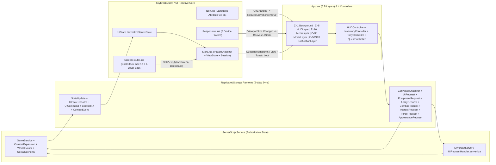
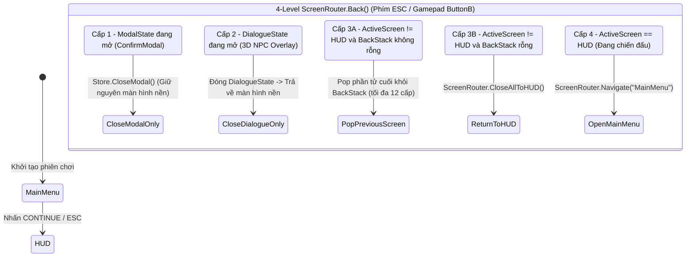
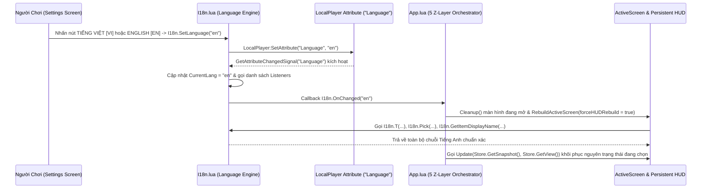

# TẬP 05: HỆ THỐNG GIAO DIỆN PHẢN ỨNG 11 MÀN HÌNH (PREMIUM UI v12), ĐA NGÔN NGỮ SONG NGỮ (I18N VI/EN), BAY 6-DOF, CAMERA ĐỘNG & ÂM THANH 3D / DSP

**Dự án:** **SKYBREAK: Fragments of the Core** (`v12 PremiumUI • Macro-World 27x / 9x Edition`)  
**Phiên bản tài liệu:** `v12.0-Handoff` • **Đối tượng sử dụng:** UI/UX Engineers, Client Gameplay Programmers, Technical Artists, Localization Leads, Audio & DSP Designers  
**Nguồn sự thật (Authoritative Codebase):**
- **Lõi Kiến Trúc Giao Diện & Trạng Thái (`SkybreakClient/UI` & `SkybreakShared`):** [Main.client.lua](file:///C:/Users/khang/Documents/Codex/2026-10-22/new-chat/outputs/SKYBREAK_Antigravity_Handoff/04_Roblox/src/StarterPlayer/StarterPlayerScripts/SkybreakClient/Main.client.lua), [SkybreakUIController.client.lua](file:///C:/Users/khang/Documents/Codex/2026-10-22/new-chat/outputs/SKYBREAK_Antigravity_Handoff/04_Roblox/src/StarterPlayer/StarterPlayerScripts/SkybreakUIController.client.lua), [App.lua](file:///C:/Users/khang/Documents/Codex/2026-10-22/new-chat/outputs/SKYBREAK_Antigravity_Handoff/04_Roblox/src/StarterPlayer/StarterPlayerScripts/SkybreakClient/UI/App.lua), [Store.lua](file:///C:/Users/khang/Documents/Codex/2026-10-22/new-chat/outputs/SKYBREAK_Antigravity_Handoff/04_Roblox/src/StarterPlayer/StarterPlayerScripts/SkybreakClient/UI/Store.lua), [ScreenRouter.lua](file:///C:/Users/khang/Documents/Codex/2026-10-22/new-chat/outputs/SKYBREAK_Antigravity_Handoff/04_Roblox/src/StarterPlayer/StarterPlayerScripts/SkybreakClient/UI/ScreenRouter.lua), [Responsive.lua](file:///C:/Users/khang/Documents/Codex/2026-10-22/new-chat/outputs/SKYBREAK_Antigravity_Handoff/04_Roblox/src/StarterPlayer/StarterPlayerScripts/SkybreakClient/UI/Responsive.lua), [Animations.lua](file:///C:/Users/khang/Documents/Codex/2026-10-22/new-chat/outputs/SKYBREAK_Antigravity_Handoff/04_Roblox/src/StarterPlayer/StarterPlayerScripts/SkybreakClient/UI/Animations.lua), [UIFactory.lua](file:///C:/Users/khang/Documents/Codex/2026-10-22/new-chat/outputs/SKYBREAK_Antigravity_Handoff/04_Roblox/src/StarterPlayer/StarterPlayerScripts/SkybreakClient/UI/UIFactory.lua), [I18n.lua](file:///C:/Users/khang/Documents/Codex/2026-10-22/new-chat/outputs/SKYBREAK_Antigravity_Handoff/04_Roblox/src/StarterPlayer/StarterPlayerScripts/SkybreakClient/UI/I18n.lua), [UIState.lua](file:///C:/Users/khang/Documents/Codex/2026-10-22/new-chat/outputs/SKYBREAK_Antigravity_Handoff/04_Roblox/src/ReplicatedStorage/SkybreakShared/Types/UIState.lua), [Theme.lua](file:///C:/Users/khang/Documents/Codex/2026-10-22/new-chat/outputs/SKYBREAK_Antigravity_Handoff/04_Roblox/src/ReplicatedStorage/SkybreakShared/Config/Theme.lua), [UIAssets.lua](file:///C:/Users/khang/Documents/Codex/2026-10-22/new-chat/outputs/SKYBREAK_Antigravity_Handoff/04_Roblox/src/ReplicatedStorage/SkybreakShared/Config/UIAssets.lua), [AssetManifest.lua](file:///C:/Users/khang/Documents/Codex/2026-10-22/new-chat/outputs/SKYBREAK_Antigravity_Handoff/04_Roblox/src/ReplicatedStorage/SkybreakShared/AssetManifest.lua), [MotionTokens.lua](file:///C:/Users/khang/Documents/Codex/2026-10-22/new-chat/outputs/SKYBREAK_Antigravity_Handoff/04_Roblox/src/ReplicatedStorage/SkybreakShared/MotionTokens.lua), [PanelMotion.lua](file:///C:/Users/khang/Documents/Codex/2026-10-22/new-chat/outputs/SKYBREAK_Antigravity_Handoff/04_Roblox/src/ReplicatedStorage/SkybreakShared/PanelMotion.lua), [UIAnimator.lua](file:///C:/Users/khang/Documents/Codex/2026-10-22/new-chat/outputs/SKYBREAK_Antigravity_Handoff/04_Roblox/src/ReplicatedStorage/SkybreakShared/UIAnimator.lua), [SpritePlayer.lua](file:///C:/Users/khang/Documents/Codex/2026-10-22/new-chat/outputs/SKYBREAK_Antigravity_Handoff/04_Roblox/src/ReplicatedStorage/SkybreakShared/SpritePlayer.lua).
- **4 Bộ Điều Phối (`Controllers`), 13 Module Thành Phần (`Components`) & 11 Màn Hình (`Screens`):** Toàn bộ cây thư mục `StarterPlayer/StarterPlayerScripts/SkybreakClient/UI/Controllers/`, `Components/` và `Screens/`.
- **Điều Khiển, Bay 6-DOF, Camera Động & Âm Thanh 3D / DSP:** [ClientBootstrap.client.lua](file:///C:/Users/khang/Documents/Codex/2026-10-22/new-chat/outputs/SKYBREAK_Antigravity_Handoff/04_Roblox/src/StarterPlayer/StarterPlayerScripts/ClientBootstrap.client.lua), [SkybreakFlightAndCamera.client.lua](file:///C:/Users/khang/Documents/Codex/2026-10-22/new-chat/outputs/SKYBREAK_Antigravity_Handoff/04_Roblox/src/StarterPlayer/StarterPlayerScripts/SkybreakFlightAndCamera.client.lua), [SkybreakAudioEngine.lua](file:///C:/Users/khang/Documents/Codex/2026-10-22/new-chat/outputs/SKYBREAK_Antigravity_Handoff/04_Roblox/src/StarterPlayer/StarterPlayerScripts/SkybreakAudioEngine.lua) và bộ tổng hợp DSP ngoại tuyến [generate_skybreak_sfx_wavs.py](file:///C:/Users/khang/Documents/Codex/2026-10-22/new-chat/outputs/SKYBREAK_Antigravity_Handoff/06_Antigravity_Work/generate_skybreak_sfx_wavs.py) xuất `30` tệp `.wav` chuẩn `44.1 kHz / 16-bit Stereo PCM` trong `07_Audio_SFX/`.

---

## Mục 1: Kiến Trúc Giao Diện Phản Ứng (Reactive UI Architecture) & Luồng Trạng Thái Một Chiều

### 1.1. Tổng Quan Phân Tầng 5 Lớp Z-Layer & Cấu Trúc `SkybreakUI`

Hệ thống giao diện **PremiumUI v12** của **SKYBREAK** loại bỏ hoàn toàn mô hình tạo/hủy `GuiObject` rời rạc trong script chiến đấu truyền thống, thay bằng kiến trúc **Unidirectional Reactive Store + 5-Layer Z-Stack** khởi chạy qua hai điểm nạp song hành:
1. [Main.client.lua](file:///C:/Users/khang/Documents/Codex/2026-10-22/new-chat/outputs/SKYBREAK_Antigravity_Handoff/04_Roblox/src/StarterPlayer/StarterPlayerScripts/SkybreakClient/Main.client.lua#L1-L72) (`72` dòng): Nạp [App.lua](file:///C:/Users/khang/Documents/Codex/2026-10-22/new-chat/outputs/SKYBREAK_Antigravity_Handoff/04_Roblox/src/StarterPlayer/StarterPlayerScripts/SkybreakClient/UI/App.lua) và [Store.lua](file:///C:/Users/khang/Documents/Codex/2026-10-22/new-chat/outputs/SKYBREAK_Antigravity_Handoff/04_Roblox/src/StarterPlayer/StarterPlayerScripts/SkybreakClient/UI/Store.lua), lắng nghe `Remotes.StateUpdate` và `SkybreakShared.Remotes.UIStateUpdated` / `UICommand`, đồng thời gọi `GetPlayerSnapshot:InvokeServer()` để đồng bộ trạng thái ban đầu ngay khi người chơi vào phòng.
2. [SkybreakUIController.client.lua](file:///C:/Users/khang/Documents/Codex/2026-10-22/new-chat/outputs/SKYBREAK_Antigravity_Handoff/04_Roblox/src/StarterPlayer/StarterPlayerScripts/SkybreakUIController.client.lua#L1-L120) (`120` dòng): Khởi động sớm các bộ máy hoạt ảnh dùng chung ([UIAnimator.lua](file:///C:/Users/khang/Documents/Codex/2026-10-22/new-chat/outputs/SKYBREAK_Antigravity_Handoff/04_Roblox/src/ReplicatedStorage/SkybreakShared/UIAnimator.lua), [MotionTokens.lua](file:///C:/Users/khang/Documents/Codex/2026-10-22/new-chat/outputs/SKYBREAK_Antigravity_Handoff/04_Roblox/src/ReplicatedStorage/SkybreakShared/MotionTokens.lua), [PanelMotion.lua](file:///C:/Users/khang/Documents/Codex/2026-10-22/new-chat/outputs/SKYBREAK_Antigravity_Handoff/04_Roblox/src/ReplicatedStorage/SkybreakShared/PanelMotion.lua), [SpritePlayer.lua](file:///C:/Users/khang/Documents/Codex/2026-10-22/new-chat/outputs/SKYBREAK_Antigravity_Handoff/04_Roblox/src/ReplicatedStorage/SkybreakShared/SpritePlayer.lua)) và kết nối cầu nối với [ClientBootstrap.client.lua](file:///C:/Users/khang/Documents/Codex/2026-10-22/new-chat/outputs/SKYBREAK_Antigravity_Handoff/04_Roblox/src/StarterPlayer/StarterPlayerScripts/ClientBootstrap.client.lua).

Trong [`App.Build()`](file:///C:/Users/khang/Documents/Codex/2026-10-22/new-chat/outputs/SKYBREAK_Antigravity_Handoff/04_Roblox/src/StarterPlayer/StarterPlayerScripts/SkybreakClient/UI/App.lua#L168-L320), thực thể gốc `SkybreakUI` (`ScreenGui`, `DisplayOrder = 25`, `IgnoreGuiInset = false`, `ScreenInsets = Enum.ScreenInsets.CoreUISafeInsets`, `ResetOnSpawn = false`, `ZIndexBehavior = Enum.ZIndexBehavior.Sibling`) dựng cố định **5 tầng Z-Layer** tách biệt:

| Tầng Z-Layer | Tên Instance | `ZIndex` | Kiểu Instance | Vai Trò & Cơ Chế Tối Ưu Hóa Render |
| :--- | :--- | :---: | :---: | :--- |
| **Layer 1** | `BackgroundLayer` | `1` | `Frame` | Nền kính mờ toàn màn hình điều biến độ trong suốt động theo tuyến màn hình: `1.0` khi ở `HUD` (trong suốt hoàn toàn), `0.72` khi ở `MainMenu` (lộ cảnh 3D Diorama trực tiếp phía sau), và `0.08` khi mở các sub-menu (`Inventory`, `Skills`, `Fruits`, `Forge`, `WorldMap`, `QuestJournal`, `Raid`, `Settings`), đi kèm hiệu ứng `Lighting.SkybreakMenuBlur` (`BlurEffect`, `Size = 0` trên `HUD/MainMenu`, tween mượt lên `Size = 8` trên các sub-menu). |
| **Layer 2** | `HUDLayer` | `5` | `Frame` + `Canvas` + `UIScale` | Chứa khung quy chiếu `Canvas` (`1366×768` ngang hoặc `760×1220` dọc) gắn `UIScale` (`[0.68..1.25]`). **Không bao giờ bị `Destroy()` khi mở menu**: chỉ ẩn/hiện tức thời (`Visible = (ActiveScreen == "HUD")`), đảm bảo thời gian đóng menu quay lại chiến đấu đạt **`0 ms` độ trễ cấp phát bộ nhớ**. |
| **Layer 3** | `MenuLayer` | `10` | `Frame` | Khung chứa động cho 10 màn hình toàn cục ngoài `HUD` (`MainMenu`, `Inventory`, `Skills`, `Fruits`, `Forge`, `QuestJournal`, `WorldMap`, `Raid`, `Settings`). Chủ đích dùng `Frame` thay vì `CanvasGroup` để các khung `ViewportFrame` 3D bên trong không bị nén qua offscreen render-target gây mờ hoặc tụt FPS. |
| **Layer 4** | `ModalLayer` | `30` | `Frame` | Chứa hộp thoại cốt truyện 3D [Dialogue.lua](file:///C:/Users/khang/Documents/Codex/2026-10-22/new-chat/outputs/SKYBREAK_Antigravity_Handoff/04_Roblox/src/StarterPlayer/StarterPlayerScripts/SkybreakClient/UI/Screens/Dialogue.lua) (`780×218` ở đáy giữa màn hình) và hộp thoại xác nhận hai nút [Modal.lua](file:///C:/Users/khang/Documents/Codex/2026-10-22/new-chat/outputs/SKYBREAK_Antigravity_Handoff/04_Roblox/src/StarterPlayer/StarterPlayerScripts/SkybreakClient/UI/Components/Modal.lua) (`ConfirmModal`), có lớp phủ khóa click xuyên thấu xuống `MenuLayer`/`HUDLayer`. |
| **Layer 5** | `NotificationLayer` | `50` (`LootFeed` `120`) | `Frame` | Tầng thông báo bất biến nằm trên cùng mọi giao diện: chứa băng thông báo đỉnh màn hình [Toast.lua](file:///C:/Users/khang/Documents/Codex/2026-10-22/new-chat/outputs/SKYBREAK_Antigravity_Handoff/04_Roblox/src/StarterPlayer/StarterPlayerScripts/SkybreakClient/UI/Components/Toast.lua) (`480×46`, `ZIndex = 50`) và cột thẻ chiến lợi phẩm trượt dọc bên phải [LootFeed.lua](file:///C:/Users/khang/Documents/Codex/2026-10-22/new-chat/outputs/SKYBREAK_Antigravity_Handoff/04_Roblox/src/StarterPlayer/StarterPlayerScripts/SkybreakClient/UI/Components/LootFeed.lua) (`264×190`, `ZIndex = 120`, tối đa `4` thẻ đồng thời). |



### 1.2. Quản Lý Trạng Thái Phản Ứng (`Store.lua` & `UIState.lua`)

Toàn bộ dữ liệu giao diện được tách bạch nghiêm ngặt thành **3 miền trạng thái** trong [Store.lua](file:///C:/Users/khang/Documents/Codex/2026-10-22/new-chat/outputs/SKYBREAK_Antigravity_Handoff/04_Roblox/src/StarterPlayer/StarterPlayerScripts/SkybreakClient/UI/Store.lua#L1-L464) và chuẩn hóa lược đồ qua [UIState.lua](file:///C:/Users/khang/Documents/Codex/2026-10-22/new-chat/outputs/SKYBREAK_Antigravity_Handoff/04_Roblox/src/ReplicatedStorage/SkybreakShared/Types/UIState.lua#L1-L437):

1. **`PlayerSnapshot` (Server-Authoritative Snapshot — Chuẩn hóa bởi `UIState.NormalizeServerState`):**
   - Gom toàn bộ dữ liệu thực từ Server (`Level`, `XP`, `MaxXP`, `StatPoints`, `Stats {Melee, Defense, Sword, Gun, Core}`, `Gold`, `Shards`, `Bounty`, `Class`, `Gender`, `Race`, `RaceV4Active`, `HakiStage`, `HakiEnabled`, `InstinctEnabled`, `InstinctDodges`, `DoubleExpRemaining`, `PartySize`, `Realm`, `Equipped`, `HotbarSlot`, `EquippedFruit`, `AwakenedFruits`, `OwnedFruits`, `Inventory`, `WeaponUpgrades`, `WeaponEnchants`, `Skills`, `Cooldowns`, `Quests`, `TrackedQuestId`, `BossState`, `Settings`).
   - **Tự động phát hiện biến thiên phần thưởng (Auto-Delta `LootFeed` Injection):** Mỗi khi [`Store.SetServerSnapshot()`](file:///C:/Users/khang/Documents/Codex/2026-10-22/new-chat/outputs/SKYBREAK_Antigravity_Handoff/04_Roblox/src/StarterPlayer/StarterPlayerScripts/SkybreakClient/UI/Store.lua#L195-L295) nhận gói cập nhật mới từ Server, Store tự so sánh với bản chụp liền trước (`prevSnap`):
     - Nếu `deltaGold > 0` → đẩy thẻ `+X Gold` (màu Champagne Gold) vào `LootFeed`.
     - Nếu `deltaShards > 0` → đẩy thẻ `+X Core Shards` (màu Sapphire) vào `LootFeed`.
     - Nếu `deltaXP > 0` hoặc tăng `Level` → đẩy thẻ `+X EXP` / `LEVEL UP!` vào `LootFeed`.
     - Nếu số lượng vật phẩm `Inventory[itemId]` tăng hoặc mở khóa `OwnedFruits` mới → tra cứu `RarityConfig.GetItem(itemId)` và `I18n.GetItemDisplayName(itemId)` để đẩy thẻ vật phẩm kèm viền phẩm cấp tương ứng vào `LootFeed`.
2. **`ViewState` (Client-Only Presentation State — Cập nhật qua `Store.SetView`):**
   - Lưu trạng thái điều hướng và bộ lọc cục bộ của từng màn hình mà không cần gọi lên Server: `ActiveScreen` (mặc định `"HUD"` hoặc `"MainMenu"` khi mới khởi tạo), `BackStack` (mảng tối đa `12` trang), `SelectedInventorySlot`, `InventoryCategory` (`"All" | "Weapons" | "Armor" | "Materials" | "Quest"`), `InventorySort` (`"Rarity" | "Level" | "Name"`), `InventorySearch`, `SelectedFruitId`, `SelectedRecipeId`, `ForgeTab` (`"Craft" | "Enhance" | "Star"`), `QuestCategory` (`"Main" | "Side" | "Daily" | "BossHunt"`), `SelectedQuestId`, `MapSeaFilter` (`0..3`), `MapSelectedIslandId`, `MapRightTab` (`"Info" | "Codex"`), `SelectedRaidId`, `InteractPromptText`, `LockTargetName`, `DialogueState`, và `ModalState`.
3. **`Store.Session` (Client Runtime & Optimistic Session Cache):**
   - Duy trì bộ nhớ phiên chơi: `redeemedCodes` (chống nhập trùng Giftcode ở phía client trước khi gửi Server), `weaponStars` & `weaponStarPity` (đồng bộ cấp Sao `★1..★5` và điểm chúc phúc Pity `0..100%` với `Profile.WeaponStars` / `WeaponStarPity`), `statPresets` (`3` cấu hình phân bổ điểm chỉ số lưu nhanh), `lastBossCombatAt` (`os.clock()` của đòn giao tranh Boss gần nhất để khóa hiển thị Boss HUD), `raidSimulationActive` (cờ bật mô phỏng Boss Phase từ màn hình `Raid`), và `inventoryPreviewMode` (`"WEAPON"` hoặc `"HERO"`).

> [!NOTE]
> `Store.lua` cung cấp đầy đủ 4 kênh đăng ký sự kiện tách biệt: `Store.SubscribeSnapshot(fn)`, `Store.SubscribeView(fn)`, `Store.SubscribeToast(fn)` và `Store.SubscribeLoot(fn)`. Nhờ cơ chế tách kênh này, khi người chơi gõ tìm kiếm vật phẩm hoặc xoay mô hình 3D (`ViewState`), các thanh máu/năng lượng trên `HUDLayer` (`PlayerSnapshot`) không bị vẽ lại thừa.

### 1.3. Bộ Định Tuyến Màn Hình (`ScreenRouter.lua`) & Máy Trạng Thái `Back()` 4 Cấp

[ScreenRouter.lua](file:///C:/Users/khang/Documents/Codex/2026-10-22/new-chat/outputs/SKYBREAK_Antigravity_Handoff/04_Roblox/src/StarterPlayer/StarterPlayerScripts/SkybreakClient/UI/ScreenRouter.lua#L1-L129) (`129` dòng) chuẩn hóa tên định danh của toàn bộ **11 màn hình** qua `NormalizeRoute(route)` (hỗ trợ cả bí danh như `"Map" -> "WorldMap"`, `"Quests" -> "QuestJournal"`, `"Menu" -> "MainMenu"`), quản lý ngăn xếp lịch sử `BackStack` (giới hạn tối đa **`12`** phần tử chống tràn bộ nhớ khi chuyển tab liên tục), và xuất thuộc tính đồng bộ lên `SkybreakUI` (`ActiveScreen`, `BlocksCombat`) để các script điều khiển bay/chiến đấu đọc trực tiếp với chi phí `O(1)`.

Ngoài ra, mọi hệ thống thế giới 3D (như `ProximityPrompt` tại lò rèn Kael, đền Zioles Gacha, bảng nhiệm vụ hay cổng Raid trong [Skybreak3DEquipment.lua](file:///C:/Users/khang/Documents/Codex/2026-10-22/new-chat/outputs/SKYBREAK_Antigravity_Handoff/04_Roblox/src/ReplicatedStorage/Shared/Skybreak3DEquipment.lua#L391-L398)) có thể mở bất kỳ màn hình nào mà không cần phụ thuộc vòng (`circular require`) bằng cách gán thuộc tính `SkybreakUI:SetAttribute("RequestScreen", "<ScreenId>")` — `App.lua` bắt tín hiệu `GetAttributeChangedSignal("RequestScreen")`, điều hướng ngay tới màn hình đích rồi xóa thuộc tính về `""`.



Hàm [`ScreenRouter.BlocksCombat()`](file:///C:/Users/khang/Documents/Codex/2026-10-22/new-chat/outputs/SKYBREAK_Antigravity_Handoff/04_Roblox/src/StarterPlayer/StarterPlayerScripts/SkybreakClient/UI/ScreenRouter.lua#L112-L127) trả về `true` khi thỏa **bất kỳ** điều kiện nào sau đây:
- `ViewState.ActiveScreen ~= "HUD"` (đang mở 1 trong 9 màn hình quản lý hoặc `MainMenu`);
- `ViewState.ModalState ~= nil and ViewState.ModalState.Visible == true` (đang mở hộp thoại xác nhận);
- `ViewState.DialogueState ~= nil and ViewState.DialogueState.Visible == true` (đang hội thoại với NPC 3D).

Khi `BlocksCombat() == true`, toàn bộ đòn đánh chuột trái (`M1` / `Heavy Cleave`), phím kỹ năng `[Z/X/C/V/F]`, lướt `LeftShift`/`Q` và bay 6-DOF tự động khóa lại để thao tác chuột, cuộn trang và nhập chữ (`TextBox`) trong UI tuyệt đối không kích hoạt nhầm chiêu thức.

### 1.4. Hệ Thống Token Thiết Kế (`Theme.lua` — Quy Tắc Tỷ Lệ Màu `70 / 20 / 10`)

Toàn bộ giao diện tuân thủ bảng màu **Celestial Obsidian • Sapphire • Champagne Gold** theo tỷ lệ thị giác **`70%` Nền Đá Đen Bán Trong Suốt (`Obsidian Neutral`) / `20%` Xanh Lam Ngọc Bích (`Aether Sapphire`) / `10%` Vàng Kim Hoàng Gia (`Champagne Gold`)** định nghĩa tại [Theme.lua](file:///C:/Users/khang/Documents/Codex/2026-10-22/new-chat/outputs/SKYBREAK_Antigravity_Handoff/04_Roblox/src/ReplicatedStorage/SkybreakShared/Config/Theme.lua#L1-L131):

| Nhóm Token | Khóa Token (`Theme.*`) | Giá Trị Chính Xác (`RGB / Hex / Px / Sec`) | Bí Danh Ngữ Nghĩa (`Alias`) | Mục Đích Sử Dụng Chuẩn Trong Giao Diện |
| :--- | :--- | :--- | :--- | :--- |
| **70% Obsidian Neutral** | `Colors.BG_900` | `RGB(8, 15, 29)` • `#080F1D` | `Colors.Background` | Nền sâu nhất của `BackgroundLayer`, khe thanh máu, hốc ô trang bị. |
| **70% Obsidian Neutral** | `Colors.BG_800` | `RGB(14, 25, 43)` • `#0E192B` | `Colors.Panel` | Nền tiêu chuẩn của mọi thẻ `PremiumPanel` (`Transparency = 0.06`). |
| **70% Obsidian Neutral** | `Colors.BG_700` | `RGB(19, 35, 57)` • `#132339` | `Colors.PanelHover` | Nền thẻ nâng cao (`Elevated`) hoặc trạng thái rê chuột (`Hover`). |
| **70% Obsidian Neutral** | `Colors.SURFACE_GLASS` | `RGB(25, 46, 71)` • `#192E47` | `Colors.Glass` | Bề mặt kính mờ (`Transparency = 0.18`), khung `ViewportFrame` 3D. |
| **70% Obsidian Neutral** | `Colors.STROKE_STEEL` | `RGB(76, 104, 134)` • `#4C6886` | `Colors.Stroke` | Viền kim loại mảnh (`1 px..1.5 px`, `AlphaDefault = 0.32`). |
| **Typography Color** | `Colors.TEXT_PRIMARY` | `RGB(240, 244, 250)` • `#F0F4FA` | `Colors.Text` | Chữ tiêu đề, chỉ số chính, nội dung hội thoại độ tương phản cao. |
| **Typography Color** | `Colors.TEXT_SECONDARY` | `RGB(168, 185, 209)` • `#A8B9D1` | `Colors.Muted` (`#A9B5C7`) | Nhãn phụ, mô tả kỹ năng, gợi ý phím tắt (`Caption`). |
| **20% Sapphire Accent** | `Colors.ACCENT_SAPPHIRE` | `RGB(64, 170, 255)` • `#40AAFF` | `Colors.Sapphire` | Nút hành động chính (`Primary CTA`), tab đang chọn, thanh Năng lượng (`EN`). |
| **20% Sapphire Accent** | `Colors.ACCENT_DEEP_BLUE` | `RGB(21, 78, 168)` • `#154EA8` | `Colors.DeepBlue` | Đáy dải chuyển sắc `UIGradient` của nút bấm và thanh trạng thái. |
| **20% Sapphire Accent** | `Colors.ACCENT_ICE` | `RGB(157, 225, 255)` • `#9DE1FF` | — | Điểm sáng viền băng lượng tử, chữ nổi bật khi hover, tia chớp lò rèn. |
| **10% Champagne Gold** | `Colors.ACCENT_GOLD` | `RGB(228, 184, 99)` • `#E4B863` | `Colors.Gold` | Quốc huy, tiêu đề trang, viền phẩm cấp `Legendary/Mythic`, nút Gacha/Star. |
| **10% Champagne Gold** | `Colors.ACCENT_GOLD_BRIGHT` | `RGB(255, 226, 154)` • `#FFE29A` | — | Điểm sáng đỉnh kim loại vàng khi hover hoặc nổ hiệu ứng `★5`. |
| **Semantic Status** | `Colors.HP_RED` / `DANGER` | `RGB(239, 82, 98)` `#EF5262` / `#F26A70` | `Colors.HP` | Thanh Sinh lực (`HP`), Boss Combat HUD, nút nguy hiểm (`Danger`), cảnh báo lỗi. |
| **Semantic Status** | `Colors.SUCCESS` | `RGB(94, 215, 158)` • `#5ED79E` | `Colors.Success` | Hoàn thành nhiệm vụ, đủ nguyên liệu rèn, chỉ số tăng (`▲`), Boss `POSTURE BROKEN!`. |
| **Semantic Status** | `Colors.VOID_PURPLE` | `RGB(180, 106, 250)` • `#B46AFA` | `Colors.VoidPurple` | Phẩm cấp `Epic`, thanh `Break` / `Void`, Boss `Noxar` & `Veyr`, trạng thái `PURIFICATION!`. |
| **Semantic Status** | `Colors.Warning` | `RGB(245, 166, 66)` • `#F5A642` | — | Thông báo cảnh báo (`warning`), thời gian hồi hoặc trạng thái chờ. |
| **Fonts & Sizes** | `Typography.*` | `GothamBold` (`44/26/18/16`), `GothamMedium` (`13/12`), `Gotham` (`15`) | `TextSize` (`34/26/18/14/12`) | Hệ thống phân cấp chữ không chân hiện đại, hỗ trợ đầy đủ dấu tiếng Việt UTF-8. |
| **Spacing & Radius** | `Spacing` / `Radius` | `Spacing: 4, 8, 12, 16, 24, 32 px` • `Radius: 6, 10, 12, 999 px` | `Layout` (`48 px` PC / `54 px` Touch) | Lưới khoảng cách bội số `4 px`; bo góc `6 px` cho ô vật phẩm, `999 px` cho `Pill`. |
| **Motion Durations** | `Motion.*` | `Press 0.08s`, `Tooltip 0.12s`, `Hover 0.14s`, `Reward 0.18s`, `Open/HP 0.22s`, `BossPhase 0.35s` | — | Thời lượng chuẩn đồng bộ với `MotionTokens.lua` và `Animations.lua`. |

### 1.5. Thích Ứng Đa Thiết Bị 6 Cấu Hình (`Responsive.lua`)

[Responsive.lua](file:///C:/Users/khang/Documents/Codex/2026-10-22/new-chat/outputs/SKYBREAK_Antigravity_Handoff/04_Roblox/src/StarterPlayer/StarterPlayerScripts/SkybreakClient/UI/Responsive.lua#L1-L102) (`102` dòng) tính toán trạng thái khung nhìn theo thời gian thực mỗi khi `CurrentCamera.ViewportSize` thay đổi hoặc người chơi đổi chế độ `LayoutOverride` (`"Auto" | "Desktop" | "Mobile"`) và `UIScale` (`90% | 100% | 112%`) trong `Settings`:

| Cấu Hình (`Profile`) | Điều Kiện Kích Hoạt Trong `Responsive.GetState()` | Khung Quy Chiếu (`CanvasSize`) | Dải Kẹp `UIScale` | Chiều Cao Nút Tối Thiểu | Hành Vi Thích Ứng Giao Diện Đặc Thù |
| :--- | :--- | :---: | :---: | :---: | :--- |
| **`Desktop`** | Bàn phím + chuột, `W > 1400 px` và `H > 800 px`, không ép `Mobile` | `1366 × 768` | `[0.68 .. 1.25]` | `44 px` (`48 px` chuẩn) | Hiển thị đầy đủ `AbilityHotbar` + cụm `[Z-F]`, `KeybindBadge`, bố cục 3 cột rộng. |
| **`Laptop`** | Bàn phím + chuột, `W <= 1400 px` hoặc `H <= 800 px` (ví dụ `1366×768`, `1280×720`) | `1366 × 768` | `[0.68 .. 1.25]` | `44 px` | Bật `IsCompact = true` khi `W < 1024` hoặc `H < 640`; tự động kẹp vị trí `Tooltip` cách mép `12 px`. |
| **`Tablet`** | Thiết bị cảm ứng (`TouchEnabled` & không bàn phím) hoặc ép `Mobile`, `W >= 960 px`, màn ngang | `1366 × 768` | `[0.68 .. 1.25]` | `52 px` (`54 px` chuẩn) | Bật `TouchControls = true`: ẩn cụm phím `[Z-F]` PC, kích hoạt cung cảm ứng **Mobile Touch Arc (`260×260`)** góc dưới phải. |
| **`PhoneLandscape`** | Cảm ứng / `IsMobile == true` (`W < 820` hoặc `W <= 920 & H <= 540`) và `W < 960 px`, màn ngang | `1366 × 768` | `[0.68 .. 1.25]` | `52 px` | Bật đồng thời `TouchControls = true`, `IsCompact = true`, và `CollapseSidebar = true` khi `W < 900 px`. |
| **`PhonePortrait`** | Màn hình dọc `W < H * 0.92` trên mọi kích thước điện thoại | `760 × 1220` | `[0.68 .. 1.25]` | `52 px` | Đảo khung quy chiếu sang dọc `760×1220`, thu gọn thanh bên (`CollapseSidebar = true`), xếp chồng thẻ theo chiều đứng. |
| **`Console`** | `GamepadEnabled == true`, không có bàn phím, `LayoutOverride == "Auto"` | `1366 × 768` | `[0.68 .. 1.25]` | `44 px` | Bật `GamepadEnabled = true`, tự động hiển thị dải gợi ý tay cầm `GamepadHintStrip` (`L1/R1`, `R2+X/Y/B/A`, `DPad`). |

### 1.6. Pipeline Hoạt Ảnh, Sprite Tuyệt Kỹ Tự Tổng Hợp & 4 Bộ Điều Phối (`Controllers`)

Hệ thống chuyển động và tài nguyên đồ họa 2D/3D của giao diện được vận hành bởi **6 module nền tảng** kết hợp cùng **4 `Controllers` nghiệp vụ**:

1. **[UIAnimator.lua](file:///C:/Users/khang/Documents/Codex/2026-10-22/new-chat/outputs/SKYBREAK_Antigravity_Handoff/04_Roblox/src/ReplicatedStorage/SkybreakShared/UIAnimator.lua#L1-L80) (`80` dòng) & [Animations.lua](file:///C:/Users/khang/Documents/Codex/2026-10-22/new-chat/outputs/SKYBREAK_Antigravity_Handoff/04_Roblox/src/StarterPlayer/StarterPlayerScripts/SkybreakClient/UI/Animations.lua#L1-L159) (`159` dòng):**
   - Lưu bảng yếu (`weak-key table` `__mode = "k"`) ánh xạ từng `(Instance, propertyKey)` tới `Tween` đang chạy; mỗi lệnh tween mới tự động hủy (`Cancel()`) đúng tween cũ trên cùng thuộc tính đó, triệt tiêu hoàn toàn lỗi giật hình (tween fighting) khi người chơi rê chuột nhanh qua hàng chục ô vật phẩm.
   - Quản lý hủy theo phạm vi màn hình (`Animations.CleanupScope(scope)`) khi chuyển trang và tôn trọng cờ trợ năng **`ReducedMotion`**: khi người chơi bật *Giảm chuyển động* trong `Settings`, mọi phép biến đổi được rút ngắn về gán giá trị tức thời hoặc fade siêu ngắn `<= 0.05s`.
2. **[MotionTokens.lua](file:///C:/Users/khang/Documents/Codex/2026-10-22/new-chat/outputs/SKYBREAK_Antigravity_Handoff/04_Roblox/src/ReplicatedStorage/SkybreakShared/MotionTokens.lua#L1-L57) (`57` dòng) & [PanelMotion.lua](file:///C:/Users/khang/Documents/Codex/2026-10-22/new-chat/outputs/SKYBREAK_Antigravity_Handoff/04_Roblox/src/ReplicatedStorage/SkybreakShared/PanelMotion.lua#L1-L67) (`67` dòng):**
   - Định nghĩa `10` cấu hình gia tốc chuẩn (`FastHover`, `ButtonPress`, `PanelOpen`, `PanelClose`, `BarFill`, `BarTrail`, `TooltipPop`, `ToastSlide`, `PulseLoop`, `GachaSpin`).
   - `PanelMotion.Open(panel)` gắn `UIScale` khởi đầu ở `0.97` và phóng mượt lên `1.0` trong `0.28s` theo đường cong `Enum.EasingStyle.Quart` (`Out`), tạo độ đầm sang trọng mà không bị nảy lố như `Bounce`.
3. **[SpritePlayer.lua](file:///C:/Users/khang/Documents/Codex/2026-10-22/new-chat/outputs/SKYBREAK_Antigravity_Handoff/04_Roblox/src/ReplicatedStorage/SkybreakShared/SpritePlayer.lua#L1-L244) (`244` dòng), [AssetManifest.lua](file:///C:/Users/khang/Documents/Codex/2026-10-22/new-chat/outputs/SKYBREAK_Antigravity_Handoff/04_Roblox/src/ReplicatedStorage/SkybreakShared/AssetManifest.lua#L1-L65) (`65` dòng) & [UIAssets.lua](file:///C:/Users/khang/Documents/Codex/2026-10-22/new-chat/outputs/SKYBREAK_Antigravity_Handoff/04_Roblox/src/ReplicatedStorage/SkybreakShared/Config/UIAssets.lua#L1-L127) (`127` dòng):**
   - Kiểm định tính hợp lệ của `rbxassetid://` thông qua `AssetManifest.IsValidRbxAsset(id)` (tự loại bỏ các chuỗi rỗng `""` hoặc `"rbxassetid://0"` khi chạy offline trong Studio).
   - **Cơ chế Tự Tổng Hợp Atlas RGBA `EditableImage` Ở Runtime:** Khi tài sản sprite sheet chưa được tải lên đám mây Roblox, `SpritePlayer` tự động khởi tạo `AssetService:CreateEditableImage({ Size = Vector2.new(256, 256) })` gồm `16` khung hình (`4×4`, mỗi khung `64×64 px`) vẽ bằng toán học pixel RGBA ngay trong bộ nhớ cho hai hiệu ứng chủ lực:
     - `SYNTH_ULTIMATE_4X4`: Vòng hào quang năng lượng xoay quanh ô kỹ năng Ultimate `[V]` khi đầy nộ/sẵn sàng thi triển (`SkillButton.lua`).
     - `SYNTH_COREPULSE_4X4`: Quả cầu Lõi Sáng Thế (`CorePulse`) đập nhịp ở `12 FPS` trên thẻ tiêu đề `MainMenu.lua`.
   - Đối với biểu tượng 2D, khi `UIAssets.GetIcon(name)` chưa có `rbxassetid://`, `UIFactory.Icon()` tự động dựng biểu tượng hình học đa lớp sắc nét bằng các khung vector xoay góc (`Sword`, `Shield`, `Fruit`, `Flame`, `Bolt`, `Shard`, `Gold`, `Quest`, `Lock`, `Star`, `Anvil`, `Compass`).
4. **4 Bộ Điều Phối Nghiệp Vụ (`SkybreakClient/UI/Controllers/`):**
   - **[HUDController.lua](file:///C:/Users/khang/Documents/Codex/2026-10-22/new-chat/outputs/SKYBREAK_Antigravity_Handoff/04_Roblox/src/StarterPlayer/StarterPlayerScripts/SkybreakClient/UI/Controllers/HUDController.lua#L1-L275) (`275` dòng):** Kết nối trực tiếp tín hiệu `Humanoid.HealthChanged` của nhân vật với thanh máu HUD (đảm bảo thanh máu phản hồi ở từng khung hình ngay cả trước khi gói `StateUpdate` tiếp theo kịp về), điều phối chọn ô Hotbar `1..4` (`EquipmentRequest: SelectSlot`), kích hoạt kỹ năng và chuyển tiếp đầu vào tấn công cảm ứng/chuột về `ClientBootstrap`.
   - **[InventoryController.lua](file:///C:/Users/khang/Documents/Codex/2026-10-22/new-chat/outputs/SKYBREAK_Antigravity_Handoff/04_Roblox/src/StarterPlayer/StarterPlayerScripts/SkybreakClient/UI/Controllers/InventoryController.lua#L1-L363) (`363` dòng):** Xử lý lọc 5 danh mục, tìm kiếm chuỗi con không phân biệt hoa thường, sắp xếp theo `Rarity -> Level -> Name`, tính toán độ lệch chỉ số chính (`ComputePrimaryDiffDelta`) giữa vật phẩm trong túi với trang bị đang mặc, gửi lệnh mặc/tháo (`EquipmentRequest`), và dựng bản sao 3D của vũ khí hoặc toàn bộ nhân vật (`CloneCharacterForViewport`) vào `ViewportFrame`.
   - **[PartyController.lua](file:///C:/Users/khang/Documents/Codex/2026-10-22/new-chat/outputs/SKYBREAK_Antigravity_Handoff/04_Roblox/src/StarterPlayer/StarterPlayerScripts/SkybreakClient/UI/Controllers/PartyController.lua#L1-L276) (`276` dòng):** Điều phối chuyển đổi Class & Giới tính (`AppearanceRequest` / `SkillService`), yêu cầu dịch chuyển nhanh qua 8 Realms (`TravelService`), gửi lệnh rèn/cường hóa (`ForgeRequest` / `CraftingService`), và vận hành bộ giả lập giai đoạn Boss `P1..P4` (`SimulateBossPhase`) cho màn hình `Raid`.
   - **[QuestController.lua](file:///C:/Users/khang/Documents/Codex/2026-10-22/new-chat/outputs/SKYBREAK_Antigravity_Handoff/04_Roblox/src/StarterPlayer/StarterPlayerScripts/SkybreakClient/UI/Controllers/QuestController.lua#L1-L125) (`125` dòng):** Lọc nhiệm vụ theo 4 tab (`Main`, `Side`, `Daily`, `BossHunt`), ghim mục tiêu lên HUD & La bàn (`UIRequest: TrackQuest`), và đóng/mở hộp thoại NPC 3D (`OpenDialogue` / `CloseDialogue`).

---

## Mục 2: Bảng Tham Chiếu Toàn Bộ Điều Khiển Đa Nền Tảng (PC Keyboard/Mouse, Gamepad & Mobile Touch Arc)

Hệ thống đầu vào của **SKYBREAK** hợp nhất ba tầng xử lý: [ClientBootstrap.client.lua](file:///C:/Users/khang/Documents/Codex/2026-10-22/new-chat/outputs/SKYBREAK_Antigravity_Handoff/04_Roblox/src/StarterPlayer/StarterPlayerScripts/ClientBootstrap.client.lua#L2610-L3150) (chiến đấu, combo, kỹ năng), [SkybreakFlightAndCamera.client.lua](file:///C:/Users/khang/Documents/Codex/2026-10-22/new-chat/outputs/SKYBREAK_Antigravity_Handoff/04_Roblox/src/StarterPlayer/StarterPlayerScripts/SkybreakFlightAndCamera.client.lua#L1420-L2104) (bay 6-DOF, Flash Step, Mantle, Skydive, Action Cam, Photo Mode, Emote Wheel, Gamepad chords, chống kẹt ShiftLock) và [App.lua](file:///C:/Users/khang/Documents/Codex/2026-10-22/new-chat/outputs/SKYBREAK_Antigravity_Handoff/04_Roblox/src/StarterPlayer/StarterPlayerScripts/SkybreakClient/UI/App.lua#L325-L450) / [HUD.lua](file:///C:/Users/khang/Documents/Codex/2026-10-22/new-chat/outputs/SKYBREAK_Antigravity_Handoff/04_Roblox/src/StarterPlayer/StarterPlayerScripts/SkybreakClient/UI/Screens/HUD.lua#L640-L890) (phím tắt 11 màn hình & cung cảm ứng Mobile Touch Arc `#125`).

> [!WARNING]
> **Cơ Chế Chống Bẫy Khóa Chuột ShiftLock (`syncRobloxShiftLockBoundKeys`):** Mặc định của Roblox gán `LeftShift` cho MouseLockSwitch, gây xung đột trực tiếp với phím Lướt (`Forward Dash`) của game hành động RPG và làm kẹt con trỏ chuột khi mở UI. Ngay khi khởi động, [SkybreakFlightAndCamera.client.lua](file:///C:/Users/khang/Documents/Codex/2026-10-22/new-chat/outputs/SKYBREAK_Antigravity_Handoff/04_Roblox/src/StarterPlayer/StarterPlayerScripts/SkybreakFlightAndCamera.client.lua#L1960-L2065) tự động ánh xạ lại `BoundKeys` của `MouseLockController` từ `LeftShift` sang **`RightControl`**, đồng thời cung cấp tổ hợp giải cứu con trỏ vạn năng **`LeftCtrl`** hoặc **`Shift + Tab`** (`unlockAllViewAndMouseLocks`) để nhả mọi trạng thái khóa camera/chuột bất cứ lúc nào.

### 2.1. Di Chuyển, Vượt Địa Hình Khí Động Học & Bay 6-DOF (Movement & Traversal)

| Hành Động | PC (Bàn Phím / Chuột) | Tay Cầm (`Gamepad1 / Gamepad2`) | Cảm Ứng Di Động (`Mobile Touch`) | Thông Số Vật Lý, Thời Gian Hồi & Hành Vi Kỹ Thuật Chính Xác |
| :--- | :--- | :--- | :--- | :--- |
| **Di chuyển mặt đất / Không trung** | `W / A / S / D` | Cần gạt trái (`Thumbstick1`) | Cần điều hướng ảo mặc định bên trái | Di chuyển 8 hướng theo hướng nhìn camera; tự nghiêng thân khi bay 6-DOF. |
| **Nhảy cơ bản (Ground Jump)** | `Space` (trên mặt đất) | `ButtonA` | Nút Nhảy mặc định / `GEPPO` | Phát xung nhảy cơ bản của `Humanoid` từ mặt sàn collider. |
| **Đạp Không Đa Tầng (Geppo / Sky Walk)** | `Space` (nhấn giữa không trung) | `ButtonA` (nhấn trên không) | Nút tiện ích `GEPPO` (`46×40`) | Độ trễ tối thiểu `0.20s`/bước; tối đa **`7` bước** (thường), **`9` bước** (tộc `Skyborn`), **`12` bước** (khi bật `Race V4`). Bước thường `Vy = 64` studs/s; **mỗi bước thứ 3** kích hoạt nhào lộn trên không (`Vy = 70` studs/s) kèm vòng sóng xung kích dưới bàn chân. |
| **Lướt Xung Kích Tới Trước (Forward Dash)** | `LeftShift` | `ButtonB` (khi ở `HUD`) | Nút tiện ích `DASH` (`46×40`) | Lướt mượt `44` studs trong `0.38s`, thời gian hồi `0.85s`, sinh vòng âm thanh (`SonicRing`) và bóng mờ nguyên tố. |
| **Né Chiến Thuật Sau / Theo Hướng (Directional Dodge)** | `Q` | `ButtonB` + hướng `Thumbstick1` | `DASH` + kéo cần di chuyển | Lướt lùi hoặc theo hướng di chuyển `38` studs trong `0.34s`, thời gian hồi `1.35s`, gửi `CombatRequest("Dodge")` kích hoạt khung bất tử ngắn trên Server. |
| **Tốc Biến Quang Ảnh (Flash Step / Soru)** | `R` (nhấn đơn không giữ Shift) | `DPadDown` | — (hoặc gán nhanh qua kỹ năng di chuyển) | Dịch chuyển tức thời qua tia raycast tối đa **`36` studs** (cách tường chắn `2.5` studs), hồi chiêu **`4.5s`**, để lại **`3` tàn ảnh 3D `ForceField`** mờ dần dọc quỹ đạo. |
| **Trèo Gờ Đá Tự Động (Auto Ledge Mantle)** | Tự động khi tiến sát vách + giữ hướng tới | Tự động | Tự động | Phát hiện gờ tường cao từ **`1.2 .. 6.8` studs** có mặt đáp thông thoáng phía trên; tự cuốn nhân vật lên đỉnh gờ theo cung parabol mượt trong **`0.24s`**. |
| **Lao Dốc Cao Không (High-Altitude Skydive)** | Tự động khi rơi tự do nhanh | Tự động | Tự động | Kích hoạt khi `Freefall` có `Vy < -58` studs/s liên tục **`>= 0.65s`**: chúi người góc `-62°`, bật vệt gió ở 4 tứ chi, và nổ sóng chấn động bán kính **`17.5` studs** khi tiếp đất. |
| **Bay Tự Do Nguyên Tố 6-DOF (Elemental Free-Flight)** | `F` (bật/tắt tức thời ở Slot `2`; hoặc **giữ `>= 0.24s`** ở Slot `1/3/4`; `Space` nâng cao độ, `LeftCtrl/C` hạ cao độ) | `DPadUp` (bật/tắt bay); `ButtonA` bay lên | Nút kỹ năng `F` trên vòng cung (`84°`) | Triệu hồi **1 trong 12 mô hình bay 3D độc bản** theo `EquippedFruit` (`64 .. 115` studs/s), điều khiển 6 bậc tự do với góc nghiêng cánh lượn $\phi_{\text{bank}} = -0.34 \cdot u_{\text{right}}\text{ rad}$. |

### 2.2. Chiến Đấu, Vũ Trang 4 Ô, Haki & Thức Tỉnh Tộc V4 (Combat, Loadout & Awakenings)

| Hành Động | PC (Bàn Phím / Chuột) | Tay Cầm (`Gamepad1 / Gamepad2`) | Cảm Ứng Di Động (`Mobile Touch Arc`) | Cơ Chế Vận Hành & Gói Tin Remote Gửi Lên Server |
| :--- | :--- | :--- | :--- | :--- |
| **Chuỗi Đánh Thường 4 Nhịp (4-Hit M1 Combo)** | Nhấp `Chuột Trái (LMB)` (`< 0.40s`) | `ButtonX` (nhấn đơn, không giữ `R2`) | Nút tâm cung `M1AttackArcButton` (`86×86 px` tại `204, 204`) | Chuỗi 4 đòn liên hoàn (Kata 4 bước cho Võ thuật hoặc vệt chém nguyên tố cho Kiếm/Súng), tự lướt áp sát `+19` studs (`performCombatLunge`), gửi `CombatRequest("BasicAttack")`. |
| **Trọng Kích Phá Giáp (Heavy Cleave)** | **Giữ `Chuột Trái (LMB) >= 0.40s`** rồi thả | `ButtonY` (nhấn đơn, không giữ `R2`) | Nhấn giữ `M1AttackArcButton >= 0.40s` | Đòn bổ hạng nặng lướt tới `+28` studs, tăng mạnh sát thương phá thanh `Break` của Boss (hoặc bắn kiếm khí tụ lực `ChargedCrescentSlash`), gửi `CombatRequest("HeavyAttack")`. |
| **Chọn Ô 1: Võ Thuật (`FightingStyle`) + Class `Skill1`** | Phím `1` | `ButtonL1` / `ButtonR1` (đảo vòng `1..4`) | Chạm trực tiếp thẻ `Slot 1` dưới đáy HUD | Chuyển vũ trang sang `Slot 1` (`EquipmentRequest: SelectSlot(1)`) đồng thời kích hoạt kỹ năng Class số 1 (`SkySlash` / `LightningDash` / `ArcaneBolt`). |
| **Chọn Ô 2: Trái Ác Quỷ (`AetherFruit`) + Class `Skill2`** | Phím `2` | `ButtonL1` / `ButtonR1` | Chạm trực tiếp thẻ `Slot 2` dưới đáy HUD | Chuyển vũ trang sang `Slot 2` (`SelectSlot(2)`) đồng thời kích hoạt kỹ năng Class số 2 (`AegisShield` / `StormVolley` / `FrostNova`). |
| **Chọn Ô 3: Thần Kiếm (`Sword`) + Class `Skill3`** | Phím `3` | `ButtonL1` / `ButtonR1` | Chạm trực tiếp thẻ `Slot 3` dưới đáy HUD | Chuyển vũ trang sang `Slot 3` (`SelectSlot(3)`) đồng thời kích hoạt kỹ năng Class số 3 (`CelestialLeap` / `ThunderPrison` / `ManaBarrier`). |
| **Chọn Ô 4: Pháp Khí / Súng (`Gun`)** | Phím `4` | `ButtonL1` / `ButtonR1` | Chạm trực tiếp thẻ `Slot 4` dưới đáy HUD | Chuyển vũ trang sang `Slot 4` (`SelectSlot(4)`), hiển thị khẩu súng 3D trên tay phải và đổi bộ chiêu `[Z/X/C]` sang kỹ năng xạ kích có tâm ngắm tia. |
| **Tuyệt Kỹ Class Tối Thượng (Class Ultimate)** | `Shift + R` | — (hoặc nhấn trên `AbilityHotbar`) | Chạm ô `Ultimate [R]` trên thanh kỹ năng | Thi triển đại chiêu đặc trưng của Class (`JudgmentOfDawn` / `HeavenlyThunderfall` / `AstralCataclysm`) qua `AbilityRequest`. |
| **Chiêu Vũ Trang `[Z]` (Move 1 — Mastery Lv. 1)** | Phím `Z` | Tổ hợp **`ButtonR2 + ButtonX`** | Nút cung `Z` (`48×48`, bán kính `112 px`, góc **`184°`**) | Thi triển chiêu `Z` của ô đang cầm (`Slot 1..4`); tự truyền tọa độ tia ngắm `AimPos / AimDir` và cờ `Awakened V2` nếu đã thức tỉnh. |
| **Chiêu Vũ Trang `[X]` (Move 2 — Mastery Lv. 50..100)** | Phím `X` | Tổ hợp **`ButtonR2 + ButtonY`** | Nút cung `X` (`48×48`, bán kính `112 px`, góc **`159°`**) | Thi triển chiêu `X` của ô đang cầm (`AbilityRequest: SlotMove("X")`). |
| **Chiêu Vũ Trang `[C]` (Move 3 — Mastery Lv. 125..200)** | Phím `C` | Tổ hợp **`ButtonR2 + ButtonB`** | Nút cung `C` (`48×48`, bán kính `112 px`, góc **`134°`**) | Thi triển chiêu `C` của ô đang cầm (`AbilityRequest: SlotMove("C")`; với `DimensionalPortalCore` mở cổng dịch chuyển liên đảo). |
| **Tuyệt Kỹ Vũ Trang / Hóa Hình `[V]` (Ultimate Move)** | Phím `V` (hoặc `T`) | Tổ hợp **`ButtonR2 + ButtonA`** | Nút cung `V` (`48×48`, bán kính `112 px`, góc **`109°`**) | Thi triển đại chiêu `V` (ví dụ hóa Phật Hoàng `SolarTitanCore` hoặc hóa Rồng `AbyssalSovereignCore` 2 tầng) kèm hiệu ứng **Camera Zoom-Punch**; tự động uống bình máu nếu sinh lực đang thấp. |
| **Dùng Bình Hồi Phục Thủ Công (`UsePotion`)** | `Shift + V` | — | Chạm ô Bình máu trên HUD | Gửi lệnh `AbilityRequest("UsePotion")` hồi máu tức thời kèm âm thanh `potion_heal`. |
| **Chiêu Cơ Động / Chuyển Dạng `[F]`** | Nhấn nhanh `F` (`< 0.25s` ở Slot `1/3/4`) | — | Nút cung `F` (`48×48`, bán kính `112 px`, góc **`84°`**) | Gửi `SlotMove("F")` nếu ở Slot khác Trái Ác Quỷ; nếu đang ở Slot `2` hoặc nhấn giữ `>= 0.24s` thì bật/tắt Bay 6-DOF. |
| **Haki Vũ Trang (`Busoshoku / Armament Haki`)** | Phím `J` | `DPadLeft` | Nút tiện ích `HAKI` (`46×40`) | Bật/tắt lớp bọc Hắc Kim + hào quang 6 bậc (`0..5`) và 8 màu sắc trên vũ khí/tay chân (`AbilityRequest("ToggleAura")`). |
| **Haki Quan Sát (`Kenbunshoku / Instinct Haki`)** | Phím `U` | `DPadRight` | — (hoặc bật trong màn `Fruits [G]`) | Bật/tắt thị giác ngoại cảm (`ColorCorrectionEffect` lam ngọc + viền `Highlight` xuyên vật cản lên mọi kẻ địch + né đòn tự động) qua `AbilityRequest("ToggleInstinct")`. |
| **Haki Bá Vương (`Haoshoku / Conqueror Burst`)** | Phím `H` | — | Nút trong màn `Fruits [G]` | Bùng nổ sóng uy áp Bá Vương càn quét xung quanh kèm sấm sét đen–đỏ (`AbilityRequest("ConquerorBurst")`). |
| **Thức Tỉnh Huyết Mạch Tộc V4 (`Race V4 Awakening`)** | Phím `Y` | — | Nút trong màn `Fruits [G]` | Kích hoạt trạng thái Thức tỉnh V4 của 1 trong 6 Tộc (`Skyborn`, `Human`, `Mink`, `Shark`, `Cyborg`, `Ghoul`), bung đôi cánh xương 3D trên lưng và tăng giới hạn Geppo lên `12` bước (`AbilityRequest("ActivateRaceV4")`). |

### 2.3. Tương Tác Thế Giới, Camera Chiến Thuật, Nhiếp Ảnh Tự Do & Phím Tắt 11 Màn Hình UI

| Hành Động / Màn Hình Đích | Phím Tắt PC | Tay Cầm (`Gamepad`) | Tương Tác Trên Giao Diện (`Touch / Click`) | Mô Tả Chi Tiết Cơ Chế Hoạt Động |
| :--- | :---: | :---: | :--- | :--- |
| **Tương Tác Thế Giới (`Interact`)** | `E` | — (hoặc nút `[E]` trên màn hình) | Chạm nút nổi `[E] INTERACT` cạnh tâm dưới HUD | Kích hoạt `ProximityPrompt` hoặc `InteractRequest` trong bán kính `<= 12` studs (mở rương 3D, nói chuyện NPC, cầu nguyện Điện thờ, nhặt Trái Ác Quỷ tự nhiên). |
| **Khóa Mục Tiêu Chiến Đấu (`Target Lock-On`)** | `Tab` | Nhấn cần phải `ButtonR3` | Nút tiện ích `LOCK` (`46×40`) | Quét mục tiêu sống trong bán kính **`<= 85` studs** (ưu tiên `ActiveBosses` trước `ActiveEnemies`), gắn tâm kim cương 3D xoay và tự xoay mặt nhân vật hướng về mục tiêu. |
| **Camera Ngắm Qua Vai (`Over-The-Shoulder Action Cam`)** | `LeftAlt` hoặc `Chuột Giữa (MMB)` | — | — | Dịch tâm camera lệch vai **`(+2.4 X, +0.8 Y)` studs**, khóa chuột vào hồng tâm chiến đấu giữa màn hình cho kỹ năng bắn tia/xạ kích chuẩn xác. |
| **Mở Khóa Chuột & Camera Khẩn Cấp** | `LeftCtrl` hoặc `Shift + Tab` | — | — | Giải phóng ngay lập tức ShiftLock, Action Cam, Target Lock và trả con trỏ chuột về `Enum.MouseBehavior.Default`. |
| **Bánh Xe Biểu Cảm & Thiền Định 6 Hướng (`Emote Wheel`)** | Nhấn `B` (chọn bằng chuột hoặc phím `1..6`) | — | Chạm lát cắt `1..6` trên vòng tròn | Mở vòng xoay 6 tư thế khớp xương thời gian thực: `1: Meditate` (ngồi thiền lơ lửng), `2: ConquerorFlex`, `3: SwordSalute`, `4: VictoryFloat`, `5: BattleTaunt`, `6: Cancel` (tự hủy tức thì khi di chuyển/ra đòn). |
| **Chế Độ Drone Nhiếp Ảnh Điện Ảnh (`Cinematic Photo Mode`)** | `F8` | — | — | Ẩn toàn bộ `SkybreakUI`, tách camera sang Drone bay tự do (`WASD` ngang, `E/Q` lên/xuống tốc độ `34` studs/s hoặc `78` studs/s khi giữ `Shift`; lăn chuột đổi FOV `25°..95°`; phím `G` bật lưới bố cục *Rule-of-Thirds*; phím `H` ẩn khung hướng dẫn để chụp ảnh sạch). |
| **Quay Lại 4 Cấp / Mở `MainMenu`** | `Esc` | `ButtonB` (khi đang mở UI) | Nút `CLOSE [ESC]` góc phải trên Header | Vận hành máy trạng thái 4 cấp `ScreenRouter.Back()` (Modal → Dialogue → BackStack → HUD ↔ MainMenu). |
| **Tiếp Tục Hội Thoại NPC (`Advance Dialogue`)** | `Space` (khi `Dialogue` đang mở) | `ButtonA` | Nút hành động chính `[SPACE]` trên hộp thoại | Thực thi lệnh đính kèm (ví dụ `OpenScreen:Forge`, `OpenScreen:Fruits`, nhận nhiệm vụ) hoặc đóng hộp thoại. |
| **Màn Hình 3: Túi Đồ & Trang Bị (`Inventory`)** | `I` | Chọn trên `QuickNavStrip` | Nút `BAG [I]` ở dải điều hướng đáy trái HUD | Bật/tắt màn hình `Inventory.lua` (`ScreenRouter.ToggleScreen("Inventory")`). |
| **Màn Hình 4: Kỹ Năng, Class & Chỉ Số (`Skills`)** | `K` | Chọn trên `QuickNavStrip` | Nút `SKILLS [K]` ở đáy trái HUD | Bật/tắt màn hình `Skills.lua` (3 Class, phân bổ `Lv. 2550` Stats & 3 Stat Presets). |
| **Màn Hình 5: Trái Ác Quỷ 3D & Gacha (`Fruits`)** | `G` | Chọn trên `QuickNavStrip` | Nút `FRUITS [G]` ở đáy trái HUD | Bật/tắt màn hình `Fruits.lua` (12 Trái 3D, Thức tỉnh V2, vòng quay Zioles Gacha 3D, Haki/V4). |
| **Màn Hình 6: Lò Rèn Thần Khí Kael (`Forge`)** | `Shift + F` | Chọn trên `Header TabBar` | Nút `FORGE` trong `Inventory` hoặc `Header TabBar` | Bật/tắt màn hình `Forge.lua` (tránh trùng phím `F` bay tự do khi đang chiến đấu ngoài `HUD`). |
| **Màn Hình 7: Nhật Ký Nhiệm Vụ (`QuestJournal`)** | `L` (hoặc `Shift + J`) | Chọn trên `QuickNavStrip` | Chạm thẻ `QuestTracker [L]` hoặc nút `QUESTS [L]` | Bật/tắt màn hình `QuestJournal.lua` (tránh trùng phím `J` bật Haki Vũ Trang). |
| **Màn Hình 8: Bản Đồ Thiên Cầu 20 Đảo & Codex (`WorldMap`)** | `M` | Chọn trên `QuickNavStrip` | Chạm thẳng vào `CelestialMinimap` góc trên phải | Bật/tắt màn hình `WorldMap.lua` (Bản đồ 20 đảo Sea 1–3, FastTravel & Bestiary `%` Drop Codex). |
| **Màn Hình 9: Trung Tâm Chỉ Huy Đột Kích (`Raid`)** | `P` | Chọn trên `QuickNavStrip` | Nút `RAID [P]` ở đáy trái HUD | Bật/tắt màn hình `Raid.lua` (Cơ chế Boss 4 pha, mô phỏng `RaidPhase` & dịch chuyển Boss Rush). |
| **Màn Hình 11: Cài Đặt, Đồ Họa & Giftcode (`Settings`)** | `O` | Chọn trên `Header TabBar` | Nút `SETTINGS [O]` trên `MainMenu` / `Header TabBar` | Bật/tắt màn hình `Settings.lua` (Đổi ngôn ngữ `VI/EN`, `LowFX`, Âm lượng, UI Scale & nhập Giftcode). |

---

## Mục 3: Đặc Tả Chi Tiết Toàn Bộ 11 Màn Hình Giao Diện (`SkybreakClient/UI/Screens/`)

Mỗi màn hình trong `Screens/` đều tuân thủ giao ước vòng đời thống nhất gồm 3 hàm chuẩn: `Build(parent, responsiveState)` (khởi tạo cây giao diện và kết nối sự kiện), `Update(snapshot, viewState)` (cập nhật dữ liệu phản ứng không tạo rác bộ nhớ), và `Cleanup()` (ngắt toàn bộ `RBXScriptConnection`, dừng `ViewportOrbit` / `SpritePlayer` và hoàn trả camera khi rời trang). Tất cả các màn hình quản lý đều sử dụng thanh tiêu đề dùng chung [`UIFactory.BuildScreenHeader()`](file:///C:/Users/khang/Documents/Codex/2026-10-22/new-chat/outputs/SKYBREAK_Antigravity_Handoff/04_Roblox/src/StarterPlayer/StarterPlayerScripts/SkybreakClient/UI/UIFactory.lua#L470-L565) tích hợp quốc huy, tiêu đề song ngữ, dải **Shared Navigation TabBar** chuyển nhanh giữa các màn hình chỉ với 1 cú nhấp, hai viên thuốc tiền tệ (`Gold` & `Core Shards`) và nút `CLOSE [ESC]`.

### 3.1. Màn Hình 1 — `MainMenu.lua` (`595` dòng • Cổng Khởi Đầu & Live 3D Orbital Diorama)
- **Tệp nguồn:** [MainMenu.lua](file:///C:/Users/khang/Documents/Codex/2026-10-22/new-chat/outputs/SKYBREAK_Antigravity_Handoff/04_Roblox/src/StarterPlayer/StarterPlayerScripts/SkybreakClient/UI/Screens/MainMenu.lua#L1-L595) (`23,435` bytes).
- **Bố cục bất đối xứng (`39% / 61%` Split):**
  - **Cột Trái (`39%` chiều rộng — `HeroMenuCard`):** Thẻ kính `PremiumPanel` viền vàng kim chứa:
    1. Huy hiệu Lõi Sáng Thế `CorePulse` chạy hoạt ảnh sprite `4×4` ở **`12 FPS`** qua `SpritePlayer.Play` (`SYNTH_COREPULSE_4X4`) đặt cạnh quốc huy `SKYBREAK: FRAGMENTS OF THE CORE` có nhịp thở sáng nhẹ (`Animations.PulseGlow`).
    2. Viên thuốc trạng thái nhân vật trực tiếp (`Lv. X • Class • Realm • Gold • Shards`).
    3. **5 Nút Hành Động Chính (`PremiumButton`) xuất hiện tuần tự lệch pha (Staggered Entrance):** `CONTINUE / ENTER SKYHUB` (biến thể `Gold`, đóng menu vào thẳng `HUD`), `AETHER FRUITS [G]`, `ARSENAL & BAG [I]`, `WORLD ATLAS [M]`, và `SETTINGS & CODES [O]`.
    4. **Bộ Chọn Nhanh 3 Class Trực Tiếp (`SkyGuardian`, `ThunderStriker`, `ArcaneMage`):** Đổi Class ngay tại sảnh chính qua `PartyController.RequestClassOrGenderChange`, cập nhật tức thì trang phục và vũ khí 3D của nhân vật đang đứng bên phải.
    5. **Danh Sách Cổng Dịch Chuyển Nhanh (`Quick Realm Gateway`):** Cho phép nhảy thẳng tới các Cõi Giới đã đủ cấp mở khóa.
  - **Không Gian Phải (`61%` chiều rộng — Live 3D Orbital Diorama):** Hoàn toàn để trống lớp nền (`BackgroundLayer` hạ độ mờ về `0.72`, `BlurSize = 0`) để phô diễn trực tiếp thế giới 3D thực thông qua `startDioramaCamera()`:
    - Chuyển `CurrentCamera.CameraType = Enum.CameraType.Scriptable`, quay quỹ đạo tròn mượt quanh `LocalPlayer.Character` ở bán kính **`R = 12.5` studs**, tốc độ góc **`0.20 rad/s`**, dịch điểm nhìn sang trái **`2.8` studs** để nhân vật 3D đứng đúng tâm khoảng trống `61%` bên phải màn hình mà không bị thẻ menu bên trái che khuất.
    - Nếu nhân vật chưa kịp sinh ra (`Character == nil`), camera tự động bay lượn quanh đài quan sát trung tâm `SKY_HUB_VISTA_PIVOT = Vector3.new(-92, 58, 153)` ở bán kính **`R = 44` studs**, đồng thời bật khung dự phòng `HeroFallbackShowcase3D` (`ViewportOrbit` gắn mô hình `GoldenKnight` / `ThunderStriker` / `ArcaneMage`) để màn hình không bao giờ trống. Khi đóng `MainMenu`, `restoreGameplayCamera()` trả `CameraType` về `Custom` nguyên vẹn.

### 3.2. Màn Hình 2 — `HUD.lua` (`966` dòng • Giao Diện Chiến Đấu Tối Giản Không Rác Thị Giác)
- **Tệp nguồn:** [HUD.lua](file:///C:/Users/khang/Documents/Codex/2026-10-22/new-chat/outputs/SKYBREAK_Antigravity_Handoff/04_Roblox/src/StarterPlayer/StarterPlayerScripts/SkybreakClient/UI/Screens/HUD.lua#L1-L966) (`41,389` bytes).
- **7 Vùng Thành Phần Neo Theo Góc Khung Quy Chiếu (`1366×768` / `760×1220`):**
  1. **Góc Trên Trái — `PlayerHUD` (`310×138`):** Hiển thị cấp độ `Lv. 1..2550`, danh hiệu/Bounty, tiền tệ rút gọn (`Gold` & `Core Shards`), 3 thanh chỉ số [StatBar.lua](file:///C:/Users/khang/Documents/Codex/2026-10-22/new-chat/outputs/SKYBREAK_Antigravity_Handoff/04_Roblox/src/StarterPlayer/StarterPlayerScripts/SkybreakClient/UI/Components/StatBar.lua) có lớp đuổi sát thương `TrailFill` (`HP` đỏ ngọc, `EN` lam ngọc, `EXP` vàng kim), và hàng huy hiệu trạng thái động **`ActiveBuffsRow`** chỉ hiện khi kích hoạt: `HakiArm [J]`, `HakiKen` (hiển thị số lượt né còn lại), `RaceV4 [Y]`, đồng hồ đếm ngược `DoubleExp (MM:SS)`, và `Shield / Beast Transform`.
  2. **Giữa Bên Trái — `QuestTracker [L]` (`268×116`, thu gọn được):** Nhúng module [QuestTracker.lua](file:///C:/Users/khang/Documents/Codex/2026-10-22/new-chat/outputs/SKYBREAK_Antigravity_Handoff/04_Roblox/src/StarterPlayer/StarterPlayerScripts/SkybreakClient/UI/Components/QuestTracker.lua) hiển thị nhiệm vụ đang ghim, tiến độ mục tiêu và nút mở nhanh `QuestJournal`.
  3. **Góc Trên Phải — `CelestialMinimap` (`148×148`) + `NaturalFruitNotifier` + `CompanionSquadCard`:**
     - La bàn radar thời gian thực [CelestialMinimap.lua](file:///C:/Users/khang/Documents/Codex/2026-10-22/new-chat/outputs/SKYBREAK_Antigravity_Handoff/04_Roblox/src/StarterPlayer/StarterPlayerScripts/SkybreakClient/UI/Components/CelestialMinimap.lua) (4 nấc zoom `450m .. 8,500m`) kèm băng báo động **Radar Trái Ác Quỷ Tự Nhiên** hiển thị tên Trái & khoảng cách mét khi phát hiện Trái 3D xuất hiện ngoài thế giới.
     - Ngay bên dưới la bàn là thẻ **`CompanionSquadCard`** điều khiển quy mô tổ đội AI Skyborn (`Solo [1]`, `Duo [2]` mở đồng đội `Kairo` ở `Lv. 15`, `Trio [3]` mở `Lumen` ở `Lv. 30`, `Squad [4]` mở `Nyx` ở `Lv. 50`) qua `EquipmentRequest("CyclePartySize")`.
  4. **Chính Giữa Đỉnh Màn Hình — Thanh Máu Boss `RaidPhase` Có Cổng Khoảng Cách Thông Minh (Proximity & Combat Latch):**
     - Để ngăn lỗi thanh máu Boss treo vĩnh viễn che tầm nhìn khi người chơi đứng ở khu an toàn, `HUD.Update` chỉ bật `RaidPhase` (`560×108`) khi thỏa ít nhất 1 trong 3 điều kiện nghiêm ngặt:
       - Khoảng cách tới Boss sống gần nhất **`<= 55` studs** (có độ trễ nhả hysteresis **`<= 65` studs** chống nhấp nháy ở rìa đấu trường);
       - Người chơi vừa gây hoặc nhận sát thương Boss trong vòng **`<= 15` giây** gần nhất (`Store.Session.lastBossCombatAt`) và còn đứng trong bán kính **`<= 145` studs**;
       - Đang ở trong phiên đột kích khóa (`RaidActive == true`) hoặc bật chế độ mô phỏng từ màn hình `Raid` (`raidSimulationActive == true`).
  5. **Cận Tâm Dưới — Nút Tương Tác Nổi `[E]` & Chỉ Báo `Target Lock`:** Tự động trượt lên khi tiến vào tầm `ProximityPrompt` (`App.SetInteract`) hoặc hiển thị tên mục tiêu đang khóa `[TAB]`.
  6. **Góc Dưới Trái — Dải Điều Hướng Nhanh `QuickNavStrip`:** Các nút biểu tượng mở nhanh `BAG [I]`, `SKILLS [K]`, `FRUITS [G]`, `QUESTS [L]`, `MAP [M]`, `RAID [P]`, `MENU [ESC]`.
  7. **Chính Giữa Đáy & Góc Dưới Phải — `LoadoutHotbar1To4` + Cụm Kỹ Năng Thích Ứng PC / Mobile:**
     - **Thanh 4 Ô Vũ Trang (`[1] Võ Thuật`, `[2] Trái Ác Quỷ`, `[3] Thần Kiếm`, `[4] Pháp Khí`):** Hiển thị tên món đồ đã dịch qua `I18n.GetHotbarSlotSummary`, tự đổi màu viền sáng rực theo nguyên tố của ô đang cầm.
     - **Trên PC / Console:** Hiển thị `AbilityHotbar` (4 kỹ năng Class `1/2/3/R` bằng `SkillButton.lua`) và cụm 5 ô chiêu vũ trang `[Z] [X] [C] [V] [F]` đồng bộ thời gian hồi trực tiếp.
     - **Trên Thiết Bị Cảm Ứng (`TouchControls == true`):** Tự ẩn cụm phím PC, dựng khung **`MobileTouchArc` (`260×260 px`)** ở góc dưới phải gồm nút đại công kích `M1AttackArcButton` (`86×86`) ở tâm `(204, 204)`, **5 nút kỹ năng `[Z, X, C, V, F]` (`48×48`)** xòe đều theo cung tròn bán kính **`R = 112 px`** tại các góc **`184°, 159°, 134°, 109°, 84°`**, cùng hàng 4 nút tác chiến nhanh (`DASH`, `GEPPO`, `HAKI`, `LOCK` kích thước `46×40`).

### 3.3. Màn Hình 3 — `Inventory.lua` (`565` dòng • Kho Vũ Khí 3D, 8 Ô Trang Bị & So Sánh Chỉ Số Tự Động)
- **Tệp nguồn:** [Inventory.lua](file:///C:/Users/khang/Documents/Codex/2026-10-22/new-chat/outputs/SKYBREAK_Antigravity_Handoff/04_Roblox/src/StarterPlayer/StarterPlayerScripts/SkybreakClient/UI/Screens/Inventory.lua#L1-L565) (`21,663` bytes).
- **Bố cục 3 cột chuẩn RPG (`24% / 35% / 41%`):**
  - **Cột Trái (`24%` — `PlayerStats` & Tác Vụ Nhanh):** Tổng hợp toàn bộ chỉ số chiến đấu hiện hành (`Level`, `HP`, `Energy`, `Attack / Melee`, `Defense`, `Sword`, `Gun`, `Aether Fruit`, `Crit Chance`, `Bounty`), trạng thái Haki/Tộc, và nút chuyển thẳng sang Lò rèn `OPEN KAEL FORGE` với đúng vũ khí đang chọn.
  - **Cột Giữa (`35%` — Bục Trưng Bày 3D & 8 Ô Trang Bị):**
    - Khung `ViewportFrame` (`224×326`) gắn [ViewportOrbit.lua](file:///C:/Users/khang/Documents/Codex/2026-10-22/new-chat/outputs/SKYBREAK_Antigravity_Handoff/04_Roblox/src/StarterPlayer/StarterPlayerScripts/SkybreakClient/UI/Components/ViewportOrbit.lua) hỗ trợ kéo xoay `360°` & cuộn phóng đại, có công tắc chuyển đổi tức thời giữa **`3D WEAPON`** (dựng thẳng đứng mô hình 3D thật `Wep_*` từ `DelegatedV5Renderer`) và **`3D HERO`** (nhân bản toàn bộ mô hình nhân vật 3D đang mặc giáp/cánh V4/vũ khí của người chơi).
    - Bao quanh hoặc xếp dưới bục 3D là **8 ô `EquipmentSlots`** dùng `ItemSlot.lua`: `Weapon`, `Offhand`, `Head`, `Chest`, `Gloves`, `Boots`, `Accessory`, `Artifact`.
  - **Cột Phải (`41%` — Lưới Kho Đồ Thông Minh & Thẻ So Sánh `Tooltip`):**
    - Thanh công cụ gồm **5 tab lọc danh mục** (`All`, `Weapons`, `Armor`, `Materials`, `Quest`), ô tìm kiếm trực tiếp (`SearchBox`), và nút đảo tiêu chí sắp xếp (`Rarity` → `Level` → `Name`).
    - Lưới cuộn `5` cột các thẻ `ItemSlot` hiển thị viền phẩm cấp, cấp cường hóa `+1..+15`, số sao `★1..★5`, số lượng chồng (`×N`), dấu `EQUIPPED` và mũi tên chênh lệch lực chiến nhanh (`▲` xanh ngọc / `▼` đỏ).
    - Khung chi tiết [Tooltip.lua](file:///C:/Users/khang/Documents/Codex/2026-10-22/new-chat/outputs/SKYBREAK_Antigravity_Handoff/04_Roblox/src/StarterPlayer/StarterPlayerScripts/SkybreakClient/UI/Components/Tooltip.lua) neo dưới đáy cột phải hiển thị bảng **Stat Comparison Diff (`SO VỚI ĐANG MẶC`)** tính cả hệ số cường hóa lẫn hệ số Thăng Sao, kèm nút `EQUIP / UNEQUIP` và `ENHANCE AT FORGE`.

### 3.4. Màn Hình 4 — `Skills.lua` (`779` dòng • 3 Class, Phân Bổ Chỉ Số `Lv. 2550`, 3 Preset & Cây Kỹ Năng)
- **Tệp nguồn:** [Skills.lua](file:///C:/Users/khang/Documents/Codex/2026-10-22/new-chat/outputs/SKYBREAK_Antigravity_Handoff/04_Roblox/src/StarterPlayer/StarterPlayerScripts/SkybreakClient/UI/Screens/Skills.lua#L1-L779) (`31,407` bytes).
- **Dải Đỉnh — 3 Thẻ Chuyển Class (`SkyGuardian`, `ThunderStriker`, `ArcaneMage`):** Hiển thị vai trò (`Tank / Vanguard`, `Assassin / Burst`, `Spellcaster / Control`), vũ khí trấn phái và cho phép đổi Class trực tiếp.
- **Bố cục 3 cột bên dưới (`25% / 38% / 37%`):**
  - **Cột Trái (`25%` — `ClassOverview` & Diễn Võ 3D Kata):** Hiển thị hệ số nhân sát thương theo Class, công tắc đổi khung xương giới tính `Male / Female`, **3 nút biểu diễn hoạt ảnh 3D Motion Kata** (`HeroicKata`, `ElementalSurge`, `UltimateAwakening` phát trực tiếp lên nhân vật 3D), và nút `Reset Mastery`.
  - **Cột Giữa (`38%` — Phân Bổ 5 Nhánh Chỉ Số `Lv. 2550` & 3 Cấu Hình Lưu Nhanh):**
    - Hiển thị số điểm `Available Stat Points` và 5 hàng chỉ số (`Melee`, `Defense`, `Sword`, `Gun`, `Aether Fruit [Core]`, tối đa `2,550` điểm/nhánh), mỗi hàng có thanh tiến độ và **4 nút cộng tốc độ cao**: `+1`, `+10`, `+100`, `+MAX` (`EquipmentRequest: AddStat`), cùng nút hoàn điểm toàn bộ **`STAT REFUND`** (`UIRequest: RefundStats`).
    - **Hệ Thống 3-Slot Stat Loadout Presets:** Cung cấp 3 khe cấu hình chiến thuật dựng sẵn theo tỷ lệ phần trăm tổng điểm đang có:
      1. `Slot 1 — Brawler`: `50% Melee / 50% Defense`
      2. `Slot 2 — Swordmaster`: `20% Melee / 35% Defense / 45% Sword`
      3. `Slot 3 — Fruit Sovereign`: `18% Melee / 34% Defense / 48% Fruit`
      Người chơi có thể nhấn **`SAVE`** để ghi đè tỷ lệ chỉ số hiện tại của bản thân vào khe bất kỳ, hoặc nhấn **`LOAD`** để gửi gói nguyên tử `UIRequest("ApplyStatPreset", { Stats = ... })` tẩy và nạp lại toàn bộ bảng điểm chỉ trong 1 cú nhấp.
    - **Hàng Đột Phá Cấp Độ Thử Nghiệm (`Sea Breakthrough Sandbox` — Chỉ bật trong Roblox Studio hoặc khi `DevSandbox == true`):** Các nút `+100 Lv`, `Sea 2 (Lv. 700)`, `Sea 3 (Lv. 1500)`, `MAX (Lv. 2550)` hỗ trợ QA kiểm thử cân bằng cuối game tức thì.
  - **Cột Phải (`37%` — `SkillTreePanel`):** Danh sách toàn bộ kỹ năng chủ động của Class hiện hành (`Skill1 [1]`, `Skill2 [2]`, `Skill3 [3]`, `Ultimate [R]`), hiển thị cấp kỹ năng, hệ số sát thương, năng lượng tiêu hao, thời gian hồi và nút nâng cấp/thi triển thử.

### 3.5. Màn Hình 5 — `Fruits.lua` (`1,477` dòng • Kho 12 Trái Ác Quỷ 3D, Thức Tỉnh V2 & Vòng Quay Zioles 3D Gacha)
- **Tệp nguồn:** [Fruits.lua](file:///C:/Users/khang/Documents/Codex/2026-10-22/new-chat/outputs/SKYBREAK_Antigravity_Handoff/04_Roblox/src/StarterPlayer/StarterPlayerScripts/SkybreakClient/UI/Screens/Fruits.lua#L1-L1477) (`60,609` bytes — module màn hình lớn nhất hệ thống).
- **Khởi Tạo Nóng Không Giật (`Async 3D Pre-Warm`):** Ngay khi nạp module, một luồng nền gọi `DelegatedV5Renderer.CloneModel` dựng sẵn bộ nhớ đệm cho 3 Trái phức tạp nhất (`Fruit_GaleCore`, `Fruit_SolarTitanCore`, `Fruit_AbyssalSovereignCore`) để lần mở màn hình đầu tiên mượt tức thì.
- **Bố cục 3 cột (`31% / 33% / 36%`):**
  - **Cột Trái (`31%` — Bục Trưng Bày `FruitViewport3D`, Tác Vụ Trái, Zioles Gacha & Haki/V4):**
    - Khung `FruitViewport3D` gắn `ViewportOrbit`: phân loại từng mảnh mesh của Trái 3D theo vai trò vật liệu (`classifyFruitPartRole`: `Ring`, `Wing`, `Orbit`, `Core`) để diễn hoạt vòng xoay hành tinh đa trục kết hợp clip xương V5 theo thời gian thực.
    - **4 Nút Tác Vụ Trái Ác Quỷ:** `EatFruit` (ăn/trang bị Trái đang chọn vào Slot `2`), `HoldFruit` (triệu hồi mô hình Trái 3D thật phát sáng trên lòng bàn tay nhân vật ngoài thế giới để khoe hoặc giao dịch/thả xuống đất), `AwakenFruit` (mở khóa / bật tắt **Thức tỉnh V2** với chi phí `500 Core Shards`), và **`Spin Zioles Gacha`** (`25,000 Gold` hoặc thẻ Gacha).
    - **Lưới `2×2` Bật Nhanh Huyết Mạch & Haki:** 4 nút điều khiển trực tiếp `Busoshoku [J]`, `Kenbunshoku [U]`, `Haoshoku [H]`, và `Race V4 [Y]`.
  - **Cột Giữa (`33%` — Bảng 5 Chiêu Thức `[Z / X / C / V / F]` & 4 Ô Vũ Trang):**
    - Liệt kê đầy đủ 5 chiêu thức của Trái đang xem (tự động cập nhật tên và mô tả sang bộ chiêu **Awakened V2** khi Trái đã bật V2), kèm cấp Mastery mở khóa, viên thuốc thời gian hồi rộng `88×22 px` không bao giờ bị cắt chữ, và nút **`CAST` 1 chạm** (tự trang bị Trái nếu đã sở hữu → chuyển sang Slot `2` → đóng giao diện về `HUD` → tung chiêu ngay).
  - **Cột Phải (`36%` — Danh Mục 2 Cột Toàn Bộ 12 Trái Ác Quỷ 3D):** Hiển thị đủ 12 Trái (`GaleCore`, `SandstoneCore`, `SolarFlameCore`, `GlacierIceCore`, `ThunderRumbleCore`, `StarforgedMagmaCore`, `CelestialLightCore`, `AstralGravityCore`, `DimensionalPortalCore`, `AetherflowCore`, `SolarTitanCore`, `AbyssalSovereignCore`) kèm nhãn nguyên tố `Logia / Natural / Beast`, phẩm cấp, trạng thái `EQUIPPED / OWNED / V2` và giá trị Gold.
- **Cơ Chế Vòng Quay Điện Ảnh 3D `launchZiolesGachaCarousel` (`ZIndex = 60`):**
  - Khi nhấn `Quay Gacha Zioles`, màn hình gửi `EquipmentRequest({ Action = "RollFruit" })` đồng thời mở lớp phủ điện ảnh toàn màn hình `ZIndex = 60` với khung 3D trung tâm và **`8` tia hào quang xoay tròn**.
  - Vòng quay duyệt qua **`N = 15` bước** mô hình Trái 3D thật trong tổng thời gian **`T = 3.2` giây** theo đường cong giảm tốc bậc bốn `easeOutQuart`:

$$p(u) = 1 - (1 - u)^4, \qquad t_k = T \cdot \left(1 - \left(1 - \frac{k}{N}\right)^4\right) \quad (k = 1, 2, \dots, 15)$$

  - Ở các bước đầu, mô hình Trái 3D nhảy cực nhanh kèm tiếng tích tắc tăng cao độ; càng về bước thứ `14..15`, vòng quay chậm dần kịch tính và **khớp chính xác bước thứ `15` với Trái Ác Quỷ thực tế mà Server vừa quay trúng** (phát hiện từ hiệu số `OwnedFruits` / `EquippedFruit` trong `Store.GetSnapshot()`), sau đó bung pháo sáng vàng kim và hiển thị nút `EAT NOW` hoặc `KEEP IN STORAGE`.

### 3.6. Màn Hình 6 — `Forge.lua` (`1,236` dòng • Lò Rèn Kael, Đe Sét 3D, Cường Hóa `+15` & Thăng Sao `★1 → ★5`)
- **Tệp nguồn:** [Forge.lua](file:///C:/Users/khang/Documents/Codex/2026-10-22/new-chat/outputs/SKYBREAK_Antigravity_Handoff/04_Roblox/src/StarterPlayer/StarterPlayerScripts/SkybreakClient/UI/Screens/Forge.lua#L1-L1236) (`51,524` bytes).
- **Bố cục 2 cột (`41% / 59%`):**
  - **Cột Trái (`41%` — Cuộn Bản Thiết Kế `CombinedBlueprints`):** Hợp nhất danh sách **8 Thần Khí Trấn Phái (`SIGNATURE_ARSENAL`):** `Dawnbringer`, `cursed_dual_skyblades`, `cryon_frostblade`, `noxar_abyssal_greatsword`, `saber_of_aureon`, `Stormfang`, `soul_guitar_void`, `cryo_railgun` cùng toàn bộ công thức chế tác trong `RarityConfig.Recipes`. Mỗi thẻ hiển thị trạng thái `OWNED / CRAFTABLE`, cấp cường hóa `+0..+15` và dải sao vàng `★1..★5`.
  - **Cột Phải (`59%` — Bàn Đe Rèn 3D `AnvilWorkbench` & 3 Chế Độ Chế Tác):**
    - Khung `ViewportFrame` (`252×166`) gắn `ViewportOrbit` dựng mô hình vũ khí 3D (`UprightWeapon = true`) trên mặt đe cổ ngữ.
    - **Hiệu Ứng Búa Sét 3D Đập Đe (`play3DLightningHammerStrike`):** Mỗi lần người chơi nhấn Đúc, Cường hóa hoặc Nâng Sao, một chiếc **Búa Rèn Chiến Thần 3D** được sinh trực tiếp bên trong `WorldModel` của `ViewportFrame`, bổ xuống theo quỹ đạo bậc ba (`0.18s` cubic slam) ngay vào lưỡi kiếm, kích nổ tia sét neon từ đỉnh lò rèn, vòng sóng chấn động mặt đe và **`14` tia lửa kim loại 3D** bắn tỏa tròn trong `0.48s` đồng bộ cùng âm thanh đe sắt `forge_anvil`.
    - **Chế Độ 1 & 2 (`ForgeCraft` & `ForgeEnhance +1..+15`):** Kiểm tra từng dòng nguyên liệu (`✓` xanh ngọc khi đủ / `✗` đỏ khi thiếu). Nếu chưa sở hữu vật phẩm, nút chính hiển thị `RÈN THẦN KHÍ` (`ForgeCraft`); nếu đã sở hữu, tự chuyển sang `CƯỜNG HÓA +1..+15` (`100 Gold` mỗi cấp ở `< +10`, `250 Gold` mỗi cấp từ `+10` trở lên).
    - **Chế Độ 3 (`Star Ascension ★1 → ★5` với Cơ Chế Bảo Hiểm `100% Pity Blessing`):** Cho phép đột phá mọi vũ khí đã sở hữu từ `★1` lên tối đa `★5` qua lệnh `UIRequest("AscendWeaponStar", { ItemId = ... })` theo bảng thông số cân bằng chính xác sau:

| Bậc Đột Phá | Chi Phí `Core Shards` | Chi Phí `Gold` | Tỷ Lệ Thành Công Cơ Bản | Điểm Chúc Phúc Cộng Thêm Khi Thất Bại (`+Pity`) | Ngưỡng Bảo Hiểm Chắc Chắn Lên Sao | Tổng Chỉ Số Cộng Thêm Ở Cấp Sao Đích (`STAR_BONUSES`) |
| :---: | :---: | :---: | :---: | :---: | :---: | :--- |
| **`★1`** *(Mặc định)* | — | — | `100%` | — | — | `+0%` Tỷ lệ Chí mạng • `+0%` Sát thương Kỹ năng |
| **`★1 → ★2`** | `60` Shards | `3,500` Gold | **`85%`** | `+35%` Pity | `100%` Pity (Tối đa 3 lần thử) | **`+6%` Crit Chance** • **`+12%` Skill DMG** |
| **`★2 → ★3`** | `120` Shards | `7,500` Gold | **`65%`** | `+40%` Pity | `100%` Pity (Tối đa 3 lần thử) | **`+10%` Crit Chance** • **`+20%` Skill DMG** |
| **`★3 → ★4`** | `220` Shards | `15,000` Gold | **`45%`** | `+50%` Pity | `100%` Pity (Tối đa 2 lần thất bại) | **`+15%` Crit Chance** • **`+30%` Skill DMG** |
| **`★4 → ★5`** | `400` Shards | `30,000` Gold | **`30%`** | `+55%` Pity | `100%` Pity (Tối đa 2 lần thất bại) | **`+22%` Crit Chance** • **`+45%` Skill DMG** |

### 3.7. Màn Hình 7 — `QuestJournal.lua` (`320` dòng • Nhật Ký 4 Nhánh Nhiệm Vụ & Xem Lại Hội Thoại Lore 3D)
- **Tệp nguồn:** [QuestJournal.lua](file:///C:/Users/khang/Documents/Codex/2026-10-22/new-chat/outputs/SKYBREAK_Antigravity_Handoff/04_Roblox/src/StarterPlayer/StarterPlayerScripts/SkybreakClient/UI/Screens/QuestJournal.lua#L1-L320) (`13,680` bytes).
- **Bố cục 2 cột (`42% / 58%`):**
  - **Cột Trái (`42%`):** Dải **4 tab phân loại** (`Main` — Chính tuyến `Q01..Q14`, `Side` — Phụ tuyến, `Daily` — Nhiệm vụ ngày, `BossHunt` — Săn Boss) cùng danh sách thẻ nhiệm vụ hiển thị trạng thái `TRACKED`, `ACTIVE`, `COMPLETED`.
  - **Cột Phải (`58%`):** Bảng chi tiết cốt truyện, danh sách mục tiêu định dạng RichText (`[x]` xanh ngọc khi hoàn tất / `[ ]` kèm bộ đếm `cur / max`), các viên thuốc phần thưởng chính xác từ Server (`EXP`, `Gold`, `Core Shards`, vật phẩm mở khóa), nút **`TRACK ON HUD [L]`** (ghim mục tiêu lên `QuestTracker`, `CelestialMinimap` và cột sáng dẫn đường ngoài thế giới), cùng nút **`3D LORE DIALOGUE`** mở hộp thoại chân dung 3D của NPC giao nhiệm vụ để người chơi đọc lại cốt truyện bất cứ lúc nào.

### 3.8. Màn Hình 8 — `WorldMap.lua` (`1,174` dòng • Hải Đồ Thiên Cầu 20 Đảo & Bách Khoa Tỷ Lệ Rơi Đồ Bestiary Codex)
- **Tệp nguồn:** [WorldMap.lua](file:///C:/Users/khang/Documents/Codex/2026-10-22/new-chat/outputs/SKYBREAK_Antigravity_Handoff/04_Roblox/src/StarterPlayer/StarterPlayerScripts/SkybreakClient/UI/Screens/WorldMap.lua#L1-L1174) (`50,851` bytes).
- **Bố cục 2 cột (`61% / 39%`):**
  - **Cột Trái (`61%` — Hải Đồ Thiên Cầu Tương Tác 20 Quần Đảo `Astrolabe Map`):**
    - Thanh lọc đại dương trên đỉnh (`ALL SEAS [20]`, `SEA 1 • GOLDEN SKY [8 Đảo, Lv. 1–700]`, `SEA 2 • FROZEN CYBER [6 Đảo, Lv. 700–1500]`, `SEA 3 • SHADOW REALM [6 Đảo, Lv. 1500–2550]`).
    - Vẽ lưới kinh vĩ độ thiên cầu, các đường hải trình nối đảo và **20 nút đảo tương tác** kèm dải cấp độ khuyến nghị.
    - **Định Vị GPS Trực Tiếp & Radar Trạng Thái Boss Sống:** Hàm `detectCurrentIslandId()` đối chiếu vị trí 3D của `HumanoidRootPart` (và thuộc tính `Realm`) để gắn vòng phát sáng **`"● YOU ARE HERE"`** ngay trên hòn đảo người chơi đang đứng; đồng thời `queryLiveBossStatus(bossKey)` quét trực tiếp `Workspace.ActiveBosses` / `ActiveEnemies` để hiển thị huy hiệu **`BOSS ALIVE (XX% HP)`** màu đỏ rực hoặc **`RESPAWNING`** màu xám cho từng đảo theo thời gian thực.
  - **Cột Phải (`39%` — Bảng Thanh Tra Hai Chế Độ `ISLAND & BOSS` / `BESTIARY & % DROP CODEX`):**
    - **Tab 1 (`ISLAND & BOSS`):** Mô tả địa lý–cốt truyện của đảo đang chọn, danh sách NPC dịch vụ, cấp độ mở khóa, thông tin Boss trấn đảo và nút **`FAST TRAVEL NOW`** (gửi đồng bộ qua `TravelService` / `UIRequest("FastTravel")` / `InteractRequest`).
    - **Tab 2 (`BESTIARY & % DROP CODEX`):** Cuộn tra cứu bách khoa quái vật và Boss (có công tắc lọc *Chỉ Đảo Đang Chọn* hoặc *Toàn Bộ 20 Đảo*), liệt kê chính xác cấp độ, lượng máu và **tỷ lệ phần trăm rơi từng vật phẩm (`% Drop Rate`)** phân màu trực quan theo độ hiếm: **`<= 8%`** tô màu **Champagne Gold** (báu vật hiếm/Mythic), **`<= 40%`** tô màu **Aether Sapphire** (nguyên liệu tinh anh), và **`> 40%`** tô màu **Emerald** (chiến lợi phẩm phổ thông).

### 3.9. Màn Hình 9 — `Raid.lua` (`324` dòng • Trung Tâm Chỉ Huy Đột Kích, Giả Lập 4 Pha Boss & Boss Rush)
- **Tệp nguồn:** [Raid.lua](file:///C:/Users/khang/Documents/Codex/2026-10-22/new-chat/outputs/SKYBREAK_Antigravity_Handoff/04_Roblox/src/StarterPlayer/StarterPlayerScripts/SkybreakClient/UI/Screens/Raid.lua#L1-L324) (`13,743` bytes).
- **Tính năng & Bố cục (`54% / 46%`):**
  - Dải chọn 3 Chiến Dịch Đột Kích Đại Boss trên đỉnh: **`AureonSentinel`** (Sea 1 — Hộ Pháp Tháp Ánh Sáng), **`Noxar`** (Sea 3 — Chúa Tể Hư Không), và **`Veyr`** (Realm 8 — Đấng Kiến Tạo Đầu Tiên `Lv. 2550`).
  - Nhúng trực tiếp một thanh **`RaidPhase` tương tác sống** ngay dưới dải chọn cùng 4 nút **`PREVIEW P1 / P2 / P3 / P4`** (`PartyController.SimulateBossPhase`), cho phép đội hình xem trước ngưỡng chuyển pha, lá chắn `AEGIS SHIELD`, trạng thái `POSTURE BROKEN!` và băng cảnh báo chiêu sát thủ trước khi bước vào trận.
  - **Cột Trái (`54%`):** Phân tích chi tiết cơ chế từng giai đoạn, kỹ năng Telegraph cần né/phá trụ và công tắc bật/tắt hiển thị mô phỏng Boss HUD ngoài màn hình chính.
  - **Cột Phải (`46%`):** Lưới giám sát độ bền các **Trụ Neo Thiên Giới (`Celestial Anchors / Energy Pylons`)**, danh sách kiểm tra sẵn sàng chiến đấu (`Raid Readiness Checklist`: Cấp độ, Bình máu, Haki, Vũ khí cường hóa) và nút **`START BOSS RUSH / WARP TO ARENA`** (`EquipmentRequest("StartBossRush")`).

### 3.10. Màn Hình 10 — `Dialogue.lua` (`495` dòng • Hộp Thoại Cốt Truyện Với Chân Dung NPC 3D Sống)
- **Tệp nguồn:** [Dialogue.lua](file:///C:/Users/khang/Documents/Codex/2026-10-22/new-chat/outputs/SKYBREAK_Antigravity_Handoff/04_Roblox/src/StarterPlayer/StarterPlayerScripts/SkybreakClient/UI/Screens/Dialogue.lua#L1-L495) (`18,463` bytes).
- **Kiến trúc Overlay (`780×218 px` neo đáy giữa `ModalLayer`, `ZIndex = 30`):**
  - **Khung Chân Dung NPC 3D Sống (`132×186 px`, `FieldOfView = 28°`):** Thay vì dùng ảnh 2D tĩnh, `mountSpeaker3DPortrait(speakerName)` vận hành cơ chế phân giải mô hình 3D **3 tầng thông minh**:
    1. **Tầng 1 (Live Workspace Clone):** Quét `Workspace` tìm chính thực thể NPC 3D đang đứng nói chuyện gần người chơi (`cloneLiveWorkspaceNPC`) để nhân bản nguyên vẹn trang phục và phụ kiện của NPC đó.
    2. **Tầng 2 (`DelegatedV5Renderer` Async Rig):** Nếu mở hộp thoại từ xa (ví dụ xem lại Lore từ `QuestJournal`), hệ thống tự ánh xạ tên nhân vật sang gói mô hình V5 chuẩn (`Zioles` → `ZiolesGachaNPC`, `Kael` / `Commander` → `GoldenKnight`, `Elder` / `Monk` → `AncientMonkNPC`, `Shipwright` → `ShipwrightNPC`, `Lyra` / `Scout` → `LightArcher`) và nạp tư thế `TalkIdle` / `Idle`.
    3. **Tầng 3 (`CelestialNPCBust3D` Instant Sculpture):** Trong vài mili-giây chờ Tầng 2 dựng mesh bất đồng bộ, khung hình gắn ngay tượng bán thân pha lê Aether 3D để không bao giờ nháy trống.
  - Camera chân dung tự căn khung từ ngực lên đỉnh đầu (`frameChestToHeadAndBreathe`) và diễn hoạt nhịp thở sin (`math.sin(t * 2.1) * 0.045` studs) kết hợp lắc nhẹ góc nhìn sống động.
  - Bên phải chân dung là huy hiệu vai trò NPC, tên người nói màu vàng kim, nội dung hội thoại hỗ trợ RichText, nút hành động chính **`[SPACE]`** (hỗ trợ chuỗi lệnh điều hướng trực tiếp dạng `OpenScreen:Forge`, `OpenScreen:Fruits`, `OpenScreen:QuestJournal`...) và nút đóng **`[ESC]`**.

### 3.11. Màn Hình 11 — `Settings.lua` (`825` dòng • Ngôn Ngữ `VI/EN`, Tối Ưu Hóa `LowFX` Toàn Thế Giới, Âm Thanh & Giftcode)
- **Tệp nguồn:** [Settings.lua](file:///C:/Users/khang/Documents/Codex/2026-10-22/new-chat/outputs/SKYBREAK_Antigravity_Handoff/04_Roblox/src/StarterPlayer/StarterPlayerScripts/SkybreakClient/UI/Screens/Settings.lua#L1-L825) (`32,533` bytes).
- **Bố cục 2 cột đối xứng (`50% / 50%`):**
  - **Cột Trái (`50%` — Ngôn Ngữ, Đồ Họa `ApplyLowFXWorld` & Trợ Năng Điều Khiển):**
    1. **Bộ Chuyển Ngôn Ngữ Trực Tiếp (`TIẾNG VIỆT [VI]` / `ENGLISH [EN]`):** Gọi `I18n.SetLanguage("vi" | "en")` → gán `LocalPlayer:SetAttribute("Language", lang)` → dựng lại toàn bộ giao diện đang mở ngay lập tức không cần tải lại phòng.
    2. **Công Tắc Tối Ưu Hóa Đồ Họa Thực Thi Toàn Thế Giới (`Settings.ApplyLowFXWorld(enabled)`):** Không chỉ đổi cờ UI mà can thiệp trực tiếp vào pipeline render 3D của client:
       - Gán `LocalPlayer:SetAttribute("LowFX", enabled)` để `UniversalVFXOverhaul`, `DragonSovereignVFX` và `Skybreak3DEquipment` giảm mật độ tia hạt mới sinh ra.
       - Bật/tắt `Lighting.GlobalShadows = not enabled`.
       - Duyệt toàn bộ `Workspace` (và móc `Workspace.DescendantAdded` cho mọi hiệu ứng sinh ra về sau): lưu giá trị gốc vào thuộc tính `OrigRate` / `OrigLifetime`, sau đó **hạ toàn bộ `ParticleEmitter.Rate` xuống đúng `35%`** (`origRate * 0.35`) và **rút ngắn toàn bộ `Trail.Lifetime` xuống đúng `45%`** (`origLifetime * 0.45`); khi tắt `LowFX`, khôi phục chính xác `100%` thông số gốc từ cache.
    3. **Bậc Chất Lượng Hiệu Ứng (`Low / Medium / High`)**, công tắc ẩn/hiện **`Celestial Minimap`**, công tắc **`Reduced Motion`** (cập nhật thẳng `Animations.SetReducedMotion`), công tắc **`Disable Camera Shake / Lock`**, và bộ ép bố cục **`Layout Mode` (`Auto / Desktop / Mobile`)**.
  - **Cột Phải (`50%` — Đổi Giftcode, Tỷ Lệ Giao Diện, Âm Lượng Tổng & Bảng Tra Phím Tắt):**
    1. **Trung Tâm Đổi Mã Quà Tặng (`Giftcode Redemption`):** Ô nhập mã `TextBox` kèm nút `REDEEM` và **4 thẻ chọn nhanh 1 chạm (`Quick-Tap Code Chips`):** `SKYBREAK2026`, `AETHERV2`, `MYTHICFRUIT`, `FREESTAT`. Hệ thống kiểm tra chống nhập trùng trên `Store.Session.redeemedCodes`, gửi `UIRequest("RedeemCode", { Code = code })` (và `EquipmentRequest` dự phòng), đồng thời bật `Toast` + thẻ thưởng trên `LootFeed`.
    2. **Tỷ Lệ Phóng Đại Chữ & UI (`UI Scale`: `90%`, `100%`, `112%`):** Tác động trực tiếp vào `TextScale` của `Responsive.GetState`.
    3. **Âm Lượng Tổng (`Master Volume`: `MUTE [0%]`, `25%`, `50%`, `80%`, `100%`):** Đồng bộ tức thời qua `SoundService.SkybreakAudioEngine.Volume` và hai thuộc tính `LocalPlayer` (`AudioMuted`, `MasterVolume`).
    4. **Thẻ Tham Chiếu Phím Tắt Song Ngữ (`Localized Keybind Reference Card`):** Tóm tắt trực quan toàn bộ cụm phím chiến đấu, bay 6-DOF, Haki và UI theo đúng ngôn ngữ `VI / EN` đang chọn.

---

## Mục 4: Đặc Tả Toàn Bộ 13 Module Thành Phần Tái Sử Dụng (`Components/`) & Nguyên Tử Giao Diện (`UIFactory.lua`)

Thư mục `StarterPlayer/StarterPlayerScripts/SkybreakClient/UI/Components/` đóng gói **13 module thành phần độc lập** (tổng cộng **`3,753` dòng mã Luau**), kết hợp với bộ nguyên tử đồ họa trong [UIFactory.lua](file:///C:/Users/khang/Documents/Codex/2026-10-22/new-chat/outputs/SKYBREAK_Antigravity_Handoff/04_Roblox/src/StarterPlayer/StarterPlayerScripts/SkybreakClient/UI/UIFactory.lua#L1-L567) (`567` dòng). Mọi module đều trả về đối tượng điều khiển có phương thức `:Update(...)` và `:Destroy()` để tái sử dụng không rò rỉ bộ nhớ.

### 4.1. Bảng Tổng Hợp 13 Module Thành Phần Độc Lập (`SkybreakClient/UI/Components/`)

| STT | Module Thành Phần | Quy Mô (`Dòng / Bytes`) | Hàm Khởi Tạo & Giao Diện Công Khai (`Public API`) | Cơ Chế Kỹ Thuật, Thuật Toán & Quy Tắc Chống Lỗi Hiển Thị |
| :-: | :--- | :---: | :--- | :--- |
| **1** | [CelestialMinimap.lua](file:///C:/Users/khang/Documents/Codex/2026-10-22/new-chat/outputs/SKYBREAK_Antigravity_Handoff/04_Roblox/src/StarterPlayer/StarterPlayerScripts/SkybreakClient/UI/Components/CelestialMinimap.lua#L1-L739) | `739` dòng (`22,419` B) | `Create(parent, onOpenMap)` • `IsAliveBossModel(inst)` • `FindClosestLiveBoss(origin)` • `api:SetQuestTarget(pos)` • `api:Destroy()` | Radar tròn thiên cầu `148×148 px` quay hướng Bắc/Camera, hỗ trợ **4 nấc bán kính thu phóng**: **`450m` (`450` studs), `1,200m`, `3,200m`, `8,500m`** qua 2 nút `+/-`. Chiếu tọa độ 3D sang mặt phẳng radar qua `projectToRadar` (kẹp các điểm ở xa như Boss, Cổng `WorldGate`, mục tiêu Nhiệm vụ lên vành la bàn `clampToRim = true`). Tích hợp **Radar Báo Động Trái Ác Quỷ Tự Nhiên (`NaturalFruitNotifier`)** quét `Workspace` phát hiện mô hình Trái 3D hoang dã kèm khoảng cách mét. |
| **2** | [ViewportOrbit.lua](file:///C:/Users/khang/Documents/Codex/2026-10-22/new-chat/outputs/SKYBREAK_Antigravity_Handoff/04_Roblox/src/StarterPlayer/StarterPlayerScripts/SkybreakClient/UI/Components/ViewportOrbit.lua#L1-L570) | `570` dòng (`18,329` B) | `Attach(viewport, opts)` • `MountAssetAsync(orbitApi, idOrAsset, accentColor, modelOpts, onMounted)` • `api:SetModel(model, opts)` • `api:SetCustomStep(fn)` • `api:ResetView()` • `api:Destroy()` | Khung điều khiển mô hình 3D chuẩn studio bên trong `ViewportFrame` + `WorldModel`: hỗ trợ kéo chuột/ngón tay xoay `Yaw / Pitch` `360°`, lăn chuột thu phóng, tự động quay chậm khi nhả tay (`AutoTurntable`) và nhãn hướng dẫn song ngữ `orbit.hint`. Khi `DelegatedV5Renderer` đang dựng mesh nặng ở luồng nền, `MountAssetAsync` gắn tức thì mô hình điêu khắc 3D dự phòng (`BuildFallback3DWeapon` / `BuildFallback3DFruit`), sau đó tráo mượt sang tài sản V5 hoàn chỉnh và tự căn khung bao `GetBoundingBox()` (`UprightWeapon = true` cho kiếm/súng). |
| **3** | [Tooltip.lua](file:///C:/Users/khang/Documents/Codex/2026-10-22/new-chat/outputs/SKYBREAK_Antigravity_Handoff/04_Roblox/src/StarterPlayer/StarterPlayerScripts/SkybreakClient/UI/Components/Tooltip.lua#L1-L366) | `366` dòng (`13,655` B) | `Create(parent, props)` • `ComputeStatDiffs(itemCfg, upg, stars, eqCfg, eqUpg, eqStars)` • `api:ClampToScreen(pos, vp)` • `api:Update(data)` • `api:Destroy()` | Thẻ thông tin trang bị cao cấp tích hợp thuật toán **So Sánh Chênh Lệch Chỉ Số Tự Động (`Stat Comparison Diff`)**: nhân đồng thời hệ số cường hóa (`+1..+15`) và hệ số Thăng Sao (`★1..★5`) của món đang xem rồi trừ đi món đang mặc cùng khe, xuất các dòng `▲ +X` (xanh `SUCCESS`), `▼ -X` (đỏ `HP_RED`) hoặc `= 0` (xám), đồng thời tự kẹp tọa độ cách mép màn hình tối thiểu `12 px`. |
| **4** | [PremiumButton.lua](file:///C:/Users/khang/Documents/Codex/2026-10-22/new-chat/outputs/SKYBREAK_Antigravity_Handoff/04_Roblox/src/StarterPlayer/StarterPlayerScripts/SkybreakClient/UI/Components/PremiumButton.lua#L1-L368) | `368` dòng (`12,599` B) | `Create(parent, props)` • `api:SetLabel(txt)` • `api:SetDisabled(b)` • `api:SetSelected(b)` • `api:SetVariant(v)` • `api:Update(props)` • `api:Destroy()` | Nút hành động chuẩn hóa hỗ trợ **5 biến thể thị giác**: `Primary` (chuyển sắc Sapphire `#40AAFF -> #154EA8`), `Gold` (Champagne Gold `#FFE29A -> #E4B863`), `Secondary` (kính Obsidian viền thép), `Ghost` (trong suốt viền mảnh) và `Danger` (đỏ chiến thuật). Tích hợp phản hồi xúc giác 3 pha (`Hover` sáng viền `0.14s` + âm `ui_hover`, `Press` co `UIScale` về `0.96` trong `0.08s` + âm `ui_click`, `Disabled` khóa nhấn và hạ độ tương phản), kèm khe gắn `Icon` trái và `KeybindBadge` phải. |
| **5** | [SkillButton.lua](file:///C:/Users/khang/Documents/Codex/2026-10-22/new-chat/outputs/SKYBREAK_Antigravity_Handoff/04_Roblox/src/StarterPlayer/StarterPlayerScripts/SkybreakClient/UI/Components/SkillButton.lua#L1-L264) | `264` dòng (`9,170` B) | `Create(parent, props)` • `api:Update(newState)` • `api:Destroy()` | Ô kỹ năng chiến đấu trên `AbilityHotbar` & cụm `[Z-F]`: hiển thị biểu tượng nguyên tố, huy hiệu phím tắt ở góc trên trái, lớp phủ quét đen đếm ngược thời gian hồi (`CooldownSweep` + số giây chính xác tới `0.1s`), khóa cấp Mastery nếu chưa mở, và kích hoạt vòng hào quang sprite `4×4` **`SYNTH_ULTIMATE_4X4`** qua `SpritePlayer` khi chiêu Ultimate sẵn sàng. |
| **6** | [RaidPhase.lua](file:///C:/Users/khang/Documents/Codex/2026-10-22/new-chat/outputs/SKYBREAK_Antigravity_Handoff/04_Roblox/src/StarterPlayer/StarterPlayerScripts/SkybreakClient/UI/Components/RaidPhase.lua#L1-L212) | `212` dòng (`7,653` B) | `Create(parent, props)` • `api:Update(state)` • `api:Destroy()` | Khung chỉ huy Boss Raid đỉnh màn hình (`560×108 px`) tự động đổi màu viền và huy hiệu trạng thái theo cơ chế thực chiến: Tím hư không khi **`PURIFICATION!`**, Xanh ngọc lục bảo khi **`POSTURE BROKEN!`** (gục ngã nhận sát thương chí mạng), Vàng kim khi bật khiên **`AEGIS SHIELD`**, và Đỏ thẫm khi **`COMBAT`**. Gồm tên Boss + danh hiệu, `4` hạt chỉ báo giai đoạn **`PhasePips` (`P1..P4`)**, thanh `BossHP` lớn, thanh `Break` (Posture) bên dưới và băng chữ cảnh báo đòn hủy diệt `BossWarning`. |
| **7** | [ItemSlot.lua](file:///C:/Users/khang/Documents/Codex/2026-10-22/new-chat/outputs/SKYBREAK_Antigravity_Handoff/04_Roblox/src/StarterPlayer/StarterPlayerScripts/SkybreakClient/UI/Components/ItemSlot.lua#L1-L200) | `200` dòng (`7,247` B) | `Create(parent, props)` • `api:Update(newState)` • `api:Destroy()` | Ô chứa vật phẩm đa năng dùng chung cho lưới `Inventory`, 8 khe `EquipmentSlots` và danh sách nguyên liệu `Forge`. Tự động tra cứu `RarityConfig.GetRarity` để áp màu khung `RarityFrame`, vẽ biểu tượng loại trang bị, nhãn cường hóa `+N`, chuỗi sao `★1..★5`, số lượng chồng `×N`, chấm sáng `EQUIPPED` và mũi tên so sánh nhanh `▲/▼`. |
| **8** | [QuestTracker.lua](file:///C:/Users/khang/Documents/Codex/2026-10-22/new-chat/outputs/SKYBREAK_Antigravity_Handoff/04_Roblox/src/StarterPlayer/StarterPlayerScripts/SkybreakClient/UI/Components/QuestTracker.lua#L1-L195) | `195` dòng (`6,845` B) | `Create(parent, props)` • `api:Update(questState)` • `api:Destroy()` | Thẻ ghim nhiệm vụ bên trái `HUD` (`268×116 px`) có nút thu gọn/mở rộng (`applyCollapse`), hiển thị tiêu đề nhiệm vụ song ngữ, danh sách các bước mục tiêu kèm thanh tiến độ con và nút nhấn mở thẳng `QuestJournal [L]`. |
| **9** | [LootFeed.lua](file:///C:/Users/khang/Documents/Codex/2026-10-22/new-chat/outputs/SKYBREAK_Antigravity_Handoff/04_Roblox/src/StarterPlayer/StarterPlayerScripts/SkybreakClient/UI/Components/LootFeed.lua#L1-L195) | `195` dòng (`5,992` B) | `Init(parentLayer)` • `Push(entry: LootEntry)` | Dải thông báo chiến lợi phẩm trượt dọc bên phải màn hình (`264×190 px`, `ZIndex = 120` trên `NotificationLayer`). Giữ tối đa **`4` thẻ hiển thị đồng thời** (khi thẻ thứ 5 vào sẽ đẩy mượt thẻ cũ nhất lên trên và giải phóng), mỗi thẻ mang thanh màu phẩm cấp bên trái, biểu tượng, tên vật phẩm/tiền tệ đã dịch và tự mờ dần sau `3.2s`. |
| **10** | [PremiumPanel.lua](file:///C:/Users/khang/Documents/Codex/2026-10-22/new-chat/outputs/SKYBREAK_Antigravity_Handoff/04_Roblox/src/StarterPlayer/StarterPlayerScripts/SkybreakClient/UI/Components/PremiumPanel.lua#L1-L155) | `155` dòng (`5,417` B) | `Create(parent, props)` • `api:Update(newProps)` • `api:Destroy()` | Khung thẻ kính nền tảng của toàn bộ 11 màn hình: dựng nền `BG_800` (`Transparency = 0.06`), bo góc `12 px`, viền kép kim loại (`STROKE_STEEL` hoặc `ACCENT_GOLD` cho thẻ anh hùng), dải phân cách tiêu đề `Divider` phát sáng nhẹ và vùng nội dung `Content` tách biệt để thêm phần tử con an toàn. |
| **11** | [Modal.lua](file:///C:/Users/khang/Documents/Codex/2026-10-22/new-chat/outputs/SKYBREAK_Antigravity_Handoff/04_Roblox/src/StarterPlayer/StarterPlayerScripts/SkybreakClient/UI/Components/Modal.lua#L1-L144) | `144` dòng (`4,672` B) | `Create(parent, props)` • `api:Update(state)` • `api:Destroy()` | Hộp thoại xác nhận hai nút (`Confirm` / `Cancel`) trên `ModalLayer` (`ZIndex = 30`), dùng cho các thao tác quan trọng như tẩy điểm chỉ số, đổi Trái Ác Quỷ đang ăn hoặc dịch chuyển khỏi khu vực sự kiện; tự động đóng ở cấp ưu tiên số 1 khi nhấn `Esc`. |
| **12** | [StatBar.lua](file:///C:/Users/khang/Documents/Codex/2026-10-22/new-chat/outputs/SKYBREAK_Antigravity_Handoff/04_Roblox/src/StarterPlayer/StarterPlayerScripts/SkybreakClient/UI/Components/StatBar.lua#L1-L135) | `135` dòng (`4,937` B) | `Create(parent, props)` • `api:Update(state)` • `api:Destroy()` | Thanh chỉ số 2 lớp chuẩn ARPG hỗ trợ **7 kiểu màu ngữ nghĩa** (`HP`, `Mana / Energy`, `EXP`, `BossHP`, `Break`, `Shield`, `Pity`): lớp chính `Fill` co giãn nhanh trong **`0.22s`** (`Theme.Motion.HP`), trong khi lớp bóng chấn thương phía sau **`TrailFill`** đuổi theo chậm hơn ở **`0.22 × 1.65 = 0.363s`**, giúp người chơi cảm nhận rõ ràng lượng máu vừa mất sau mỗi đòn đánh lớn. |
| **13** | [Toast.lua](file:///C:/Users/khang/Documents/Codex/2026-10-22/new-chat/outputs/SKYBREAK_Antigravity_Handoff/04_Roblox/src/StarterPlayer/StarterPlayerScripts/SkybreakClient/UI/Components/Toast.lua#L1-L110) | `110` dòng (`3,363` B) | `Create(parent, props)` • `api:Show(msg, kind, dur)` • `api:Update(state)` • `api:Destroy()` | Băng thông báo nổi chính giữa đỉnh màn hình (`480×46 px`, `ZIndex = 50`) hỗ trợ **5 phân loại màu sắc** (`info` Sapphire, `success` Emerald, `warning` Amber, `error` Crimson, `reward` Champagne Gold), sử dụng bộ đếm `showToken` chống đè luồng hẹn giờ và tự trượt ẩn sau **`2.8s`**. |

### 4.2. Các Nguyên Tử Giao Diện Dùng Chung Trong `UIFactory.lua` & `RarityConfig.lua`

Bên cạnh 13 module thành phần cấp cao, [UIFactory.lua](file:///C:/Users/khang/Documents/Codex/2026-10-22/new-chat/outputs/SKYBREAK_Antigravity_Handoff/04_Roblox/src/StarterPlayer/StarterPlayerScripts/SkybreakClient/UI/UIFactory.lua#L1-L567) và [RarityConfig.lua](file:///C:/Users/khang/Documents/Codex/2026-10-22/new-chat/outputs/SKYBREAK_Antigravity_Handoff/04_Roblox/src/ReplicatedStorage/SkybreakShared/Config/RarityConfig.lua#L1-L646) cung cấp bộ nguyên tử xây dựng giao diện đồng nhất trên mọi màn hình:

- **`TabBar` & `CloseButton` (`UIFactory.BuildScreenHeader`):** Dựng thanh điều hướng đỉnh trang cao `54 px` gồm dải tab chuyển trang tức thời (`nav.fruits`, `nav.inventory`, `nav.skills`, `nav.forge`, `nav.map`, `nav.quests`, `nav.raid`, `nav.settings`) phát âm thanh `ui_tab`, đi kèm nút đóng chuẩn hóa `CLOSE [ESC]` (`nav.resume`) gọi `ScreenRouter.CloseAllToHUD()`.
- **`CurrencyPill` (Tích hợp trong Header & `PlayerHUD`):** Viên thuốc bo tròn `UIFactory.PillCorner` (`CornerRadius = 999 px`) hiển thị biểu tượng hình học vàng/tinh thể cùng số dư định dạng dấu phẩy hàng nghìn qua `UIFactory.FormatNumber(n)` (ví dụ `1,250,000`).
- **`KeybindBadge` (`UIFactory.Badge`):** Khung nhãn phím tắt nhỏ gọn (`[Z]`, `[ESC]`, `[L1/R1]`, `[SPACE]`) đặt tại góc ô kỹ năng hoặc bên phải nút bấm, tự động ẩn đi khi `Responsive.IsMobile == true` để giao diện cảm ứng sạch gọn.
- **`RarityFrame` (`RarityConfig.GetRarity` + `UIFactory.Stroke` + `UIFactory.Gradient`):** Ánh xạ 5 bậc phẩm cấp chuẩn (`Common` xám thép `#94A3B8`, `Rare` lam ngọc `#38BDF8`, `Epic` tím hư không `#B46AFA`, `Legendary` vàng hoàng kim `#E4B863`, `Mythic` đỏ ánh kim hồng ngọc `#FF5E7E`) sang màu khung viền, nền chuyển sắc và nhãn chữ song ngữ (`I18n.GetRarityLabel`).
- **`Procedural Vector Icon` (`UIFactory.Icon`):** Bộ dựng biểu tượng hình học 2D đa mảnh không phụ thuộc tệp ảnh ngoài, tự động chuyển sang `ImageLabel` ngay khi khóa tương ứng trong `UIAssets.lua` được điền `rbxassetid://` hợp lệ.

---

## Mục 5: Hệ Thống Đa Ngôn Ngữ Song Ngữ Thời Gian Thực `VI / EN` (`I18n.lua`)

### 5.1. Kiến Trúc Từ Điển Kép & Cơ Chế Tách Chuỗi UTF-8 Thông Minh

Module [I18n.lua](file:///C:/Users/khang/Documents/Codex/2026-10-22/new-chat/outputs/SKYBREAK_Antigravity_Handoff/04_Roblox/src/StarterPlayer/StarterPlayerScripts/SkybreakClient/UI/I18n.lua#L1-L704) (`704` dòng • `23,758` bytes, bật kiểm tra kiểu nghiêm ngặt `--!strict`) cung cấp khả năng chuyển đổi song ngữ **Tiếng Việt (`"vi"` — ngôn ngữ mặc định)** và **Tiếng Anh (`"en"`)** với độ trễ **`0 ms`** mà không cần khởi động lại phiên chơi:

1. **Nguồn Sự Thật Ngôn Ngữ Duy Nhất (`LocalPlayer` Attribute Sync):**
   - Ngôn ngữ hiện hành được lưu trực tiếp trên thuộc tính `LocalPlayer:GetAttribute("Language")` (`"vi"` hoặc `"en"`). Nếu thuộc tính chưa tồn tại khi vào game, `I18n.lua` tự khởi tạo `"vi"`.
   - Bất kỳ thay đổi nào trên thuộc tính `"Language"` (từ nút chuyển trong `Settings.lua`, từ dữ liệu lưu `PlayerDataService` đồng bộ xuống, hoặc từ lệnh kiểm thử trong Command Bar) đều kích hoạt `GetAttributeChangedSignal("Language")`, cập nhật `CurrentLang` và phát sự kiện tới toàn bộ hàm lắng nghe đăng ký qua `I18n.OnChanged(callback)`.
2. **3 Lớp Dữ Liệu Bản Địa Hóa Chính Xác Trong `I18n.lua`:**
   - **Lớp 1 — Từ Điển Khóa Giao Diện `I18n.Dict.vi` & `I18n.Dict.en` (`63` khóa chuẩn mỗi ngôn ngữ):** Bao phủ toàn bộ thanh điều hướng (`nav.*`), gợi ý xoay 3D (`orbit.hint`), thanh máu/đội hình/radar HUD (`hud.*`), nhiệm vụ (`quest.*`), lò rèn & thăng sao (`forge.*`), Trái Ác Quỷ & vòng quay Zioles (`fruits.*`), túi đồ & so sánh chỉ số (`inv.*`), bản đồ & bách khoa Bestiary (`map.*`), cài đặt & Giftcode (`settings.*`), cùng hộp thoại/nút chung (`common.*`). Truy xuất qua **`I18n.T(key, ...)`** (hỗ trợ nội suy tham số `string.format` an toàn qua `pcall`, tự lùi về bảng `"vi"` nếu khóa mới chưa kịp dịch sang ngôn ngữ đích).
   - **Lớp 2 — Từ Điển Tên Riêng Vật Phẩm, Thần Khí, Trái Ác Quỷ & Nguyên Liệu (`ITEM_NAME_VI` & `ITEM_NAME_EN` — `63` định danh vật phẩm mỗi bảng):** Ánh xạ trực tiếp `itemId` tiếng Anh trên Server (ví dụ `"cursed_dual_skyblades"`, `"AbyssalSovereignCore"`, `"leviathan_heart"`, `"void_crystal"`) sang tên hiển thị chuẩn bản địa (*Song Kiếm Nguyền Rủa Thiên Giới* / *Cursed Dual Skyblades*, *Trái Hắc Long Bá Chủ* / *Abyssal Sovereign Fruit*...) thông qua **`I18n.GetItemDisplayName(itemId, fallbackName)`**.
   - **Lớp 3 — Bộ Tách Nhãn Song Ngữ Tự Động Bằng Nhận Diện Byte UTF-8 (`[\192-\255]`):** Nhiều chuỗi cấu hình gốc trong [Config.lua](file:///C:/Users/khang/Documents/Codex/2026-10-22/new-chat/outputs/SKYBREAK_Antigravity_Handoff/04_Roblox/src/ReplicatedStorage/Shared/Config.lua) được viết gộp dạng `"Song Kiếm • Dual Blades"` hoặc `"Cảng Thiên Giới - Sky Harbor"`. Khi `fallbackName` đi qua `I18n.GetItemDisplayName`, thuật toán kiểm tra sự hiện diện của dải byte đa byte tiếng Việt `string.find(leftPart, "[\192-\255]") ~= nil`: nếu vế trái chứa dấu tiếng Việt còn vế phải là ASCII thuần tiếng Anh, hàm tự động trích đúng vế Tiếng Việt khi `lang == "vi"` và vế Tiếng Anh khi `lang == "en"`, loại bỏ hoàn toàn tình trạng hiển thị chuỗi ghép dài làm tràn khung UI!
3. **Các Hàm Trợ Giúp Ngữ Cảnh Chuyên Biệt:**
   - `I18n.Pick(viText, enText)`: Trả về chuỗi tương ứng tức thời cho các đoạn mô tả nội tuyến trong màn hình phức tạp.
   - `I18n.GetSlotLabel(slotOrCategory)`, `I18n.GetRarityLabel(rarityId)`, `I18n.GetSortLabel(sortMode)`: Dịch chuẩn tên 8 khe trang bị, 5 danh mục lọc, 5 bậc phẩm cấp và 3 chế độ sắp xếp.
   - `I18n.GetHotbarSlotSummary(slotIndex, snapshot)`: Trả về tên đã dịch của đúng môn Võ thuật (`Slot 1`), Trái Ác Quỷ (`Slot 2`), Thần Kiếm (`Slot 3`) hoặc Súng (`Slot 4`) đang trang bị trên thanh Hotbar HUD.



### 5.2. Hướng Dẫn Từng Bước Cho Lập Trình Viên Khi Mở Rộng Bản Địa Hóa

#### Quy Trình A: Thêm Một Khóa Văn Bản Giao Diện Mới
1. Mở [I18n.lua](file:///C:/Users/khang/Documents/Codex/2026-10-22/new-chat/outputs/SKYBREAK_Antigravity_Handoff/04_Roblox/src/StarterPlayer/StarterPlayerScripts/SkybreakClient/UI/I18n.lua#L62-L265) và thêm khóa theo quy ước phân vùng `<module>.<key_name>` vào **cả hai bảng** `I18n.Dict.vi` và `I18n.Dict.en`:
```lua
-- Trong I18n.Dict.vi:
["forge.enchant_btn"] = "KHẮC CỔ NGỮ (%d Mảnh)",

-- Trong I18n.Dict.en:
["forge.enchant_btn"] = "INSCRIBE RUNE (%d Shards)",
```
2. Tại bất kỳ màn hình hoặc component nào, gọi `I18n.T("forge.enchant_btn", shardCost)`. Nhờ cơ chế `App.RebuildActiveScreen(true)` đã gắn sẵn vào `I18n.OnChanged`, nhãn mới sẽ tự động đổi ngôn ngữ trực tiếp mà không cần viết thêm bất kỳ dòng lắng nghe sự kiện riêng lẻ nào.

#### Quy Trình B: Bản Địa Hóa Một Vũ Khí, Trái Ác Quỷ Hoặc Nguyên Liệu Mới
1. Giữ nguyên định danh kỹ thuật `itemId` bằng tiếng Anh chuẩn snake_case hoặc PascalCase trong `Config.lua` / `RarityConfig.lua` (ví dụ `"astral_chronos_scythe"`).
2. Mở [I18n.lua](file:///C:/Users/khang/Documents/Codex/2026-10-22/new-chat/outputs/SKYBREAK_Antigravity_Handoff/04_Roblox/src/StarterPlayer/StarterPlayerScripts/SkybreakClient/UI/I18n.lua#L270-L435) và khai báo tên hiển thị vào `ITEM_NAME_VI` cùng `ITEM_NAME_EN`:
```lua
-- Trong ITEM_NAME_VI:
astral_chronos_scythe = "Lưỡi Hái Thời Không Aion",

-- Trong ITEM_NAME_EN:
astral_chronos_scythe = "Aion Chronos Scythe",
```
3. Toàn bộ `Inventory`, `Tooltip`, `Forge`, `LootFeed`, `WorldMap Bestiary Codex` và `HUD LoadoutHotbar` sẽ tự động hiển thị tên đã dịch thông qua `I18n.GetItemDisplayName(itemId)`.

#### Quy Trình C: Mở Rộng Sang Ngôn Ngữ Thứ Ba (Ví Dụ Tiếng Nhật `"ja"` Hoặc Tiếng Hàn `"ko"`)
1. Cập nhật hàm `normalizeLang(raw)` ở dòng `30–38` của [I18n.lua](file:///C:/Users/khang/Documents/Codex/2026-10-22/new-chat/outputs/SKYBREAK_Antigravity_Handoff/04_Roblox/src/StarterPlayer/StarterPlayerScripts/SkybreakClient/UI/I18n.lua#L30-L38) để chấp nhận mã `"ja"` / `"ko"`.
2. Bổ sung bảng `I18n.Dict.ja = { ... }` sao chép đủ `63` khóa từ `I18n.Dict.en`, và thêm bảng `ITEM_NAME_JA` vào nhánh tra cứu trong `I18n.GetItemDisplayName`.
3. Thêm nút chọn ngôn ngữ thứ ba bên cạnh hai nút `VI` và `EN` trong [Settings.lua](file:///C:/Users/khang/Documents/Codex/2026-10-22/new-chat/outputs/SKYBREAK_Antigravity_Handoff/04_Roblox/src/StarterPlayer/StarterPlayerScripts/SkybreakClient/UI/Screens/Settings.lua#L210-L265) gọi `I18n.SetLanguage("ja")`.

---

## Mục 6: Hệ Thống Bay Tự Do Nguyên Tố 6-DOF, Camera Chiến Đấu Động & Công Cụ Âm Thanh Không Gian 3D / DSP

### 6.1. Hệ Thống Bay Tự Do Nguyên Tố 6-DOF & 12 Mô Hình Bay 3D Độc Bản (`SkybreakFlightAndCamera.client.lua`)

Trong [SkybreakFlightAndCamera.client.lua](file:///C:/Users/khang/Documents/Codex/2026-10-22/new-chat/outputs/SKYBREAK_Antigravity_Handoff/04_Roblox/src/StarterPlayer/StarterPlayerScripts/SkybreakFlightAndCamera.client.lua#L85-L890) (`2,104` dòng • `83,883` bytes), mỗi Trái Ác Quỷ Aether trong số **12 Trái** sở hữu một cấu hình vận tốc khí động học và một **mô hình phương tiện/hóa hình bay 3D riêng biệt (`buildBespokeFlightRig`)** gắn trực tiếp lên nhân vật:

| STT | Định Danh Trái (`FruitId`) | Chế Độ Bay (`FlightMode`) | Tốc Độ Bay Tối Đa | Kiến Trúc Mô Hình Bay 3D & Hiệu Ứng Sinh Động Dọc Quỹ Đạo |
| :-: | :--- | :--- | :---: | :--- |
| **1** | `CelestialLightCore` | `LightBeam` | **`115` studs/s** *(Nhanh nhất)* | Làm bán trong suốt tứ chi nhân vật (`Transparency = 0.65`), bọc lõi ánh sáng hoàng kim `PhotonBody` kèm vòng hào quang `PhotonHalo` quay tốc độ cao và tia đuôi sao chổi kéo dài. |
| **2** | `GaleCore` | `WindCyclone` | **`88` studs/s** | Dựng lốc xoáy khí quyển gồm **`4` vòng gió `VortexRing`** đồng tâm quay ngược chiều nhau quanh chân và eo nhân vật kèm dải lụa phong nhận xanh ngọc. |
| **3** | `AbyssalSovereignCore` | `DragonWings` / `SovereignMach` | **`88` studs/s** | **Ở dạng Người / Hybrid:** Bung đôi cánh Hắc Long 3D vỗ nhịp theo vận tốc. **Ở dạng Hóa Rồng 3D Toàn Phần (`DragonTier == 2`):** Tắt cánh phụ để không đè lên sải cánh Rồng chính, thay bằng vòng phá bức tường âm thanh **`DragonSovereignMachHalo` đường kính `9.6` studs** trước ngực và sinh vòng sóng xung kích trên không mỗi **`14` studs** bay tới. |
| **4** | `ThunderRumbleCore` | `LightningForm` | **`88` studs/s** | Bọc giáp điện quang `VoltShroud` quanh cơ thể cùng **`4` cung hồ quang `VoltArc`** phóng điện xoay quỹ đạo tốc độ cao quanh tâm trọng lực. |
| **5** | `SolarFlameCore` | `FlameJets` | **`76` studs/s** | Gắn hai ống phản lực lửa mặt trời đôi dưới bàn chân và sau lưng, phun luồng plasma cam–vàng rực sáng theo gia tốc tiến. |
| **6** | `GlacierIceCore` | `IceSkyBridge` | **`76` studs/s** | Trang bị giày trượt băng vĩnh cửu dưới hai bàn chân và **đóng băng không khí thành từng tấm cầu pha lê `IceSkyBridgeTile` (`Glass`) mỗi `3.6` studs** dưới chân nhân vật (tự tan biến mượt sau khi lướt qua). |
| **7** | `DimensionalPortalCore` | `PortalRings` | **`76` studs/s** | Mở chuỗi cổng không–thời gian liên hoàn: cứ mỗi **`11` studs** quãng đường bay sẽ dựng một vòng cổng dịch chuyển **`WarpFlightRing`** phát sáng xanh–tím để nhân vật xuyên qua. |
| **8** | `AetherflowCore` | `DoughWheel` | **`76` studs/s** | Hóa hình bánh xe chiến xa Aether gai góc đường kính **`6.8` studs** quay tròn liên tục quanh trục ngang theo đúng vận tốc dài của nhân vật. |
| **9** | `StarforgedMagmaCore` | `MagmaHound` | **`64` studs/s** | Triệu hồi chiến khuyển dung nham 3D (`MagmaHound`) chở nhân vật lướt trên bầu trời kèm tàn tro núi lửa đỏ rực. |
| **10** | `AstralGravityCore` | `GravityBoulder` | **`64` studs/s** | Tách một tảng thiên thạch lơ lửng dưới chân làm bàn đạp phản trọng lực, bao quanh bởi vành đai sóng hấp dẫn tím thẫm xoay ổn định. |
| **11** | `SandstoneCore` | `SandWhirlwind` | **`64` studs/s** | Cuốn nửa thân dưới vào cơn bão cát sa mạc xoáy hình phễu vàng kim mang hạt bụi cát bay lượn. |
| **12** | `SolarTitanCore` | `BuddhaLotus` | **`64` studs/s** | Kết tinh **Đài Sen Hoàng Kim 8 Cánh (`8-Petal Golden Lotus Pedestal`)** xoay thanh tịnh dưới chân (tự phóng đại tỷ lệ đài sen khớp với kích thước khổng lồ khi đang bật Hóa Hình Phật Hoàng `[V]`). |

**Mô Hình Vật Lý 6-DOF & Bảo Hiểm Đáy Vực Mây (`stepFreeFlight`):**
- Điều khiển vận tốc bằng `LinearVelocity` (`MaxForce = 10^6`) nội suy mượt theo từng khung hình $\mathbf{v}(t + \Delta t) = \text{Lerp}(\mathbf{v}(t), V_{\text{spec}} \cdot \hat{\mathbf{u}}_{\text{3D}}, \min(1, 10\,\Delta t))$, kết hợp `AlignOrientation` (`MaxTorque = 10^6`, `Responsiveness = 26`) tự động nghiêng thân liệng cánh theo thành phần rẽ ngang $u_{\text{right}} \in [-1, 1]$:

$$\phi_{\text{bank}} = -0.34 \cdot u_{\text{right}} \text{ (rad)} \approx -19.5^\circ \cdot u_{\text{right}}$$

- **Đệm Nâng An Toàn Chống Rơi Vực (`Void-Floor Upward Safety Bounce`):** Khi nhân vật bay xuống dưới cao độ an toàn tối thiểu `minSafeY = 14` studs trên biển mây đại thế giới, bộ điều khiển tự động cưỡng bức thành phần vận tốc đứng $v_y \ge +28\text{ studs/s}$ đẩy nhẹ nhân vật vọt trở lại tầng mây an toàn, ngăn chặn tuyệt đối tai nạn lao nhầm xuống mặt phẳng hủy `FallenPartsDestroyHeight`.

### 6.2. Toán Học Camera Chiến Đấu Động, Biến Hình Thần Thú & Chấn Động Lò Xo (`RenderPriority.Camera + 5`)

Vòng lặp hậu kỳ camera chạy trên `RunService:BindToRenderStep` ở mức ưu tiên `Enum.RenderPriority.Camera.Value + 5` trong [SkybreakFlightAndCamera.client.lua](file:///C:/Users/khang/Documents/Codex/2026-10-22/new-chat/outputs/SKYBREAK_Antigravity_Handoff/04_Roblox/src/StarterPlayer/StarterPlayerScripts/SkybreakFlightAndCamera.client.lua#L180-L430), kết hợp **4 lớp hiệu ứng điện ảnh thời gian thực**:

1. **Lùi Camera Tự Động Theo Thể Hình Hóa Thú (`getTargetTransformPullback`):** Để mô hình khổng lồ của Phật Hoàng hoặc Hắc Long không bao giờ che kín tầm nhìn người chơi, camera tự động nội suy khoảng lùi và nâng độ cao tâm nhìn:
   - **Dạng Thường:** Khoảng lùi `+0` studs • Nâng tâm `+0` studs.
   - **`DragonHybrid` (Bán Long Nhân — Tier 1):** Lùi camera **`+9.0` studs** • Nâng cao độ **`+2.2` studs**.
   - **`SolarTitan` (Phật Hoàng Khổng Lồ):** Lùi camera **`+14.0` studs** • Nâng cao độ **`+4.8` studs**.
   - **`AbyssalSovereign` (Hắc Long Toàn Phần — Tier 2):** Lùi camera **`+18.0` studs** • Nâng cao độ **`+5.2` studs**.
2. **Biến Thiên Trường Nhìn Theo Vận Tốc (`Velocity FOV Warp`) & Cú Giật Tiêu Cự Tuyệt Kỹ (`Ultimate [V] Zoom-Punch`):**
   - Khi lướt Dash, Skydive hoặc bay 6-DOF ở tốc độ $\|\mathbf{v}\| \in [22, 100]\text{ studs/s}$, góc mở ống kính `FieldOfView` giãn tuyến tính từ $70^\circ$ lên $82^\circ$; khi kích hoạt đại chiêu `[V]`, ống kính thu hẹp tụ lực **`-6.5°` trong `0.11s`** rồi bung nổ **`+11.5°`** kèm xung chấn động `0.55` trauma, tổng hợp trong giới hạn an toàn chống chóng mặt $[58^\circ, 92^\circ]$:

$$\text{FOV}(t) = \text{clamp}\!\left(70^\circ + 12^\circ \cdot \text{clamp}\!\left(\frac{\|\mathbf{v}\| - 22}{78},\, 0,\, 1\right) + \Delta\text{FOV}_{\text{punch}}(t),\; 58^\circ,\; 92^\circ\right)$$

3. **Rung Chấn Bậc Hai (`Quadratic Trauma`) & Hệ Phương Trình Vi Phân Lò Xo Giảm Chấn Dưới Tới Hạn (`Directional Hit-Punch Spring`):**
   - Khác với hàm rung ngẫu nhiên tuyến tính gây nhức mắt, hệ thống tích lũy biến chấn động $\tau \in [0, 1]$ suy giảm với tốc độ `2.35 / giây` và lấy **bình phương $\tau^2$** làm biên độ xoay góc Perlin/nhiễu đa tần; đồng thời mỗi đòn chém trúng đích truyền một xung vận tốc có hướng vào hệ lò xo giảm chấn ($k = 145$, $c = 18$):

$$\frac{d\tau}{dt} = -2.35, \qquad \Theta_{\text{shake}}(t) \propto \tau(t)^2, \qquad \frac{d^2\mathbf{x}}{dt^2} = -145\,\mathbf{x} - 18\,\frac{d\mathbf{x}}{dt}$$

   - Toàn bộ hiệu ứng rung và kéo FOV tự động tắt sạch (`0` biên độ) nếu người chơi bật `ReducedMotion` hoặc `DisableCameraLock` trong `Settings.lua`.

### 6.3. Công Cụ Âm Thanh Không Gian 3D & Hòa Âm Chuyển Cảnh Động (`SkybreakAudioEngine.lua`)

[SkybreakAudioEngine.lua](file:///C:/Users/khang/Documents/Codex/2026-10-22/new-chat/outputs/SKYBREAK_Antigravity_Handoff/04_Roblox/src/StarterPlayer/StarterPlayerScripts/SkybreakAudioEngine.lua#L1-L776) (`776` dòng • `30,513` bytes) quản lý tập trung toàn bộ âm thanh chiến đấu, giao diện, gió tầng bình lưu và nhạc nền của 8 Cõi Giới dưới một `SoundGroup` duy nhất `SoundService.SkybreakAudioEngine`:

1. **Kiến Trúc Hồ Tái Sử Dụng Kép (`Zero-GC Dual Sound Pools`):**
   - **Hồ Phát Thanh Không Gian 3D `24` Nút (`SpatialAudioPool` — `SpatialEmitter_01..24`):** Gồm `24` khối `Part` vô hình (`0.2×0.2×0.2`, `CanCollide/CanQuery/CanTouch = false`) đỗ sẵn ở tọa độ nghỉ `(0, -5000, 0)` bên trong `Workspace.TempFX.SpatialAudioPool`. Mỗi nút gắn `Attachment` + `SpatialSound` (`RollOffMode = InverseTapered`, `RollOffMinDistance = 10` studs, `RollOffMaxDistance = 165` studs). Khi `Audio.PlaySFX(sfxName, worldPos)` được gọi, nếu khoảng cách tới tai người chơi `> 165` studs thì lệnh phát bị **cắt bỏ sớm (`Distance Culled`)** tốn `0` tài nguyên; nếu trong tầm nghe, bộ cấp phát vòng tròn (`acquirePoolNode`) chọn nút rảnh (hoặc nút sắp kết thúc sớm nhất), dịch chuyển tức thời tới `worldPos`, phát âm thanh và tự trả nút về `(0, -5000, 0)` khi phát xong.
   - **Hồ Âm Thanh Giao Diện 2D `12` Kênh (`UISoundPool` — `UISound_01..12`):** Đặt trực tiếp dưới `SoundGroup` cho các âm thanh không phụ thuộc vị trí (`ui_hover`, `ui_click`, `ui_tab`, `world_banner`, `nebula_wipe`).
   - **Chuỗi DSP Gắn Sẵn Trên Từng Nút & Cơ Chế Tự Chữa Lỗi `0.55s` Fallback:** Mỗi trong số `36` nút (`24 + 12`) đều gắn sẵn 3 bộ lọc `PitchShiftSoundEffect`, `ReverbSoundEffect` và `DistortionSoundEffect` (chỉ bật/tắt cờ `Enabled` theo từng `SFX_Spec`, không bao giờ `Instance.new` ở runtime). Mỗi lần phát tự biến thiên cao độ tự nhiên **`±4%..7%`** (và âm lượng **`±5%`**) cho âm 3D hoặc **`±1%..2.5%`** cho âm UI để chuỗi chém kiếm liên thanh không bao giờ nghe lặp máy móc. Đặc biệt, một bộ canh thời gian kiểm tra sau **`0.55s`**: nếu `Sound.IsLoaded == false` hoặc `TimeLength == 0` (do mạng chặn tài sản chính), engine tự động tráo sang `spec.Fallback` và phát bù ngay lập tức.
2. **Danh Mục `41` Hiệu Ứng `SFX_Specs`:** Bao phủ đầy đủ `3` âm UI (`ui_hover`, `ui_click`, `ui_tab`), `8` âm cận chiến & di chuyển (`sword_swing_1..3`, `heavy_cleave`, `dodge_dash`, `geppo_step`, `flash_step`, `land_impact`), `3` bậc va chạm (`hit_normal`, `hit_crit` tăng `+15%` octave, `hit_break`), `13` kỹ năng Class/Trái Ác Quỷ/Haki (`skill_sky_slash`, `skill_guardian_shield`, `skill_judgment_strike`, `skill_thunder_strike`, `skill_frost_shatter`, `skill_void_rift`, `flame_burst`, `magma_erupt`, `light_beam`, `gravity_crush`, `portal_warp`, `haki_conqueror`, `haki_instinct`), và `14` âm Boss/Thế giới/Kinh tế (`boss_telegraph`, `boss_roar`, `level_up`, `quest_complete`, `forge_anvil`, `potion_heal`, `chest_open`, `shrine_bless`, `cloud_geyser`, `coin_collect`, `world_banner`, `nebula_wipe`, `npc_greet`, `ship_cannon`).
3. **Hệ Thống 9 Bản Nhạc Nền `BGM_Specs`, 2 Lớp Khí Quyển Liên Tục & Crossfade Chiến Đấu Boss `1.8s`:**
   - Duy trì song song 3 kênh âm thanh nền: bản nhạc chủ đề `activeBgmSound`, lớp gió đại dương mây `SkybreakAmbientWind` và lớp bồi âm địa phương `SkybreakRegionalHarmonic`.
   - Bộ quét chiến đấu `scanBossProximityAndCombat` kiểm tra `23` định danh Boss (`AureonSentinel`, `CryonPrime`, `Noxar`, `AbyssalLeviathan`, `Veyr`...): ngay khi người chơi tiến vào bán kính **`<= 75` studs** quanh Boss sống hoặc phát sinh sát thương giao tranh trong bán kính **`<= 115` studs**, nhạc nền tự động hòa âm chéo (**`1.8s` `Sine.InOut` Crossfade**) sang bản `BossBattle`, và giữ nhịp chiến đấu thêm **`8.0` giây** sau đòn đánh cuối cùng trước khi trả mượt về nhạc khám phá của Cõi Giới hiện tại:

| Khóa Bản Nhạc (`BGM_Specs`) | Cõi Giới / Tình Huống Áp Dụng | `SoundId` Trực Tuyến (`rbxassetid://`) | Âm Lượng Gốc (`Vol`) | Tốc Độ Nhạc (`Speed`) | Tốc Độ Gió (`WindSpeed`) | Tốc Độ Bồi Âm (`HarmonicSpeed`) |
| :--- | :--- | :--- | :---: | :---: | :---: | :---: |
| **`GoldenSky`** | Sea 1 — Quần Đảo Hoàng Kim (`Lv. 1–700`) | `rbxassetid://1846800656` | `0.28` | `1.00` | `0.85` | `1.00` |
| **`FrozenCyber`** | Sea 2 — Đại Hải Trình Băng Cơ Giới (`Lv. 700–1500`) | `rbxassetid://9042466902` | `0.28` | `1.00` | `0.96` | `1.12` |
| **`ShadowRealm`** | Sea 3 — Vực Thẳm Hắc Tinh (`Lv. 1500–2200`) | `rbxassetid://1840777443` | `0.30` | `1.00` | `0.74` | `0.86` |
| **`VerdantCrown`** | Realm 4 — Vương Miện Đại Cổ Thụ (`Lv. 2200–2270`) | `rbxassetid://9038472201` | `0.28` | `1.00` | `0.84` | `1.04` |
| **`EmberforgeWastes`** | Realm 5 — Hoang Mạc Sao Nung (`Lv. 2270–2340`) | `rbxassetid://1843821342` | `0.30` | `1.00` | `0.78` | `0.90` |
| **`AbyssalTides`** | Realm 6 — Thủy Triều Vực Sâu (`Lv. 2340–2410`) | `rbxassetid://1841333389` | `0.28` | `1.00` | `0.80` | `0.94` |
| **`ChronosBastion`** | Realm 7 — Pháo Đài Thời Gian (`Lv. 2410–2480`) | `rbxassetid://9047776050` | `0.28` | `1.00` | `0.88` | `1.06` |
| **`VeilsEnd`** | Realm 8 — Tận Cùng Bức Màn (`Lv. 2480–2550 MAX`) | `rbxassetid://9046506025` | `0.32` | `1.00` | `0.72` | `0.82` |
| **`BossBattle`** | Giao Tranh Đại Boss (`<= 75m` hoặc Combat Hold `8.0s`) | `rbxassetid://1846800615` | **`0.34`** | **`1.05`** | `0.92` | `1.00` |

### 6.4. Pipeline Tổng Hợp Âm Thanh DSP Ngoại Tuyến (`generate_skybreak_sfx_wavs.py`) & Bảng Kiểm Toán Toàn Bộ 30 Tệp `.wav` (`07_Audio_SFX/`)

Để bàn giao trọn gói bộ tài nguyên âm thanh gốc sạch bản quyền 100% có thể chạy offline ngay trong `Roblox Studio content/sounds/skybreak/` hoặc tải lên tài khoản nhóm phát hành, công cụ Python [generate_skybreak_sfx_wavs.py](file:///C:/Users/khang/Documents/Codex/2026-10-22/new-chat/outputs/SKYBREAK_Antigravity_Handoff/06_Antigravity_Work/generate_skybreak_sfx_wavs.py#L1-L830) (`830` dòng) tổng hợp bằng toán học xử lý tín hiệu số (DSP) **toàn bộ `30` tệp `.wav` chuẩn `44,100 Hz`, `16-bit Signed Integer Little-Endian Stereo PCM` (`<hh`, `176,400 bytes/giây` + `44 bytes` tiêu đề RIFF WAV)**.

Mọi tệp âm thanh đều đi qua bộ tạo đường bao `env_adsr` / `env_exp`, tổng hợp điều chế tần số (FM), cộng hưởng mode vật lý (như 4 tần số riêng của đe thép `1120, 1780, 2640, 3520 Hz`), bão hòa phi tuyến ống chân không $\tanh(k \cdot x)$ và mạng vang âm lập thể đa nhánh chéo kênh (`add_stereo_reverb`) với chuẩn hóa đỉnh chống vỡ tiếng ở `-0.44 dBFS` (`peak <= 0.95`):

$$L_{\text{out}}[n] = L[n] + \sum_{m} g_m \cdot X_m\!\left[n - \left\lfloor \frac{f_s \cdot d_m}{1000} \right\rfloor\right], \qquad g_m = \text{decay} \cdot (0.72)^m, \quad f_s = 44,100\text{ Hz}$$

Dưới đây là **bảng kiểm toán đầy đủ cả `30 / 30` tệp `.wav`** trong thư mục bàn giao `07_Audio_SFX/` (tổng dung lượng chính xác **`13,808,900` bytes ≈ `13.17 MB`**):

| STT | Tên Tệp Trong `07_Audio_SFX/` | Dung Lượng Chính Xác (`Bytes`) | Thời Lượng (`Giây`) | Phân Loại | Thuật Toán Tổng Hợp DSP, Hòa Thanh & Nhánh Reverb (`ms`) | Sự Kiện Kích Hoạt Trong Gameplay |
| :-: | :--- | :---: | :---: | :--- | :--- | :--- |
| **1** | `ambient_sky_wind.wav` | `529,244` | `3.00s` | **Ambience** | Nhiễu trắng hai kênh lọc thông thấp biến thiên tần số cắt sin + hợp âm pad Aether (`220.0, 329.63, 440.0 Hz`), reverb `(47, 97 ms)`. | Lớp gió nền tầng bình lưu lặp vô tận `SkybreakAmbientWind`. |
| **2** | `bgm_boss_battle.wav` | `2,116,844` | `12.00s` | **BGM Loop** | Nhịp hành khúc `160 BPM` (4 ô nhịp × `3.0s`): kèn đồng bão hòa `Em -> C -> D -> B7`, trống trận kick/tom luân phiên `48` bước `0.25s` + đàn dây staccato ostinato, reverb `(31, 67, 109 ms)`. | Bản nhạc giao tranh Boss chủ lực (`BossBattle` crossfade `1.8s`). |
| **3** | `bgm_frozencyber.wav` | `2,822,444` | `16.00s` | **BGM Loop** | Tiến trình Cyber-Glacial `Dm9 -> Bbmaj7 -> Fmaj7 -> Csus4` (`4×4.0s`), bass synthwave FM đập nhịp móc đơn `4 Hz` + chuỗi chuông băng `64` nốt móc kép, reverb `(37, 79, 131 ms)`. | Nhạc nền khám phá Sea 2 `FrozenCyber` & các đảo băng `9x`. |
| **4** | `bgm_goldensky.wav` | `2,822,444` | `16.00s` | **BGM Loop** | Tiến trình thiên giới `Fmaj7 -> G6 -> Em7 -> Am9` (`4×4.0s`), bass ấm + hợp âm pad rung vibrato `4.2 Hz` + `32` nốt đàn hạc thiên thần trải pan stereo, reverb `(43, 89, 149 ms)`. | Nhạc nền chủ đạo Sea 1 `GoldenSky` & sảnh `MainMenu`. |
| **5** | `bgm_shadowrealm.wav` | `2,822,444` | `16.00s` | **BGM Loop** | Tiến trình hợp xướng hư không `Cm(add9) -> Abmaj7(#11) -> Fm9 -> G7(b9)`, drone trầm bão hòa `43.65..65.41 Hz` + dàn choir điều chế pha + `8` tiếng chuông ma mị, reverb `(53, 107, 173 ms)`. | Nhạc nền khám phá Sea 3 `ShadowRealm` & `VeilsEnd`. |
| **6** | `boss_roar.wav` | `185,264` | `1.05s` | **Boss SFX** | Hai bộ dao động gầm trầm lệch tần (`92->64 Hz` & `138->96 Hz`) méo hài $\tanh(2.8x)$ + nhiễu hơi thở thông thấp + cộng hưởng vòm họng formant `380->270 Hz`, reverb `(43, 89, 139, 193 ms)`. | Boss xuất hiện, chuyển giai đoạn `P2/P3` hoặc gầm nộ khí. |
| **7** | `boss_telegraph.wav` | `81,188` | `0.46s` | **Boss SFX** | Còi báo động kép hai cao độ sắc nét (`A5 880 Hz` trong `0.22s` nhảy lên `D6 1174.66 Hz` kèm họa âm bậc 2), reverb `(29, 59 ms)`. | Boss vẽ vòng đỏ/hình nón cảnh báo đòn hiểm `spawn3DTelegraphZone`. |
| **8** | `chest_open.wav` | `167,624` | `0.95s` | **World SFX** | Tiếng bật chốt gỗ–đồng `280 Hz` ở `0.08s` đầu nối tiếp chuỗi hợp âm rải 6 nốt `C5 -> E5 -> G5 -> C6 -> E6 -> G6` lấp lánh, reverb `(37, 73, 119 ms)`. | Mở rương kho báu 3D 4 bậc ngoài thế giới (`build3DChestAssembly`). |
| **9** | `dodge_dash.wav` | `52,964` | `0.30s` | **Combat SFX** | Quét gió khí động học tăng tốc căn bậc hai `420 -> 1870 Hz` trộn nhiễu thông thấp lướt pan từ trái sang phải, reverb `(21, 43 ms)`. | Lướt `LeftShift`, né `Q`, hoặc lướt không chiến. |
| **10** | `forge_anvil.wav` | `149,984` | `0.85s` | **Economy SFX** | Hai nhát búa đập đe thép tại `t = 0.00s` và `t = 0.28s` (`×1.18` cao độ) kích thích 4 mode cộng hưởng kim loại (`1120..3520 Hz`) + tiếng tôi nước lấp lánh `C6 + G6` ở `t = 0.32s`, reverb `(31, 61, 97 ms)`. | Búa sét 3D đập đe trong `Forge.lua` (Rèn, Cường hóa `+15`, Nâng Sao `★5`). |
| **11** | `heavy_cleave.wav` | `102,356` | `0.58s` | **Combat SFX** | Xung trầm hạ âm rơi mũ `190 -> 45 Hz` bão hòa $\tanh(1.8x)$ kết hợp lưỡi đao kim loại quét xuống `920 -> 620 Hz` & `1840 -> 1390 Hz`, reverb `(31, 61, 97 ms)`. | Trọng kích giữ chuột trái `>= 0.40s` (`HeavyAttack` / Kiếm khí tụ lực). |
| **12** | `hit_break.wav` | `132,344` | `0.75s` | **Combat SFX** | Cú sập trọng trường hạ âm `180 -> 34 Hz` kết hợp `6` mảnh pha lê vỡ lệch pha `18 ms` (`1180 .. 3860 Hz`) rung tần số, reverb 4 nhánh `(37, 71, 113, 163 ms)`. | Phá vỡ hoàn toàn thanh `Break` khiến Boss khuỵu gối (`POSTURE BROKEN!`). |
| **13** | `hit_crit.wav` | `74,132` | `0.42s` | **Combat SFX** | Xung đấm nén `310 -> 58 Hz` + nhiễu nổ giòn `28/s` + hợp âm vang kim loại `C6-E6-G6-C7` (`1046.5..2093 Hz`), reverb `(27, 53, 83 ms)`. | Đòn đánh nổ sát thương Chí mạng (`Crit == true`). |
| **14** | `hit_normal.wav` | `45,908` | `0.26s` | **Combat SFX** | Thân lực va chạm `220 -> 52 Hz` tắt nhanh (`decay = 18`) + tiếng tát sắc `1650 Hz` (`decay = 42`), reverb ngắn `(19, 39 ms)`. | Đòn đánh thường `M1` hoặc đạn trúng mục tiêu. |
| **15** | `level_up.wav` | `202,900` | `1.15s` | **Progression SFX** | Kèn khải hoàn 5 nốt đi lên `C5 -> E5 -> G5 -> B5 -> C6` (`Cmaj7` sáng rực) giàu họa âm bậc 2 & 3 quét rộng trên trường stereo, reverb `(37, 73, 113, 163 ms)`. | Nhân vật thăng cấp (`Level Up`), đột phá Mastery hoặc mở danh hiệu mới. |
| **16** | `potion_heal.wav` | `119,996` | `0.68s` | **Combat SFX** | Chuỗi tinh thể hồi sinh 5 nốt ngũ cung `D5 -> F#5 -> A5 -> D6 -> F#6` cách nhau `75 ms`, reverb `(29, 59, 97 ms)`. | Sử dụng bình hồi máu (`Shift+V` / tự động khi nguy kịch) hoặc đồng đội `Lumen` hồi phục. |
| **17** | `quest_complete.wav` | `220,544` | `1.25s` | **Progression SFX** | Ba hợp âm chiến thắng nối tiếp `F Major (0.00s) -> G Major (0.28s) -> C Major 4-Voice (0.56s)`, reverb `(41, 79, 127, 179 ms)`. | Hoàn thành nhiệm vụ `Q01..Q14`, thắng Raid hoặc nhận Giftcode. |
| **18** | `shrine_bless.wav` | `194,084` | `1.10s` | **World SFX** | Hòa âm thánh ca `A Major` 5 giọng (`440, 554.37, 659.25, 880, 1108.73 Hz`) điều chế pha êm `5 Hz` với đường bao `ADSR` ngân dài, reverb sâu `(43, 89, 139, 193 ms)`. | Cầu nguyện tại Điện thờ Aether, đặt Điểm Hồi Sinh hoặc thức tỉnh Tộc V4. |
| **19** | `skill_frost_shatter.wav` | `112,940` | `0.64s` | **Skill SFX** | Chuỗi `6` tinh thể băng tần số cao (`G6 1567.98 Hz -> B7 3951.07 Hz`) nổ cách nhau `22 ms` trên nền gió tuyết và xung trầm `140 -> 65 Hz`, reverb `(31, 67, 107, 149 ms)`. | Kỹ năng `FrostNova` (`ArcaneMage`), Trái `GlacierIceCore` và kiếm `cryon_frostblade`. |
| **20** | `skill_guardian_shield.wav` | `127,052` | `0.72s` | **Skill SFX** | Vòm cộng hưởng từ trường `Fmaj7` 5 giọng detune `±0.25%` + xung năng lượng quét lên `140 -> 320 Hz`, reverb `(37, 73, 119, 167 ms)`. | Kỹ năng `AegisShield` (`SkyGuardian`), `ManaBarrier` và bật khiên hộ thể. |
| **21** | `skill_judgment_strike.wav` | `137,636` | `0.78s` | **Skill SFX** | Hai pha điện ảnh: `0.18s` đầu tiếng rít thiên thạch lao xuống `1800 -> 550 Hz`, sau đó nổ đại hồng chung `A5-E6-A6` + sóng trầm `160 -> 38 Hz`, reverb `(33, 67, 109, 157 ms)`. | Đại chiêu `JudgmentOfDawn`, hóa Phật Hoàng `SolarTitanCore` và thiên thạch `AstralGravityCore`. |
| **22** | `skill_sky_slash.wav` | `91,772` | `0.52s` | **Skill SFX** | Tổng hợp FM quang kiếm mặt trời (sóng mang `660..1100 Hz`, điều chế bậc 2 chỉ số `1.4`) + bồi âm `1320 / 1980 Hz`, reverb `(29, 59, 97 ms)`. | Kỹ năng `SkySlash`, kiếm khí ánh sáng và chiêu Trái `CelestialLightCore`. |
| **23** | `skill_thunder_strike.wav` | `109,412` | `0.62s` | **Skill SFX** | Hồ quang sét cao áp `950 -> 120 Hz` rung FM `48 Hz` trộn nhiễu trắng qua hàm kẹp cứng $\tanh(2.8x)$ + sấm rền hạ âm `95 -> 42 Hz`, reverb `(23, 51, 89 ms)`. | Bộ kỹ năng `ThunderStriker`, Trái `ThunderRumbleCore` và kiếm `Stormfang`. |
| **24** | `skill_void_rift.wav` | `144,692` | `0.82s` | **Skill SFX** | Xoáy kỳ điểm không gian uốn cong tần số `135 -> 60 Hz` rung `14 Hz` + hai giọng kỳ điểm trượt xuống `440->250 Hz` & `660->400 Hz`, reverb `(41, 83, 131, 181 ms)`. | Đại chiêu `AstralCataclysm`, Trái `DimensionalPortalCore`, `AbyssalSovereignCore` & Boss `Noxar`. |
| **25** | `sword_swing_1.wav` | `60,020` | `0.34s` | **Combat SFX** | Bộ lọc thông dải bậc 2 quét gió `320..1920 Hz` (`pitch_mult = 0.95`, `seed = 11`) + tiếng ngân thép luyện 3 họa âm, reverb `(23, 47 ms)`. | Nhịp chém thứ 1 trong chuỗi combo `4-Hit M1`. |
| **26** | `sword_swing_2.wav` | `60,020` | `0.34s` | **Combat SFX** | Quét gió thông dải & ngân thép ở cao độ trung (`pitch_mult = 1.08`, `seed = 22`), đổi pha stereo đảo chiều chém ngang. | Nhịp chém thứ 2 trong chuỗi combo `4-Hit M1`. |
| **27** | `sword_swing_3.wav` | `60,020` | `0.34s` | **Combat SFX** | Quét gió thông dải & ngân thép sắc tốc độ cao (`pitch_mult = 1.22`, `seed = 33`) cho đòn xoay người dứt điểm. | Nhịp chém thứ 3 & 4 trong chuỗi combo `4-Hit M1`. |
| **28** | `ui_click.wav` | `31,796` | `0.18s` | **UI SFX** | Xung gõ cơ học siêu ngắn `240 Hz` (`decay = 45`) hòa cùng chuông pha lê kép `E6 1320 Hz + B6 1980 Hz`, reverb `(23, 41 ms)`. | Nhấn mọi `PremiumButton`, chọn `ItemSlot`, cộng điểm chỉ số hoặc xác nhận `Modal`. |
| **29** | `ui_hover.wav` | `24,740` | `0.14s` | **UI SFX** | Ánh sáng lướt nhẹ quét tần số `1850 -> 2800 Hz` (`decay = 24`) cực êm ở âm lượng tinh tế, reverb `(19, 37 ms)`. | Rê chuột qua các nút bấm, thẻ Trái Ác Quỷ, ô kỹ năng và nút đảo trên `WorldMap`. |
| **30** | `ui_tab.wav` | `49,436` | `0.28s` | **UI SFX** | Bước nhảy quãng năm đúng `D5 587.33 Hz -> A5 880.0 Hz` tại mốc `70 ms` kèm luồng giấy lụa thông thấp lướt stereo, reverb `(29, 53 ms)`. | Chuyển tab trên `Header TabBar`, đổi danh mục `Inventory / QuestJournal / WorldMap` hoặc mở màn hình mới. |
