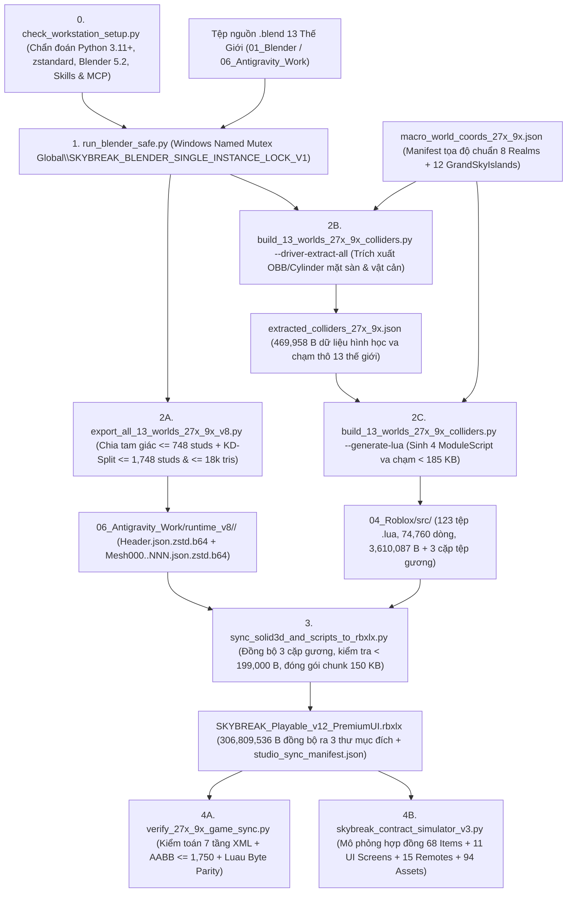
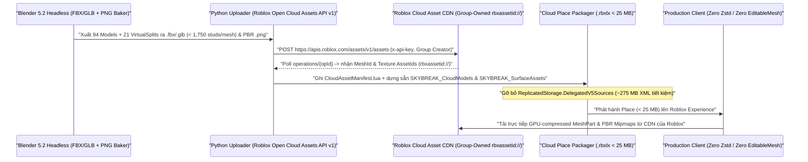

# 06 — SỔ TAY VẬN HÀNH DEVOPS, ĐÓNG GÓI BUILD, KIỂM THỬ QA & XUẤT BẢN ROBLOX CLOUD (`27x / 9x`)

**Dự án**: `SKYBREAK: Fragments of the Core` (`v12 PremiumUI • Macro-World 27x / 9x Edition`)  
**Tệp đóng gói chuẩn**: [SKYBREAK_Playable_v12_PremiumUI.rbxlx](file:///C:/Users/khang/Documents/Codex/2026-10-22/new-chat/outputs/SKYBREAK_Antigravity_Handoff/04_Roblox/SKYBREAK_Playable_v12_PremiumUI.rbxlx) (`306,809,536 bytes` / `~292.60 MB`)  
**Bộ công cụ Pipeline**: `05_Pipeline_Tools_27x_9x/` (`8` tệp công cụ & manifest di động) + [run_blender_safe.py](file:///C:/Users/khang/Documents/Codex/2026-10-22/new-chat/outputs/SKYBREAK_Argon_Refinement/run_blender_safe.py)  
**Đối tượng sử dụng**: Kỹ sư Build/DevOps, Kỹ sư Gameplay Luau, Chuyên viên QA Automation và Kỹ sư Phát hành Live-Ops trên Roblox Cloud.

---

## Mục Lục Điều Hướng

1. [Phần 1: Sổ Tay Quy Trình Build & Đóng Gói CLI (`Blender 5.2` → `V8 Zstd` → `.rbxlx`)](#phần-1-sổ-tay-quy-trình-build--đóng-gói-cli-blender-52--v8-zstd--rbxlx)
2. [Phần 2: Cẩm Nang Kiểm Thử QA Tự Động Offline, `SkybreakSmokeTest` 130 Hạng Mục & `DevSandbox`](#phần-2-cẩm-nang-kiểm-thử-qa-tự-động-offline-skybreaksmoketest-130-hạng-mục--devsandbox)
3. [Phần 3: Các Ràng Buộc Kỹ Thuật Sống Còn & Sổ Tay Xử Lý Sự Cố (Troubleshooting Playbook)](#phần-3-các-ràng-buộc-kỹ-thuật-sống-còn--sổ-tay-xử-lý-sự-cố-troubleshooting-playbook)
4. [Phần 4: Lộ Trình Xuất Bản Roblox Cloud Production (`< 25 MB`) & Vận Hành Live-Ops Đa Máy Chủ](#phần-4-lộ-trình-xuất-bản-roblox-cloud-production--25-mb--vận-hành-live-ops-đa-máy-chủ)

---

## Phần 1: Sổ Tay Quy Trình Build & Đóng Gói CLI (`Blender 5.2` → `V8 Zstd` → `.rbxlx`)

Toàn bộ dây chuyền biên dịch hình học 3D quy mô đại lục `27x` (`~38,000+ studs`) / đảo mở rộng `9x`, trích xuất vật lý va chạm, đồng bộ `123` tệp mã nguồn Luau và đóng gói tệp [SKYBREAK_Playable_v12_PremiumUI.rbxlx](file:///C:/Users/khang/Documents/Codex/2026-10-22/new-chat/outputs/SKYBREAK_Antigravity_Handoff/04_Roblox/SKYBREAK_Playable_v12_PremiumUI.rbxlx) được tự động hóa hoàn toàn bằng Python và Blender Headless CLI (không phụ thuộc vào thao tác kéo-thả thủ công trong giao diện Studio).

### 1.1 Kiến Trúc Dây Chuyền Build Tổng Thể



> [!IMPORTANT]
> Trên các máy trạm Windows chưa bật alias `python` toàn cục (hoặc nơi `python` bị trỏ vào stub Microsoft Store), luôn gọi trực tiếp trình thông dịch Python độc lập đã cài sẵn `zstandard`, `numpy`, `Pillow`, `requests` (ví dụ trên máy trạm chuẩn: `"C:/Users/khang/.cache/codex-runtimes/codex-primary-runtime/dependencies/python/python.exe"`). Mọi ví dụ PowerShell dưới đây đều khai báo biến `$Py` ở dòng đầu để chạy ổn định trên mọi phiên terminal mới.

### 1.2 Danh Mục Đầy Đủ 9 Tệp Công Cụ & Manifest Trong Pipeline

| STT | Tệp Công Cụ / Manifest | Dung Lượng | Môi Trường Thực Thi | Vai Trò Cốt Lõi |
| :-: | :--- | ---: | :--- | :--- |
| 1 | [check_workstation_setup.py](file:///C:/Users/khang/Documents/Codex/2026-10-22/new-chat/outputs/SKYBREAK_Antigravity_Handoff/05_Pipeline_Tools_27x_9x/check_workstation_setup.py) | `8,300 B` | Standalone Python `>= 3.11` | Chẩn đoán toàn diện máy trạm: Python packages (`zstandard`, `numpy`, `Pillow`, `requests`), Blender `5.2` + Embedded Python, Roblox Studio, Git/LFS/Node.js, `AGENTS.md`, Skills và cầu nối MCP. |
| 2 | [run_blender_safe.py](file:///C:/Users/khang/Documents/Codex/2026-10-22/new-chat/outputs/SKYBREAK_Argon_Refinement/run_blender_safe.py) | `2,487 B` | Standalone Python (Win32 `ctypes`) | Trình bọc hàng đợi khóa đơn tiến trình (`Named Mutex`) bắt buộc cho mọi tác vụ Blender `5.2` chạy ngầm (`-b`), bảo vệ VRAM/RAM khỏi xung đột đa tiến trình. |
| 3 | [macro_world_coords_27x_9x.json](file:///C:/Users/khang/Documents/Codex/2026-10-22/new-chat/outputs/SKYBREAK_Antigravity_Handoff/05_Pipeline_Tools_27x_9x/macro_world_coords_27x_9x.json) | `17,502 B` | JSON Manifest (`27x_9x_final_v1`) | Nguồn sự thật duy nhất (Single Source of Truth) về tọa độ `Origin`, `Spawn`, `DeckY`, `Islands`, `Boss`, `WorldGateExit` và `grand_sky_islands_streaming` của toàn bộ vũ trụ `27x / 9x`. |
| 4 | [export_all_13_worlds_27x_9x_v8.py](file:///C:/Users/khang/Documents/Codex/2026-10-22/new-chat/outputs/SKYBREAK_Antigravity_Handoff/05_Pipeline_Tools_27x_9x/export_all_13_worlds_27x_9x_v8.py) | `26,603 B` | Blender `5.2` Embedded Python (qua `run_blender_safe.py`) | Xuất hình học 13 thế giới sang định dạng mảnh ghép V8 (`Mesh000..NNN.json.zstd.b64`), đảm bảo mỗi mảnh `<= 18,000` tam giác và hộp bao AABB `<= 1,748.0 < 1,750.0 studs`. |
| 5 | [build_13_worlds_27x_9x_colliders.py](file:///C:/Users/khang/Documents/Codex/2026-10-22/new-chat/outputs/SKYBREAK_Antigravity_Handoff/05_Pipeline_Tools_27x_9x/build_13_worlds_27x_9x_colliders.py) | `63,733 B` | Chế độ kép: Blender `5.2` & Standalone Python | Trích xuất hình học mặt sàn/vật cản từ `.blend` ra JSON trung gian và sinh mã tự động cho 4 `ModuleScript` va chạm vật lý phía Server (`< 185,000 B` mỗi tệp). |
| 6 | [extracted_colliders_27x_9x.json](file:///C:/Users/khang/Documents/Codex/2026-10-22/new-chat/outputs/SKYBREAK_Antigravity_Handoff/05_Pipeline_Tools_27x_9x/extracted_colliders_27x_9x.json) | `469,958 B` | JSON Artifact trung gian | Kho lưu trữ toàn bộ các khối `walkables` (`Block`/`Cylinder`) và `obstacles` đã quy chuẩn sang hệ trục Roblox của đủ 13 thế giới `W1..W13`, cho phép tái sinh mã Luau tức thời mà không cần mở lại Blender. |
| 7 | [sync_solid3d_and_scripts_to_rbxlx.py](file:///C:/Users/khang/Documents/Codex/2026-10-22/new-chat/outputs/SKYBREAK_Antigravity_Handoff/05_Pipeline_Tools_27x_9x/sync_solid3d_and_scripts_to_rbxlx.py) | `11,662 B` | Standalone Python `>= 3.11` | Công cụ đóng gói `.rbxlx` trung tâm: đồng bộ 3 cặp tệp gương, chuẩn hóa LF cho 123 tệp `.lua`, kiểm tra ngưỡng cứng `199,000 B`, nhúng 17 gói V8 vào `DelegatedV5Sources` và xuất ra 3 bản `.rbxlx` đồng nhất. |
| 8 | [verify_27x_9x_game_sync.py](file:///C:/Users/khang/Documents/Codex/2026-10-22/new-chat/outputs/SKYBREAK_Antigravity_Handoff/05_Pipeline_Tools_27x_9x/verify_27x_9x_game_sync.py) | `11,894 B` | Standalone Python (`zstandard` + `ET`) | Bộ kiểm toán tự động 7 tầng đối chiếu trực tiếp cây XML `.rbxlx` với `04_Roblox/src`, hộp bao AABB của mọi chunk V8, cấu hình `Lighting`/`FallenPartsDestroyHeight` và bảng tọa độ. |
| 9 | [skybreak_contract_simulator_v3.py](file:///C:/Users/khang/Documents/Codex/2026-10-22/new-chat/outputs/SKYBREAK_Antigravity_Handoff/05_Pipeline_Tools_27x_9x/skybreak_contract_simulator_v3.py) | `5,600 B` | Standalone Python | Trình mô phỏng hợp đồng kiến trúc 4 tầng: đối xứng 100% danh mục `68` vật phẩm (`Config.lua` ↔ `RarityConfig.lua`), 11 màn hình UI, schema 66 trường `PlayerDataService`, 15 `RemoteEvent` và 94 nguồn `DelegatedV5Sources`. |

---

### 1.3 Đặc Tả Chi Tiết & Lệnh PowerShell Cho Từng Công Cụ

#### Bước 0 — Chẩn Đoán Trạm Làm Việc (`check_workstation_setup.py`)

[check_workstation_setup.py](file:///C:/Users/khang/Documents/Codex/2026-10-22/new-chat/outputs/SKYBREAK_Antigravity_Handoff/05_Pipeline_Tools_27x_9x/check_workstation_setup.py#L88-L214) kiểm tra 6 nhóm điều kiện tiên quyết trước khi chạy bất kỳ lệnh build nào:
- **Đầu vào**: Môi trường hệ điều hành, thư mục cài đặt Blender `5.2 LTS`, thư mục `LOCALAPPDATA\Roblox\Versions` và cây bàn giao `SKYBREAK_Antigravity_Handoff`.
- **Đầu ra**: Báo cáo trạng thái `[OK] / [WARN] / [MISSING]` trên `stdout`; trả về mã thoát `0` khi đủ điều kiện cốt lõi hoặc `1` nếu thiếu thành phần bắt buộc (như `zstandard` trong Python nhúng của Blender).

```powershell
$Py = "C:/Users/khang/.cache/codex-runtimes/codex-primary-runtime/dependencies/python/python.exe"
$Handoff = "C:/Users/khang/Documents/Codex/2026-10-22/new-chat/outputs/SKYBREAK_Antigravity_Handoff"

& $Py "$Handoff/05_Pipeline_Tools_27x_9x/check_workstation_setup.py"
```

---

#### Bước 1 — Hàng Đợi Khóa Đơn Tiến Trình Blender (`run_blender_safe.py`)

[run_blender_safe.py](file:///C:/Users/khang/Documents/Codex/2026-10-22/new-chat/outputs/SKYBREAK_Argon_Refinement/run_blender_safe.py#L1-L75) là lớp bảo vệ hệ thống bắt buộc mỗi khi gọi `"C:/Program Files/Blender Foundation/Blender 5.2/blender.exe"`:
- **Cơ chế khóa**: Khởi tạo Windows Named Mutex toàn cục `Global\SKYBREAK_BLENDER_SINGLE_INSTANCE_LOCK_V1` thông qua `ctypes.windll.kernel32.CreateMutexW` kèm độ trễ ngẫu nhiên (`0.2s .. 1.2s` jitter) và vòng chờ `WaitForSingleObject(mutex, 2000)` để xếp hàng tuần tự khi có nhiều tiến trình/subagent cùng yêu cầu Blender.
- **Chuẩn hóa cờ CLI tự động**:
  - Tự động chèn cờ `-b` (background/headless — tuyệt đối không bao giờ mở cửa sổ GUI Blender).
  - Nếu đối số đầu tiên (hoặc đối số thứ hai sau đường dẫn tệp `.blend`) kết thúc bằng `.py` mà thiếu cờ `-P`, script tự động chèn `-P` trước đường dẫn script Python.
- **Bảo vệ treo & giải phóng VRAM**: Giới hạn thời gian chạy tối đa `240 giây` mỗi tác vụ (`subprocess.TimeoutExpired` trả về mã thoát `124`), nghỉ `1.0 giây` hậu xử lý để GPU trả sạch VRAM trước khi nhả khóa `ReleaseMutex` và `CloseHandle` trong khối `finally`.

```powershell
$Py = "C:/Users/khang/.cache/codex-runtimes/codex-primary-runtime/dependencies/python/python.exe"
$SafeBlender = "C:/Users/khang/Documents/Codex/2026-10-22/new-chat/outputs/SKYBREAK_Argon_Refinement/run_blender_safe.py"

# Cú pháp tổng quát: truyền script Blender và đối số sau dấu '--'
& $Py $SafeBlender -P "<duong_dan_script_blender.py>" -- <cac_co_cli_cua_script>
```

---

#### Bước 2A — Xuất Hình Học V8 Tiled Meshes Cho 13 Thế Giới (`export_all_13_worlds_27x_9x_v8.py`)

[export_all_13_worlds_27x_9x_v8.py](file:///C:/Users/khang/Documents/Codex/2026-10-22/new-chat/outputs/SKYBREAK_Antigravity_Handoff/05_Pipeline_Tools_27x_9x/export_all_13_worlds_27x_9x_v8.py#L1-L724) giải quyết giới hạn cứng `< 2,048 studs` của `EditableMesh` Roblox trên các đại lục `27x` rộng hơn `38,000 studs`:
- **Cờ CLI** (truyền sau dấu `--`):
  - `--world <W1..W13 | world_name | ALL>` (**Bắt buộc**): Mã thế giới (`W1` đến `W13`), tên định danh chuẩn (ví dụ `GoldenSky`, `FrozenCyber`, `ShadowRealm`, `TempleOfTheCoreRaceV4`) hoặc `ALL` để xuất tuần tự toàn bộ 13 thế giới trong một phiên.
- **Thuật toán chia mảnh 2 pha**:
  1. **Pha A (`split_oversized_triangle`, dòng `599`)**: Chia đôi đệ quy theo trung điểm cạnh dài nhất mọi tam giác có sải trục `> 748.0 studs` (`< 750 studs`), nội suy chuẩn xác vector pháp tuyến (`cnormals`) và tọa độ UV.
  2. **Pha B (`kd_split_triangles` + `merge_compatible_chunks`, dòng `628-649`)**: Phân hoạch cây KD-Tree từ trên xuống theo từng nhóm vật liệu sao cho mỗi mảnh thỏa mãn đồng thời `<= 18,000` tam giác và sải hộp bao AABB `<= 1,748.0 studs` (có hậu kiểm cứng `span > 1750.0` ném `RuntimeError`).
- **Ánh xạ trục & Lọc lồng FX**: Áp dụng phép biến đổi tọa độ từ Blender sang Roblox `rbx = (x_bl, z_bl, -y_bl)` và đổi tên hậu tố `_Env` cho các vật liệu môi trường trùng chuỗi lọc FX nhân vật trong `DelegatedV5Renderer.lua`.
- **Đầu ra**: Ghi đồng thời tệp `.json` và `.json.zstd.b64` (`Zstandard level=12` + `Base64`) gồm `Header.json(.zstd.b64)`, `Clips.json(.zstd.b64)` và `Mesh000..MeshNNN.json(.zstd.b64)` vào `06_Antigravity_Work/runtime_v8/<WorldName>/`.

```powershell
$Py = "C:/Users/khang/.cache/codex-runtimes/codex-primary-runtime/dependencies/python/python.exe"
$SafeBlender = "C:/Users/khang/Documents/Codex/2026-10-22/new-chat/outputs/SKYBREAK_Argon_Refinement/run_blender_safe.py"
$Handoff = "C:/Users/khang/Documents/Codex/2026-10-22/new-chat/outputs/SKYBREAK_Antigravity_Handoff"

# Ví dụ 1: Xuất riêng 1 thế giới (W1 = GoldenSky) để lặp nhanh trong quá trình chỉnh sửa 3D
& $Py $SafeBlender -P "$Handoff/05_Pipeline_Tools_27x_9x/export_all_13_worlds_27x_9x_v8.py" -- --world W1

# Ví dụ 2: Xuất tuần tự toàn bộ 13 thế giới (khuyến nghị chạy vòng lặp từng thế giới qua khóa an toàn)
1..13 | ForEach-Object {
    & $Py $SafeBlender -P "$Handoff/05_Pipeline_Tools_27x_9x/export_all_13_worlds_27x_9x_v8.py" -- --world "W$_"
    if ($LASTEXITCODE -ne 0) { throw "Blender V8 export failed on W$_" }
}
```

---

#### Bước 2B & 2C — Trích Xuất Vật Lý & Sinh Mã Va Chạm Luau (`build_13_worlds_27x_9x_colliders.py`)

[build_13_worlds_27x_9x_colliders.py](file:///C:/Users/khang/Documents/Codex/2026-10-22/new-chat/outputs/SKYBREAK_Antigravity_Handoff/05_Pipeline_Tools_27x_9x/build_13_worlds_27x_9x_colliders.py#L1605-L1703) kết hợp tệp tọa độ [macro_world_coords_27x_9x.json](file:///C:/Users/khang/Documents/Codex/2026-10-22/new-chat/outputs/SKYBREAK_Antigravity_Handoff/05_Pipeline_Tools_27x_9x/macro_world_coords_27x_9x.json) với hình học `.blend` để tạo hệ thống sàn/tường va chạm vô hình phía Server:
- **3 Chế độ cờ CLI**:
  - `-- --world <W1..W13>` (chạy bên trong Blender Headless): Trích xuất các mặt sàn đi bộ được (`walkables` dạng `Block`/`Cylinder`) và khối tường/tháp đặc (`obstacles`) của một thế giới, cập nhật vào [extracted_colliders_27x_9x.json](file:///C:/Users/khang/Documents/Codex/2026-10-22/new-chat/outputs/SKYBREAK_Antigravity_Handoff/05_Pipeline_Tools_27x_9x/extracted_colliders_27x_9x.json).
  - `--driver-extract-all` (chạy bằng Standalone Python): Trình điều phối tự động gọi [run_blender_safe.py](file:///C:/Users/khang/Documents/Codex/2026-10-22/new-chat/outputs/SKYBREAK_Argon_Refinement/run_blender_safe.py) lần lượt từng thế giới từ `W1` đến `W13` để xây dựng trọn bộ [extracted_colliders_27x_9x.json](file:///C:/Users/khang/Documents/Codex/2026-10-22/new-chat/outputs/SKYBREAK_Antigravity_Handoff/05_Pipeline_Tools_27x_9x/extracted_colliders_27x_9x.json) (`469,958 B`).
  - `--generate-lua` (chạy bằng Standalone Python, hoàn tất trong `< 1 giây` mà không cần mở Blender): Đọc [extracted_colliders_27x_9x.json](file:///C:/Users/khang/Documents/Codex/2026-10-22/new-chat/outputs/SKYBREAK_Antigravity_Handoff/05_Pipeline_Tools_27x_9x/extracted_colliders_27x_9x.json) và [macro_world_coords_27x_9x.json](file:///C:/Users/khang/Documents/Codex/2026-10-22/new-chat/outputs/SKYBREAK_Antigravity_Handoff/05_Pipeline_Tools_27x_9x/macro_world_coords_27x_9x.json), tự động khoét vùng an toàn `pocket_half = 16.0 studs` cho mặt sàn nâng cao và lọc sạch vật cản trong bán kính `clearance_xz = 26.0 studs` quanh mọi điểm `Spawn`, `Boss`, `NPC` và `WorldGateExit`, chia nhỏ mọi `Part` có cạnh `> 1,680.0 studs`, rồi ghi đè 4 module va chạm vào `04_Roblox/src/ServerScriptService/Services/`:
    1. [GoldenSkyCollision.lua](file:///C:/Users/khang/Documents/Codex/2026-10-22/new-chat/outputs/SKYBREAK_Antigravity_Handoff/04_Roblox/src/ServerScriptService/Services/GoldenSkyCollision.lua) (`11,130 B`, `405` khối)
    2. [FrozenCyberCollision.lua](file:///C:/Users/khang/Documents/Codex/2026-10-22/new-chat/outputs/SKYBREAK_Antigravity_Handoff/04_Roblox/src/ServerScriptService/Services/FrozenCyberCollision.lua) (`10,327 B`, `641` khối)
    3. [ShadowRealmCollision.lua](file:///C:/Users/khang/Documents/Codex/2026-10-22/new-chat/outputs/SKYBREAK_Antigravity_Handoff/04_Roblox/src/ServerScriptService/Services/ShadowRealmCollision.lua) (`19,711 B`, `414` khối)
    4. [Solid3DWorldColliders.lua](file:///C:/Users/khang/Documents/Codex/2026-10-22/new-chat/outputs/SKYBREAK_Antigravity_Handoff/04_Roblox/src/ServerScriptService/Services/Solid3DWorldColliders.lua) (`34,329 B`, toàn bộ 10 đảo mở rộng `9x` + 5 thiên giới `Realms 4..8` + `Solid3DObstacles`)

```powershell
$Py = "C:/Users/khang/.cache/codex-runtimes/codex-primary-runtime/dependencies/python/python.exe"
$Handoff = "C:/Users/khang/Documents/Codex/2026-10-22/new-chat/outputs/SKYBREAK_Antigravity_Handoff"

# Chế độ 1: Chỉ chạy khi tệp .blend của 13 thế giới có thay đổi hình học mặt đất/cầu/tường
& $Py "$Handoff/05_Pipeline_Tools_27x_9x/build_13_worlds_27x_9x_colliders.py" --driver-extract-all

# Chế độ 2: Sinh lại ngay 4 tệp .lua va chạm khi chỉnh tọa độ trong macro_world_coords_27x_9x.json
& $Py "$Handoff/05_Pipeline_Tools_27x_9x/build_13_worlds_27x_9x_colliders.py" --generate-lua
```

---

#### Bước 3 — Đồng Bộ Mã Nguồn Luau & Đóng Gói Tệp `.rbxlx` (`sync_solid3d_and_scripts_to_rbxlx.py`)

[sync_solid3d_and_scripts_to_rbxlx.py](file:///C:/Users/khang/Documents/Codex/2026-10-22/new-chat/outputs/SKYBREAK_Antigravity_Handoff/05_Pipeline_Tools_27x_9x/sync_solid3d_and_scripts_to_rbxlx.py#L1-L281) là bước biên dịch bắt buộc sau bất kỳ chỉnh sửa nào trong `04_Roblox/src/` hoặc `06_Antigravity_Work/runtime_v8/`:
- **Chuỗi tác vụ tự động trong 1 lần gọi (không cần cờ CLI)**:
  1. **Đồng bộ 3 cặp tệp gương bắt buộc**: Tự động sao chép từ bản gốc trong `SkybreakShared/{Config,Types}/` ra thư mục gốc `SkybreakShared/` cho `RarityConfig.lua`, `WorldConfig.lua` và `UIState.lua`.
  2. **Áp đặt thuộc tính DataModel chuẩn**: Khóa cứng `Lighting` (`Brightness = 1.35`, `ExposureCompensation = -0.22`, `FogStart = 1800.0`, `FogEnd = 18000.0`), `StarterPlayer.EnableMouseLockOption = false`, `Workspace.FallenPartsDestroyHeight = -4500.0` và vị trí `Workspace.SkyHub.SkybornSpawn = (-2484.0, 51.5, 4131.0)`.
  3. **Nhúng 17 thư mục `SYNC_RUNTIME_V8_ASSETS`**: Đóng gói 3 đại lục `27x`, 10 thế giới mở rộng `9x`, 2 đài thờ (`ZiolesGachaShrine`, `AetherShrinesAndRaidConsole`) và 2 rig Rồng (`AbyssalSovereignDragon`, `AbyssalDragonHybrid`) vào `ReplicatedStorage.DelegatedV5Sources` dưới dạng các `ModuleScript` chứa trình nạp `V5_LOADER` 4 dòng và các `StringValue` con `Data001..DataNNN` được cắt khúc mỗi `150,000 bytes`.
  4. **Bơm 123 tệp `.lua` & Kiểm tra giới hạn `199,000 B`**: Chuẩn hóa dấu xuống dòng `LF` (`\n`), kiểm tra cứng `HARD_BYTE_LIMIT = 199000` trên từng script và ghi vào thẻ `<ProtectedString name="Source">`.
  5. **Xuất Manifest & Nhân bản 3 đích**: Ghi [studio_sync_manifest.json](file:///C:/Users/khang/Documents/Codex/2026-10-22/new-chat/outputs/SKYBREAK_Antigravity_Handoff/04_Roblox/src/studio_sync_manifest.json), chèn khai báo XML `xmlns:xmime="http://www.w3.org/2005/05/xmlmime"` và ghi đồng bộ tệp [SKYBREAK_Playable_v12_PremiumUI.rbxlx](file:///C:/Users/khang/Documents/Codex/2026-10-22/new-chat/outputs/SKYBREAK_Antigravity_Handoff/04_Roblox/SKYBREAK_Playable_v12_PremiumUI.rbxlx) tới `04_Roblox/`, `06_Antigravity_Work/` (nếu hiện diện) và `SKYBREAK_Visual_v2/` (nếu hiện diện).

```powershell
$Py = "C:/Users/khang/.cache/codex-runtimes/codex-primary-runtime/dependencies/python/python.exe"
$Handoff = "C:/Users/khang/Documents/Codex/2026-10-22/new-chat/outputs/SKYBREAK_Antigravity_Handoff"

& $Py "$Handoff/05_Pipeline_Tools_27x_9x/sync_solid3d_and_scripts_to_rbxlx.py"
```

---

## Phần 2: Cẩm Nang Kiểm Thử QA Tự Động Offline, `SkybreakSmokeTest` 130 Hạng Mục & `DevSandbox`

Hệ thống đảm bảo chất lượng (QA) của **SKYBREAK** gồm 3 lớp bảo vệ độc lập: **(1) Kiểm toán tĩnh & nhị phân Offline bằng Python**, **(2) Bộ kiểm thử Runtime In-Studio `SkybreakSmokeTest.lua`**, và **(3) Bảng điều khiển gian lận kiểm thử `DevSandbox` (`F9`)**.

### 2.1 Lớp 1 — Hai Công Cụ Kiểm Toán Offline Bằng Python (Chạy Trước Khi Mở Studio)

Mọi bản build `.rbxlx` mới sinh ra từ Bước 3 **bắt buộc** phải vượt qua hai bài kiểm toán Python dưới đây với mã thoát `0`:

```powershell
$Py = "C:/Users/khang/.cache/codex-runtimes/codex-primary-runtime/dependencies/python/python.exe"
$Handoff = "C:/Users/khang/Documents/Codex/2026-10-22/new-chat/outputs/SKYBREAK_Antigravity_Handoff"

# 1. Kiểm toán 7 tầng đồng bộ XML .rbxlx, AABB hình học V8 và bảng tọa độ 27x/9x
& $Py "$Handoff/05_Pipeline_Tools_27x_9x/verify_27x_9x_game_sync.py"

# 2. Mô phỏng hợp đồng dữ liệu 4 tầng (Items, Screens, Profile Schema, Remotes & 94 V5 Sources)
& $Py "$Handoff/05_Pipeline_Tools_27x_9x/skybreak_contract_simulator_v3.py"
```

#### Bảng Đối Chiếu Các Hạng Mục Kiểm Toán Của 2 Script Python

| Công Cụ | Tầng Kiểm Tra | Nội Dung Xác Thực Cụ Thể | Điều Kiện Đạt (`PASS`) |
| :--- | :--- | :--- | :--- |
| [verify_27x_9x_game_sync.py](file:///C:/Users/khang/Documents/Codex/2026-10-22/new-chat/outputs/SKYBREAK_Antigravity_Handoff/05_Pipeline_Tools_27x_9x/verify_27x_9x_game_sync.py) | `Stage 1..2` | Đối chiếu từng byte (`LF`-normalized) toàn bộ `123` tệp `.lua` giữa `04_Roblox/src` và cây XML `.rbxlx`, bao gồm đồng nhất tuyệt đối 3 cặp tệp gương và ngưỡng `< 199,000 B`. | `0` tệp lệch byte, `0` tệp vượt ngưỡng. |
| [verify_27x_9x_game_sync.py](file:///C:/Users/khang/Documents/Codex/2026-10-22/new-chat/outputs/SKYBREAK_Antigravity_Handoff/05_Pipeline_Tools_27x_9x/verify_27x_9x_game_sync.py) | `Stage 3..4` | Giải nén Zstandard thật (`zstandard.ZstdDecompressor`) trên toàn bộ các chunk `DelegatedV5Sources` của 13 thế giới ngay từ tệp `.rbxlx`, đo hộp bao đỉnh 3D `(sx, sy, sz)` và đếm số tam giác. | Mọi chunk có `max(sx, sy, sz) <= 1,750.0 studs` và `tris <= 18,000`. |
| [verify_27x_9x_game_sync.py](file:///C:/Users/khang/Documents/Codex/2026-10-22/new-chat/outputs/SKYBREAK_Antigravity_Handoff/05_Pipeline_Tools_27x_9x/verify_27x_9x_game_sync.py) | `Stage 5..7` | Xác thực thuộc tính `Lighting` chống chói, `StarterPlayer.EnableMouseLockOption == false`, `FallenPartsDestroyHeight == -4500`, `SkybornSpawn`, không còn mã nhân bản đảo wing/continent cũ và khớp tọa độ `macro_world_coords_27x_9x.json`. | In dòng `[ALL 27X/9X VERIFICATION CHECKS PASSED]`. |
| [skybreak_contract_simulator_v3.py](file:///C:/Users/khang/Documents/Codex/2026-10-22/new-chat/outputs/SKYBREAK_Antigravity_Handoff/05_Pipeline_Tools_27x_9x/skybreak_contract_simulator_v3.py) | `[1/4] .. [4/4]` | Đối chiếu hai chiều toàn bộ `68` vật phẩm giữa [Config.lua](file:///C:/Users/khang/Documents/Codex/2026-10-22/new-chat/outputs/SKYBREAK_Antigravity_Handoff/04_Roblox/src/ReplicatedStorage/Shared/Config.lua) và [RarityConfig.lua](file:///C:/Users/khang/Documents/Codex/2026-10-22/new-chat/outputs/SKYBREAK_Antigravity_Handoff/04_Roblox/src/ReplicatedStorage/SkybreakShared/Config/RarityConfig.lua), sự tồn tại của 11 màn hình UI, 66 trường `PlayerDataService`, 15 `RemoteEvent` và đủ `94` thư mục tài nguyên 3D trong `.rbxlx`. | `0` lỗi hợp đồng trên cả 4 pha. |

---

### 2.2 Lớp 2 — Bộ Kiểm Thử Tự Động In-Studio `SkybreakSmokeTest.lua` (`Task #130`)

Module [SkybreakSmokeTest.lua](file:///C:/Users/khang/Documents/Codex/2026-10-22/new-chat/outputs/SKYBREAK_Antigravity_Handoff/04_Roblox/src/ReplicatedStorage/Shared/SkybreakSmokeTest.lua#L1-L666) (`ReplicatedStorage.Shared.SkybreakSmokeTest`) là bộ kiểm thử tự động đại diện cho **Hạng mục Kỹ thuật `#130` (Automated 130-Task Verification Suite)**, xác thực trực tiếp trạng thái bộ nhớ sống của cả Client và Server thông qua **199 phép kiểm tra đơn lẻ (`100` Client assertions + `99` Server assertions)**.

#### Cấu Trúc Hàm Nội Bộ & Phân Bổ Phép Kiểm Tra Trong `SkybreakSmokeTest.lua`

| Hàm Kiểm Toán Nội Bộ | Dòng Mã | Số Checks (Client / Server) | Các Hạng Mục Được Xác Thực Trực Tiếp Trong Runtime |
| :--- | :---: | :---: | :--- |
| `check3DAssetsAndRenderer(ctx, isClientRuntime)` | `L161-L271` | `43` / `41` | Sự hiện diện & `require()` thành công của `DelegatedV5Renderer` + `DelegatedV5Sources`; giải nén `Header` (`mesh_count > 0`) cho đủ **21 mô hình tách rời** (`8` Vũ khí `Wep_*`, `6` Cánh Tộc V4 `Wing_*`, `3` Cây Cổ Thụ `Tree_*`, `3` Đài Thờ `Shrine_*`, `1` Bàn điều khiển `Console_RaidMicrochip`), **3 Chiến hạm** (`CelestialAetherGalleon`, `CyberEnforcerShip`, `LeviathanHunterShip`), **2 Rig Rồng V8** (`AbyssalSovereignDragon`, `AbyssalDragonHybrid`), **12 Trái Ác Quỷ 3D** (`Fruit_*`); riêng trên Client thực hiện dựng thử `Renderer.Build` sống cho `Wep_Dawnbringer` và `Console_RaidMicrochip` (`PrimaryPart ~= nil`). |
| `checkLightingAntiGlare(ctx)` | `L273-L299` | `3` / `0` | Khóa chống lóa mắt trên Client: `Lighting.Brightness <= 1.46`, `Lighting.ExposureCompensation <= -0.15`, và mọi `BloomEffect` đang bật thỏa `Intensity <= 0.36` & `Threshold >= 1.40`. |
| `checkZeroAstralEmojis(ctx, scanPlayerGui)` | `L301-L355` | `2` / `1` | Quét toàn bộ `ProximityPrompt` (`ActionText`, `ObjectText`) và `BillboardGui` trong `Workspace` (cộng thêm toàn bộ `TextLabel`/`TextButton` trong `LocalPlayer.PlayerGui` khi chạy ở Client) đảm bảo **0 ký tự Emoji Astral Plane** (`codepoint >= U+1F300`). |
| `checkUIScreenModules(ctx)` | `L357-L387` | `12` / `12` | Xác thực thư mục `SkybreakClient/UI/Screens` và `pcall(require)` thành công toàn bộ **11 màn hình giao diện**: `Dialogue`, `Forge`, `Fruits`, `HUD`, `Inventory`, `MainMenu`, `QuestJournal`, `Raid`, `Settings`, `Skills`, `WorldMap`. |
| `checkRemotesAndCombatDataAndWorld(ctx)` | `L389-L495` | `26` / `29` | Thư mục `ReplicatedStorage.Remotes` có `>= 15` `RemoteEvent` và khớp đúng 15 tên chuẩn; `SkybreakCombatData` nạp đủ `5` Võ Thuật (`MartialStyles`), `12` Trái Thức Tỉnh (`AwakenedFruitMoves`), `>= 56` Danh Hiệu (`Titles`); `StarterPlayer.EnableMouseLockOption == false`; đối xứng 100% `Config.Items` ↔ `RarityConfig.Items`; hiện diện các thư mục Landmark trong `Workspace` (`SkybreakWorldObjects`, `SkybreakExpansionWorld`, `ActiveEnemies`, `ActiveShips`, `SkybreakChests`, `SkybreakLoreTablets`, `HomePointCrystals`). |
| `SmokeTest.RunClientAudit()` *(riêng Client)* | `L497-L591` | `+14` (`= 100`) | Chờ ổn định tối đa `3.0s` sau khi vào Play; kiểm tra `PlayerGui` và đủ **6 `ScreenGui`** (`SkybreakUI`, `SkybreakDragonFuryGui`, `SkybreakActionOverlayGui`, `SkybreakWorldOverlayGui`, `SkybreakNebulaWipeGui`, cộng `SkybreakDevSandboxGui` trong Studio); `TempFX.DamageNumberPool` (`>= 40` nút), `TempFX.SpatialAudioPool` (`>= 16` nút), `SkybreakCloudSeaBlanket`, `QuestWaypointBeacon`, `SoundService.SkybreakAudioEngine` và cờ hoạt động NPC sống (`_G.SkybreakLivingNPCsStarted` / `SkybreakLivingNPCsActive`). |
| `SmokeTest.RunServerAudit()` *(riêng Server)* | `L593-L657` | `+16` (`= 99`) | Chờ ổn định tối đa `3.0s`; kiểm tra 6 `ModuleScript` dịch vụ cốt lõi trong `ServerScriptService.Services`, kiểm tra 6 `LocalScript` đầu vào trong `StarterPlayerScripts` không bị `Disabled`, và 3 thư viện hiệu ứng (`DragonSovereignVFX`, `VFXStudioLibrary`, `UniversalVFXOverhaul`). |

#### Cách Chạy `SkybreakSmokeTest` Trong Roblox Studio (`Play` Mode / `F5`)

Mở tệp [SKYBREAK_Playable_v12_PremiumUI.rbxlx](file:///C:/Users/khang/Documents/Codex/2026-10-22/new-chat/outputs/SKYBREAK_Antigravity_Handoff/04_Roblox/SKYBREAK_Playable_v12_PremiumUI.rbxlx) trong Roblox Studio, nhấn **Play (`F5`)**, sau đó chạy hai đoạn lệnh sau trong thanh **Command Bar** (hoặc qua công cụ `execute_luau` của MCP `Roblox_Studio`):

```lua
-- 1. Chạy ở chế độ VIEW -> Command Bar (bối cảnh CLIENT khi nút chuyển Server/Client đang ở "Client"):
local Smoke = require(game:GetService("ReplicatedStorage").Shared.SkybreakSmokeTest)
local res = Smoke.RunClientAudit() -- hoặc Smoke.RunAll() (tự động chọn Client/Server theo RunService)
print(res.Summary)
if not res.Passed then
    for i, err in ipairs(res.Failed) do
        warn(string.format("Client Fail #%d: %s", i, err))
    end
end
```

```lua
-- 2. Chuyển nút bối cảnh Studio sang "Server" rồi chạy trong Command Bar:
local Smoke = require(game:GetService("ReplicatedStorage").Shared.SkybreakSmokeTest)
local res = Smoke.RunServerAudit() -- hoặc Smoke.RunAll()
print(res.Summary)
if not res.Passed then
    for i, err in ipairs(res.Failed) do
        warn(string.format("Server Fail #%d: %s", i, err))
    end
end
```

Kết quả chuẩn bắt buộc trên cả hai phía:
- Client: `[PASS] SKYBREAK SmokeTest (Client): 100/100 checks passed (0 failed)`
- Server: `[PASS] SKYBREAK SmokeTest (Server): 99/99 checks passed (0 failed)`

---

### 2.3 Lớp 3 — Chế Độ `DevSandbox` (`F9`) Kiểm Thử Tức Thời Boss, Trái V2, Cánh V4, Chiến Hạm & 8 Realms

Để kỹ sư QA không phải cày cấp thủ công từ `Lv.1` lên `Lv.2550`, trò chơi tích hợp sẵn giao diện ngăn kéo `SkybreakDevSandboxGui` ở góc màn hình (xây dựng trong [SkybreakWorldClient.client.lua](file:///C:/Users/khang/Documents/Codex/2026-10-22/new-chat/outputs/SKYBREAK_Antigravity_Handoff/04_Roblox/src/StarterPlayer/StarterPlayerScripts/SkybreakWorldClient.client.lua#L2400-L2437), bật/tắt nhanh bằng phím **`F9`**) kết nối về bộ xử lý quyền uy [SocialEconomy.HandleDevSandbox](file:///C:/Users/khang/Documents/Codex/2026-10-22/new-chat/outputs/SKYBREAK_Antigravity_Handoff/04_Roblox/src/ServerScriptService/Services/SkybreakSocialEconomyService.lua#L2620-L2789).

> [!CAUTION]
> `HandleDevSandbox` chỉ chấp nhận thực thi khi `RunService:IsStudio() == true` **hoặc** khi `workspace:GetAttribute("EnableDevSandbox") == true`. Trên môi trường Production xuất bản công khai, tuyệt đối **không** được đặt thuộc tính `EnableDevSandbox = true` trên `Workspace` để ngăn người chơi thường gọi `UIRequest:FireServer("DevSandbox", ...)`.

#### Danh Mục Đầy Đủ Các Lệnh `DevSandbox` (Bấm Trên Ngăn Kéo `F9` Hoặc Gọi Từ Command Bar Client)

Mọi lệnh dưới đây đều có thể kích hoạt qua nút bấm trực quan trên bảng `F9` hoặc gọi thẳng từ Command Bar phía **Client** theo mẫu `game.ReplicatedStorage.Remotes.UIRequest:FireServer("DevSandbox", <payload>)`:

| Lệnh `subAction` | Payload Mẫu Qua `UIRequest` | Tác Động Gameplay Tức Thời Phía Server | Kịch Bản Kiểm Thử QA Điển Hình |
| :--- | :--- | :--- | :--- |
| `UnlockAll` *(alias: `UnlockFullSave`, `GrantMaxTestKit`)* | `{ subAction = "UnlockAll" }` | Nâng `Level = 2550`, `Mastery = 600` cho toàn bộ 12 Trái & Võ Thuật, `25,000,000 Gold`, `75,000 CoreShards`, `12,500,000 Bounty/Honor`, mở khóa & thức tỉnh đủ 12 Trái V2 (`StoredFruits >= 2`), mở toàn bộ Vũ khí `5-Star +15`, `20 EnchantScroll`, `3 LeviathanHeart`, `HakiStage = 5`, `KenV2Unlocked = true`, `RaceV4Unlocked = true` (`RaceTier = 4`, hiện Cánh V4 3D) và mở khóa toàn bộ 8 Realms. | Kiểm thử toàn diện Endgame: đổi tự do 12 Trái V2, bắn súng/kiếm `+15`, phù phép lò rèn, bay Cánh Tộc V4 và Hóa Rồng 2 bậc. |
| `FullFury` *(alias: `FullFuryHP`)* | `{ subAction = "FullFury" }` | Sạc đầy `AwakeningMeter = 100`, `rt.FuryMeter = 100`, `Energy = 100`, `Stamina = 100`, `InstinctDodges = 8`, mở `RaceV4Unlocked = true` (`RaceTier = 4`) và hồi `100% HP`. | Kiểm thử kích hoạt ngay trạng thái Thức Tỉnh Tộc V4 (`Y`/`T`) và nộ khí Hóa Rồng V8 (`AbyssalSovereignDragon`) mà không cần tích nộ qua đòn đánh. |
| `ZeroCooldowns` | `{ subAction = "ZeroCooldowns" }` | Đảo trạng thái `rt.ZeroCooldowns` (`BẬT / TẮT`), xóa trắng bảng `rt.Cooldowns` và gắn `Player:SetAttribute("ZeroCooldowns", bool)`. | Xả liên hoàn chiêu `[Z][X][C][V][F]` của 12 Trái Ác Quỷ, 5 Võ Thuật và 12 Kỹ năng Class để đo FPS, kiểm tra rò rỉ `TempFX` và âm thanh không gian. |
| `SpawnBoss` | `{ subAction = "SpawnBoss", bossId = "CryonPrime" }` | Triệu hồi Boss cách mặt người chơi `20 studs` (hỗ trợ `AureonSentinel`, `CryonPrime`, `Noxar`, `SunshardTemplar`, `AbyssalDreadknight`, `OrderCyborgBoss`, `Sylvaris`, `Ignivar`, `Nerith`, `Chronovex`, `VeyrTheArchitect`, ...). Riêng `AureonSentinel` tự động khởi tạo đấu trường `G.StartBoss({ p })` và dịch chuyển tới `(0, 54, -2380)`. | Kiểm thử AI Boss đa giai đoạn, vòng cảnh báo Telegraph 3D, bảng tổng kết `MVPSummary` và tỉ lệ rơi vật phẩm Thần Thoại. |
| `SpawnShip` | `{ subAction = "SpawnShip", shipId = "LeviathanHunterShip" }` | Đóng và hạ thủy ngay chiến hạm 3D trước mặt người chơi (`CelestialAetherGalleon`, `CyberEnforcerShip` hoặc `LeviathanHunterShip`). | Kiểm thử lái tàu biển mây, bắn đại bác hai mạn và bắn lao móc săn tim Leviathan (`LeviathanHeart`). |
| `TriggerMirage` | `{ subAction = "TriggerMirage" }` | Gọi `G.SpawnMirageIsland(p)` triệu hồi ngay sự kiện Đảo Ảo Ảnh (`MirageSkyIsland`) kèm Thương Nhân Bí Ẩn (`MirageDealer`) và bánh răng cộng hưởng Tộc V4. | Kiểm thử luồng mua Trái hiếm từ Mirage Dealer và chuỗi nhiệm vụ mở khóa Đền Thờ Tộc V4. |
| `TriggerLeviathan` | `{ subAction = "TriggerLeviathan" }` | Gọi `G.SpawnSeaMonsterEvent(p, "AbyssalLeviathan")` triệu hồi Thủy Quái Vực Thẳm ngay vùng biển mây của người chơi. | Kiểm thử săn Boss biển nhiều đốt, kéo `LeviathanHeart` về pháo đài băng giá và rèn Võ Thuật Huyết Long. |
| `TeleportIsland` *(alias: `Teleport`)* | `{ subAction = "Teleport", islandId = "VeilsEnd" }` | Mở khóa `CurrentRealm` đích, dò độ cao mặt sàn an toàn `safeFloorY` và dịch chuyển tức thời kèm màn chuyển cảnh `NebulaPortalWipe`. Nếu bỏ trống `islandId`, tự động xoay vòng tuần tự qua toàn bộ danh bạ đảo (`DevTeleportCursor`). | Bay kiểm tra va chạm mặt sàn, ánh sáng bầu trời và cọc neo NPC xuyên suốt 8 Realms `27x / 9x`. |
| `InspectSelf` | `{ subAction = "InspectSelf" }` | Kích hoạt `SocialEconomy.InspectPlayer(p, { targetUserId = p.UserId })` gửi gói `InspectCard` về Client. | Kiểm thử thẻ Hồ Sơ Nhân Vật (`Alt+Click`) hiển thị cấp độ, Bounty, Danh hiệu, Trái, Võ thuật và Vũ khí `+15`. |

---

## Phần 3: Các Ràng Buộc Kỹ Thuật Sống Còn & Sổ Tay Xử Lý Sự Cố (Troubleshooting Playbook)

Sáu ràng buộc kỹ thuật dưới đây là những giới hạn cứng của engine Roblox và kiến trúc `27x / 9x`. Vi phạm bất kỳ mục nào sẽ dẫn đến lỗi không mở được tệp `.rbxlx`, sập luồng khởi tạo thế giới hoặc hỏng ánh sáng toàn game.

### 3.1 Giới Hạn Cứng `199,000 Bytes` Cho Mỗi Thẻ XML `<ProtectedString>` & Quy Trình Tách Nhỏ `GameService.lua` An Toàn

- **Nguyên nhân gốc**: Trình phân tích XML `.rbxlx` của Roblox Studio và bộ cổng kiểm tra trong [sync_solid3d_and_scripts_to_rbxlx.py](file:///C:/Users/khang/Documents/Codex/2026-10-22/new-chat/outputs/SKYBREAK_Antigravity_Handoff/05_Pipeline_Tools_27x_9x/sync_solid3d_and_scripts_to_rbxlx.py#L40) áp đặt giới hạn cứng `HARD_BYTE_LIMIT = 199,000 bytes` (tính theo UTF-8, xuống dòng `LF`) cho mã nguồn của mỗi `Script` / `LocalScript` / `ModuleScript`.
- **Điểm nóng hiện tại**: [GameService.lua](file:///C:/Users/khang/Documents/Codex/2026-10-22/new-chat/outputs/SKYBREAK_Antigravity_Handoff/04_Roblox/src/ServerScriptService/Services/GameService.lua) đang ở mức **`186,503 bytes` (`93.72%` trần)** — chỉ còn dư đúng **`12,497 bytes`**. Ngoài ra 3 module lớn khác cũng cần theo dõi sát: [SkybreakCombatExpansion.lua](file:///C:/Users/khang/Documents/Codex/2026-10-22/new-chat/outputs/SKYBREAK_Antigravity_Handoff/04_Roblox/src/ServerScriptService/Services/SkybreakCombatExpansion.lua) (`161,685 B` / `81.25%`), [DelegatedV5.client.lua](file:///C:/Users/khang/Documents/Codex/2026-10-22/new-chat/outputs/SKYBREAK_Antigravity_Handoff/04_Roblox/src/StarterPlayer/StarterPlayerScripts/DelegatedV5.client.lua) (`161,262 B` / `81.04%`), và [SkybreakWorldEventsService.lua](file:///C:/Users/khang/Documents/Codex/2026-10-22/new-chat/outputs/SKYBREAK_Antigravity_Handoff/04_Roblox/src/ServerScriptService/Services/SkybreakWorldEventsService.lua) (`160,350 B` / `80.58%`).

#### Mẫu Kiến Trúc Tách Module Không Phá Vỡ Tầng Decorator (`GameService.lua`)

Vì 3 tầng mở rộng Wave 2 / Wave 3A / Wave 3B đều ghi đè trực tiếp các hàm công khai trên bảng `G` (`G.Start`, `G.DamageEnemy`, `G.GiveXP`, `G.HandleUIRequest`, `G.Sync`, `G.Stats`), **tuyệt đối không đổi chữ ký các hàm trên bảng `G`**. Thay vào đó, hãy áp dụng một trong hai mẫu đã kiểm chứng trong dự án:

1. **Mẫu A — Trích Xuất Bảng Dữ Liệu Tĩnh (giống [GameStaticData.lua](file:///C:/Users/khang/Documents/Codex/2026-10-22/new-chat/outputs/SKYBREAK_Antigravity_Handoff/04_Roblox/src/ServerScriptService/Services/GameStaticData.lua))**: Di chuyển các bảng cấu hình lớn (danh sách nhiệm vụ, thoại NPC, bảng chỉ số kỹ năng Class, điểm tuần tra) sang một `ModuleScript` con mới trong `ServerScriptService/Services/` rồi `require` một dòng ở đầu `GameService.lua`.
2. **Mẫu B — Tầng Decorator / Sub-Service Nhận Tham Chiếu `(G, D, W, C)`**: Tạo `ModuleScript` mới (ví dụ `ServerScriptService/Services/SkybreakLiveOpsService.lua`), đăng ký thêm 1 nút `<Item class="ModuleScript">` trong cây `.rbxlx` (hoặc tạo tự động trong `sync_solid3d_and_scripts_to_rbxlx.py`) và gắn móc ở cuối `G.Start()` theo đúng mẫu `Init(G)`:

```lua
-- Bên trong ServerScriptService/Services/SkybreakNewFeatureService.lua:
local SubService = {}
function SubService.Init(G, D, W, C)
    local prevHandleUI = G.HandleUIRequest
    function G.HandleUIRequest(player, action, payload)
        if action == "NewFeatureCommand" then
            return SubService.HandleCommand(player, payload, G, D)
        end
        return prevHandleUI(player, action, payload)
    end
end
return SubService
```

---

### 3.2 Giới Hạn `< 2,048 Studs` Của `EditableMesh` & `Part.Size` Trên Vũ Trụ `27x / 9x`

- **Triệu chứng lỗi**: Xuất hiện cảnh báo động cơ `EditableMesh size exceeds maximum limit` hoặc một mảng lớn mặt đất/vách núi của `GoldenSky` (`~38,000 studs`) biến mất, hoặc nhân vật rơi xuyên qua sàn dù có khối `Part` trong code.
- **Nguyên nhân**: Roblox khóa cứng kích thước tối đa mỗi chiều của cả `BasePart.Size` lẫn hộp bao đỉnh cục bộ của `EditableMesh` ở `2,048 studs`. Nếu truyền một `Part.Size = Vector3.new(5000, 20, 5000)`, Roblox âm thầm kẹp (`clamp`) kích thước thực tế xuống `2,048 x 20 x 2,048`, để hở toàn bộ phần rìa đại lục!
- **Cách khắc phục chuẩn**:
  - Đối với hình học hiển thị V8: Mọi thế giới `.blend` mới hoặc chỉnh sửa phải đi qua [export_all_13_worlds_27x_9x_v8.py](file:///C:/Users/khang/Documents/Codex/2026-10-22/new-chat/outputs/SKYBREAK_Antigravity_Handoff/05_Pipeline_Tools_27x_9x/export_all_13_worlds_27x_9x_v8.py) (ép cứng mỗi tam giác `<= 748 studs` và mỗi chunk KD-Tree `<= 1,748 studs < 1,750 studs`).
  - Đối với hình học va chạm Server: Mọi sàn va chạm phải đi qua [build_13_worlds_27x_9x_colliders.py](file:///C:/Users/khang/Documents/Codex/2026-10-22/new-chat/outputs/SKYBREAK_Antigravity_Handoff/05_Pipeline_Tools_27x_9x/build_13_worlds_27x_9x_colliders.py) (ép cứng `MAX_PART_SIZE = 1680.0 studs`) hoặc chia lưới gạch lát (`tiled slabs <= 1,700 studs`).

---

### 3.3 Ngưỡng Hủy Rơi Vực `Workspace.FallenPartsDestroyHeight = -4500`

- **Triệu chứng lỗi**: Người chơi lao xuống biển mây để kích hoạt mạch nước phun cứu hộ (`CloudGeyserRescue`), hoặc chiến hạm/Boss biển chìm nhẹ xuống dưới mặt mây thì bị chết tức khắc / mất trắng mô hình mà không kịp phát hiệu ứng cứu hộ.
- **Nguyên nhân**: Giá trị mặc định của Roblox (`-500 studs`) quá nông so với chiều dày vách đá đáy đảo bay `27x` (nhiều chóp đá đáy đảo vươn sâu tới `Y = -1,800 .. -2,800 studs`).
- **Quy tắc bất biến**: `Workspace.FallenPartsDestroyHeight` luôn phải giữ ở **`-4500`**. Hệ thống cứu hộ mạch nước mây của Server bắt người chơi ở vùng `Y < -65` (tương đối theo cao độ `DeckY` của từng Realm) và nâng trở lại mặt đảo an toàn trước rất xa ngưỡng hủy vật lý `-4500`.

---

### 3.4 Đồng Bộ Khóa Kép `Atmosphere` / `DOF` / `Anti-Glare` Giữa 3 Tệp Luau

Trong **SKYBREAK**, hệ thống ánh sáng chống chói và chiều sâu khí quyển được kiểm soát đồng thời bởi **3 mô-đun**:
1. [RealmEnvironment.lua](file:///C:/Users/khang/Documents/Codex/2026-10-22/new-chat/outputs/SKYBREAK_Antigravity_Handoff/04_Roblox/src/ReplicatedStorage/Shared/RealmEnvironment.lua#L1-L50) (`E.Apply(name)`): Thiết lập bảng màu gốc cho từng Realm, `Atmosphere` (`Density = 0.14..0.16`, `Haze = 0.20`, `Offset = 0.12`, `Glare <= 0.08`), `FogEnd = 18000` và `SkybreakDistanceDOF` (`FarIntensity = 0.04`, `FocusDistance = 550`, `InFocusRadius = 700`).
2. [ClientBootstrap.client.lua](file:///C:/Users/khang/Documents/Codex/2026-10-22/new-chat/outputs/SKYBREAK_Antigravity_Handoff/04_Roblox/src/StarterPlayer/StarterPlayerScripts/ClientBootstrap.client.lua#L2642-L2711) (`updateRealmAtmosphere()`): Gọi `RealmEnv.Apply(realm)` mỗi khi người chơi đổi `CurrentRealm` hoặc nhận `StateUpdate`, rồi **ghi đè trực tiếp** các thông số tinh chỉnh của từng Realm lên `Lighting`, `Atmosphere`, `SkybreakBloom`, `SkybreakGrade` và `SkybreakDistanceDOF`.
3. [SkybreakWorldClient.client.lua](file:///C:/Users/khang/Documents/Codex/2026-10-22/new-chat/outputs/SKYBREAK_Antigravity_Handoff/04_Roblox/src/StarterPlayer/StarterPlayerScripts/SkybreakWorldClient.client.lua#L19-L54) (`enforceAntiGlareLock()` + chu kỳ Ngày/Hoàng hôn/Đêm Tinh Vân 12 phút): Gắn listener `GetPropertyChangedSignal` kẹp cứng `Lighting.Brightness <= 1.42` (kéo về `1.38`), `ExposureCompensation <= -0.18` (kéo về `-0.20`), `BloomEffect.Intensity <= 0.35`, `BloomEffect.Threshold >= 1.45` và `Atmosphere.Glare <= 0.10`.

> [!WARNING]
> Nếu kỹ sư đồ họa chỉ sửa thông số sương mù/DOF trong [RealmEnvironment.lua](file:///C:/Users/khang/Documents/Codex/2026-10-22/new-chat/outputs/SKYBREAK_Antigravity_Handoff/04_Roblox/src/ReplicatedStorage/Shared/RealmEnvironment.lua) mà quên cập nhật `updateRealmAtmosphere()` trong [ClientBootstrap.client.lua](file:///C:/Users/khang/Documents/Codex/2026-10-22/new-chat/outputs/SKYBREAK_Antigravity_Handoff/04_Roblox/src/StarterPlayer/StarterPlayerScripts/ClientBootstrap.client.lua), gói `StateUpdate` tiếp theo sẽ lập tức ghi đè mất thay đổi đó. Ngược lại, nếu đặt `Brightness > 1.42` hoặc `ExposureCompensation > -0.18`, `enforceAntiGlareLock()` sẽ kẹp ngược lại và `SkybreakSmokeTest` (`checkLightingAntiGlare`) sẽ báo `[FAIL]` nếu vượt `1.46` / `-0.15`. Ba tệp này **luôn phải được chỉnh sửa đồng bộ (in lockstep)**.

---

### 3.5 Bảng Chẩn Đoán & Khắc Phục Nhanh Sự Cố Vận Hành (Quick Troubleshooting Matrix)

| Triệu Chứng Sự Cố | Nguyên Nhân Gốc | Quy Trình Khắc Phục Dứt Điểm |
| :--- | :--- | :--- |
| Lệnh xuất Blender trả về `exit code 124` hoặc báo kẹt Mutex lâu bất thường. | Một tiến trình `blender.exe` mồ côi bị treo quá `240s` hoặc ai đó mở trực tiếp `blender.exe` ngoài hàng đợi [run_blender_safe.py](file:///C:/Users/khang/Documents/Codex/2026-10-22/new-chat/outputs/SKYBREAK_Argon_Refinement/run_blender_safe.py). | Kiểm tra tiến trình treo bằng `Get-Process blender -ErrorAction SilentlyContinue \| Stop-Process -Force` trong PowerShell để hệ điều hành thu hồi handle `Global\SKYBREAK_BLENDER_SINGLE_INSTANCE_LOCK_V1`, sau đó chạy lại qua `run_blender_safe.py`. |
| `verify_27x_9x_game_sync.py` báo lỗi `Mirror mismatch` trên `RarityConfig.lua`, `WorldConfig.lua` hoặc `UIState.lua`. | Kỹ sư sửa nhầm vào bản sao ở thư mục gốc `ReplicatedStorage/SkybreakShared/*.lua` thay vì bản gốc trong thư mục con `Config/` hoặc `Types/`. | Gộp thay đổi về **bản gốc chuẩn** (`SkybreakShared/Config/RarityConfig.lua`, `SkybreakShared/Config/WorldConfig.lua`, `SkybreakShared/Types/UIState.lua`), rồi chạy lại [sync_solid3d_and_scripts_to_rbxlx.py](file:///C:/Users/khang/Documents/Codex/2026-10-22/new-chat/outputs/SKYBREAK_Antigravity_Handoff/05_Pipeline_Tools_27x_9x/sync_solid3d_and_scripts_to_rbxlx.py) để tự động phủ đồng bộ các tệp gương. |
| `skybreak_contract_simulator_v3.py` báo thiếu vật phẩm giữa `Config.Items` và `RarityConfig.Items`. | Vật phẩm mới được thêm vào `Shared/Config.lua` nhưng chưa khai báo cấp độ hiếm/icon tương ứng trong `SkybreakShared/Config/RarityConfig.lua`. | Bổ sung khóa `itemId` trùng khớp chính xác vào cả hai tệp, chạy `sync_solid3d_and_scripts_to_rbxlx.py` (để đồng bộ gương `RarityConfig.lua`) và chạy lại simulator. |
| Mở tệp `.rbxlx` trong Studio thấy nhân vật đứng được nhưng không thấy mặt đất 3D của đảo `27x / 9x`. | Studio chưa bật tính năng `EditableMesh / EditableImage` hoặc đang xem ở chế độ Edit (chưa nhấn `Play F5` để `DelegatedV5.client.lua` giải nén streaming V8). | Vào `File -> Beta Features` bật `EditableMesh and EditableImage`, khởi động lại Studio và nhấn `Play (F5)`. |

---

## Phần 4: Lộ Trình Xuất Bản Roblox Cloud Production (`< 25 MB`) & Vận Hành Live-Ops Đa Máy Chủ

Bản bàn giao hiện tại ([SKYBREAK_Playable_v12_PremiumUI.rbxlx](file:///C:/Users/khang/Documents/Codex/2026-10-22/new-chat/outputs/SKYBREAK_Antigravity_Handoff/04_Roblox/SKYBREAK_Playable_v12_PremiumUI.rbxlx) — `306,809,536 bytes` / `~292.60 MB`) được thiết kế theo triết lý **100% Portable Offline Self-Contained**: toàn bộ `94` kho hình học V5/V8 (cùng `21` mô hình `VirtualSplitSpecs` và bản đồ PBR) được nén Zstandard nhúng thẳng vào `ReplicatedStorage.DelegatedV5Sources` để bất kỳ máy Studio nào cũng chạy được ngay mà không phụ thuộc quyền sở hữu Asset ID theo Group.

Tuy nhiên, trước khi phát hành thương mại công khai (**Public Production Launch**) cho hàng nghìn CCU trên cả PC, Mobile và Console, đội ngũ Live-Ops cần thực hiện lộ trình **4 giai đoạn chuyển đổi sang Cloud Native** dưới đây để thu nhỏ tệp Place từ **`~292.6 MB` xuống `< 25 MB`**, loại bỏ hoàn toàn chi phí CPU/RAM giải nén `Zstd + EditableMesh` lúc khởi động Client, và bật đầy đủ thương mại hóa + chống gian lận.

---

### 4.1 Giai Đoạn 1 — Di Trú 94 Tài Nguyên `DelegatedV5Sources` Sang Native `MeshPart` & `SurfaceAppearance` (`rbxassetid://`) Qua Roblox Open Cloud API

Mã nguồn [DelegatedV5Renderer.lua](file:///C:/Users/khang/Documents/Codex/2026-10-22/new-chat/outputs/SKYBREAK_Antigravity_Handoff/04_Roblox/src/ReplicatedStorage/DelegatedV5Renderer.lua#L55-L75) đã được thiết kế sẵn móc tra cứu tài nguyên Cloud (`ReplicatedStorage.SKYBREAK_SurfaceAssets` khớp theo `SourceSignature` ở dòng `57-66` và điểm hội tụ duy nhất `M.BuildPriority(name, ...)` ở dòng `1075-1120`).



#### Quy Trình Kỹ Thuật 4 Bước Thực Thi Di Trú Cloud Assets

1. **Bước 1 — Xuất FBX/GLB Tách Sẵn Theo Đúng Ranh Giới V8 & `VirtualSplitSpecs`**:
   - Với **13 thế giới tĩnh & công trình** (`STATIC_WORLD_MODELS`): Xuất mỗi chunk KD-Tree đã chia sẵn (`<= 18,000` tam giác, sải AABB `<= 1,748 studs`) thành một mesh con độc lập trong tệp `.fbx`/`.glb` để giữ nguyên 100% tọa độ khớp với hệ thống va chạm [Solid3DWorldColliders.lua](file:///C:/Users/khang/Documents/Codex/2026-10-22/new-chat/outputs/SKYBREAK_Antigravity_Handoff/04_Roblox/src/ServerScriptService/Services/Solid3DWorldColliders.lua).
   - Với **21 mô hình `VirtualSplitSpecs`** (`8` Vũ khí, `6` Cánh V4, `3` Cây Cổ Thụ, `3` Đài Thờ, `1` Console Raid) và **12 Trái Ác Quỷ**: Tách thành 33 tệp `.fbx` độc lập (nướng sẵn màu đỉnh `evalFruitShader` ra texture `512x512` PNG cho 12 Trái Ác Quỷ để giữ nguyên chất liệu `VORTEX` / `PLASMA` / `FRESNEL` mà không cần `EditableMesh:AddColor`).
   - Với **Nhân vật, Quái, Boss & 2 Rig Rồng Skinned Mesh**: Xuất `.fbx` giữ nguyên phả hệ xương (`Armature` -> các `Bone` trùng tên `HumanoidRootNode`, `LowerTorso`, `UpperTorso`, `Cape01..03`, ...) để hàm diễn hoạt thủ tục `DelegatedV5Renderer.Pose(model, clip, time, dynCtx)` (dòng `2024-2096`) điều khiển `Bone.Transform` tương thích 100% mà không phải viết lại bất kỳ dòng code animation nào.

2. **Bước 2 — Tải Lên Hàng Loạt Bằng Roblox Open Cloud Assets API v1 (Sở Hữu Bởi Roblox Group)**:
   - Tạo API Key trong **Creator Hub → Open Cloud → API Keys** thuộc quyền sở hữu của **Group** phát hành game, cấp quyền `asset:read` và `asset:write`.
   - Gửi yêu cầu `multipart/form-data` tới `POST https://apis.roblox.com/assets/v1/assets` với header `x-api-key: $env:ROBLOX_OPEN_CLOUD_KEY` và trường `request` JSON chỉ định `assetType` (`"Model"` cho `.fbx`/`.glb`, `"Image"` cho bản đồ PBR `ColorMap` / `NormalMap` / `MetalnessMap` / `RoughnessMap`) cùng `creationContext.creator.groupId`.
   - Thăm dò `GET https://apis.roblox.com/assets/v1/operations/{operationId}` cho tới khi `done == true`, thu thập bảng ánh xạ `assetName -> rbxassetid://<id>` lưu vào `ReplicatedStorage/Shared/CloudAssetManifest.lua`.

3. **Bước 3 — Dựng Thư Viện Mẫu `SKYBREAK_CloudModels` & `SKYBREAK_SurfaceAssets`**:
   - Tạo thư mục `ReplicatedStorage.SKYBREAK_SurfaceAssets`: chứa các `SurfaceAppearance` gắn sẵn `ColorMap`, `NormalMap`, `MetalnessMap`, `RoughnessMap` (`rbxassetid://`) kèm Attribute `SourceSignature` khớp đúng công thức chữ ký tại [DelegatedV5Renderer.lua](file:///C:/Users/khang/Documents/Codex/2026-10-22/new-chat/outputs/SKYBREAK_Antigravity_Handoff/04_Roblox/src/ReplicatedStorage/DelegatedV5Renderer.lua#L59-L64) (cho phép nâng độ phân giải PBR từ mức giới hạn `256x256` của `EditableImage` lên `1024x1024` có mipmap phần cứng!).
   - Tạo thư mục `ReplicatedStorage.SKYBREAK_CloudModels` (hoặc `ServerStorage.SKYBREAK_CloudWorlds` đối với 13 thế giới đặt sẵn vào `Workspace`): chứa các `Model` mẫu có `PrimaryPart = RootPart`, các `MeshPart` native và Attribute `ElementType`, `PrimaryColorRGB`, `SecondaryColorRGB`.
   - Thêm nhánh ưu tiên 3 dòng ở đầu `M.BuildPriority(name, ...)` trong `DelegatedV5Renderer.lua`: nếu `SKYBREAK_CloudModels:FindFirstChild(name)` tồn tại, lưu thẳng vào `M.Models[name]` và trả về tức khắc (`O(1)`).

4. **Bước 4 — Gỡ Bỏ `DelegatedV5Sources` Cho Bản Build Cloud (`~292.6 MB` → `< 25 MB`)**:
   - Bổ sung cờ `--cloud-strip-v5-sources` vào script đóng gói để loại bỏ thư mục `ReplicatedStorage.DelegatedV5Sources` khỏi cây XML xuất bản (vẫn giữ nguyên kho `runtime_v8/` trong Git để làm nguồn build). Dung lượng tệp `.rbxlx` giảm từ `306.8 MB` xuống còn ~`14–22 MB` (chỉ gồm cấu trúc Instance, Colliders và `3.61 MB` mã Luau), cho phép xuất bản trực tiếp qua `POST https://apis.roblox.com/universes/v1/{universeId}/places/{placeId}/versions?versionType=Published`.

---

### 4.2 Giai Đoạn 2 — Cấu Hình `Workspace.StreamingEnabled` Cho Vũ Trụ Đại Lục `27x / 9x`

Với khoảng cách trải dài từ `ShadowRealm` (`X = -48,000`) tới `FrozenCyber` (`X = +48,000`) và `VeilsEnd` (`Z = -62,000`), khi chuyển từ bộ tải khoảng cách thủ công `DelegatedV5.client.lua` sang các `MeshPart` Native đặt trực tiếp trong `Workspace`, cần cấu hình `Instance Streaming` của Roblox như sau để bảo vệ thiết bị Mobile `2 GB - 3 GB RAM`:

| Thuộc Tính / Đối Tượng | Giá Trị Khuyến Nghị Production | Lý Do Kỹ Thuật Trong Bối Cảnh `27x / 9x` |
| :--- | :--- | :--- |
| `Workspace.StreamingEnabled` | `true` | Chỉ tải về Client các cụm `MeshPart` đảo bay nằm quanh bán kính người chơi thay vì giữ đồng thời cả 8 Realms trong VRAM. |
| `Workspace.StreamingMinRadius` | `1024` *(studs)* | Đảm bảo toàn bộ mặt đảo đang đứng, đấu trường Boss và các cọc neo NPC quanh người chơi không bao giờ bị thu hồi khi RAM thiết bị thấp. |
| `Workspace.StreamingTargetRadius` | `4096` *(studs)* | Giữ tầm nhìn xa hùng vĩ cho quần đảo bay trong cùng một vùng biển mây (khớp với `FogStart = 1800`, `FogEnd = 18000`). |
| `Workspace.StreamOutBehavior` | `Enum.StreamOutBehavior.Opportunistic` | Chủ động giải phóng các Realm cũ ngay sau khi người chơi nhảy qua cổng `WorldGate` sang đại lục cách đó `34,000 - 48,000 studs`. |
| `Model.ModelStreamingMode` trên `ActiveBosses`, `ActiveShips`, `HomePointCrystals` & Cổng `WorldGate` | `Enum.ModelStreamingMode.Persistent` *(hoặc `Atomic` cho quái thường & NPC)* | Đảm bảo `PrimaryPart` và toàn bộ xương/vũ khí của Boss, Chiến hạm đang lái (`Atomic`/`Persistent`) xuất hiện đồng bộ nguyên khối, không bao giờ xảy ra lỗi script Client đọc `model.PrimaryPart == nil` nửa chừng. |
| Gọi `Player:RequestStreamAroundAsync(targetPos, 5)` trong `G.Teleport(p, targetPos)` | Trước khi đặt `HumanoidRootPart.CFrame` khi dịch chuyển xuyên Realm (`> 1,500 studs`) | Tải sẵn mặt sàn va chạm Native tại điểm đến trong thời gian màn hình Client đang chạy hiệu ứng `playNebulaPortalWipe`, triệt tiêu hoàn toàn hiện tượng rơi tự do trong lúc chờ mạng tải chunk. |

---

### 4.3 Giai Đoạn 3 — Đấu Nối Thương Mại Hóa `MarketplaceService` (GamePasses & Developer Products)

Hệ thống hồ sơ `66` trường trong [PlayerDataService.lua](file:///C:/Users/khang/Documents/Codex/2026-10-22/new-chat/outputs/SKYBREAK_Antigravity_Handoff/04_Roblox/src/ServerScriptService/Services/PlayerDataService.lua) và bộ công thức thưởng trong `GameService.lua` / `SkybreakCombatExpansion.lua` / `SkybreakWorldEventsService.lua` đã có sẵn các điểm nhân hệ số để gắn `MarketplaceService` an toàn chống trùng lặp giao dịch (`Idempotent Receipt Processing`):

#### 1. Danh Mục GamePasses Đề Xuất & Điểm Móc Server

- **`2x Mastery` (`GamePass`)**: Nhân `2.0x` lượng EXP Thông Thạo trong móc cộng `prof.Mastery[weaponOrFruitId]` tại `SkybreakCombatExpansion.lua`. Kiểm tra bằng `MarketplaceService:UserOwnsGamePassAsync(p.UserId, PASS_IDS.DoubleMastery)` khi `PlayerAdded` và lưu cache vào `G.Runtime[p].Passes` (kèm lắng nghe `PromptGamePassPurchaseFinished` để kích hoạt ngay trong phiên mà không bắt thoát vào lại).
- **`2x Gold & Bounty Boost` (`GamePass`)**: Nhân `2.0x` lượng `Gold` thưởng từ nhiệm vụ, quái, Boss và rương `SkybreakChests` trong `G.GiveGold` / `SocialEconomy`.
- **`Fast Warships` (`GamePass`)**: Mở khóa quyền triệu hồi miễn phí chiến hạm tốc độ cao `CyberEnforcerShip` và tăng `+25%` tốc độ hành trình tại bến tàu `SkyShipwright`.
- **`Aether Fruit Radar` (`GamePass`)**: Hiển thị khoảng cách & hướng tới các Trái Ác Quỷ 3D rụng tự nhiên dưới gốc 3 cây `AncientAetherFruitTrees` trên la bàn HUD.
- **`+4 Fruit Storage Capacity` *(Developer Product mua lặp lại)* **: Cộng `+4` vào trường `prof.MaxFruitStorage` (nâng sức chứa tối đa của mỗi loại Trái trong `prof.StoredFruits`).

#### 2. Quy Tắc Bắt Buộc Khi Cài Đặt `MarketplaceService.ProcessReceipt`

> [!IMPORTANT]
> Theo chuẩn an toàn tài chính của Roblox, `MarketplaceService.ProcessReceipt` **chỉ được phép trả về `Enum.ProductPurchaseDecision.PurchaseGranted` SAU KHI dữ liệu người chơi cùng mã `receiptInfo.PurchaseId` đã được ghi thành công xuống `DataStoreService:UpdateAsync`**.

- Thêm bảng vòng đệm `ProcessedReceipts = {}` (giữ tối đa `100` `PurchaseId` gần nhất dưới dạng mảng chuỗi tuần tự để qua bộ lọc `sanitizeForDataStore`) vào `DEFAULT_PROFILE` trong [PlayerDataService.lua](file:///C:/Users/khang/Documents/Codex/2026-10-22/new-chat/outputs/SKYBREAK_Antigravity_Handoff/04_Roblox/src/ServerScriptService/Services/PlayerDataService.lua).
- Luồng xử lý chuẩn trong `ProcessReceipt(receiptInfo)`:
  1. Tìm `player = Players:GetPlayerByUserId(receiptInfo.PlayerId)`. Nếu người chơi đã thoát hoặc hồ sơ đang ở trạng thái `ReadOnlyFallback == true`, trả về ngay `Enum.ProductPurchaseDecision.NotProcessedYet` để Roblox tự gọi lại ở phiên sau.
  2. Nếu `receiptInfo.PurchaseId` đã nằm trong `prof.ProcessedReceipts`, trả về ngay `PurchaseGranted` (đảm bảo tính lũy đẳng — không cộng vật phẩm 2 lần).
  3. Tra cứu hàm trao thưởng của `receiptInfo.ProductId` (ví dụ: gói `CoreShards`, `StatResetToken`, `RaceReroll`, `PermanentFruitUnlock`), cập nhật trường trong `prof`, đẩy `PurchaseId` vào `prof.ProcessedReceipts` (cắt bớt phần tử đầu nếu `> 100`), rồi gọi cưỡng bức `D.Save(player)`.
  4. Chỉ khi `D.Save(player)` trả về `true`, mới gọi `G.Sync(player)` và trả về `Enum.ProductPurchaseDecision.PurchaseGranted`; nếu `DataStore` tạm thời lỗi mạng, hoàn tác thay đổi trên RAM và trả về `NotProcessedYet`.

---

### 4.4 Giai Đoạn 4 — Đo Lường `AnalyticsService` & Gia Cố Bảo Mật Multi-CCU Anti-Exploit

#### 1. Tích Hợp `AnalyticsService` Theo Chuẩn Creator Hub Funnels & Economy

Gắn một trình bọc bất đồng bộ (`task.spawn` + `pcall`, không bao giờ chặn vòng lặp chiến đấu `25 Hz`) gọi các API chuẩn của `game:GetService("AnalyticsService")`:
- **Economy Events (`LogEconomyEvent`)**: Ghi nhận mọi nguồn sinh (`Enum.AnalyticsEconomyFlowType.Source`: hạ Boss, hoàn thành Quest, mở rương Tier 4, Điểm danh) và nguồn tiêu (`Enum.AnalyticsEconomyFlowType.Sink`: quay Gacha `Zioles`, nâng cấp Vũ khí `+1..+15`, Phù phép, mua Mirage Dealer) cho cả hai đơn vị tiền tệ `"Gold"` và `"CoreShards"`.
- **Onboarding & Progression Funnels (`LogOnboardingFunnelStepEvent` / `LogFunnelStepEvent`)**:
  - Phễu Tân Thủ 10 phút đầu: `Step 1: SpawnedSkyHub` → `Step 2: AcceptedFirstQuest_Kael` → `Step 3: FirstEnemyDefeated` → `Step 4: FirstStatAllocated` → `Step 5: FirstGachaOrWeaponEquip` → `Step 6: ReachedLevel15_FirstIslandTravel`.
  - Phễu Chinh Phục 8 Realms: Ghi dấu mỗi khi người chơi mở khóa lần đầu `FrozenCyber` (Sea 2), `ShadowRealm` (Sea 3), hoàn thành `MicrochipRaid` thức tỉnh Trái V2, đạt `RaceV4Unlocked` và hạ gục trùm cuối `VeyrTheArchitect` tại `VeilsEnd`.

#### 2. Danh Sách Kiểm Tra Gia Cố Bảo Mật & Chống Gian Lận Trước Giờ G (Production Launch Checklist)

1. **Khóa chặt `StudioPersistence` & `EnableDevSandbox`**:
   - Trong [Config.lua](file:///C:/Users/khang/Documents/Codex/2026-10-22/new-chat/outputs/SKYBREAK_Antigravity_Handoff/04_Roblox/src/ReplicatedStorage/Shared/Config.lua): Đặt `C.StudioPersistence = false` (trên máy chủ Live, `RunService:IsStudio()` vốn là `false`, nhưng đặt tường minh `false` giúp kiểm thử trực tiếp với `DataStoreService` thật ngay trong Studio khi bật *Enable Studio Access to API Services*). Kiểm tra tên `C.StoreName` sang khóa Production sạch (ví dụ `"SKYBREAK_Prod_v1"`) trước giờ mở máy chủ chính thức.
   - Thêm một dòng `assert(workspace:GetAttribute("EnableDevSandbox") ~= true, "CRITICAL: Disable EnableDevSandbox in Production!")` khi `not RunService:IsStudio()` ở đầu `ServerBootstrap.server.lua` để triệt tiêu 100% nguy cơ lộ cổng `DevSandbox`.
2. **Xác Thực Chống Dịch Chuyển Tức Thời & Speed-Hack Phía Server (`Server-Side Movement Envelope`)**:
   - Trong vòng lặp nhịp tim Server, ghi nhận vị trí hợp lệ cuối cùng `rt.LastValidatedPos` và dấu thời gian miễn trừ `rt.ServerTeleportGraceUntil = os.clock() + 1.5` mỗi khi `G.Teleport`, `AetherSkyRails`, `CloudGeyserRescue`, kỹ năng lướt/bay hợp lệ hoặc ghế lái Chiến hạm di chuyển nhân vật. Nếu dịch chuyển ngang `deltaXZ / dt` vượt quá `2.2x` vận tốc tối đa cho phép (đã tính hệ số Tộc `Mink` V4 / kỹ năng bay `[F]`) ngoài cửa sổ miễn trừ, kéo (`rubber-band`) `HumanoidRootPart.CFrame` về `rt.LastValidatedPos` và từ chối mọi gói `CombatRequest` / `InteractRequest` phát sinh từ tọa độ bất hợp lệ đó.
3. **Khóa Giao Dịch Liên Máy Chủ Bằng `MemoryStoreService` (Chống Nhân Bản Trái Ác Quỷ Khi Trade)**:
   - Hiện tại [PlayerDataService.lua](file:///C:/Users/khang/Documents/Codex/2026-10-22/new-chat/outputs/SKYBREAK_Antigravity_Handoff/04_Roblox/src/ServerScriptService/Services/PlayerDataService.lua) đã có cơ chế khóa phiên thuê bao (`SessionLock` `180s` + chế độ `ReadOnlyFallback` chống ghi đè). Khi mở rộng lên hàng trăm máy chủ đồng thời, kết hợp thêm `MemoryStoreService:GetSortedMap("SKYBREAK_ActiveSessions")` với TTL `90s` để phát hiện xung đột phiên dưới `< 50 ms`, đồng thời bắt buộc hàm hoàn tất Bàn Giao Dịch Cafe (`TradeAction = "Accept"`) gọi `D.Save(playerA)` và `D.Save(playerB)` tuần tự ngay lập tức sau khi hoán đổi `StoredFruits`, chặn đứng hoàn toàn kỹ thuật rút dây mạng nhân bản vật phẩm (disconnect-duping).
4. **Kiểm Tra Khoảng Cách Vật Lý Mọi Tương Tác Thế Giới (`Server Proximity Verification`)**:
   - Giữ vững nguyên tắc mọi lệnh `InteractRequest`, mở rương `SkybreakChests`, nhặt Trái dưới cây `AncientAetherFruitTrees`, kích hoạt `HomePointCrystals`, nói chuyện NPC `Zioles` / `MirageDealer` và `ForgeRequest` đều kiểm tra `(hrp.Position - targetAnchorPos).Magnitude <= MAX_INTERACT_DIST` ngay trên Server trước khi trao thưởng, kết hợp bộ giới hạn tốc độ gói tin Token Bucket (`45 tokens/sec` trong `SkybreakCombatExpansion.lua`) để vô hiệu hóa hoàn toàn các công cụ spam `RemoteEvent` tự động.
