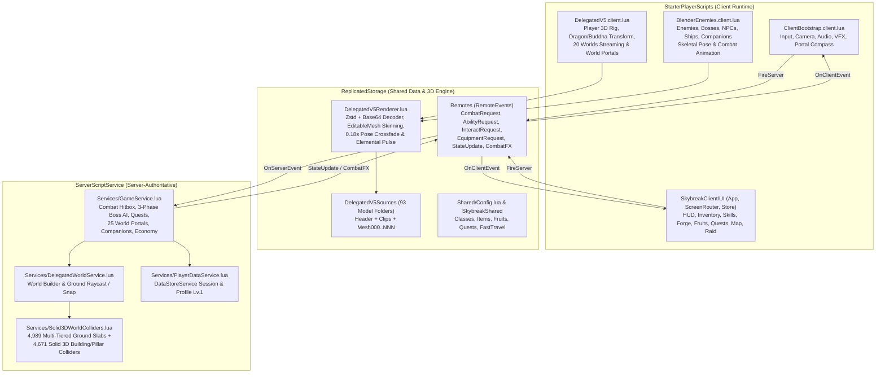

# SKYBREAK: FRAGMENTS OF THE CORE — TÀI LIỆU TỔNG HỢP GIỚI THIỆU GAME (INTRO) & KIẾN TRÚC KỸ THUẬT (TECH DOCS)

> **Dự án:** `SKYBREAK: Fragments of the Core`  
> **Thể loại:** 3D Action RPG • Khám phá 20 Đảo Bay • Trái Ác Quỷ 3D & Thức Tỉnh Tộc V4 • Co-op & Đồng Hành AI • Đánh Boss Đa Pha  
> **Nền tảng:** Roblox Studio (PC & Mobile) — Ngôn ngữ **Luau** + Pipeline **Blender 5.2 LTS (`Zstd + Base64 EditableMesh`)**  
> **File Place chính thức:** [SKYBREAK_Playable_v12_PremiumUI.rbxlx](file:///C:/Users/khang/Documents/Codex/2026-10-22/new-chat/outputs/SKYBREAK_Antigravity_Handoff/04_Roblox/SKYBREAK_Playable_v12_PremiumUI.rbxlx)

---

## 0. DANH MỤC CÁC FILE TÀI LIỆU HIỆN CÓ TRONG DỰ ÁN

| STT | Tên tài liệu | Nội dung chính | Đường dẫn |
|---:|---|---|---|
| 1 | **Tài liệu Tổng hợp Intro & Tech (File này)** | Tổng hợp đầy đủ cốt truyện, 20 Worlds, 3 Classes, 12 Trái Ác Quỷ, AI Companions và toàn bộ kiến trúc kỹ thuật Luau/3D V5 | [SKYBREAK_TECH_AND_GAME_INTRO_DOCS.md](file:///C:/Users/khang/Documents/Codex/2026-10-22/new-chat/outputs/SKYBREAK_Antigravity_Handoff/00_Documents/SKYBREAK_TECH_AND_GAME_INTRO_DOCS.md) |
| 2 | **Game Design Document (GDD Gốc)** | Thiết kế cốt truyện gốc, công thức sát thương/EXP, thiết kế màn chơi, Boss 3 pha và quy chuẩn bảo mật Server-Authoritative | [DESIGN_SOURCE.md](file:///C:/Users/khang/Documents/Codex/2026-10-22/new-chat/outputs/SKYBREAK/references/DESIGN_SOURCE.md) |
| 3 | **Báo Cáo Bàn Giao Kỹ Thuật (Codex Handoff)** | Báo cáo tổng kết 93/93 mô hình 3D V5, 104 script Luau, 22+ cổng dịch chuyển, hệ thống biến hình Rồng/Phật Tổ và kiểm toán | [CODEX_HANDOFF_REPORT.md](file:///C:/Users/khang/Documents/Codex/2026-10-22/new-chat/outputs/SKYBREAK_Antigravity_Handoff/CODEX_HANDOFF_REPORT.md) |
| 4 | **Tài Liệu Khởi Động Dự Án** | Hướng dẫn cấu trúc thư mục bàn giao, quy trình kiểm thử và nguyên tắc làm việc | [00_START_HERE.md](file:///C:/Users/khang/Documents/Codex/2026-10-22/new-chat/outputs/SKYBREAK_Antigravity_Handoff/00_START_HERE.md) |
| 5 | **Handoff Mỹ Thuật 3D & Concept Art** | Danh mục 17 bức Concept Art gốc và ánh xạ từng nhân vật, Boss, Thế giới sang file nguồn Blender `.blend` | [SKYBREAK_ARGON_3D_HANDOFF.md](file:///C:/Users/khang/Documents/Codex/2026-10-22/new-chat/outputs/SKYBREAK_Antigravity_Handoff/00_Documents/SKYBREAK_ARGON_3D_HANDOFF.md) |
| 6 | **Định Hướng Mỹ Thuật (Art Direction)** | Bảng màu, ánh sáng, chất liệu và phong cách thiết kế cho từng vùng | [ART_DIRECTION.md](file:///C:/Users/khang/Documents/Codex/2026-10-22/new-chat/outputs/SKYBREAK_Visual_v2/ART_DIRECTION.md) |
| 7 | **Hướng Dẫn Điều Khiển & Lát Cắt Gameplay** | Bảng phím điều khiển PC/Mobile, combo, né/lướt và luồng nhiệm vụ | [README_VI.md](file:///C:/Users/khang/Documents/Codex/2026-10-22/new-chat/outputs/SKYBREAK_Visual_v2/README_VI.md) |

---

## PHẦN I — GIỚI THIỆU GAME (GAME INTRO, LORE & GAMEPLAY)

### 1. Bối Cảnh & Cốt Truyện (Lore Intro)
Hàng nghìn năm trước, đại lục Thiên Giới lơ lửng giữa biển mây nhờ **Sky Core** — trái tim năng lượng vĩnh cửu giữ cho hàng chục quần đảo không rơi xuống vực thẳm. Khi thực thể cổ xưa **The Void** xâm thực nhằm nuốt chửng Sky Core, **Astrael** — Thủ lĩnh Vệ Binh Thiên Giới — buộc phải đập vỡ Sky Core thành các mảnh nguyên thủy và phân tán khắp các tầng trời để phong ấn The Void. Tuy nhiên, chính Astrael đã bị năng lượng Hư Không tha hóa và trở thành **Hư Không Vương Noxar**.

Hàng trăm năm sau, các quần đảo bắt đầu mất độ cao, vết nứt không gian mở rộng và các Vệ Binh cổ đại bị nhiễm năng lượng trở nên cuồng loạn. Người chơi vào vai một **Skyborn** — chiến binh thức tỉnh tại **Đảo Khởi Đầu (Sky Hub)** với sứ mệnh:
1. Tập hợp các mảnh vỡ **Sky Core** qua **3 Đại Hải Trình (Sea 1, Sea 2, Sea 3)** và **5 Cõi Mở Rộng Thượng Cổ (Realms 4–8)** gồm tổng cộng **20 Thế Giới (Worlds 1 → 20)**.
2. Thu thập thần khí, lĩnh ngộ **6 Bộ Võ Thuật Thượng Cổ**, thức tỉnh **12 Trái Ác Quỷ Aether 3D** cùng **Huyết Thống Chủng Tộc V4**.
3. Đánh bại các Boss trấn ải, giải cứu linh hồn Astrael và đối mặt với thực thể tối thượng **Veyr • Đấng Kiến Tạo Đầu Tiên** tại **Tận Cùng Bức Màn (The Veil's End — World 20)**.

### 2. Nhân Vật Cốt Truyện & Hệ Thống NPC 3D
- **Lyra • Chỉ Huy Skyborn (`Lyra`)**: Người dẫn đường tại Sky Hub, giao chuỗi 14 nhiệm vụ cốt truyện chính (`Q01` → `Q14`).
- **Kael • Đại Sư Rèn Thần Khí (`Kael`)**: Chủ trì Lò Rèn Thần Khí (`[H]`), chế tác vũ khí Legendary/Mythic và cường hóa vũ khí lên `+15`.
- **Zioles • Thương Nhân Gacha (`ZiolesGachaNPC`)**: Triệu hồi ngẫu nhiên 12 Trái Ác Quỷ 3D tại Sky Hub và Đảo Điện Thờ Zioles (World 2).
- **Đại Sư Cổ Tự (`AncientMonkNPC`)**: Truyền thụ 6 bộ võ thuật thượng cổ (`SkybornCombat`, `ElectricClaw`, `GlacialKarate`, `DragonTalon`, `GodhumanSkyborn`, `SanguineVoidArt`).
- **Tiến Sĩ Dr. Vega (`DrVega`)**: Nhà khoa học tại Frozen Cyber & Phòng Thí Nghiệm Đột Kích (World 9), phụ trách Đột Kích Thức Tỉnh Trái Ác Quỷ V2 (`Awakening Raid`).
- **Chronos (`Chronos`)**: Giám hộ Thời Gian & Hư Không tại Sea 3 và Pháo Đài Thời Gian (Chronos Bastion).
- **Đại Công Trình Sư Tàu Bay (`SkyShipwrightNPC`)**: Triệu hồi 3 mẫu Chiến Hạm Bay 3D (`CelestialBrigantine`, `CyberEnforcer`, `LeviathanHunterShip`) tại các bến cảng.

### 3. Hệ Thống 3 Class Nhân Vật & Tiến Trình Trang Phục
Người chơi bắt đầu ở **Cấp 1 (trang phục sơ khai `Novice`)**, tự động nâng cấp ngoại hình 3D sang **`Adventurer` (Lv.4)** và **`SkyGuardian` (Lv.8+)**, có thể chuyển đổi tự do giữa **Nam/Nữ** và **3 Class**:
1. **Sky Guardian (Kiếm Khiên Thái Dương — Nguyên tố `Sky`/`Solar`)**:
   - Đỡ đòn & cận chiến hạng nặng (+25% HP, +20% DEF).
   - Kỹ năng: `Sky Slash [1]`, `Guardian Shield [2]`, `Judgment Strike [3]`, `Celestial Aegis [R]`.
2. **Thunder Striker (Song Đao Lôi Tốc — Nguyên tố `Lightning`)**:
   - Sát thủ tốc độ cao (+10% ATK, nội tại cộng dồn tốc đánh tới 5 tầng).
   - Kỹ năng: `Arc Cut [1]`, `Flash Step [2]`, `Storm Blitz [3]`, `Thunder Judgement [R]`.
3. **Arcane Mage (Pháp Sư Tinh Cầu — Nguyên tố `Frost`/`Arcane`)**:
   - Tầm xa & khống chế diện rộng (đánh thường phóng cầu phép tầm xa 34m).
   - Kỹ năng: `Frost Bolt [1]`, `Mana Barrier [2]`, `Arcane Comet [3]`, `Astral Cataclysm [R]`.

### 4. Hệ Thống 12 Trái Ác Quỷ 3D (`Aether Fruits`) & Biến Hình Rồng / Phật Tổ
- **12 Trái Ác Quỷ 3D độc lập** (cầm trực tiếp trên tay 3D và hiển thị mô hình 3D động trong bảng `[G]`):
  - *Logia (Miễn nhiễm sát thương thường từ quái cấp thấp)*: `GaleCore` (Phong), `SandstoneCore` (Sa Mạc), `SolarFlameCore` (Hỏa Dương), `GlacierIceCore` (Băng Hà), `CelestialLightCore` (Ánh Sáng), `StarforgedMagmaCore` (Dung Nham), `ThunderRumbleCore` (Lôi Thần).
  - *Natural / Paramecia*: `AstralGravityCore` (Trọng Lực), `DimensionalPortalCore` (Không Gian — chiêu `[C]` dịch chuyển xuyên không gian 40m), `AetherflowCore` (Linh Mạch).
  - *Beast / Mythical Zoan (Biến hình 3D toàn phần)*:
    - **`SolarTitanCore` (Trái Kim Thân Thái Dương)**: Chiêu `[Z]` hóa **Kim Thân Phật Tổ Khổng Lồ 3D (`SolarTitanBuddha`)**, tăng mạnh giáp, tầm đánh gấp đôi, đầy đủ hoạt ảnh đứng thở, bước đi, vung chưởng và tung tuyệt kỹ.
    - **`AbyssalSovereignCore` (Trái Long Vương Hư Không)**: Chiêu `[V]` hóa **Thái Cổ Long Hoàng 3D (`AbyssalSovereignDragon`)**, uốn lượn, vỗ cánh khi di chuyển, quất đuôi/cào móng khi đánh thường và gầm phóng năng lượng khi dùng chiêu `[Z][X][C][V][F]`.

### 5. Hệ Thống 3 Đồng Hành AI (`AI Companions`)
Hỗ trợ người chơi vượt ải và săn Boss, mở khóa theo mốc cấp độ thực lực:
- **Lv.15 — Đội hình `Duo`**: Mở khóa **`Kairo • Vanguard`** (Tanker cận chiến dùng `Sky Slash`, thu hút hỏa lực).
- **Lv.30 — Đội hình `Trio`**: Mở khóa **`Lumen • Starweaver`** (Pháp sư tầm xa dùng `Frost Bolt`, tự động hồi 20% HP cho người chơi khi máu dưới 85%).
- **Lv.50 — Đội hình `Squad`**: Mở khóa **`Nyx • Shadowblitz`** (Sát thủ chí mạng cao dùng `Dagger Combo`, gây sát thương Break lớn lên Boss).

### 6. Bản Đồ 20 Thế Giới (`Worlds 1 → 20`) & Chuỗi Cổng Dịch Chuyển Tuần Tự
Mỗi World đều có **Đài Thờ Hồi Sinh (`Aether Shrine`)**, **NPC riêng**, **Quái & Boss trấn ải 3 Pha**, và **Cổng Dịch Chuyển Cuối World (`WorldGate_01` → `WorldGate_20`)**:
- **Sea 1 — Golden Sky Odyssey (Worlds 1–5)**:
  - `W1`: Golden Sky & Aureon Citadel (Boss: `Commander Valen`, `Golden Knight`, `Aureon Sentinel`)
  - `W2`: Zioles Gacha Shrine Island (Boss: `Shrine Warden Orion`)
  - `W3`: Aether Home Shrine Sanctuary (Boss: `Archon Helios`)
  - `W4`: West Garden Pirate Bastion (Boss: `Captain Vance`)
  - `W5`: Sunshard Sky Sanctuary (Boss: `High Priest Solarius`)
- **Sea 2 — Frozen Cyber Continent (Worlds 6–10)**:
  - `W6`: Frozen Cyber & Cryon Citadel (Boss: `Cryon Prime`)
  - `W7`: Cyberport Café Trading Hub (Boss: `Overlord Kron`)
  - `W8`: Permafrost Garrison Fortress (Boss: `General Boreas`)
  - `W9`: Microchip Awakening Raid Lab (Boss: `Order Cyborg`)
  - `W10`: Glacial Wreckage Danger Sea (Boss: `Sky Sea Beast`)
- **Sea 3 — Shadow Realm Odyssey (Worlds 11–15)**:
  - `W11`: Shadow Realm & Noxar Throne (Boss: `Noxar` & `Abyssal Sovereign Dragon`)
  - `W12`: Castle on the Void Mansion (Boss: `Lord Malakor`)
  - `W13`: Umbral Crystal Sanctum Forest (Boss: `Archfiend Zerath`)
  - `W14`: Temple of the Core • Race V4 (Boss: `Soul Reaper`)
  - `W15`: Mirage Sky Island • Leviathan Abyss (Boss: `Abyssal Leviathan`)
- **Expansion Realms 4–8 (Worlds 16–20)**:
  - `W16`: The Verdant Crown — Realm 4 (Boss: `Sylvaris • Đại Cổ Thụ Hoàng`)
  - `W17`: Emberforge Wastes — Realm 5 (Boss: `Ignivar • Titan Lò Rèn Lửa`)
  - `W18`: Abyssal Tides — Realm 6 (Boss: `Nerith • Thủy Hoàng Vực Sâu`)
  - `W19`: Chronos Bastion — Realm 7 (Boss: `Aion • Pháp Vương Thời Gian`)
  - `W20`: The Veil's End — Realm 8 (Boss: `Veyr • Đấng Kiến Tạo Đầu Tiên`)

---

## PHẦN II — KIẾN TRÚC KỸ THUẬT (TECHNICAL ARCHITECTURE)

### 1. Kiến Trúc Server-Authoritative (`ServerScriptService`)
Toàn bộ logic cốt lõi nằm trên Server để đảm bảo chống gian lận (anti-exploit) và đồng bộ trạng thái chính xác:
- **[GameService.lua](file:///C:/Users/khang/Documents/Codex/2026-10-22/new-chat/outputs/SKYBREAK_Antigravity_Handoff/06_Antigravity_Work/luau_v8/GameService.lua)**:
  - Xác thực mọi đòn đánh (`G.Action`, `G.UseSlotMove`), kiểm tra cooldown, tầm đánh, góc nhìn, vật cản (`clearLine`), tính sát thương theo công thức:
    $$\text{FinalDamage} = \max\left(1, \left\lfloor \text{ATK} \times \text{Multiplier} \times \frac{100}{100 + \text{DEF}} \times \text{CritMult} \right\rfloor\right)$$
  - Quản lý máy trạng thái (State Machine) cho toàn bộ Quái và 22 Singleton Bosses (`Idle` $\rightarrow$ `Patrol` $\rightarrow$ `Chase` $\rightarrow$ `Attack` $\rightarrow$ `Recover` $\rightarrow$ `ReturnToSpawn` $\rightarrow$ `Dead`), tự động chuyển 3 Phase (`100%` $\rightarrow$ `70%` $\rightarrow$ `35% HP`) kèm cơ chế Khiên Băng (`CryonPillar`), Hố Đen (`NoxarVoidFX`) và Trụ Năng Lượng (`EnergyPylon`).
  - Điều khiển 3 AI Companions (`G.SyncCompanions`, `G.TickCompanions`) bám theo người chơi, tự tìm mục tiêu gần nhất, tung kỹ năng và hồi máu.
- **[PlayerDataService.lua](file:///C:/Users/khang/Documents/Codex/2026-10-22/new-chat/outputs/SKYBREAK_Antigravity_Handoff/06_Antigravity_Work/luau_v8/PlayerDataService.lua)**:
  - Quản lý hồ sơ người chơi (`Profile`) với khởi đầu chuẩn RPG tại **Cấp 1 (`Level = 1`, `OutfitStage = "Novice"`, `PartySize = "Solo"`)**, lưu trữ an toàn qua `DataStoreService` khi người chơi rời phòng hoặc server đóng (`BindToClose`).

### 2. Engine Giải Mã & Dựng Hình 3D Thời Gian Thực (`DelegatedV5Renderer.lua`)
Thay vì phụ thuộc vào asset cloud bên ngoài, toàn bộ **93 mô hình 3D** (`7,337,723` tam giác, `2,461` mesh, `2,135` xương, `754` clip hoạt ảnh) được đóng gói trực tiếp trong `ReplicatedStorage.DelegatedV5Sources`:
- **Nén dữ liệu `Zstd + Base64`**: Mỗi mô hình gồm các `ModuleScript` con (`Header`, `Clips`, `Mesh000..MeshNNN`) chứa chuỗi JSON đã nén bằng thuật toán `Zstd` (`EncodingService:DecompressBuffer`) và mã hóa `Base64`.
- **Khởi tạo `EditableMesh` & `EditableImage` (PBR)**:
  - [DelegatedV5Renderer.lua](file:///C:/Users/khang/Documents/Codex/2026-10-22/new-chat/outputs/SKYBREAK_Antigravity_Handoff/06_Antigravity_Work/luau_v8/DelegatedV5Renderer.lua) giải mã danh sách đỉnh (`v`), pháp tuyến (`n`), tọa độ UV (`u`), mặt tam giác (`f`), trọng số xương (`bw`, `bi`) và tạo `MeshPart` từ `AssetService:CreateEditableMesh()` kết hợp `SurfaceAppearance` PBR.
- **Hệ thống Hoạt Ảnh Xương Nội Suy `Cubic Hermite` & `Crossfade 0.18s`**:
  - Mỗi nhân vật/quái/boss có 8 clip chuẩn hóa (`Idle`, `Walk`, `Run`, `Attack`, `Skill`, `ElementalSurge`, `HeroicKata`, `UltimateAwakening`).
  - Khi đổi trạng thái (ví dụ từ `Run` sang `Idle` hoặc `Attack`), hàm `Renderer.Pose(model, clip, time)` thực hiện nội suy mượt `0.18s` giữa tư thế xương hiện tại và clip mới, đồng thời điều chỉnh `GroundOffset` để chân nhân vật luôn chạm sát mặt đất và đứng thẳng tự nhiên.

### 3. Hệ Thống Va Chạm Vật Lý 3D Đa Tầng (`Solid3DWorldColliders.lua` & `DelegatedWorldService.lua`)
Để giải quyết triệt để việc mô hình `EditableMesh` khởi tạo ở Client không tự sinh va chạm vật lý trên Server:
- **[Solid3DWorldColliders.lua](file:///C:/Users/khang/Documents/Codex/2026-10-22/new-chat/outputs/SKYBREAK_Antigravity_Handoff/06_Antigravity_Work/luau_v8/Solid3DWorldColliders.lua)** trích xuất trực tiếp từ lưới tam giác 3D ở tỷ lệ chuẩn `scale = 1.0`:
  - **`4.989` tấm sàn địa hình 3D đa tầng (`workspace.GrandSkyIslands_Collision`)**: Bám sát từng bậc thềm, đảo phụ cao/thấp, cầu đá, và tự động loại bỏ khoảng trống trên các vực thẳm để nhân vật không bao giờ đi trên không.
  - **`4.671` khối vật cản cứng (`workspace.Solid3DObstacles`)**: Bao phủ toàn bộ nhà cửa, tháp chùa, tường thành, cột đá và trụ pha lê với `CanCollide = true` để người chơi và quái không đi xuyên qua công trình.
  - **Hàm `SnapToOpenGround(pos, refFloorY, heightOffset)`**: Tự động dò mặt sàn 3D hợp lệ và đẩy lùi khỏi vùng chồng lấn của nhà cửa/vật cản, đảm bảo mọi điểm dịch chuyển, cổng không gian, NPC và Boss luôn đứng trên mặt đất thông thoáng.

### 4. Hệ Thống Giao Diện Người Dùng (`SkybreakClient/UI`)
- Kiến trúc **Unidirectional Data Flow (`Store.lua` $\rightarrow$ `ScreenRouter.lua` $\rightarrow$ `Screens/*`)**:
  - **[HUD.lua](file:///C:/Users/khang/Documents/Codex/2026-10-22/new-chat/outputs/SKYBREAK_Antigravity_Handoff/06_Antigravity_Work/luau_v8/HUD.lua)**: Hiển thị thanh máu/năng lượng, thanh kỹ năng `[1][2][3][R]` & chiêu thức Trái Ác Quỷ `[Z][X][C][V][F]`, thanh máu Boss 3 pha kèm cảnh báo cơ chế, và La Bàn Cổng Thế Giới (`◈ REALM (Wn/20)`).
  - **Các màn hình chuyên biệt có khung xem 3D (`ViewportFrame`)**:
    - `Inventory [I]` ([Inventory.lua](file:///C:/Users/khang/Documents/Codex/2026-10-22/new-chat/outputs/SKYBREAK_Antigravity_Handoff/06_Antigravity_Work/luau_v8/Inventory.lua)): Xem nhân vật 3D thời gian thực và trang bị 8 ô đồ (`Weapon`, `Offhand/Gun`, `Helm`, `Chest`, `Gauntlets`, `Greaves`, `Ring`, `Artifact`).
    - `Fruits [G]` ([Fruits.lua](file:///C:/Users/khang/Documents/Codex/2026-10-22/new-chat/outputs/SKYBREAK_Antigravity_Handoff/06_Antigravity_Work/luau_v8/Fruits.lua)): Xem mô hình 3D động của 12 Trái Ác Quỷ, ăn trái, cầm trái 3D trên tay hoặc Thức Tỉnh V2.
    - `Forge [H]` ([Forge.lua](file:///C:/Users/khang/Documents/Codex/2026-10-22/new-chat/outputs/SKYBREAK_Antigravity_Handoff/06_Antigravity_Work/luau_v8/Forge.lua)): Rèn thần khí và cường hóa vũ khí `+15` với khung 3D `MythicalWeaponsSet`.
    - `Skills [K]` ([Skills.lua](file:///C:/Users/khang/Documents/Codex/2026-10-22/new-chat/outputs/SKYBREAK_Antigravity_Handoff/06_Antigravity_Work/luau_v8/Skills.lua)): Nâng cấp kỹ năng, đổi Class/Giới tính, chọn đội hình Đồng Hành AI (`Solo` / `Duo Lv.15` / `Trio Lv.30` / `Squad Lv.50`), và biểu diễn Kata 3D.
    - `Map [M]` & `Raid [P]` ([Raid.lua](file:///C:/Users/khang/Documents/Codex/2026-10-22/new-chat/outputs/SKYBREAK_Antigravity_Handoff/06_Antigravity_Work/luau_v8/Raid.lua)): Dịch chuyển tức thời tới 20 World hoặc khiêu chiến trực tiếp Boss Rush.
