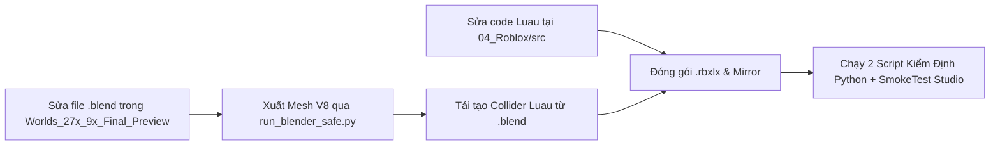

# TÀI LIỆU BÀN GIAO TỔNG THỂ DỰ ÁN (MASTER TECHNICAL & PRODUCTION HANDOVER)
## Dự án: **SKYBREAK: Fragments of the Core** (Roblox Action-RPG 3D)

> [!IMPORTANT]
> **CẬP NHẬT KIẾN TRÚC HIỆN HÀNH (07/11/2026 — Đọc [`CLAUDE.md`](CLAUDE.md) & [`PUBLISH_PLAN.md`](PUBLISH_PLAN.md) trước tiên):**
> 1. **Nơi sửa code Luau chuẩn:** Luôn sửa trong **3 thư mục Hạng Mục** (`04_Roblox/01_HangMuc1_Server_Combat_World`, `04_Roblox/02_HangMuc2_UI_Shop_Config`, `04_Roblox/03_HangMuc3_3D_VuKhi_Giap_VFX` — tổng 129 file `.lua`). **Tuyệt đối không sửa trực tiếp `04_Roblox/src/`** vì `04_Roblox/src/` là thư mục build nằm trong `.gitignore` và bị ghi đè mỗi khi chạy sync.
> 2. **Bản đồ thế giới hiện hành:** Bản đồ đang dùng trong game là **`Gameplay3x Clean3D`** (`../SKYBREAK_Argon_Refinement/Worlds_Gameplay3x_Clean3D`), **không phải** bản đồ `27× / 9×` (`Worlds_27x_9x_Final_Preview`) đã ngừng sử dụng từ ngày 31/10/2026. Các phần nhắc tới `27× / 9×` hoặc `04_Roblox/src` bên dưới phản ánh lịch sử tại thời điểm lập hồ sơ ngày 30/10/2026.

- **Phiên bản bàn giao**: `v12 PremiumUI • Gameplay3x Clean3D Edition` (`WorldArtVersion = 8`)
- **Ngày lập hồ sơ bàn giao**: `30/10/2026` *(Cập nhật chú giải kiến trúc: `07/11/2026`)*
- **Trạng thái bản dựng**: Playable End-to-End trong Roblox Studio
- **Đối tượng nhận bàn giao**: Đội ngũ Kỹ thuật (Lead Luau/Roblox Engineers), Đội ngũ Mỹ thuật 3D/Technical Art (Blender Pipeline), Game Design & QA/Live-Ops của đơn vị phát triển tiếp theo.

---

## 1. Tổng Quan Dự Án & Hồ Sơ Bàn Giao (Executive Summary)

**SKYBREAK: Fragments of the Core** là tựa game nhập vai hành động thế giới mở trên bầu trời (Celestial Action-RPG) xây dựng trên nền tảng **Roblox**, lấy cảm hứng từ cấu trúc phiêu lưu quần đảo đa đại dương (Sea 1 → Sea 2 → Sea 3 → Realms 4–8), kết hợp hệ thống chiến đấu tốc độ cao, 12 Trái Ác Quỷ 3D có thức tỉnh V2 & hóa Rồng bay tự do, 5 trường phái võ thuật, 6 Tộc V4 có cánh 3D hoạt họa, tàu chiến không gian có thể lái, sự kiện Biển Nguy Hiểm (Danger Sea Lv 1–6) và giao diện UI 11 màn hình song ngữ Việt – Anh (`VI / EN`).

### Chỉ Số Kỹ Thuật Thực Tế Tại Thời Điểm Bàn Giao

| Hạng mục | Thông số đã kiểm định | Ghi chú kỹ thuật |
| :--- | :--- | :--- |
| **File Place Roblox chính (`.rbxlx`)** | `306,809,536` bytes (~292.6 MB) | SHA-256: `f8a6182e07aaf790...` (đồng bộ trên 3 bản sao) |
| **Mã nguồn Luau (`04_Roblox/src`)** | **123** file `.lua` • **74,883** dòng code | Tổng dung lượng mã nguồn `3,610,087` bytes; mọi file `< 187 KB` |
| **Gói tài nguyên 3D nhúng (`DelegatedV5Sources`)** | **94** gói tài nguyên 3D (`Zstd + Base64`) | Dựng trực tiếp qua Roblox `EditableMesh` / `EditableImage` |
| **Quy mô thế giới 3D (`13` file `.blend`)** | **3** Map chính `27×` + **10** World mở rộng `9×` | Tổng **2,804** mảnh `MeshPart` (`964,974` tam giác), mọi mảnh `<= 1,748` studs |
| **Bố cục không gian & Dịch chuyển** | **8** Realms • **20** cụm đảo 3D • **40** điểm FastTravel | `0` chồng lấn AABB; khoảng cách phân tách `14,000–62,500` studs |
| **Hệ thống Va chạm Vật lý (Physics Colliders)** | **1,663** sàn/cầu OBB + **29** khối công trình | Mọi `Part.Size <= 1,679` studs; `216/216` điểm gameplay raycast khớp `100%` |
| **Giao diện người dùng (UI/UX)** | **11** màn hình chính + **13** UI Components | Song ngữ `VI / EN`, 3D `ViewportOrbit`, `CelestialMinimap` (`450m–8,500m`) |
| **Âm thanh (`07_Audio_SFX` & Procedural)** | **30** tệp âm thanh gốc + Synthesizer Engine | Quản lý qua [SkybreakAudioEngine.lua](file:///C:/Users/khang/Documents/Codex/2026-10-22/new-chat/outputs/SKYBREAK_Antigravity_Handoff/04_Roblox/src/StarterPlayer/StarterPlayerScripts/SkybreakAudioEngine.lua) |

> [!IMPORTANT]
> Toàn bộ tài nguyên 3D hiện tại đang được nén `Zstandard + Base64` trực tiếp bên trong `ReplicatedStorage.DelegatedV5Sources` của file `.rbxlx` để chạy độc lập (zero-cloud-dependency) trên mọi máy Roblox Studio mà không lo lỗi quyền sở hữu Asset ID giữa các tài khoản. Khi chuẩn bị **Publish công khai lên Roblox Cloud**, đơn vị tiếp nhận cần thực hiện lộ trình **Phase 1 (Chuyển đổi sang Native Roblox MeshPart Asset IDs)** được hướng dẫn chi tiết tại **Mục 8 & Mục 9**.

---

## 2. Cấu Trúc Thư Mục & Nguồn Chân Lý Duy Nhất (Repository Topology)

Dự án bao gồm 3 thư mục làm việc song hành dưới `C:/Users/khang/Documents/Codex/2026-10-22/new-chat/outputs/`. Đơn vị tiếp nhận cần nắm rõ vai trò từng thư mục để tránh sửa nhầm bản sao (mirror):

```text
outputs/
├── SKYBREAK_Antigravity_Handoff/                 <-- [GÓI BÀN GIAO CHÍNH - CANONICAL WORKSPACE]
│   ├── README.md                                 <-- Tổng quan kho lưu trữ & chỉ mục nhanh
│   ├── AGENTS.md                                 <-- Quy tắc bảo vệ bất biến nạp tự động cho AI Coding Agents
│   ├── .agents/skills/                           <-- [3 SKILLS ĐẶC THÙ DỰ ÁN NẠP TỰ ĐỘNG CHO ANTIGRAVITY / CODEX]
│   ├── SKYBREAK_MASTER_PROJECT_HANDOVER.md       <-- Tài liệu bàn giao tổng thể này
│   ├── 00_Documents/                             <-- [BỘ TÀI LIỆU KỸ THUẬT & THIẾT KẾ TOÀN TẬP (TẬP 00 -> 07)]
│   │   ├── 00_DOCUMENTATION_INDEX.md             <-- Cổng điều hướng tài liệu & lộ trình đọc theo vai trò
│   │   ├── 01_SYSTEM_ARCHITECTURE_AND_NETWORK_PROTOCOL.md
│   │   ├── 02_COMPLETE_LUAU_API_REFERENCE_123_MODULES.md
│   │   ├── 03_GAME_DESIGN_AND_COMBAT_BALANCE_BIBLE.md
│   │   ├── 04_WORLD_ATLAS_27X_9X_AND_3D_ASSET_PIPELINE.md
│   │   ├── 05_UI_UX_11_SCREENS_I18N_AND_AUDIO_GUIDE.md
│   │   ├── 06_DEVOPS_BUILD_QA_AND_CLOUD_PUBLISHING_RUNBOOK.md
│   │   └── 07_SOFTWARE_ENVIRONMENT_MCP_AND_AGENT_SKILLS_SETUP.md
│   ├── 02_Blender_Files/ & 02_Concept_Art/       <-- Lưu trữ nguồn Blender ban đầu & 17 tranh Concept Art gốc
│   ├── 04_Roblox/
│   │   ├── SKYBREAK_Playable_v12_PremiumUI.rbxlx <-- [FILE GAME CHÍNH ĐỂ MỞ TRONG ROBLOX STUDIO]
│   │   └── src/                                  <-- [NGUỒN CHÂN LÝ DUY NHẤT CỦA 123 FILE MÃ NGUỒN LUAU]
│   │       ├── ReplicatedStorage/                <-- Renderer 3D, Config, 23 clip GuardianMotion, Shared UI/Data
│   │       ├── ServerScriptService/              <-- Core GameService, Combat, WorldEvents, Economy, Colliders
│   │       ├── ServerStorage/                    <-- Importer phụ trợ
│   │       ├── StarterPlayer/                    <-- ClientBootstrap, DelegatedV5, VFX, Flight, Audio, 11-Screen UI
│   │       └── studio_sync_manifest.json         <-- Manifest kiểm tra đồng bộ 123 script & dung lượng byte
│   ├── 05_Pipeline_Tools_27x_9x/                 <-- [BỘ CÔNG CỤ ĐÓNG GÓI, SINH COLLIDER & KIỂM ĐỊNH TỰ ĐỘNG 27x/9x]
│   │   ├── sync_solid3d_and_scripts_to_rbxlx.py  <-- Đóng gói runtime_v8 + 123 script Luau vào .rbxlx & mirrors
│   │   ├── build_13_worlds_27x_9x_colliders.py   <-- Trích xuất mặt sàn Blender & sinh 4 module Collider Luau
│   │   ├── export_all_13_worlds_27x_9x_v8.py     <-- Bản lưu trữ trình xuất mesh V8 chia lưới KD-tree <= 1,748 studs
│   │   ├── verify_27x_9x_game_sync.py            <-- Kiểm định toàn diện AABB < 2,048, 0 chồng lấn, SHA-256 & < 199KB
│   │   ├── skybreak_contract_simulator_v3.py     <-- Kiểm định hợp đồng VisualAsset, Vũ khí/Súng, Giftcodes & Luau math
│   │   └── macro_world_coords_27x_9x.json        <-- File JSON khóa cứng tọa độ chuẩn toàn bộ 8 Realms & 20 cụm đảo
│   ├── 06_Antigravity_Work/
│   │   ├── runtime_v8/                           <-- [OUTPUT MESH V8 (.json + .zstd.b64) CỦA 13 WORLD + DRAGON RIGS]
│   │   ├── luau_v8/                              <-- Thư mục mirror script phẳng (tự động cập nhật khi đóng gói)
│   │   └── SKYBREAK_Playable_v12_PremiumUI.rbxlx <-- Bản sao dự phòng đồng nhất SHA-256 của file .rbxlx chính
│   └── 07_Audio_SFX/                             <-- 30 file âm thanh WAV/SFX thiết kế riêng
│
├── SKYBREAK_Argon_Refinement/                    <-- [XƯỞNG BLENDER 3D & PIPELINE XUẤT MESH V8]
│   ├── Worlds_27x_9x_Final_Preview/              <-- [NGUỒN .BLEND CHUẨN CỦA 13 THẾ GIỚI 27x / 9x + MANIFEST + RENDERS]
│   │   ├── SKYBREAK_All13Worlds_27x_9x_Manifest.json
│   │   ├── MainMaps_27x/                         <-- W1 GoldenSky, W4 FrozenCyber, W9 ShadowRealm (27x)
│   │   ├── Sea1_9x/                              <-- W2 SunshardSkySanctuary, W3 WestGardenPirateBastion (9x)
│   │   ├── Sea2_9x/                              <-- W5 Cyberport, W6 Permafrost, W7 RaidLab, W8 GlacialDangerSea (9x)
│   │   └── Sea3_9x/                              <-- W10 CastleVoid, W11 UmbralForest, W12 TempleCore, W13 MirageAbyss (9x)
│   ├── <Character/Boss/Prop Folders>/            <-- Nguồn .blend đã tinh chỉnh PBR của 45+ nhân vật, Boss, tàu, vũ khí, trái
│   ├── run_blender_safe.py                       <-- Wrapper chạy Blender ngầm (-b) an toàn qua hàng đợi khóa độc quyền
│   └── export_all_13_worlds_27x_9x_v8.py         <-- Trình xuất 13 thế giới 27x/9x có chia lưới KD-tree <= 1,748 studs
│
└── SKYBREAK_Visual_v2/                           <-- [WORKSPACE MIRROR CHO ROJO / ARGON]
    ├── default.project.json                      <-- Cấu hình Rojo/Argon trỏ vào src/
    ├── src/                                      <-- Bản sao tự động của 04_Roblox/src
    └── SKYBREAK_Playable_v12_PremiumUI.rbxlx     <-- Bản sao tự động đồng nhất SHA-256 của file .rbxlx chính
```

> [!CAUTION]
> **Quy tắc vàng về Nguồn Chân Lý (Single Source of Truth — Cập nhật 07/11/2026)**:
> 1. Mọi chỉnh sửa code Luau **PHẢI** thực hiện trong **3 thư mục Hạng Mục** (`04_Roblox/01_HangMuc1_Server_Combat_World`, `04_Roblox/02_HangMuc2_UI_Shop_Config`, `04_Roblox/03_HangMuc3_3D_VuKhi_Giap_VFX`), sau đó chạy script đóng gói `sync_solid3d_and_scripts_to_rbxlx.py` để đẩy vào `04_Roblox/src/` (bản build, `.gitignore`), `.rbxlx` và các thư mục mirror. **Không** sửa trực tiếp trong `04_Roblox/src/` hay trong Roblox Studio vì lần đóng gói tiếp theo sẽ ghi đè.
> 2. Bản đồ thế giới hiện hành là **`Gameplay3x Clean3D`** (`../SKYBREAK_Argon_Refinement/Worlds_Gameplay3x_Clean3D`), không phải bản đồ `27× / 9×` (`Worlds_27x_9x_Final_Preview`) đã bỏ. **Tuyệt đối không xuất lại thế giới từ `Worlds_27x_9x_Final_Preview`** và không chạy các script thế hệ cũ như `rework_skybreak_from_scratch.py` hay `export_all_15_worlds_v8.py`.

---

## 3. Kiến Trúc Kỹ Thuật Tổng Thể (System Architecture)

### 3.1. Sơ Đồ Luồng Dữ Liệu & Khởi Động Runtime

```mermaid
flowchart TD
    subgraph BlenderPipeline["1. Blender 3D Pipeline (Offline)"]
        BL["13 World .blend (27x / 9x) + 81 Rig/Prop .blend"] --> EXP["export_all_13_worlds_27x_9x_v8.py"]
        BL --> COLGEN["build_13_worlds_27x_9x_colliders.py"]
        EXP --> RV8["runtime_v8/*.json.zstd.b64 (<= 1,748 studs/chunk)"]
        COLGEN --> COLLUA["4 Collider Modules (*Collision.lua + Solid3DWorldColliders.lua)"]
        RV8 --> PACK["sync_solid3d_and_scripts_to_rbxlx.py"]
        COLLUA --> PACK
    end

    subgraph RobloxServer["2. Roblox Server (ServerScriptService)"]
        PACK --> RBXLX["SKYBREAK_Playable_v12_PremiumUI.rbxlx"]
        SB["ServerBootstrap.server.lua (15 RemoteEvents)"] --> GS["GameService.lua (Core Loop, Quests, NPCs, Gates, Enemies)"]
        GS --> DWS["DelegatedWorldService.lua (8 Realms Setup + Ground Raycast)"]
        DWS --> PHYS["GoldenSky / FrozenCyber / ShadowRealmCollision + Solid3DWorldColliders"]
        GS --> PDS["PlayerDataService.lua (DataStore + Session Sanitizer)"]
        GS --> SCE["SkybreakCombatExpansion.lua (5 Styles, V2 Fruits, Haki, Trading)"]
        GS --> WES["SkybreakWorldEventsService.lua (Ships, Danger Sea, Raids, Spire)"]
        GS --> SES["SkybreakSocialEconomyService.lua (SafeZones, SkyRails, Chests, Colosseum)"]
    end

    subgraph RobloxShared["3. Shared Modules (ReplicatedStorage)"]
        CFG["Shared/Config.lua + RealmConfig.lua + WorldConfig.lua"]
        REND["DelegatedV5Renderer.lua + DelegatedV5Sources (94 Assets)"]
        EQ3D["Shared/Skybreak3DEquipment.lua (21 VirtualSplit Weapons/Wings/Trees/Shrines)"]
    end

    subgraph RobloxClient["4. Roblox Client (StarterPlayerScripts)"]
        CB["ClientBootstrap.client.lua (Input, HUD Sync, Combat Request, Lighting)"]
        DV5["DelegatedV5.client.lua (Builds 3D Worlds, Player Class Rigs, Portals)"]
        BE["BlenderEnemies.client.lua + BlenderNPCs.client.lua (3D Mob/Boss/NPC Rigs)"]
        VFX["SkybreakClientVFX.lua + UniversalVFXOverhaul.lua + DragonSovereignVFX.lua"]
        FLIGHT["SkybreakFlightAndCamera.client.lua (Free Flight, Dynamic FOV, Shake)"]
        UIAPP["SkybreakClient/UI/App.lua (11 Bilingual Screens + CelestialMinimap)"]
        AUD["SkybreakAudioEngine.lua (Spatial BGM & Combat SFX)"]
    end

    REND --> DV5
    REND --> BE
    REND --> EQ3D
    CFG --> GS
    CFG --> CB
    CFG --> UIAPP
    GS <-->|"15 Core RemoteEvents"| CB
    GS <-->|"UIRequest / UICommand / StateUpdate"| UIAPP
```



### 3.2. Kiến Trúc Dựng Hình 3D Runtime (`DelegatedV5Renderer`)
Thay vì phụ thuộc vào `rbxassetid://` bên ngoài, dự án sử dụng cơ chế giải nén và tạo lưới 3D động tại Client:
1. **Đóng gói dữ liệu (`DelegatedV5Sources`)**:
   - Mỗi tài nguyên trong `ReplicatedStorage.DelegatedV5Sources.<AssetName>` là một `Folder` chứa `Header`, `Clips`, và `Mesh000` → `MeshNNN` (`ModuleScript`).
   - Bên trong mỗi `ModuleScript` là các `StringValue` `Data001`, `Data002`... (mỗi mảnh `150,000` ký tự ASCII) lưu chuỗi `Base64` của buffer nén `Zstandard`.
   - Khi `require()`, đoạn loader 4 dòng giải nén bằng `EncodingService:DecompressBuffer(..., Enum.CompressionAlgorithm.Zstd)` và `HttpService:JSONDecode(...)`.
2. **Tái tạo Mesh & Rig xương ([DelegatedV5Renderer.lua](file:///C:/Users/khang/Documents/Codex/2026-10-22/new-chat/outputs/SKYBREAK_Antigravity_Handoff/04_Roblox/src/ReplicatedStorage/DelegatedV5Renderer.lua))**:
   - Dùng `AssetService:CreateEditableMesh()` và `AssetService:CreateMeshPartAsync()` để dựng từng `MeshPart` kèm Vertex Positions, Normals, UVs, PBR `SurfaceAppearance` / `MaterialVariant`, độ trong suốt (`alpha`), phát sáng (`emission`), và hệ thống `Bone` (rig 19 xương `Shared19` cho nhân vật hoặc skeleton riêng cho Boss/Rồng).
   - **Tách tài nguyên ảo (`VirtualSplitSpecs`)**: Cho phép gộp nhiều vật phẩm vào chung 1 file Blender nhưng tách riêng từng model độc lập lúc runtime theo dải `minMesh..maxMesh` hoặc `bonePrefix` (áp dụng cho **21 model tách rời**: 8 Vũ khí/Súng thần thoại từ `MythicalWeaponsSet`, 6 Cánh Tộc V4 từ `RaceV4WingsSet`, 3 Cây Trái Ác Quỷ Cổ Đại từ `AncientAetherFruitTrees`, 3 Điện Thờ Nguyên Tố & 1 Bảng Điều Khiển Raid từ `AetherShrinesAndRaidConsole`).
3. **Phân tách Trách nhiệm Vật lý Server – Đồ họa Client**:
   - **Server** *không* tốn CPU dựng `EditableMesh` cho địa hình: Server chỉ chạy 4 module va chạm siêu nhẹ ([GoldenSkyCollision.lua](file:///C:/Users/khang/Documents/Codex/2026-10-22/new-chat/outputs/SKYBREAK_Antigravity_Handoff/04_Roblox/src/ServerScriptService/Services/GoldenSkyCollision.lua), [FrozenCyberCollision.lua](file:///C:/Users/khang/Documents/Codex/2026-10-22/new-chat/outputs/SKYBREAK_Antigravity_Handoff/04_Roblox/src/ServerScriptService/Services/FrozenCyberCollision.lua), [ShadowRealmCollision.lua](file:///C:/Users/khang/Documents/Codex/2026-10-22/new-chat/outputs/SKYBREAK_Antigravity_Handoff/04_Roblox/src/ServerScriptService/Services/ShadowRealmCollision.lua), [Solid3DWorldColliders.lua](file:///C:/Users/khang/Documents/Codex/2026-10-22/new-chat/outputs/SKYBREAK_Antigravity_Handoff/04_Roblox/src/ServerScriptService/Services/Solid3DWorldColliders.lua)) tạo các khối `Part` / `Cylinder` vô hình (`Transparency = 1`, `Anchored = true`, `CanCollide = true`) khớp `1:1` với mặt sàn Blender để tính raycast quái, NPC và chống xuyên sàn.
   - **Client** ([DelegatedV5.client.lua](file:///C:/Users/khang/Documents/Codex/2026-10-22/new-chat/outputs/SKYBREAK_Antigravity_Handoff/04_Roblox/src/StarterPlayer/StarterPlayerScripts/DelegatedV5.client.lua)) dựng toàn bộ lớp vỏ mỹ thuật 3D (`CanCollide = false`, `Anchored = true`) đặt trùng khít lên tọa độ `Origin` của Server.

### 3.3. Hợp Đồng Giao Thức Mạng (15 Core RemoteEvents)
Khởi tạo tập trung tại [ServerBootstrap.server.lua](file:///C:/Users/khang/Documents/Codex/2026-10-22/new-chat/outputs/SKYBREAK_Antigravity_Handoff/04_Roblox/src/ServerScriptService/ServerBootstrap.server.lua) bên trong `ReplicatedStorage.Remotes`:

| STT | Tên RemoteEvent | Chiều | Chức năng chính |
| :---: | :--- | :---: | :--- |
| 1 | `CombatRequest` | C → S | Đòn đánh thường M1 combo, đỡ đòn (block), lướt (dash/dodge) |
| 2 | `AbilityRequest` | C → S | Kích hoạt kỹ năng Class, Võ thuật, Vũ khí, Súng, Trái Ác Quỷ (`Z/X/C/V/F`), Haki, Thức tỉnh Tộc V4 |
| 3 | `InteractRequest` | C → S | Tương tác NPC, nhận/trả nhiệm vụ, mở cổng `WorldGate`, nhặt rương/trái, triệu hồi tàu, vào Raid |
| 4 | `StateUpdate` | S → C | Đồng bộ toàn bộ hồ sơ người chơi (Level, Gold, Shards, Inventory, Equipped, Quest, Cooldowns, Boss HP) |
| 5 | `EquipmentRequest` | C → S | Trang bị / tháo vũ khí, súng, phụ kiện, đổi võ thuật |
| 6 | `CombatFX` | S → C | Phát hiệu ứng VFX/SFX đòn đánh, kỹ năng Boss, tia sét, vụ nổ diện rộng cho mọi Client |
| 7 | `CombatEvent` | S → C | Hiển thị số sát thương nổi (damage numbers), trạng thái hit-stop, thông báo hạ gục / rơi đồ |
| 8 | `AppearanceRequest` | C → S | Đổi Class (`SkyGuardian`, `ThunderStriker`, `ArcaneMage`), giới tính nhân vật, skin/cánh |
| 9 | `UIRequest` | C → S | Truy vấn dữ liệu từ bộ UI mới ([UIRequestHandler.server.lua](file:///C:/Users/khang/Documents/Codex/2026-10-22/new-chat/outputs/SKYBREAK_Antigravity_Handoff/04_Roblox/src/ServerScriptService/SkybreakServer/UIRequestHandler.server.lua)): cài đặt, giftcode, party, kho đồ |
| 10 | `UICommand` | S → C | Lệnh điều khiển mở/đóng màn hình UI, hiện Toast, cập nhật Raid Phase / LootFeed |
| 11 | `FruitAction` | C → S | Quay Gacha Zioles, cầm trái 3D trên tay, ăn trái, cất vào kho, thả trái ra đất, thức tỉnh chiêu V2 |
| 12 | `TradeAction` | C → S | Giao dịch an toàn tại bàn Café Sea 2 (khóa vật phẩm, kiểm tra chênh lệch giá trị, xác nhận 2 bước) |
| 13 | `StatAllocate` | C → S | Cộng điểm tiềm năng (Melee, Defense, Sword, Gun, Core/Fruit) & tẩy điểm (Stat Refund) |
| 14 | `TeleportIsland` | C → S | Dịch chuyển nhanh (Fast Travel) qua WorldMap tới 40 đảo đã mở khóa & về Home Point |
| 15 | `ForgeRequest` | C → S | Rèn / nâng cấp sao vũ khí tại Kael, khảm bùa chú (Arcane Enchanting) |

---

## 4. Quy Hoạch Địa Lý Thế Giới `27× / 9×` & Xử Lý Giới Hạn `2,048` Studs

### 4.1. Bảng Tọa Độ Chuẩn Toàn Bộ 8 Realms & 20 Cụm Thế Giới 3D
Nguồn tọa độ chuẩn được khóa tại [macro_world_coords_27x_9x.json](file:///C:/Users/khang/Documents/Codex/2026-10-22/new-chat/outputs/SKYBREAK_Antigravity_Handoff/05_Pipeline_Tools_27x_9x/macro_world_coords_27x_9x.json) và đồng bộ `100%` giữa [RealmConfig.lua](file:///C:/Users/khang/Documents/Codex/2026-10-22/new-chat/outputs/SKYBREAK_Antigravity_Handoff/04_Roblox/src/ReplicatedStorage/Shared/RealmConfig.lua), [Config.lua](file:///C:/Users/khang/Documents/Codex/2026-10-22/new-chat/outputs/SKYBREAK_Antigravity_Handoff/04_Roblox/src/ReplicatedStorage/Shared/Config.lua), [WorldConfig.lua](file:///C:/Users/khang/Documents/Codex/2026-10-22/new-chat/outputs/SKYBREAK_Antigravity_Handoff/04_Roblox/src/ReplicatedStorage/SkybreakShared/Config/WorldConfig.lua), [DelegatedV5.client.lua](file:///C:/Users/khang/Documents/Codex/2026-10-22/new-chat/outputs/SKYBREAK_Antigravity_Handoff/04_Roblox/src/StarterPlayer/StarterPlayerScripts/DelegatedV5.client.lua) và 4 module Collider:

| Mã / Khu vực | Asset 3D (`DelegatedV5Sources`) | Cấp tỷ lệ | Kích thước ngang (Studs) | `Origin (X, Y, Z)` | Độ cao sàn chính `DeckY` | Điểm `Spawn` / `FastTravel` chính | Số Mesh V8 / Tam giác |
| :--- | :--- | :---: | :---: | :---: | :---: | :---: | :---: |
| **SEA 1 • `GoldenSky`** | `GoldenSky` (`W1`) | **`27×`** | `15,831 × 16,517` | `(0, 0, 0)` | `50.5` | `SkyHub (-2484, 54, 4131)` • `Lumen (0, 54, 180)` • `Arena (0, 54, -2420)` | `586` / `140,542` |
| Sea 1 • Điện Thờ Zioles | `ZiolesGachaShrine` | Đảo đơn | `~270 × 270` | `(-3600, 50, 6600)` | `50.0` | `(-3600, 54, 6616)` | Có sẵn trong `.rbxlx` |
| Sea 1 • Đài Điện Thờ Aether | `ZiolesGachaShrine` | Đảo đơn | `~270 × 270` | `(1200, 50, 6600)` | `50.0` | `(1200, 54, 6616)` | Có sẵn trong `.rbxlx` |
| Sea 1 • Pháo Đài Vườn Tây | `WestGardenPirateBastion` (`W3`) | **`9×`** | `5,302 × 4,606` | `(-14500, 0, 1500)` | `47.5` | `(-14500, 52, 650)` | `135` / `54,938` |
| Sea 1 • Thánh Địa Thái Dương | `SunshardSkySanctuary` (`W2`) | **`9×`** | `5,087 × 5,431` | `(14500, 0, -1500)` | `47.5` | `(14500, 52, -980)` | `108` / `55,203` |
| **SEA 2 • `FrozenCyber`** | `FrozenCyber` (`W4`) | **`27×`** | `15,274 × 15,540` | `(48000, 0, 0)` | `54.1` | `Spawn (45030, 58, 4185)` • `Cryon (48000, 58, -2450)` • `Portal (52968, 54.1, -4158)` | `672` / `148,942` |
| Sea 2 • Quán Cà Phê Giao Dịch | `CyberportCafeTradingHub` (`W5`) | **`9×`** | `4,669 × 4,830` | `(35000, 0, 8500)` | `48.7` | `(35000, 53, 8560)` | `91` / `54,961` |
| Sea 2 • Pháo Đài Tuyết | `PermafrostGarrisonFortress` (`W6`) | **`9×`** | `4,687 × 4,162` | `(35000, 0, -5500)` | `48.7` | `(35000, 53, -6285)` | `89` / `58,243` |
| Sea 2 • Phòng Thí Nghiệm Raid | `MicrochipAwakeningRaidLab` (`W7`) | **`9×`** | `4,153 × 4,598` | `(62000, 0, 8500)` | `48.7` | `(62000, 53, 8640)` | `74` / `55,176` |
| Sea 2 • Vùng Biển Xác Tàu Băng | `GlacialWreckageDangerSea` (`W8`) | **`9×`** | `4,552 × 4,635` | `(62000, 0, -5500)` | `48.7` | `(62000, 53, -5530)` | `73` / `45,591` |
| **SEA 3 • `ShadowRealm`** | `ShadowRealm` (`W9`) | **`27×`** | `15,935 × 14,828` | `(-48000, 0, 0)` | `54.1` | `Spawn (-52644, 58, 3240)` • `Noxar (-45435, 58, -1120)` | `722` / `141,769` |
| Sea 3 • Dinh Thự Hư Không | `CastleOnTheVoidMansion` (`W10`) | **`9×`** | `4,618 × 4,204` | `(-62500, 0, 8500)` | `48.7` | `SafeZone (-62500, 53, 10120)` • `Keep (-62500, 48.7, 7600)` | `70` / `55,625` |
| Sea 3 • Rừng Tinh Thể Đen | `UmbralCrystalSanctumForest` (`W11`) | **`9×`** | `4,603 × 4,746` | `(-34500, 0, 8500)` | `48.7` | `(-34500, 53, 8555)` | `66` / `50,360` |
| Sea 3 • Đền Thờ Tộc V4 | `TempleOfTheCoreRaceV4` (`W12`) | **`9×`** | `4,530 × 4,638` | `(-62500, 0, -5500)` | `48.7` | `(-62500, 53, -5435)` | `51` / `55,588` |
| Sea 3 • Vực Thẳm Leviathan | `MirageSkyIslandLeviathanAbyss` (`W13`) | **`9×`** | `4,562 × 4,583` | `(-48000, 0, -16500)` | `48.7` | `(-48000, 53, -16370)` | `67` / `48,036` |
| **REALM 4 • `VerdantCrown`** | Tái sử dụng `W11` + Theme Lục Bảo | **`9×`** | `4,603 × 4,746` | `(0, 120, -34000)` | `168.7` | `(0, 173, -33940)` (+3 đảo vệ tinh Tây/Đông/Bắc) | Dùng chung `W11` |
| **REALM 5 • `EmberforgeWastes`** | Tái sử dụng `W3` + Theme Dung Nham | **`9×`** | `5,302 × 4,606` | `(48000, 120, -34000)` | `167.5` | `(48000, 172, -34850)` (+3 đảo vệ tinh) | Dùng chung `W3` |
| **REALM 6 • `AbyssalTides`** | Tái sử dụng `W13` + Theme Biển Sâu | **`9×`** | `4,562 × 4,583` | `(-48000, 120, -34000)` | `168.7` | `(-48000, 173, -33870)` (+3 đảo vệ tinh) | Dùng chung `W13` |
| **REALM 7 • `ChronosBastion`** | Tái sử dụng `W12` + Theme Thời Gian | **`9×`** | `4,530 × 4,638` | `(0, 180, -48000)` | `228.7` | `(0, 233, -47935)` (+3 đảo vệ tinh) | Dùng chung `W12` |
| **REALM 8 • `VeilsEnd`** | Tái sử dụng `W10` + Theme Hư Vô | **`9×`** | `4,618 × 4,204` | `(0, 260, -62000)` | `308.7` | `(0, 313, -60380)` (+3 đảo vệ tinh) | Dùng chung `W10` |

### 4.2. Giải Pháp Kỹ Thuật Vượt Giới Hạn `2,048` Studs Của Roblox Engine
Engine vật lý và `EditableMesh` của Roblox khóa cứng kích thước tối đa mỗi `BasePart` / `MeshPart` ở **`2,048` studs** trên mỗi trục, trong khi các đảo chính ở quy mô `27×` rộng tới `2,628–4,644` studs và vách đá nổi sâu `2,916` studs. Dự án đã giải quyết triệt để bằng 2 thuật toán tự động:
1. **Đối với Mesh đồ họa ([export_all_13_worlds_27x_9x_v8.py](file:///C:/Users/khang/Documents/Codex/2026-10-22/new-chat/outputs/SKYBREAK_Argon_Refinement/export_all_13_worlds_27x_9x_v8.py))**:
   - *Bước 1*: Chia đôi đệ quy cạnh dài nhất của mọi tam giác có AABB vượt `748` studs (nội suy tuyến tính vị trí, pháp tuyến và UV).
   - *Bước 2*: Phân hoạch không gian đệ quy theo cây KD-tree AABB + gộp thùng tham lam (greedy bin-merging) để **100% mảnh `MeshXXX`** có kích thước `<= 1,748 < 2,048` studs, số tam giác `<= 18,000` tris/mảnh và tổng số mảnh mỗi world `<= 999`.
2. **Đối với Vật lý va chạm ([build_13_worlds_27x_9x_colliders.py](file:///C:/Users/khang/Documents/Codex/2026-10-22/new-chat/outputs/SKYBREAK_Antigravity_Handoff/05_Pipeline_Tools_27x_9x/build_13_worlds_27x_9x_colliders.py) → 4 module `*Collision.lua`)**:
   - Đảo tròn đường kính `<= 1,700` studs dùng 1 `Part` hình trụ (`Enum.PartType.Cylinder`, xoay trục X thẳng đứng `CFrame.Angles(0, 0, math.pi/2)`).
   - Đảo khổng lồ đường kính `> 1,700` studs (như `LumenPlaza Ø 2,628`, `SunlitOasis Ø 2,772`, `CitadelForecourt Ø 4,644`) được lát thành các dải `Block` theo chiều rộng dây cung tròn có biên chồng mép `+0.4` studs, chia nhỏ dọc trục X để mọi cạnh `Part.Size <= 1,680` studs, không có bất kỳ khe hở nào.
   - Mọi cây cầu chéo `45°` dùng **Hộp Bao Định Hướng Ngang 2D (2D Horizontal OBB)** tính theo trục chính của đỉnh mesh cầu kèm phần vươn đầu cầu `+96` studs ăn sâu vào thềm đảo (tuyệt đối không dùng AABB thẳng trục để tránh tạo sàn tàng hình ngoài khoảng không).

---

## 5. Danh Mục Chi Tiết Mã Nguồn Luau (`04_Roblox/src` — 123 Files)

### 5.1. `ReplicatedStorage` (44 files — Dữ liệu dùng chung, Renderer 3D & Animation)
- [DelegatedV5Renderer.lua](file:///C:/Users/khang/Documents/Codex/2026-10-22/new-chat/outputs/SKYBREAK_Antigravity_Handoff/04_Roblox/src/ReplicatedStorage/DelegatedV5Renderer.lua) (`126.0 KB` — bản sao đồng bộ tại `Shared/DelegatedV5Renderer.lua`): Trái tim dựng hình `EditableMesh` / `EditableImage`, hệ thống xương `Bone`, giải mã animation `Clips`, lọc vật liệu PBR và bảng `VirtualSplitSpecs` cho 21 model vũ khí/cánh/cây/điện thờ.
- [Shared/Config.lua](file:///C:/Users/khang/Documents/Codex/2026-10-22/new-chat/outputs/SKYBREAK_Antigravity_Handoff/04_Roblox/src/ReplicatedStorage/Shared/Config.lua) (`119.2 KB`): Cấu hình tổng thể game — thông số Level/EXP, 40 điểm FastTravel (`C.Islands`), toàn bộ chỉ số Quái/Boss (`C.Enemies`), Vũ khí/Súng/Phụ kiện (`C.Items`, `C.Guns`), Nhiệm vụ, Cửa hàng và hằng số cân bằng.
- [Shared/Skybreak3DEquipment.lua](file:///C:/Users/khang/Documents/Codex/2026-10-22/new-chat/outputs/SKYBREAK_Antigravity_Handoff/04_Roblox/src/ReplicatedStorage/Shared/Skybreak3DEquipment.lua) (`105.2 KB`): Gắn vũ khí 3D vào tay nhân vật, gắn 6 bộ cánh Tộc V4 có nhịp vỗ theo trạng thái bay/lướt, đặt 3 Cây Trái Ác Quỷ Cổ Đại, 3 Điện Thờ Nguyên Tố, Bảng Raid Microchip, lò rèn Kael, cổng dịch chuyển Sea và luồng gió nhảy (`JumpStreams`).
- [Shared/SkybreakCombatData.lua](file:///C:/Users/khang/Documents/Codex/2026-10-22/new-chat/outputs/SKYBREAK_Antigravity_Handoff/04_Roblox/src/ReplicatedStorage/Shared/SkybreakCombatData.lua) (`52.2 KB`): Định nghĩa chi tiết 5 Võ thuật, 12 Trái Ác Quỷ (`60` chiêu thức + điều kiện Mastery + nâng cấp V2), công thức sát thương, Haki, Tộc V4 và danh sách Giftcodes.
- [Shared/RealmConfig.lua](file:///C:/Users/khang/Documents/Codex/2026-10-22/new-chat/outputs/SKYBREAK_Antigravity_Handoff/04_Roblox/src/ReplicatedStorage/Shared/RealmConfig.lua) (`0.9 KB`) & [Shared/RealmEnvironment.lua](file:///C:/Users/khang/Documents/Codex/2026-10-22/new-chat/outputs/SKYBREAK_Antigravity_Handoff/04_Roblox/src/ReplicatedStorage/Shared/RealmEnvironment.lua) (`5.7 KB`): Tọa độ gốc 8 Realms và preset ánh sáng/khí quyển/sương mù tầm xa (`FogStart = 1,800`, `FogEnd = 18,000`).
- [Shared/SkybreakSmokeTest.lua](file:///C:/Users/khang/Documents/Codex/2026-10-22/new-chat/outputs/SKYBREAK_Antigravity_Handoff/04_Roblox/src/ReplicatedStorage/Shared/SkybreakSmokeTest.lua) (`24.6 KB`): Bộ kiểm thử tự động **130 bài test** ngay trong phiên chạy Studio (`RunClientAudit`, `RunServerAudit`, `RunAll`).
- `GuardianMotion/*` (`23` files): Bộ keyframe CFrame chuẩn cho rig nhân vật (`Idle`, `Walk`, `Run`, `Jump`, `Dash`, `Dodge`, `Attack01..03`, `Heavy`, `SkySlash`, `ElementalSurge`, `UltimateAwakening`, `Death`...) điều phối bởi [GuardianMotionController.lua](file:///C:/Users/khang/Documents/Codex/2026-10-22/new-chat/outputs/SKYBREAK_Antigravity_Handoff/04_Roblox/src/ReplicatedStorage/GuardianMotion/GuardianMotionController.lua).
- `SkybreakShared/*` (`13` files): Design tokens, cấu hình độ hiếm [RarityConfig.lua](file:///C:/Users/khang/Documents/Codex/2026-10-22/new-chat/outputs/SKYBREAK_Antigravity_Handoff/04_Roblox/src/ReplicatedStorage/SkybreakShared/Config/RarityConfig.lua), cấu hình bản đồ [WorldConfig.lua](file:///C:/Users/khang/Documents/Codex/2026-10-22/new-chat/outputs/SKYBREAK_Antigravity_Handoff/04_Roblox/src/ReplicatedStorage/SkybreakShared/Config/WorldConfig.lua) (lưu ý: `SkybreakShared/WorldConfig.lua` và `SkybreakShared/Config/WorldConfig.lua` là cặp file mirror phải luôn giống hệt nhau; tương tự với `UIState.lua` và `Types/UIState.lua`).

### 5.2. `ServerScriptService` (25 files — Logic Server Authoritative & Vật Lý)
- [ServerBootstrap.server.lua](file:///C:/Users/khang/Documents/Codex/2026-10-22/new-chat/outputs/SKYBREAK_Antigravity_Handoff/04_Roblox/src/ServerScriptService/ServerBootstrap.server.lua) (`1.0 KB`): Điểm vào duy nhất khởi tạo 15 `RemoteEvents` và kích hoạt `GameService.Start()`.
- [Services/GameService.lua](file:///C:/Users/khang/Documents/Codex/2026-10-22/new-chat/outputs/SKYBREAK_Antigravity_Handoff/04_Roblox/src/ServerScriptService/Services/GameService.lua) (`186.5 KB` — **lưu ý sát ngưỡng 199 KB**): Trục xương sống của Server — quản lý sinh nhân vật, AI quái & Boss chính (`AureonSentinel`, `CryonPrime`, `Noxar`), chuỗi nhiệm vụ, hệ thống 25 cổng `WorldGate`, Gacha/Trái Ác Quỷ cơ bản, rèn đồ, dịch chuyển đảo và vòng lặp bảo vệ rơi khỏi đảo.
- [Services/SkybreakCombatExpansion.lua](file:///C:/Users/khang/Documents/Codex/2026-10-22/new-chat/outputs/SKYBREAK_Antigravity_Handoff/04_Roblox/src/ServerScriptService/Services/SkybreakCombatExpansion.lua) (`161.7 KB`): Xử lý toàn bộ 60 kỹ năng Trái Ác Quỷ & V2 Awakening, hóa hình Rồng Tối Thượng (`AbyssalSovereignDragon` Hybrid & Full Dragon), 5 trường phái võ thuật, kỹ năng Kiếm/Súng, 3 loại Haki, Thức tỉnh Tộc V4, bàn giao dịch Café 4 người và đổi Giftcode.
- [Services/SkybreakWorldEventsService.lua](file:///C:/Users/khang/Documents/Codex/2026-10-22/new-chat/outputs/SKYBREAK_Antigravity_Handoff/04_Roblox/src/ServerScriptService/Services/SkybreakWorldEventsService.lua) (`160.4 KB`): Hệ thống cảng đóng tàu & điều khiển 3 tàu chiến 3D, Biển Nguy Hiểm 6 cấp (triệu hồi Thủy Quái, Cá Mập Trời, Leviathan, Đảo Ảo Ảnh Mirage), công thành Không Tặc tại Dinh Thự Hư Không, Raid Microchip 5 đảo lơ lửng và Tháp Vô Tận Sky Spire.
- [Services/SkybreakSocialEconomyService.lua](file:///C:/Users/khang/Documents/Codex/2026-10-22/new-chat/outputs/SKYBREAK_Antigravity_Handoff/04_Roblox/src/ServerScriptService/Services/SkybreakSocialEconomyService.lua) (`126.7 KB`): Hệ thống Tổ đội (Party/Crew), truy nã Bounty/Honor, vùng an toàn (`SAFE_ZONES`), đường ray trượt trên không (`AetherSkyRails`), rương báu 4 bậc, thương nhân Hư Không lưu động, đấu trường PvP Colosseum, khảm bùa chú và chế độ Dev Sandbox.
- [Services/DelegatedWorldService.lua](file:///C:/Users/khang/Documents/Codex/2026-10-22/new-chat/outputs/SKYBREAK_Antigravity_Handoff/04_Roblox/src/ServerScriptService/Services/DelegatedWorldService.lua) (`47.4 KB`): Dựng khung Workspace cho 8 Realms, đặt điểm tương tác/biển báo, gọi 4 module Collider và cung cấp hàm raycast mặt đất chuẩn `W.RaycastGround` / `W.SnapToOpenGround`.
- [Services/GameStaticData.lua](file:///C:/Users/khang/Documents/Codex/2026-10-22/new-chat/outputs/SKYBREAK_Antigravity_Handoff/04_Roblox/src/ServerScriptService/Services/GameStaticData.lua) (`36.7 KB`): Bảng dữ liệu tĩnh và hàm `SpawnAllEnemies` phân bổ toàn bộ bãi quái/Boss phụ trên 20 cụm thế giới `27× / 9×`.
- [Services/PlayerDataService.lua](file:///C:/Users/khang/Documents/Codex/2026-10-22/new-chat/outputs/SKYBREAK_Antigravity_Handoff/04_Roblox/src/ServerScriptService/Services/PlayerDataService.lua) (`22.1 KB`): Quản lý tải/lưu `DataStoreService`, tự động lọc sạch `NaN/Inf/Mixed-Table` (`sanitizeForDataStore`), tự hồi phục dữ liệu lỗi và lưu tự động định kỳ + `BindToClose`.
- **Bộ 4 Module Collider Vật lý**: [GoldenSkyCollision.lua](file:///C:/Users/khang/Documents/Codex/2026-10-22/new-chat/outputs/SKYBREAK_Antigravity_Handoff/04_Roblox/src/ServerScriptService/Services/GoldenSkyCollision.lua) (`11.1 KB`), [FrozenCyberCollision.lua](file:///C:/Users/khang/Documents/Codex/2026-10-22/new-chat/outputs/SKYBREAK_Antigravity_Handoff/04_Roblox/src/ServerScriptService/Services/FrozenCyberCollision.lua) (`10.3 KB`), [ShadowRealmCollision.lua](file:///C:/Users/khang/Documents/Codex/2026-10-22/new-chat/outputs/SKYBREAK_Antigravity_Handoff/04_Roblox/src/ServerScriptService/Services/ShadowRealmCollision.lua) (`19.7 KB`), [Solid3DWorldColliders.lua](file:///C:/Users/khang/Documents/Codex/2026-10-22/new-chat/outputs/SKYBREAK_Antigravity_Handoff/04_Roblox/src/ServerScriptService/Services/Solid3DWorldColliders.lua) (`34.3 KB`).
- `SkybreakServer/*` (`7` files): Adapter cầu nối sạch giữa kiến trúc UI mới (`UIRequestHandler.server.lua`, `TravelService.lua`, `InventoryService.lua`, `CraftingService.lua`, `QuestService.lua`, `SkillService.lua`) với `GameService`.

### 5.3. `StarterPlayer/StarterPlayerScripts` (53 files — Đồ Họa Client, VFX, Camera, Âm Thanh & 11-Screen UI)
- [DelegatedV5.client.lua](file:///C:/Users/khang/Documents/Codex/2026-10-22/new-chat/outputs/SKYBREAK_Antigravity_Handoff/04_Roblox/src/StarterPlayer/StarterPlayerScripts/DelegatedV5.client.lua) (`161.3 KB`): Dựng 13 thế giới `27× / 9×` + 5 Realms mở rộng, lắp ráp rig nhân vật người chơi 3D theo Class/giới tính, đồng bộ hoạt ảnh xương mượt 60 FPS, hiệu ứng vòng xoay Trái Ác Quỷ tại điện thờ Zioles và cổng không gian hoạt họa.
- [ClientBootstrap.client.lua](file:///C:/Users/khang/Documents/Codex/2026-10-22/new-chat/outputs/SKYBREAK_Antigravity_Handoff/04_Roblox/src/StarterPlayer/StarterPlayerScripts/ClientBootstrap.client.lua) (`155.4 KB`): Xử lý phím bấm chiến đấu, khóa mục tiêu, thanh kỹ năng nhanh, bảng thông báo sát thương, đồng bộ khí quyển từng Realm (`updateRealmAtmosphere`) và kết nối sự kiện với UI.
- [BlenderEnemies.client.lua](file:///C:/Users/khang/Documents/Codex/2026-10-22/new-chat/outputs/SKYBREAK_Antigravity_Handoff/04_Roblox/src/StarterPlayer/StarterPlayerScripts/BlenderEnemies.client.lua) (`120.6 KB`) & [BlenderNPCs.client.lua](file:///C:/Users/khang/Documents/Codex/2026-10-22/new-chat/outputs/SKYBREAK_Antigravity_Handoff/04_Roblox/src/StarterPlayer/StarterPlayerScripts/BlenderNPCs.client.lua) (`19.8 KB`): Gắn model 3D Blender có xương hoạt họa cho toàn bộ Quái, Boss và NPC trên bản đồ theo thuộc tính `VisualAsset` từ Server.
- [SkybreakWorldClient.client.lua](file:///C:/Users/khang/Documents/Codex/2026-10-22/new-chat/outputs/SKYBREAK_Antigravity_Handoff/04_Roblox/src/StarterPlayer/StarterPlayerScripts/SkybreakWorldClient.client.lua) (`108.3 KB`): Biển mây động đa tầng (`CloudSea` lát 2×2 tấm `<= 1,720` studs), cột sáng chỉ đường nhiệm vụ tầm xa (`25,000` studs), hiệu ứng thời tiết theo vùng và NPC dân cư sinh động.
- **Bộ 4 Module VFX & Bay lượn**: [SkybreakClientVFX.lua](file:///C:/Users/khang/Documents/Codex/2026-10-22/new-chat/outputs/SKYBREAK_Antigravity_Handoff/04_Roblox/src/StarterPlayer/StarterPlayerScripts/SkybreakClientVFX.lua) (`106.1 KB`), [UniversalVFXOverhaul.lua](file:///C:/Users/khang/Documents/Codex/2026-10-22/new-chat/outputs/SKYBREAK_Antigravity_Handoff/04_Roblox/src/StarterPlayer/StarterPlayerScripts/SkybreakClient/UniversalVFXOverhaul.lua) (`82.7 KB`), [DragonSovereignVFX.lua](file:///C:/Users/khang/Documents/Codex/2026-10-22/new-chat/outputs/SKYBREAK_Antigravity_Handoff/04_Roblox/src/StarterPlayer/StarterPlayerScripts/SkybreakClient/DragonSovereignVFX.lua) (`67.0 KB`), và [SkybreakFlightAndCamera.client.lua](file:///C:/Users/khang/Documents/Codex/2026-10-22/new-chat/outputs/SKYBREAK_Antigravity_Handoff/04_Roblox/src/StarterPlayer/StarterPlayerScripts/SkybreakFlightAndCamera.client.lua) (`83.9 KB` — cơ chế bay tự do 6 bậc tự do, nghiêng thân khí động học, FOV động và rung camera).
- **Kiến trúc UI 11 Màn Hình (`SkybreakClient/UI/*` — 35 files)**:
  - Điều phối qua [App.lua](file:///C:/Users/khang/Documents/Codex/2026-10-22/new-chat/outputs/SKYBREAK_Antigravity_Handoff/04_Roblox/src/StarterPlayer/StarterPlayerScripts/SkybreakClient/UI/App.lua), [Store.lua](file:///C:/Users/khang/Documents/Codex/2026-10-22/new-chat/outputs/SKYBREAK_Antigravity_Handoff/04_Roblox/src/StarterPlayer/StarterPlayerScripts/SkybreakClient/UI/Store.lua), [ScreenRouter.lua](file:///C:/Users/khang/Documents/Codex/2026-10-22/new-chat/outputs/SKYBREAK_Antigravity_Handoff/04_Roblox/src/StarterPlayer/StarterPlayerScripts/SkybreakClient/UI/ScreenRouter.lua) và từ điển song ngữ [I18n.lua](file:///C:/Users/khang/Documents/Codex/2026-10-22/new-chat/outputs/SKYBREAK_Antigravity_Handoff/04_Roblox/src/StarterPlayer/StarterPlayerScripts/SkybreakClient/UI/I18n.lua).
  - 11 màn hình tại `UI/Screens/`: `MainMenu`, `HUD`, `Inventory`, `Skills`, `Fruits`, `Forge`, `QuestJournal`, `WorldMap`, `Raid`, `Dialogue`, `Settings` (lưu ý: `Settings.lua` có nút chuyển ngôn ngữ `VI/EN` thời gian thực và bảng chạy thử `SmokeTest` / `DevSandbox`).
  - Các thành phần nổi bật tại `UI/Components/`: [CelestialMinimap.lua](file:///C:/Users/khang/Documents/Codex/2026-10-22/new-chat/outputs/SKYBREAK_Antigravity_Handoff/04_Roblox/src/StarterPlayer/StarterPlayerScripts/SkybreakClient/UI/Components/CelestialMinimap.lua) (radar xoay 4 mức thu phóng `450m / 1,200m / 3,200m / 8,500m`), [ViewportOrbit.lua](file:///C:/Users/khang/Documents/Codex/2026-10-22/new-chat/outputs/SKYBREAK_Antigravity_Handoff/04_Roblox/src/StarterPlayer/StarterPlayerScripts/SkybreakClient/UI/Components/ViewportOrbit.lua) (xoay mẫu 3D nhân vật/vũ khí/trái ác quỷ trực tiếp trong UI).

---

## 6. Ma Trận Tính Năng Gameplay Đã Hoàn Thiện (Feature Completeness Matrix)

| Nhóm Hệ Thống | Chi tiết nội dung đã có sẵn trong bản bàn giao |
| :--- | :--- |
| **Hệ Nhân Vật & Võ Thuật** | 3 Class gốc (`SkyGuardian`, `ThunderStriker`, `ArcaneMage` — nam/nữ) + 5 Võ thuật cận chiến mở khóa theo tiến trình (`Skyborn Karate`, `Dragon Talon`, `Electric Claw`, `Void Step`, `Godhuman`). |
| **12 Trái Ác Quỷ 3D (`60` Chiêu)** | `Gale`, `Sandstone`, `SolarFlame`, `GlacierIce`, `CelestialLight`, `StarforgedMagma`, `ThunderRumble`, `AstralGravity`, `DimensionalPortal`, `SolarTitan` (Hóa Khổng Lồ Buddha), `Aetherflow`, `AbyssalSovereign` (Hóa Rồng Lai & Rồng Nguyên Bản 3D bay phun lửa vực thẳm). Đầy đủ mô hình 3D cầm tay, Gacha Zioles, cất kho, thả đất và Raid Thức Tỉnh V2. |
| **Vũ Khí, Súng & Rèn Đúc** | 8 Vũ khí & Súng 3D tách rời (`Cursed Dual Skyblades`, `Cryon Frostblade`, `Dawnbringer`, `Noxar Greatsword`, `Soul Guitar Void`, `Cryo Railgun`...), nâng cấp sao tại Kael và khảm bùa chú Arcane Enchanting. |
| **6 Tộc V4 & 3 Loại Haki** | `Skyborn`, `Mink`, `Leviathan`, `Cyborg`, `Ghoul`, `Draco` — kích hoạt trạng thái V4 bung cánh 3D riêng biệt tại `Temple of the Core`. Đầy đủ Haki Vũ Trang (Armament), Haki Quan Sát (Instinct né đòn + nhìn xuyên tường) và Haki Bá Vương (Conqueror xung kích). |
| **Boss Đa Giai Đoạn & Hoạt Cảnh** | 3 Đại Boss cốt truyện (`Aureon Sentinel` Sea 1, `Cryon Prime` Sea 2, `Noxar` Sea 3), 10+ Boss Vùng/Raid (`Pirate Captain Vance`, `Solar High Priest`, `Order Cyborg`, `Void Castellan`, `Soul Reaper Rift`, `Abyssal Leviathan`...) và 5 Thần Thú Cõi Mở Rộng (`Sylvaris`, `Ignivar`, `Nerith`, `Chronovex`, `Veyr The Architect`). |
| **Hàng Hải Không Gian & Co-op** | 3 Tàu chiến 3D có ghế lái & pháo, săn Thủy Quái ở Biển Nguy Hiểm 6 cấp, săn Đảo Ảo Ảnh Mirage, thủ thành Pirate Raid, leo tháp Sky Spire, giao dịch an toàn tại Quán Café Sea 2 và Đấu trường PvP. |

---

## 7. Quy Trình Kỹ Thuật 3D Blender → Đóng Gói `.rbxlx` (Build Pipeline Runbook)

### 7.1. Sơ Đồ Quy Trình Cập Nhật Thế Giới Hoặc Code



### 7.2. Môi Trường Công Cụ & Các Lệnh CLI Chuẩn (Windows PowerShell)
Trên máy trạm phát triển hiện tại, sử dụng Python runtime chuẩn đã cài sẵn thư viện `zstandard` và Blender 5.2 LTS headless thông qua hàng đợi an toàn [run_blender_safe.py](file:///C:/Users/khang/Documents/Codex/2026-10-22/new-chat/outputs/SKYBREAK_Argon_Refinement/run_blender_safe.py) (nếu chuyển sang máy mới của công ty tiếp nhận, chỉ cần mở đầu mỗi script Python cập nhật lại hằng số đường dẫn thư mục gốc):

**Bước 1 — Khi có chỉnh sửa địa hình `.blend` (xuất từng World, mất ~20–50 giây/world):**
```powershell
# Ví dụ xuất lại World 1 (GoldenSky 27x) sang runtime_v8 (thay W1 bằng W2..W13 khi cần)
& "C:/Users/khang/.cache/codex-runtimes/codex-primary-runtime/dependencies/python/python.exe" `
  "C:/Users/khang/Documents/Codex/2026-10-22/new-chat/outputs/SKYBREAK_Argon_Refinement/run_blender_safe.py" `
  "C:/Users/khang/Documents/Codex/2026-10-22/new-chat/outputs/SKYBREAK_Argon_Refinement/export_all_13_worlds_27x_9x_v8.py" `
  -- --world W1
```

**Bước 2 — Đóng gói toàn bộ `runtime_v8` + `123` script `04_Roblox/src` vào `.rbxlx` và các bản Mirror (~5 giây):**
*(Toàn bộ bộ công cụ đóng gói & kiểm định tự hành sử dụng đường dẫn tương đối `Path(__file__).resolve()` đã được đóng gói sẵn trong [05_Pipeline_Tools_27x_9x](file:///C:/Users/khang/Documents/Codex/2026-10-22/new-chat/outputs/SKYBREAK_Antigravity_Handoff/05_Pipeline_Tools_27x_9x) — chạy được ngay trên mọi máy trạm mới mà không cần sửa đường dẫn cứng)*
```powershell
& "C:/Users/khang/.cache/codex-runtimes/codex-primary-runtime/dependencies/python/python.exe" `
  "C:/Users/khang/Documents/Codex/2026-10-22/new-chat/outputs/SKYBREAK_Antigravity_Handoff/05_Pipeline_Tools_27x_9x/sync_solid3d_and_scripts_to_rbxlx.py"
```

**Bước 3 — Chạy kiểm định tự động trước khi bàn giao QA (~10 giây):**
```powershell
# 1. Kiểm định giới hạn EditableMesh < 2,048 studs, 0 chồng lấn 20 vùng, dung lượng script < 199KB & hash .rbxlx
& "C:/Users/khang/.cache/codex-runtimes/codex-primary-runtime/dependencies/python/python.exe" `
  "C:/Users/khang/Documents/Codex/2026-10-22/new-chat/outputs/SKYBREAK_Antigravity_Handoff/05_Pipeline_Tools_27x_9x/verify_27x_9x_game_sync.py"

# 2. Kiểm định hợp đồng VisualAsset, Vũ khí/Súng, Giftcodes & an toàn toán học Luau
& "C:/Users/khang/.cache/codex-runtimes/codex-primary-runtime/dependencies/python/python.exe" `
  "C:/Users/khang/Documents/Codex/2026-10-22/new-chat/outputs/SKYBREAK_Antigravity_Handoff/05_Pipeline_Tools_27x_9x/skybreak_contract_simulator_v3.py"
```

---

## 8. Các Ràng Buộc Kỹ Thuật Sống Còn & Lưu Ý Khi Tiếp Quản ("Gotchas" & Constraints)

Đội ngũ kỹ thuật mới **bắt buộc** đọc kỹ 6 lưu ý sau trước khi viết thêm code hoặc publish game:

> [!WARNING]
> **1. Trần dung lượng `199,000` Bytes cho mỗi Script trong `.rbxlx`**
> Trình phân tích XML của Roblox Studio từ chối mở hoặc cắt cụt `ProtectedString` nếu một `Script` / `LocalScript` / `ModuleScript` đơn lẻ vượt quá ~`200,000` bytes UTF-8. Hiện tại 5 file lớn nhất đang được kiểm soát chặt dưới ngưỡng an toàn:
> - [GameService.lua](file:///C:/Users/khang/Documents/Codex/2026-10-22/new-chat/outputs/SKYBREAK_Antigravity_Handoff/04_Roblox/src/ServerScriptService/Services/GameService.lua): **`186,503` B** *(Chỉ còn ~12.5 KB dư địa — KHÔNG viết nối thêm tính năng lớn trực tiếp vào file này; hãy tách tính năng mới thành `ModuleScript` con trong `ServerScriptService/Services/` rồi `require` từ `GameService`!)*.
> - [SkybreakCombatExpansion.lua](file:///C:/Users/khang/Documents/Codex/2026-10-22/new-chat/outputs/SKYBREAK_Antigravity_Handoff/04_Roblox/src/ServerScriptService/Services/SkybreakCombatExpansion.lua): **`161,685` B**
> - [DelegatedV5.client.lua](file:///C:/Users/khang/Documents/Codex/2026-10-22/new-chat/outputs/SKYBREAK_Antigravity_Handoff/04_Roblox/src/StarterPlayer/StarterPlayerScripts/DelegatedV5.client.lua): **`161,262` B**
> - [SkybreakWorldEventsService.lua](file:///C:/Users/khang/Documents/Codex/2026-10-22/new-chat/outputs/SKYBREAK_Antigravity_Handoff/04_Roblox/src/ServerScriptService/Services/SkybreakWorldEventsService.lua): **`160,350` B**
> - [ClientBootstrap.client.lua](file:///C:/Users/khang/Documents/Codex/2026-10-22/new-chat/outputs/SKYBREAK_Antigravity_Handoff/04_Roblox/src/StarterPlayer/StarterPlayerScripts/ClientBootstrap.client.lua): **`155,355` B**

2. **Giới hạn Publish Cloud & Bộ nhớ `EditableMesh` trên thiết bị di động**:
   - File `.rbxlx` hiện nặng **~292.6 MB** vì nhúng toàn bộ 94 gói dữ liệu 3D nén trong `DelegatedV5Sources`. Roblox Studio chạy Play cục bộ hoàn toàn mượt, nhưng API **Publish to Roblox** của tài khoản thường có giới hạn kích thước file Place (~100–150 MB) và hạn ngạch bộ nhớ `EditableMesh` trên điện thoại RAM thấp (2–3 GB).
   - **Giải pháp chuẩn khi lên Production**: Dùng Roblox Open Cloud API xuất hàng loạt các mảnh `MeshPart` đã dựng từ `DelegatedV5Sources` thành `rbxassetid://` thuộc sở hữu Group của công ty mới, bật `Workspace.StreamingEnabled = true`, và giữ `DelegatedV5Renderer` cho các hiệu ứng biến hình/vũ khí cần biến dạng động.
3. **Quy ước Hệ Trục Tọa Độ Blender → Roblox**:
   - Mọi thế giới `27× / 9×` sử dụng ma trận chuyển đổi chuẩn:
     `Roblox (X, Y, Z) = Blender (x, z, -y)` với `scale = 1.0`, `offset = (0, 0, 0)` và `DECK_OFFSET_Y = 0` cho cả 10 world `9×` (riêng 2 đảo điện thờ đơn `ZiolesGachaShrine` / `AetherShrineIsland` dùng `DeckOffsetY = 2.0`).
   - Khi lọc Collection trong Blender để xuất lại thế giới, **chỉ bỏ qua** `(COL-00|Archived|RenderOnly|RenderClouds|RenderAtmosphere|Lights|Cameras|Collision)`. **Không** dùng regex cũ bỏ `COL-08/09/10` vì sẽ làm mất thác nước, quần đảo xa và đảo cổng Sea 2/Sea 3!
4. **Cấu hình `Workspace.FallenPartsDestroyHeight = -4500` & Tầm nhìn Khí quyển**:
   - Các khối đá gốc đảo bay quy mô `27×` vươn sâu xuống tới `Y = -2,870` studs. Giá trị `FallenPartsDestroyHeight` trong `.rbxlx` đã được đặt ở **`-4500`** để người chơi bay tự do hoặc lái tàu chiến lượn quanh chân thác nước không bị engine Roblox tự hủy nhân vật ở `Y = -100` (người chơi đi bộ rơi khỏi đảo vẫn được `GameService.lua` cứu hộ êm ái ở `Y < 10`).
   - Cả [RealmEnvironment.lua](file:///C:/Users/khang/Documents/Codex/2026-10-22/new-chat/outputs/SKYBREAK_Antigravity_Handoff/04_Roblox/src/ReplicatedStorage/Shared/RealmEnvironment.lua) và hàm `updateRealmAtmosphere()` trong [ClientBootstrap.client.lua](file:///C:/Users/khang/Documents/Codex/2026-10-22/new-chat/outputs/SKYBREAK_Antigravity_Handoff/04_Roblox/src/StarterPlayer/StarterPlayerScripts/ClientBootstrap.client.lua) đều điều khiển `Atmosphere` & `DepthOfFieldEffect` — nếu chỉnh thông số sương mù phải sửa đồng bộ ở cả 2 file để không làm mờ đại cảnh `27×` (`FogStart = 1800`, `FogEnd = 18000`, `Density = 0.14..0.16`).
5. **Các cặp File Mirror bắt buộc giữ đồng bộ trong `04_Roblox/src`**:
   - `ReplicatedStorage/DelegatedV5Renderer.lua` ⇄ `ReplicatedStorage/Shared/DelegatedV5Renderer.lua`
   - `ReplicatedStorage/SkybreakShared/Config/WorldConfig.lua` ⇄ `ReplicatedStorage/SkybreakShared/WorldConfig.lua`
   - `ReplicatedStorage/SkybreakShared/Types/UIState.lua` ⇄ `ReplicatedStorage/SkybreakShared/UIState.lua`
   *(Script `sync_solid3d_and_scripts_to_rbxlx.py` đã tự động copy đồng bộ 3 cặp này mỗi khi chạy).*
6. **Chế độ Lưu Dữ Liệu Studio (`DataStoreService`)**:
   - Trong [PlayerDataService.lua](file:///C:/Users/khang/Documents/Codex/2026-10-22/new-chat/outputs/SKYBREAK_Antigravity_Handoff/04_Roblox/src/ServerScriptService/Services/PlayerDataService.lua), biến `persistent = not Run:IsStudio() or C.StudioPersistence` cho phép test trong Studio bằng `StudioSessionCache` ngay cả khi Place chưa bật *Enable Studio Access to API Services*. Khi lên môi trường Staging/Production trên Roblox Cloud, hãy bật *API Services* và kiểm tra khóa `C.StoreName` trong `Config.lua`.

---

## 9. Quy Trình Kiểm Thử Nghiệm Thu (Day-1 Onboarding) & Lộ Trình Phát Triển Đề Xuất

### 9.1. Hướng Dẫn Kiểm Tra Nghiệm Thu Ngay Ngày Đầu Tiếp Nhận (15 Phút)
1. Mở trực tiếp file [SKYBREAK_Playable_v12_PremiumUI.rbxlx](file:///C:/Users/khang/Documents/Codex/2026-10-22/new-chat/outputs/SKYBREAK_Antigravity_Handoff/04_Roblox/SKYBREAK_Playable_v12_PremiumUI.rbxlx) bằng **Roblox Studio** phiên bản mới nhất.
2. Trong *Game Settings → Security* (nếu đã Publish nháp vào Group của công ty) hoặc *Beta Features*, đảm bảo tính năng **EditableMesh & EditableImage** được bật.
3. Nhấn **Play (F5)**:
   - Xác nhận nhân vật xuất hiện trên đại sảnh `SkyHub` quy mô `27×` tại `(-2484, 54, 4131)` cùng NPC `Lyra`, `Kael`, `Zioles`, `Ancient Monk`, cảng tàu và đại thành `Sun Citadel` sừng sững phía Bắc.
   - Mở **Settings (Cài đặt)** trên thanh UI → thử chuyển đổi ngôn ngữ **Tiếng Việt ⇄ English**, kích hoạt **Dev Sandbox** để nhận đủ 12 Trái Ác Quỷ / Vũ khí / Tộc V4 và bấm chạy bộ kiểm định nội bộ **`SkybreakSmokeTest`** (hoặc gõ trong Command Bar của Studio: `print(require(game.ReplicatedStorage.Shared.SkybreakSmokeTest).RunAll().Summary)`).
   - Mở **World Map (Phím M)** → kiểm tra dịch chuyển nhanh (Fast Travel) qua các cụm đảo tiêu biểu của Sea 1 (`27×`/`9×`), Sea 2 (`FrozenCyber`, `CyberportCafe`, `MicrochipRaidLab`), Sea 3 (`ShadowRealm`, `CastleOnTheVoid`, `TempleOfTheCore`, `LeviathanAbyss`) và Realms 4–8.

### 9.2. Lộ Trình 4 Giai Đoạn Đề Xuất Cho Đơn Vị Phát Triển Tiếp Theo

| Giai đoạn | Mục tiêu trọng tâm | Hạng mục công việc cụ thể |
| :---: | :--- | :--- |
| **Phase 1**<br>*(Tuần 1–2)* | **Cloud Asset Migration & Tối ưu Streaming** | • Viết tool bake 94 gói `DelegatedV5Sources` thành Native Roblox `MeshPart` / `SurfaceAppearance` (`rbxassetid://`) dưới tài khoản Group của công ty.<br>• Giảm kích thước file `.rbxlx` từ `~293 MB` xuống `< 25 MB` để Publish lên Roblox Cloud mượt mà.<br>• Bật `Workspace.StreamingEnabled` (`TargetRadius = 4096..8192`) và thiết lập LOD cho điện thoại tầm trung. |
| **Phase 2**<br>*(Tuần 3–4)* | **Thương Mại Hóa (Monetization) & Telemetry** | • Tích hợp `MarketplaceService` cho GamePasses (2× Mastery, 2× Drop Chance, Fast Boats, Fruit Notifier, +1 Fruit Storage) và Developer Products (Permanent Fruits, Stat Reroll, Race Reroll).<br>• Kết nối Roblox `AnalyticsService` / Funnel Events theo dõi tỷ lệ giữ chân D1/D7, tiến độ Level và cân bằng kinh tế. |
| **Phase 3**<br>*(Tuần 5–6)* | **Bảo Mật Server, Anti-Exploit & Load Test Multi-CCU** | • Tách nhỏ [GameService.lua](file:///C:/Users/khang/Documents/Codex/2026-10-22/new-chat/outputs/SKYBREAK_Antigravity_Handoff/04_Roblox/src/ServerScriptService/Services/GameService.lua) (`186.5 KB`) thành các service chuyên biệt (`EnemyAIService`, `QuestProgressionService`, `WorldGateService`) để dễ mở rộng.<br>• Gia cố Rate-Limiter trên 15 `RemoteEvents`, kiểm chứng vị trí server-side chống speed/teleport hack và chạy thử tải thực tế 20–30 CCU/server. |
| **Phase 4**<br>*(Live-Ops)* | **Mở Rộng Nội Dung Mùa Giải & Mỹ Thuật Nhân Vật** | • Bổ sung biến thể `Female ArcaneMage` riêng biệt và tinh chỉnh thêm các chi tiết concept nâng cao.<br>• Cập nhật chuỗi sự kiện theo mùa (Seasonal Raid Bosses, Bang hội / Crew Wars chiếm đảo trên 10 World `9×`). |
